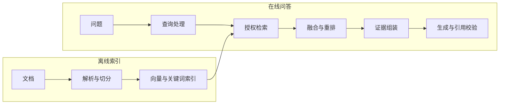

# 检索增强生成（RAG）

**检索增强生成**（Retrieval-Augmented Generation，RAG）是先从外部知识库检索相关文档，再把这些文档和问题一起交给模型生成回答。模型的训练数据里没有企业私有知识，也没有训练截止之后的新信息；RAG 在请求时把这些证据补进去，回答还能标出引用来源。

只说出「检索加生成」还不够。还要能按顺序说明离线和在线两条链路各做什么，什么时候该用 RAG、什么时候该用微调或 SQL，以及知识库更新时怎样保证不召回过期或越权的文档。

## 1. 面试核心 {#core}

- RAG 离线**解析、切分文档并建立索引**，在线**检索相关证据，再组装上下文、生成回答并校验引用**。[卡](#rag-pipeline)
- RAG 通过**请求中的外部证据**补充知识，微调通过**修改模型参数**调整输出格式、风格或任务表现。[卡](#rag-vs-fine-tuning)
- **SQL 适合精确查询和聚合结构化数据**，文本检索适合从文档里找相关证据；全库统计不能只靠 Top-K 检索。[卡](#rag-limits)
- 知识更新要**协调新旧索引、权限过滤和缓存失效**，避免回答用到过期或越权的文档。[卡](#index-updates)
- 查询改写要**保留实体、时间与否定条件**；多跳检索**用已确认的事实**继续找缺失的证据，并有明确的停止条件。[卡](#query-rewrite-multihop)

## 2. 完整链路 {#完整链路}

RAG 分成两条链路：提前处理文档的**离线索引**，和收到问题后才执行的**在线问答**。离线索引让文档变得可查，在线问答从中挑出当前问题需要的证据。

离线索引有三个主要环节：

1. 解析 PDF、Word、网页和表格，恢复文本、标题和页码。扫描件先用 OCR 识别文字，表格要保留行列关系。
2. 把文本切成块，并给每块附上**元数据**，也就是描述这个块的字段，比如来源、章节、版本、权限和更新时间，供后面过滤和引用使用。
3. 用 Embedding 模型把块转成向量，写入向量索引；同时建立关键词索引（常用 BM25 按词项统计打分），让文本既能按语义匹配，也能按词项匹配。

解析和块边界的处理见[文档解析与切分](./chunking.mdx)。

向量空间与索引机制见 [Embedding 与向量检索](./embedding-vector-search.mdx)。

在线问答按顺序完成以下处理：

1. 结合对话历史补全指代，把问题改写成能独立检索的查询。复合问题可以拆成几个查询，分别找证据。
2. 从向量和关键词索引取得候选，并按当前用户的权限和文档版本过滤。这一步叫**召回**，目标是让相关证据进入候选集。
3. 合并多路候选，用重排模型重新打分，选出更相关的文档块。
4. 按相关性和上下文预算组织文档块，给每块标上来源编号。提示要求模型依据这些证据回答并引用编号，证据不足时说明还缺什么。
5. 生成后检查引用编号是否存在，并核对被引用的文本是否真的支持结论。同时记录检索结果和回答，供后续评估和排错。

候选如何合并和排序，见[混合检索与重排序](./hybrid-search-rerank.mdx)。

检索决定能给模型哪些证据，生成决定模型怎样使用它们，两边都可能出错。切分不当、查询和文档的说法差别大、候选数量太少，都会让正确证据漏掉；即使检索到了，文档过期或模型用错证据，回答也会错。所以排查时要分清是检索遗漏、证据不足还是生成错误。

具体评估方法见 [RAG 评估](../evaluation/rag-evaluation.mdx)。

### 2.1 查询改写与多跳检索 {#查询改写与多跳检索}

多轮对话里，用户会省略前面提过的对象，但检索器只看当前这一条查询。**查询改写**就是把省略的内容补齐，让问题单独拿出来也能检索。

比如前文已经确认产品是 X，后续问题可以这样补全：

| 原问题 | 改写后的查询 |
| --- | --- |
| 它的价格呢？ | X 产品的价格。 |
| 它的退款期限呢？ | X 产品的退款期限。 |

这两个改写只补入了已经确认的产品名，没有添加别的条件。改写时，原问题里的时间和否定条件都要保留，比如「去年」「不包括赠品」，丢掉一个，检索的就是另一个问题了；权限范围也沿用原来的约束。程序要同时保存原问题和改写结果，才能检查检索意图有没有偏移。扩展同义词可以增加候选，但也会带来歧义，要用评测验证。

**多跳问题**需要依次关联多个事实才能回答。比如先查产品属于哪个系列，再查这个系列的退款规则。前一跳确认的系列名是后一跳的查询条件，所以每一跳都要保存来源和已确认的事实，避免把猜测当成下一次检索的前提。

**Agentic RAG** 把检索做成 Agent 的工具，由模型决定检索什么、要不要继续检索。这里的 Agent 是能根据当前结果决定下一步动作的程序。和固定的一次检索相比，它能主动补充缺失的证据，代价是更多的调用轮次、延迟和费用。

因此程序要规定**三种停止条件**：

- 证据已经齐全，可以回答原问题。
- 轮次、时间或费用预算已经用完。
- 继续检索也没有找到新的证据。

后两种情况下，如果关键证据仍然缺失，就要说明缺口，然后追问或拒答。

## 3. RAG 与微调 {#rag-与微调}

选 RAG 还是微调，先看问题出在哪：是应用缺少外部知识，还是模型难以稳定完成任务。RAG 在请求时提供证据；**微调**用训练数据调整模型参数，也就是模型内部参与计算的那些数值。

| 维度 | RAG | 微调 |
| --- | --- | --- |
| 改变对象 | 请求时的外部证据 | 模型参数 |
| 知识更新 | 更新索引与版本 | 修改训练数据并训练 |
| 来源追溯 | 可保留文档与段落 | 参数本身难以定位来源 |
| 用户权限 | 在检索层过滤证据 | 需另建权限控制 |
| 主要成本 | 检索与输入长度 | 训练及模型维护 |

企业私有知识变化频繁，又需要引用原文、按用户过滤时，优先评估 RAG。新文档随索引发布就能被检索到，删除也能定位到具体记录。知识一旦写进模型参数，就很难单独更新、删除或按用户隔离。

需要固定输出格式、风格或提升领域任务表现时，先改提示词；提示仍然达不到稳定要求，再评估微调。两者的成本形态不同：微调要付训练和模型维护成本，RAG 则在每次请求里增加检索和输入 Token 成本。微调能省掉多少提示长度，要结合任务验证。

两者也可以组合，做法可以围绕**三类能力**展开：

- 微调生成模型，让它更好地遵守引用格式，并在证据不足时拒答。
- 微调 Embedding 模型，改善领域术语和相关文档的匹配。
- 微调重排模型，让领域问题需要的证据排得更靠前。

组合时，用户有权访问的知识仍然由检索层提供。两者的作用也不是截然分开的：微调也会影响模型对知识的表达，RAG 也会影响输出行为，所以分工要用具体任务评测来定。动手前先用清晰的提示和检索建立基线，再验证训练有没有带来额外收益。

## 4. 适用边界 {#适用边界}

文本检索擅长找相关片段，但精确查询和全量统计要求覆盖全部相关数据。Top-K 检索只返回最相关的前 K 个结果，做不到这一点。选方案时可以区分**四类问题**：

- **结构化查询与聚合**：订单状态、库存数量可以直接查数据库。「上个月退款金额最多的 10 个客户」还要排序和聚合，应该交给 SQL 或计算工具。Text-to-SQL 是把自然语言问题转成 SQL，再由数据库执行。
- **全库统计**：「这 300 份合同中有多少份包含违约金条款」需要检查全部合同。只取前 K 个片段会漏掉其余合同，所以要批量遍历，或者先抽取成结构化字段再统计。
- **多文档关联**：答案分散在多个文档里时，要逐步补齐多跳证据。可以多轮检索，也可以用知识图谱记录实体及其关系，再沿着关系查找证据。
- **通用知识问答**：如果不加检索的基线已经能稳定达标，加检索只会增加延迟和输入费用。要不要保留检索，要同时衡量准确性和来源可追溯性的收益。

这些边界不是说 RAG 和结构化查询只能二选一。RAG 的检索器也可以连接结构化数据源：用文本检索定位文档，用 SQL 拿到精确数值，再把结果交给模型解释。

## 5. 知识更新 {#知识更新}

知识更新的目标是让问题检索到当前有效的文档，同时保留可追踪的版本。为此每个文档要记录稳定 ID、版本和**内容哈希**；内容哈希是根据文档内容算出的摘要值，内容一变，哈希就变，用来判断文档是否需要重新处理。

增量更新时，只重新解析和切分有变化的文档，并按文档 ID 整体替换它的块。块 ID 和文档版本关联，这样能准确找到要替换或删除的记录。同一版本处理多少次，得到的有效结果都应该相同，这就是更新的**幂等性**；有了它，任务失败后可以放心重跑。

### 5.1 版本发布与删除 {#版本发布与删除}

新索引准备好以后再切换，可以避免更新期间查不到文档。版本发布可以按这个顺序进行：

1. 构建新版本，验证块数、检索结果和权限过滤是否符合预期。
2. 把应用读取的有效版本切到新版本，让新请求使用新文档。
3. 确认发布成功后清理旧数据，同时保留需要的回滚入口。

这是应用层的发布策略，能不能原子切换取决于存储本身的能力。向量索引和关键词索引一起发布时，可以用共同的版本标记协调读取。发布失败就继续用旧的有效版本，不要混用还没准备完整的新数据。

源文档删除后，要同步删除各个索引里的块，并让检索缓存和回答缓存失效。有些托管索引是**最终一致**的，也就是变更要过一段时间才能在所有查询中可见，所以删除后的短时间内仍可能搜到旧内容。需要立即撤权的文档，应在返回证据前再检查一次当前授权或删除标记。

如果数据库采用标记删除，「查不到」和「空间被回收」是两回事：物理空间要靠它的压缩、合并或重建机制才能回收。具体怎么维护取决于实现，应用要分别确认这两件事何时完成。

### 5.2 缓存与权限 {#缓存与权限}

缓存里的旧回答同样会引用过期文档，所以更新时要连缓存一起处理。检索结果缓存和回答缓存都要按租户、授权范围和索引版本区分。源文档变化时，按文档 ID 让相关条目失效；权限变化时，也要清除受影响的缓存。如果只按问题文本缓存，两个权限不同的用户问同一句话，就可能拿到对方才能看的内容。

块要继承源文档的权限标签，由程序按当前用户的授权过滤。每条召回路径都要过滤，父块回取、重排输入和最终引用也要检查，这样交到生成模型手里的才全是已授权的证据。

版本和生效日期也要写进块的元数据。常规问答只检索当前有效版本，避免新旧制度互相冲突；确实需要对比新旧制度时，要在上下文和答案里分别标注版本和生效时间。

## 6. 面试题 {#面试题}

### 6.1 请完整介绍一下 RAG 的整体流程。 {#rag-pipeline}

**考察重点**：按顺序解释离线和在线各环节的产出，并说明如何校验引用、区分检索与生成错误。

**相关内容**：[完整链路](#完整链路)。

参考回答

**RAG 包含离线建立索引和在线检索后生成回答两条链路。**

离线先解析文件，保留标题、表格和页码，再切成块。每块附带来源、章节、版本、权限和更新时间。随后生成 Embedding 向量，写入向量索引，并建立关键词索引。

在线结合历史补全指代或拆分问题，再从多路检索中取得授权且版本有效的候选。候选融合、重排后，按上下文预算选出文档块，并为它们标注来源编号。提示要求模型依据证据回答并引用来源，证据不足时说明缺口。

生成后校验引用编号及其对结论的支持关系，再记录各阶段结果与回答。这些记录可以帮助区分检索遗漏、证据不足和生成错误。

### 6.2 RAG 和微调应该如何选择？实际项目中如何组合使用？ {#rag-vs-fine-tuning}

**考察重点**：比较知识更新、来源追溯、权限和成本，并说明微调生成模型或检索模型怎样与 RAG 配合。

**相关内容**：[RAG 与微调](#rag-与微调)。

参考回答

**知识频繁更新、需要引用与权限过滤时，优先评估 RAG；输出格式或领域任务表现难以稳定时，再评估微调。**

RAG 改变请求中的外部证据，文档更新后可以通过索引发布生效。微调改变模型参数，其中的知识更难单独更新、删除和按用户隔离。成本也不同：RAG 增加请求时的检索与输入费用，微调需要训练和模型维护。

组合时，可通过微调改善引用格式、证据不足时的拒答，或改善 Embedding 与重排模型的领域检索。用户有权访问的知识仍由检索层提供。先建立清晰提示和检索基线，再用评测证明训练收益，才能判断是否值得投入。

### 6.3 RAG 有哪些局限？什么场景不适合用 RAG？ {#rag-limits}

**考察重点**：解释文本检索在精确查询、全量统计和多跳问题中的限制，并选择对应的数据处理方式。

**相关内容**：[适用边界](#适用边界)。

参考回答

**RAG 受证据覆盖、时效和生成质量限制，单次 Top-K 文本检索尤其难以完成精确聚合、全库统计和多跳关联。**

切分不当、查询表达差异或候选数量过少，都会让正确证据落在上下文之外。即使检索到了相关文档，模型也会误用证据，所以检索和生成要分别评估。

结构化查询与聚合应交给 SQL 或计算工具。全库统计应遍历文档，或先抽取字段再统计。多跳问题则需要多轮检索或图谱关系补足证据。RAG 也可以调用这些结构化数据源，再让模型解释结果。

通用问答可以与无检索基线比较，同时衡量准确性、来源追溯、检索延迟和输入费用。

### 6.4 知识库更新时，怎样处理索引、缓存和旧文档召回？ {#index-updates}

**题型**：综合题

**考察重点**：解释文档增量更新和幂等性，并说明版本切换、删除一致性、缓存失效与权限过滤如何配合。

**相关内容**：[知识更新](#知识更新)、[过滤检索与候选不足](./embedding-vector-search.mdx#过滤检索与候选不足)。

参考回答

**知识更新应以文档版本为单位替换索引，并同步处理权限、缓存和旧版本可见性。**

记录文档 ID、内容哈希和版本，只重新处理变化的文档，同一版本重复处理保持幂等。先构建并验证新版本，再切换有效版本，确认成功后清理旧数据。向量与关键词索引用共同版本协调，失败时继续读取旧有效版本并保留回滚入口。

源文档删除时同步删除各索引中的块，按文档 ID 失效检索和回答缓存。最终一致的存储还要检查当前授权或删除标记，保证撤权及时生效。缓存区分租户、授权范围和索引版本，所有文档片段在交给模型前完成授权检查。

常规查询过滤失效版本，需要新旧对比时，再分别标注版本与生效日期。

### 6.5 查询改写怎样避免偏移，多跳检索何时停止？ {#query-rewrite-multihop}

<!-- 本题为本站原理自测，尚未核验对应公司面经，不作公司归属。 -->

**考察重点**：解释改写要保留哪些查询条件，以及多跳检索如何记录事实、判断证据是否齐全并停止。

**相关内容**：[查询改写与多跳检索](#查询改写与多跳检索)。

参考回答

**查询改写要保留原问题的实体、时间与否定条件，多跳检索在证据齐全或达到停止条件时结束。**

改写只补入已经确认的指代对象，并保留原问题与改写结果，便于检查意图是否偏移。每一跳都保存来源和已确认事实，再据此寻找下一份证据，权限范围保持原有约束。

证据齐全时即可回答；预算耗尽或没有新增证据时也应停止。若这时仍缺关键依据，要说明缺口，并追问或拒答，避免继续把猜测带入后续查询。

## 7. 参考资料 {#参考资料}

- [Retrieval-Augmented Generation for Knowledge-Intensive NLP Tasks](https://arxiv.org/abs/2005.11401)
- [Anthropic：Introducing Contextual Retrieval](https://www.anthropic.com/engineering/contextual-retrieval)
- [OpenAI：Retrieval](https://developers.openai.com/api/docs/guides/retrieval)
- [LangChain：Retrieval architectures](https://docs.langchain.com/oss/python/langchain/retrieval)
- [Elasticsearch：Aliases](https://www.elastic.co/docs/manage-data/data-store/aliases)
- [OpenAI：Optimizing LLM accuracy](https://developers.openai.com/api/docs/guides/optimizing-llm-accuracy)
