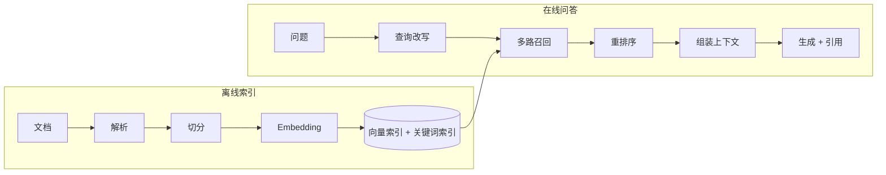

# 检索增强生成（RAG）

检索增强生成（Retrieval-Augmented Generation，RAG）在生成回答前，先从外部知识库检索与问题相关的材料，把材料和问题一起交给模型。它让模型能回答训练数据之外的私有、最新知识，并给出来源。本文讲完整链路、与微调的选择、适用边界和知识更新。

## 1. 面试核心 {#core}

- RAG 分离线和在线两部分：离线把文档解析、切分、向量化并建索引；在线改写查询、检索、重排、组装上下文、生成并引用来源。[卡](#rag-pipeline)
- RAG 解决“知识”问题，微调解决“行为”问题。知识经常变化、需要来源和权限控制时用 RAG；需要固定格式、风格或领域推理方式时考虑微调，两者可以组合。[卡](#rag-vs-fine-tuning)
- RAG 的效果上限由检索决定：没检索到正确材料，模型只能编造或拒答。排查问题时先区分检索错误、证据不足和生成错误。
- 结构化数据的精确查询（订单状态、库存数量）用数据库查询或工具调用更合适，向量检索适合非结构化文本的语义匹配。[卡](#rag-limits)
- 知识更新要处理增量索引、删除旧版本、缓存失效和权限过滤，否则会召回过期或越权内容。[卡](#index-updates)

## 2. 完整链路 {#完整链路}

**离线索引**

1. **解析**：把 PDF、Word、网页、表格转为文本，保留标题层级、表格结构、页码等信息。扫描件需要 OCR。
2. **切分**：按语义结构切成块，块上附带元数据（来源、章节、版本、权限、更新时间），见[文档解析与切分](./chunking.mdx)。
3. **向量化与索引**：用 Embedding 模型把块转为向量写入向量索引；同时建立 BM25 等关键词索引，见 [Embedding 与向量检索](./embedding-vector-search.mdx)。

**在线问答**

1. **查询改写**：补全多轮对话中的指代（“它的价格呢”→“X 产品的价格”），拆分复合问题，必要时生成多个检索查询。
2. **召回**：向量检索和关键词检索各取若干候选，按元数据过滤权限和版本。
3. **重排序**：用重排模型对候选重新打分，取前几个块，见[混合检索与重排序](./hybrid-search-rerank.mdx)。
4. **组装与生成**：把块按相关性放入提示，标明来源编号；要求模型只依据材料回答，材料不足时说明无法回答，并在回答中引用来源编号。
5. **后处理**：校验引用编号是否存在，记录检索结果和回答，用于评估和排错。

## 3. RAG 与微调 {#rag-与微调}

| 维度 | RAG | 微调 |
| --- | --- | --- |
| 改变的是 | 每次请求的输入 | 模型参数 |
| 适合 | 私有知识、频繁更新、需要来源 | 输出格式、风格、领域任务的稳定表现 |
| 知识更新 | 更新索引即可 | 需要重新训练 |
| 可追溯 | 能引用原文 | 难以说明依据 |
| 权限控制 | 检索时按用户过滤 | 写入参数后无法按用户隔离 |
| 成本 | 每次请求多了检索和更长上下文 | 训练成本，推理时上下文更短 |

微调写入的知识难以更新和删除，也无法按用户权限隔离，因此企业知识问答一般首选 RAG。组合方式是：用微调让模型更好地遵守引用格式、学会在材料不足时拒答，或者微调 Embedding 和重排模型提高领域检索质量；知识本身仍然通过检索提供。

## 4. 适用边界 {#适用边界}

RAG 不擅长的情况：

- **精确的结构化查询**：“上个月退款金额最多的 10 个客户”需要 SQL 聚合，向量检索找不到答案。用数据库查询或 Text-to-SQL 工具。
- **需要全局信息的问题**：“这 300 份合同中有多少份包含违约金条款”需要遍历全部文档，Top-K 检索只看到一小部分。用批处理或预先抽取结构化字段。
- **多跳推理**：答案分散在多个文档中且需要逐步关联，一次检索不够。可以用多轮检索（Agentic RAG）或知识图谱。
- **知识完全是通用常识**：模型已经掌握，检索只增加延迟。

Agentic RAG 把检索作为 Agent 的工具，由模型决定检索什么、是否需要再次检索，适合多跳问题，代价是轮次和延迟增加。

## 5. 知识更新 {#知识更新}

- **增量更新**：为每个文档记录内容哈希和版本，变化时只重新处理该文档，先删除旧块再写入新块，同一文档 ID 下的块整体替换。
- **删除**：源文档删除时同步删除索引中的块；向量库的删除通常是标记删除，需要定期合并或重建。
- **版本冲突**：元数据中记录生效日期和版本，检索时只取当前有效版本；确实需要比较新旧版本时，在上下文中标明版本。
- **缓存失效**：问答结果或检索结果有缓存时，文档更新后按文档 ID 失效相关缓存。
- **权限**：块继承源文档的权限标签，检索时用当前用户的权限过滤，过滤在召回阶段完成，不能交给模型判断。

## 6. 面试题

### 6.1 请完整介绍一下 RAG 的整体流程。 {#rag-pipeline}

<!-- 面试来源：
- 字节跳动：https://www.nowcoder.com/feed/main/detail/15af3788a038477bba99f2f9d94b2cef （“请完整介绍一下 RAG 的整体流程。”）
- 字节跳动：https://www.nowcoder.com/discuss/925342611194286080 （“项目中的RAG知识用到了哪些？离线上传和在线问答环节如何进行？”）
- 阿里云：https://www.nowcoder.com/feed/main/detail/7e27cf4dedb142d9b643471ba31276ed （“RAG是什么，一次完整的RAG包含哪些流程”）
- 百度：https://www.nowcoder.com/discuss/921590204903723008 （“如果从零搭建一个团队内部的知识问答 RAG，完整流程是什么？”）
- 浪潮：https://www.nowcoder.com/feed/main/detail/a8854ce3fa4b45cb8d73ec92c798a63b （“你能简单的介绍一下整个rag流程吗”）
- 字节跳动：https://www.nowcoder.com/feed/main/detail/ed5e9d17f26e489da94afbf1241b885e （“请介绍完整的 RAG 流程。”）
- TCS：https://www.linkedin.com/posts/galgalepallavi_tcs-interviewexperience-genai-activity-7419624110521090048-Q3sC （“Suppose an employee asks a question to a RAG system — how will you design the RAG?”）
- 凌脉：https://www.nowcoder.com/feed/main/detail/76f5be8b8bd5420b94d32a66e26a7ad9 （“整套 RAG 链路是怎样设计的？”）
- Accenture：https://www.geeksforgeeks.org/interview-experiences/accenture-final-interview-experience-for-llm-operations-engineer-experienced-selected/
-->

**出现公司**：字节跳动、阿里云、百度、浪潮、TCS、凌脉、Accenture

**考察重点**

- 离线索引与在线问答两条链路。
- 每个环节的作用和产出。

**相关内容**：[完整链路](#完整链路)。

参考回答

离线部分：解析各类文档为文本，保留标题、表格和页码；按语义结构切块并附加来源、版本、权限等元数据；用 Embedding 模型向量化写入向量索引，同时建立关键词索引。

在线部分：先结合对话历史改写查询，补全指代或拆分问题；向量检索和关键词检索多路召回，按权限和版本过滤；用重排模型选出最相关的几个块；把块带来源编号放入提示，要求模型只依据材料回答并引用来源，材料不足时说明无法回答；最后校验引用并记录检索结果，用于评估和排错。

### 6.2 RAG 和微调应该如何选择？实际项目中如何组合使用？ {#rag-vs-fine-tuning}

<!-- 面试来源：
- 字节跳动：https://www.nowcoder.com/feed/main/detail/15af3788a038477bba99f2f9d94b2cef （“RAG 和微调应该如何选择？在实际工程项目中如何组合使用？”）
- 字节跳动、蚂蚁：https://www.nowcoder.com/discuss/904029765160497152 （“微调和RAG的区别与策略采用维度”）
- 美团：https://www.nowcoder.com/feed/main/detail/554bdcc695ae42f8b0d78e3c44dd17d5 （微调和 RAG 选型）
- 腾讯：https://www.nowcoder.com/feed/main/detail/427caf4cc5ec4192b64fdb6ea6698bef （“这些项目哪个更适合使用模型再训练，哪些适合用rag”）
- 蚂蚁：https://www.nowcoder.com/discuss/800426409796624384 （RAG 与微调）
-->

**出现公司**：字节跳动、蚂蚁、美团、腾讯

**考察重点**

- 改变输入与改变参数的区别。
- 更新频率、可追溯、权限和成本的取舍。

**相关内容**：[RAG 与微调](#rag-与微调)。

参考回答

RAG 在每次请求时提供外部知识，微调改变模型参数。知识需要频繁更新、需要引用来源、需要按用户权限隔离时用 RAG：更新索引即可生效，检索时可以按权限过滤。需要稳定的输出格式、风格或领域任务表现，且提示词难以达到时考虑微调。

组合使用时，知识仍通过检索提供；微调用来让模型更好地遵守引用格式、在材料不足时拒答，或者微调 Embedding、重排模型提升领域检索。选择前先用提示工程和 RAG 建立基线，在评测集上证明微调有收益再投入。

### 6.3 RAG 有哪些局限？什么场景不适合用 RAG？ {#rag-limits}

<!-- 面试来源：
- 美团：https://www.nowcoder.com/feed/main/detail/1cfa5a4035b14eb99599b3a97f663a5c （“你对rag怎么看?rag的问题在哪里?rag适合的场景”）
- 阿里淘天：https://www.nowcoder.com/feed/main/detail/d5d1f688dae5496abbce783aa28d6731 （“为什么选用数据库检索而不是直接使用rag？”）
- 阿里云：https://www.nowcoder.com/feed/main/detail/d577a09f95294565b464a8b0ce49a829 （Agentic 与传统 RAG）
-->

**出现公司**：美团、阿里淘天、阿里云

**考察重点**

- 检索质量决定上限。
- 结构化查询、全局统计、多跳推理的替代方案。

**相关内容**：[适用边界](#适用边界)。

参考回答

RAG 的质量受检索限制：切分不当、查询表达与文档差异大、Top-K 太小，都会导致正确材料没有进入上下文，模型只能编造或拒答。它还增加了检索延迟和上下文长度。

不适合的场景：结构化数据的精确查询和聚合，应使用 SQL 或工具调用；需要遍历全部文档的统计问题，应预先抽取结构化字段或批处理；答案分散在多个文档的多跳问题，单次检索不够，需要多轮检索的 Agentic RAG 或知识图谱；模型已经掌握的通用知识，不需要检索。

### 6.4 知识库持续更新时，如何处理索引更新、缓存失效和旧文档仍被召回的问题？ {#index-updates}

<!-- 面试来源：
- 虾皮：https://www.nowcoder.com/feed/main/detail/79fe3fc8f8cb4c4d9beca478f4279e3a （“如果知识库内容持续更新，如何处理向量索引更新、缓存失效以及旧文档仍被召回的问题？”）
- 药明康德：https://www.nowcoder.com/feed/main/detail/365904cd189149ffb52c36286ab23b37 （“如何规避新旧版本制度冲突导致回答错误？”）
- 拼多多：https://www.nowcoder.com/feed/main/detail/2109cf8eb0254507911fbf86bcbf51e4 （“如果文档都做倒排或索引，怎么同时解决切分和权限问题？”）
- 美团：https://www.nowcoder.com/feed/main/detail/50bcdc47e7754aa7be59b6318fea514b （知识更新）
- 字节跳动：https://www.nowcoder.com/discuss/929731481189044224 （知识更新幂等）
- 科大讯飞：https://www.nowcoder.com/feed/main/detail/671d2fa1d7c04322837ee1f5788dd69d （知识更新）
-->

**出现公司**：虾皮、药明康德、拼多多、美团、字节跳动、科大讯飞

**考察重点**

- 文档级增量更新、删除与幂等。
- 版本、缓存和权限的元数据过滤。

**相关内容**：[知识更新](#知识更新)。

参考回答

以文档为单位管理：记录文档 ID、内容哈希和版本，哈希变化时重新解析切分，先删除该文档的全部旧块再写入新块，同一版本重复处理结果不变，保证幂等。源文档删除时同步删除索引，并定期清理向量库中的标记删除数据。

块的元数据包含版本、生效时间和权限标签。检索时过滤掉失效版本和当前用户无权访问的块，过滤在召回阶段完成，不交给模型判断。检索或问答结果有缓存时，文档更新后按文档 ID 失效相关缓存。确实需要新旧对比的问题，在上下文中标明版本和生效日期。

## 7. 参考资料

- [Retrieval-Augmented Generation for Knowledge-Intensive NLP Tasks](https://arxiv.org/abs/2005.11401)
- [Anthropic：Introducing Contextual Retrieval](https://www.anthropic.com/engineering/contextual-retrieval)
- [OpenAI：Retrieval](https://platform.openai.com/docs/guides/retrieval)
