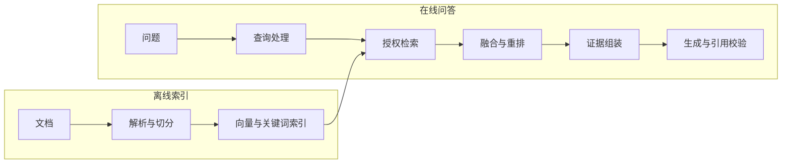

# 检索增强生成（RAG）

检索增强生成（RAG）在生成前补充外部证据。本文负责完整链路、检索与微调的选择及知识更新。切分、向量搜索和重排分别由相邻文章讲解。

## 1. 面试核心 {#core}

- RAG 的离线链路建立索引，在线链路检索证据并生成回答。[卡](#rag-pipeline)
- RAG 改变请求中的证据，微调改变模型参数。[卡](#rag-vs-fine-tuning)
- SQL 适合精确聚合，文本检索适合寻找非结构化证据。[卡](#rag-limits)
- 版本化索引发布应协调新旧数据、权限和缓存。[卡](#index-updates)
- 查询改写保留实体、时间与否定条件，多跳检索按缺失证据继续。[卡](#query-rewrite-multihop)

## 2. 完整链路 {#完整链路}

离线处理生成带来源、版本与权限的块。结构保留方法见[文档解析与切分](./chunking.mdx)。向量空间与索引见 [Embedding 与向量检索](./embedding-vector-search.mdx)。

在线处理根据问题取得候选。排序方法见[混合检索与重排序](./hybrid-search-rerank.mdx)。最终提示包含证据文本与来源标识。答案生成后，程序检查引用与结论的支持关系。

检索质量影响可用证据，生成质量影响证据使用。RAG 仍会受到过期数据、遗漏和生成错误的影响。分层诊断见 [RAG 评估](../evaluation/rag-evaluation.mdx)。

### 2.1 查询改写与多跳检索 {#查询改写与多跳检索}

查询改写将对话问题转为可独立检索的表达。例如“它的退款期限呢”，需要补入已确认的产品名。改写应保留时间、实体、否定条件和权限范围。

程序应同时保留原问题和改写结果。扩展同义词可以增加候选，但会引入歧义。评测时检查查询意图是否发生偏移。

多跳问题需要关联多个事实。例如先找产品所属系列，再查询该系列的退款规则。前一跳结果为后一跳提供实体或条件。每跳应保存来源与已确认事实。

Agentic RAG 由 Agent 决定检索步骤。停止条件可以是证据齐全、预算耗尽或无新增证据。缺少关键一跳时，回答应说明尚缺的依据。

## 3. RAG 与微调 {#rag-与微调}

| 维度 | RAG | 微调 |
| --- | --- | --- |
| 改变对象 | 请求时的外部证据 | 模型参数 |
| 知识更新 | 更新索引与版本 | 修改训练数据并训练 |
| 来源追溯 | 可保留文档与段落 | 参数本身难以定位来源 |
| 用户权限 | 在检索层过滤证据 | 需另建权限控制 |
| 主要成本 | 检索与输入长度 | 训练及模型维护 |

知识频繁变化、需要引用时，可优先评估 RAG。固定风格或任务行为难以稳定时，可评估微调。两者都应与清晰提示建立的基线比较。

微调也能改变知识表达，RAG 也会影响输出行为。两者的分工是工程选择，能力并非互斥。组合时，可微调生成、Embedding 或重排模型。授权知识仍由检索层提供。

## 4. 适用边界 {#适用边界}

- 精确汇总订单金额应使用 SQL 或计算工具。
- 全库统计需要遍历或预先抽取字段。
- 多文档关联需要完整的多跳证据。
- 普通知识问答可比较有检索与无检索的收益。

Top-K 文本检索只返回部分候选。它适合定位证据，无法直接完成全量统计。RAG 的检索器也可以调用结构化数据源。应按数据类型选择查询方式。

## 5. 知识更新 {#知识更新}

每个文档记录稳定 ID、版本与内容哈希。块 ID 与文档版本关联，方便替换和删除。相同版本重复处理应得到相同有效结果。

### 5.1 版本发布与删除 {#版本发布与删除}

先构建新版本，再验证其块数、检索和权限。准备完成后，应用切换到新的有效版本。最后清理旧数据。该顺序减少“先删旧、后写新”的服务空窗。

这是应用层发布策略，具体原子性取决于存储能力。跨向量与关键词索引可使用共同版本标记。发布失败时继续读取旧有效版本，并保留回滚入口。

删除应同步作用于各索引和结果缓存。部分托管索引采用最终一致性。OpenAI Retrieval 的删除行为核对日期为 2026-10-13。删除后短时间内仍可检索到旧内容。对立即撤权的文档，应增加当前授权或删除标记检查。

### 5.2 缓存与权限 {#缓存与权限}

检索缓存应区分租户、授权范围与索引版本。源文档或权限变化时，失效相关条目。仅按问题文本缓存，会混淆不同用户的数据范围。

每个召回路径都应执行授权过滤。父块回取、重排输入和最终引用也需检查。模型只处理已授权证据。新旧制度对比时，在答案中分别标注生效时间。

## 6. 面试题 {#面试题}

### 6.1 请完整介绍一下 RAG 的整体流程。 {#rag-pipeline}

<!-- 面试来源：
- 字节跳动：https://www.nowcoder.com/feed/main/detail/15af3788a038477bba99f2f9d94b2cef （“请完整介绍一下 RAG 的整体流程。”）
- 字节跳动：https://www.nowcoder.com/discuss/925342611194286080 （“项目中的RAG知识用到了哪些？离线上传和在线问答环节如何进行？”）
- 阿里云：https://www.nowcoder.com/feed/main/detail/7e27cf4dedb142d9b643471ba31276ed （“RAG是什么，一次完整的RAG包含哪些流程”）
- 百度：https://www.nowcoder.com/discuss/921590204903723008 （“如果从零搭建一个团队内部的知识问答 RAG，完整流程是什么？”）
- 浪潮：https://www.nowcoder.com/feed/main/detail/a8854ce3fa4b45cb8d73ec92c798a63b （“你能简单的介绍一下整个rag流程吗”）
- 字节跳动：https://www.nowcoder.com/feed/main/detail/ed5e9d17f26e489da94afbf1241b885e （“请介绍完整的 RAG 流程。”）
- TCS：https://www.linkedin.com/posts/galgalepallavi_tcs-interviewexperience-genai-activity-7419624110521090048-Q3sC （“Suppose an employee asks a question to a RAG system — how will you design the RAG?”）
- 凌脉：https://www.nowcoder.com/feed/main/detail/76f5be8b8bd5420b94d32a66e26a7ad9 （“整套 RAG 链路是怎样设计的？”）
- Accenture：https://www.geeksforgeeks.org/interview-experiences/accenture-final-interview-experience-for-llm-operations-engineer-experienced-selected/
-->

**出现公司**：字节跳动、阿里云、百度、浪潮、TCS、凌脉、Accenture

**考察重点**：理解离线索引、在线证据链路与引用校验。

**相关内容**：[完整链路](#完整链路)。

参考回答

RAG 包含离线索引与在线问答两条链路。离线解析文档，生成带元数据的块，再建立检索索引。在线处理查询，取得授权候选，再融合与重排。

最终把证据及来源放入提示，生成回答与引用。程序检查引用是否支持结论。记录各阶段结果，用于定位检索或生成错误。

### 6.2 RAG 和微调应该如何选择？实际项目中如何组合使用？ {#rag-vs-fine-tuning}

<!-- 面试来源：
- 字节跳动：https://www.nowcoder.com/feed/main/detail/15af3788a038477bba99f2f9d94b2cef （“RAG 和微调应该如何选择？在实际工程项目中如何组合使用？”）
- 字节跳动、蚂蚁：https://www.nowcoder.com/discuss/904029765160497152 （“微调和RAG的区别与策略采用维度”）
- 美团：https://www.nowcoder.com/feed/main/detail/554bdcc695ae42f8b0d78e3c44dd17d5 （微调和 RAG 选型）
- 腾讯：https://www.nowcoder.com/feed/main/detail/427caf4cc5ec4192b64fdb6ea6698bef （“这些项目哪个更适合使用模型再训练，哪些适合用rag”）
- 蚂蚁：https://www.nowcoder.com/discuss/800426409796624384 （RAG 与微调）
-->

**出现公司**：字节跳动、蚂蚁、美团、腾讯

**考察重点**：理解外部证据与参数训练的分工。

**相关内容**：[RAG 与微调](#rag-与微调)。

参考回答

RAG 提供请求时的外部证据，微调修改模型参数。知识频繁变化、需要引用与权限过滤时，可优先评估 RAG。风格或任务行为难以稳定时，可评估微调。

组合方案通过检索提供有效知识。微调改善生成行为或检索模型。先建立提示与检索基线，再用评测证明训练收益。

### 6.3 RAG 有哪些局限？什么场景不适合用 RAG？ {#rag-limits}

<!-- 面试来源：
- 美团：https://www.nowcoder.com/feed/main/detail/1cfa5a4035b14eb99599b3a97f663a5c （“你对rag怎么看?rag的问题在哪里?rag适合的场景”）
- 阿里淘天：https://www.nowcoder.com/feed/main/detail/d5d1f688dae5496abbce783aa28d6731 （“为什么选用数据库检索而不是直接使用rag？”）
- 阿里云：https://www.nowcoder.com/feed/main/detail/d577a09f95294565b464a8b0ce49a829 （Agentic 与传统 RAG）
-->

**出现公司**：美团、阿里淘天、阿里云

**考察重点**：理解全量统计、精确计算与多跳证据。

**相关内容**：[适用边界](#适用边界)。

参考回答

RAG 依赖证据覆盖、时效和生成质量。Top-K 文本检索难以完成全库统计。精确聚合应使用 SQL 或计算工具。多跳问题需要逐步收集完整证据。

普通问答也可对比无检索基线。检索增加的延迟与输入成本，应与准确性和可追溯收益一起衡量。

### 6.4 知识库更新时，怎样处理索引、缓存和旧文档召回？ {#index-updates}

<!-- 面试来源：
- 虾皮：https://www.nowcoder.com/feed/main/detail/79fe3fc8f8cb4c4d9beca478f4279e3a （“如果知识库内容持续更新，如何处理向量索引更新、缓存失效以及旧文档仍被召回的问题？”）
- 药明康德：https://www.nowcoder.com/feed/main/detail/365904cd189149ffb52c36286ab23b37 （“如何规避新旧版本制度冲突导致回答错误？”）
- 拼多多：https://www.nowcoder.com/feed/main/detail/2109cf8eb0254507911fbf86bcbf51e4 （“如果文档都做倒排或索引，怎么同时解决切分和权限问题？”）
- 美团：https://www.nowcoder.com/feed/main/detail/50bcdc47e7754aa7be59b6318fea514b （知识更新）
- 字节跳动：https://www.nowcoder.com/discuss/929731481189044224 （知识更新幂等）
- 科大讯飞：https://www.nowcoder.com/feed/main/detail/671d2fa1d7c04322837ee1f5788dd69d （知识更新）
-->

**出现公司**：虾皮、药明康德、拼多多、美团、字节跳动、科大讯飞

**题型**：综合题

**考察重点**：理解版本发布、删除一致性、权限和缓存。

**相关内容**：[知识更新](#知识更新)、[过滤检索与候选不足](./embedding-vector-search.mdx#过滤检索与候选不足)。

参考回答

更新应按文档版本协调索引、权限和缓存。先构建并验证新版本，再切换有效版本。这样可以减少删除旧数据后的服务空窗。失败时保留旧版本作为回滚入口。

删除同步到各索引和缓存。最终一致的存储还需检查当前删除标记。缓存区分用户权限与索引版本。所有材料在交给模型前完成授权检查。

### 6.5 查询改写怎样避免偏移，多跳检索何时停止？ {#query-rewrite-multihop}

<!-- 本题为本站原理自测，尚未核验对应公司面经，不作公司归属。 -->

**出现公司**：暂无已核验的公开来源（本站自测）

**考察重点**：实体约束、原问题保留与证据停止条件。

**相关内容**：[查询改写与多跳检索](#查询改写与多跳检索)。

参考回答

改写应保留原问题的实体、时间和否定条件。原问题与改写结果一起记录，便于检查意图偏移。每跳根据已确认事实补充下一份证据。证据齐全、预算耗尽或无新增证据时停止。缺少关键证据时，明确说明缺口并追问或拒答。

## 7. 参考资料 {#参考资料}

- [Retrieval-Augmented Generation for Knowledge-Intensive NLP Tasks](https://arxiv.org/abs/2005.11401)
- [Anthropic：Introducing Contextual Retrieval](https://www.anthropic.com/engineering/contextual-retrieval)
- [OpenAI：Retrieval](https://developers.openai.com/api/docs/guides/retrieval)
- [LangChain：Retrieval architectures](https://docs.langchain.com/oss/python/langchain/retrieval)
- [Elasticsearch：Aliases](https://www.elastic.co/docs/manage-data/data-store/aliases)
- [OpenAI：Optimizing LLM accuracy](https://developers.openai.com/api/docs/guides/optimizing-llm-accuracy)
