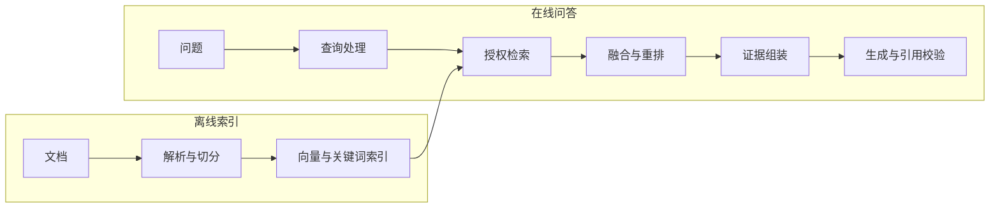

# 检索增强生成（RAG）

检索增强生成（Retrieval-Augmented Generation，RAG）先检索外部知识，再把相关文档和问题一起交给模型生成回答。它能为模型补充训练数据之外的私有知识和最新信息，并让回答引用来源。

本文从离线索引与在线问答两条链路入手，再比较 RAG 与微调的选择。随后说明文本检索的适用边界，以及知识更新时如何协调索引、缓存与权限。

## 1. 面试核心 {#core}

- **完整流程。** RAG 离线解析、切分文档并建立索引，在线检索相关证据，再组装上下文、生成回答和校验引用。[卡](#rag-pipeline)
- **RAG 与微调。** RAG 通过请求中的外部证据补充知识，微调通过修改模型参数调整输出格式、风格或任务表现。[卡](#rag-vs-fine-tuning)
- **结构化查询边界。** SQL 适合精确查询和聚合结构化数据，文本检索适合从文档中寻找相关证据。[卡](#rag-limits)
- **知识更新。** 知识更新要协调新旧索引、权限过滤和缓存失效，避免回答使用过期或越权文档。[卡](#index-updates)
- **查询改写与多跳检索。** 查询改写要保留实体、时间与否定条件，多跳检索则用已确认事实继续寻找缺失证据。[卡](#query-rewrite-multihop)

## 2. 完整链路 {#完整链路}

RAG 把提前处理文档和收到问题后的检索分成两条链路。离线索引让文档便于查找，在线问答再选出当前问题需要的证据。

**离线索引**包含三个主要环节：

1. 解析 PDF、Word、网页和表格，恢复文本、标题与页码。扫描件先通过 OCR 识别文字，表格则保留行列关系。
2. 把文本切成块，并附上元数据，也就是用于描述这个块的字段。字段包括来源、章节、版本、权限和更新时间，供后续过滤与引用使用。
3. 用 Embedding 模型把块转成向量，写入向量索引。同时建立 BM25 等关键词索引，让文本既能按语义匹配，也能按词项匹配。

解析和块边界的处理见[文档解析与切分](./chunking.mdx)。

向量空间与索引机制见 [Embedding 与向量检索](./embedding-vector-search.mdx)。

**在线问答**根据问题依次完成以下处理：

1. 结合对话历史补全指代，把问题改写成可以独立检索的查询。复合问题可拆成多个查询，分别寻找证据。
2. 从向量与关键词索引取得候选，并根据当前用户权限和文档版本过滤结果。这一步称为召回，目标是让相关证据进入候选集。
3. 合并多路候选，用重排模型重新打分，再选出更相关的文档块。
4. 按相关性和上下文预算组织文档块，为每块标注来源编号。提示要求模型依据这些证据回答并引用编号，证据不足时说明尚缺的信息。
5. 生成后检查引用编号是否存在，并核对所引文本是否支持结论。记录检索结果和回答，供后续评估与排错。

候选如何合并和排序，见[混合检索与重排序](./hybrid-search-rerank.mdx)。

检索决定当前能提供哪些证据，生成则决定模型怎样使用它们。切分不当、查询与文档表达差异大、候选数量过少，都会让正确证据遗漏。即使检索到了文档，过期内容和生成错误也会影响回答，所以排查时要区分检索遗漏、证据不足与生成错误。

具体评估方法见 [RAG 评估](../evaluation/rag-evaluation.mdx)。

### 2.1 查询改写与多跳检索 {#查询改写与多跳检索}

用户在多轮对话中会省略已经提过的对象，检索器却需要明确的查询。查询改写就是把这些省略补齐，让问题能独立用于检索。

比如，前文已经确认产品是 X，后续问题就可以这样补全：

| 原问题 | 改写后的查询 |
| --- | --- |
| 它的价格呢？ | X 产品的价格。 |
| 它的退款期限呢？ | X 产品的退款期限。 |

两种改写都只补入已确认的产品名。时间和否定条件应保留，权限范围也沿用原有约束。程序同时保存原问题与改写结果，才能检查检索意图是否偏移。扩展同义词可以增加候选，但也会引入歧义，因此要用评测验证。

多跳问题需要依次关联多个事实。比如，先找产品所属系列，再查询该系列的退款规则。前一跳确认的系列名成为后一跳的查询条件，所以每跳都应保存来源和已确认事实，避免把猜测当成下一次检索的前提。

**Agentic RAG**把检索作为 Agent 的工具，由模型决定检索什么、是否继续检索。Agent 是能够根据当前结果决定下一步动作的程序。相比固定的一次检索，这种方式可以补充缺失证据，代价是更多调用轮次、延迟和费用。

程序需要明确以下**三种停止条件**：

- 证据已经齐全，可以回答原问题。
- 轮次、时间或费用预算已经耗尽。
- 继续检索仍没有找到新增证据。

后两种情况下，若关键证据仍然缺失，应说明缺口，并追问或拒答。

## 3. RAG 与微调 {#rag-与微调}

选择 RAG 还是微调，要看应用缺少外部知识，还是模型难以稳定完成任务。RAG 在请求时提供证据，微调则用训练数据调整模型参数，也就是模型内部参与计算的数值。

| 维度 | RAG | 微调 |
| --- | --- | --- |
| 改变对象 | 请求时的外部证据 | 模型参数 |
| 知识更新 | 更新索引与版本 | 修改训练数据并训练 |
| 来源追溯 | 可保留文档与段落 | 参数本身难以定位来源 |
| 用户权限 | 在检索层过滤证据 | 需另建权限控制 |
| 主要成本 | 检索与输入长度 | 训练及模型维护 |

企业私有知识经常变化，又需要引用原文和按用户过滤时，可以优先评估 RAG。索引更新后就能提供新文档，删除也能定位到具体记录。写进模型参数的知识则难以单独更新、删除或按用户隔离，所以还需要独立的权限控制。

需要固定输出格式、风格或领域任务表现时，可以先改进提示词。提示仍难以稳定达到要求，再评估微调。微调需要训练与模型维护成本；RAG 则会在每次请求中增加检索和输入 Token 成本。微调能减少多少提示长度，要结合任务验证。

两者也可以组合使用，常见组合围绕以下**三类能力**：

- 微调生成模型，让它更好地遵守引用格式，并在证据不足时拒答。
- 微调 Embedding 模型，改善领域术语与相关文档的匹配。
- 微调重排模型，让领域问题需要的证据排得更靠前。

组合方案仍由检索层提供用户有权访问的知识。微调也能改变知识表达，RAG 也会影响输出行为，因此应以具体任务评测两者的分工。选择前先用清晰提示与检索建立基线，再验证训练是否带来额外收益。

## 4. 适用边界 {#适用边界}

文本检索适合找到相关片段，精确查询和全量统计则需要覆盖对应数据。选方案时，可以区分以下**四类问题**：

- **结构化查询与聚合**：订单状态、库存数量可以直接查询数据库。“上个月退款金额最多的 10 个客户”还需要排序和聚合，应使用 SQL 或计算工具。Text-to-SQL 是把自然语言问题转成 SQL，再由数据库执行。
- **全库统计**：“这 300 份合同中有多少份包含违约金条款”需要检查全部合同。只取前 K 个相关片段的 Top-K 检索只覆盖一部分，所以应批量遍历，或预先抽取结构化字段再统计。
- **多文档关联**：答案分散在多个文档时，需要逐步补齐多跳证据。可以采用多轮检索，也可以用知识图谱记录实体及其关系，再沿这些关系查找证据。
- **通用知识问答**：如果无检索基线已经能稳定达到要求，新增检索会增加延迟与输入费用。是否保留检索，要同时衡量准确性和来源可追溯性的收益。

RAG 的检索器也可以连接结构化数据源。因此，系统可以用文本检索定位文档，用 SQL 获取精确数值，再把结果交给模型解释。

## 5. 知识更新 {#知识更新}

知识更新要让问题检索到当前有效的文档，同时保留可追踪的版本。每个文档应记录稳定 ID、版本与内容哈希。内容哈希是根据文档内容计算的摘要值，用于识别内容是否变化。

增量更新时，只重新解析和切分发生变化的文档，并按文档 ID 整体替换它的块。块 ID 与文档版本关联，方便定位要替换或删除的记录。同一版本重复处理后，应得到相同的有效结果，这就是更新的幂等性。

### 5.1 版本发布与删除 {#版本发布与删除}

新索引准备完成后再切换，可以减少更新期间查不到文档的空窗。版本发布可按以下顺序进行：

1. 构建新版本，验证块数、检索结果和权限过滤是否符合预期。
2. 将应用读取的有效版本切换到新版本，让新请求使用新文档。
3. 确认发布成功后，清理旧数据，并保留需要的回滚入口。

这是应用层的发布策略，能否原子切换取决于存储能力。跨向量与关键词索引发布时，可以用共同的版本标记协调读取。发布失败时，继续使用旧的有效版本，避免混用尚未准备完整的新数据。

源文档删除后，要同步删除各索引中的块，并让检索和回答缓存失效。部分托管索引采用最终一致性，也就是变更需要时间才能在所有查询中可见。这时，删除后的短时间内仍会搜到旧内容。需要立即撤权的文档，应在返回证据前检查当前授权或删除标记。

如果数据库采用标记删除，物理空间的回收还需要其压缩、合并或重建机制。具体维护方式取决于实现，应用应分别确认查询不可见和空间回收何时完成。

### 5.2 缓存与权限 {#缓存与权限}

缓存中的旧回答同样会引用过期文档，所以更新还要覆盖缓存。检索结果和回答缓存应区分租户、授权范围与索引版本。源文档变化时，可按文档 ID 失效相关条目；权限变化时，也要清除受影响的缓存。仅按问题文本缓存，会混淆不同用户能访问的数据。

块应继承源文档的权限标签，由程序根据当前用户授权执行过滤。每条召回路径都要执行过滤，父块回取、重排输入和最终引用也要检查。这样，生成模型接收到的都是已经授权的证据。

版本和生效日期也应写入块的元数据。常规问答只检索当前有效版本，避免新旧制度互相冲突。确实需要比较新旧制度时，应在上下文和答案中分别标注版本与生效时间。

## 6. 面试题 {#面试题}

### 6.1 请完整介绍一下 RAG 的整体流程。 {#rag-pipeline}

<!-- 面试来源：
- 字节跳动：https://www.nowcoder.com/feed/main/detail/15af3788a038477bba99f2f9d94b2cef （“请完整介绍一下 RAG 的整体流程。”）
- 字节跳动：https://www.nowcoder.com/discuss/925342611194286080 （“项目中的RAG知识用到了哪些？离线上传和在线问答环节如何进行？”）
- 阿里云：https://www.nowcoder.com/feed/main/detail/7e27cf4dedb142d9b643471ba31276ed （“RAG是什么，一次完整的RAG包含哪些流程”）
- 百度：https://www.nowcoder.com/discuss/921590204903723008 （“如果从零搭建一个团队内部的知识问答 RAG，完整流程是什么？”）
- 浪潮：https://www.nowcoder.com/feed/main/detail/a8854ce3fa4b45cb8d73ec92c798a63b （“你能简单的介绍一下整个rag流程吗”）
- 字节跳动：https://www.nowcoder.com/feed/main/detail/ed5e9d17f26e489da94afbf1241b885e （“请介绍完整的 RAG 流程。”）
- TCS：https://www.linkedin.com/posts/galgalepallavi_tcs-interviewexperience-genai-activity-7419624110521090048-Q3sC （“Suppose an employee asks a question to a RAG system — how will you design the RAG?”）
- 凌脉：https://www.nowcoder.com/feed/main/detail/76f5be8b8bd5420b94d32a66e26a7ad9 （“整套 RAG 链路是怎样设计的？”）
- Accenture：https://www.geeksforgeeks.org/interview-experiences/accenture-final-interview-experience-for-llm-operations-engineer-experienced-selected/
-->

**出现公司**：字节跳动、阿里云、百度、浪潮、TCS、凌脉、Accenture

**考察重点**：按顺序解释离线和在线各环节的产出，并说明如何校验引用、区分检索与生成错误。

**相关内容**：[完整链路](#完整链路)。

参考回答

**RAG 包含离线建立索引和在线检索后生成回答两条链路。**

离线先解析文件，保留标题、表格和页码，再切成块。每块附带来源、章节、版本、权限和更新时间。随后生成 Embedding 向量，写入向量索引，并建立关键词索引。

在线结合历史补全指代或拆分问题，再从多路检索中取得授权且版本有效的候选。候选融合、重排后，按上下文预算选出文档块，并为它们标注来源编号。提示要求模型依据证据回答并引用来源，证据不足时说明缺口。

生成后校验引用编号及其对结论的支持关系，再记录各阶段结果与回答。这些记录可以帮助区分检索遗漏、证据不足和生成错误。

### 6.2 RAG 和微调应该如何选择？实际项目中如何组合使用？ {#rag-vs-fine-tuning}

<!-- 面试来源：
- 字节跳动：https://www.nowcoder.com/feed/main/detail/15af3788a038477bba99f2f9d94b2cef （“RAG 和微调应该如何选择？在实际工程项目中如何组合使用？”）
- 字节跳动、蚂蚁：https://www.nowcoder.com/discuss/904029765160497152 （“微调和RAG的区别与策略采用维度”）
- 美团：https://www.nowcoder.com/feed/main/detail/554bdcc695ae42f8b0d78e3c44dd17d5 （微调和 RAG 选型）
- 腾讯：https://www.nowcoder.com/feed/main/detail/427caf4cc5ec4192b64fdb6ea6698bef （“这些项目哪个更适合使用模型再训练，哪些适合用rag”）
- 蚂蚁：https://www.nowcoder.com/discuss/800426409796624384 （RAG 与微调）
-->

**出现公司**：字节跳动、蚂蚁、美团、腾讯

**考察重点**：比较知识更新、来源追溯、权限和成本，并说明微调生成模型或检索模型怎样与 RAG 配合。

**相关内容**：[RAG 与微调](#rag-与微调)。

参考回答

**知识频繁更新、需要引用与权限过滤时，优先评估 RAG；输出格式或领域任务表现难以稳定时，再评估微调。**

RAG 改变请求中的外部证据，文档更新后可以通过索引发布生效。微调改变模型参数，其中的知识更难单独更新、删除和按用户隔离。成本也不同：RAG 增加请求时的检索与输入费用，微调需要训练和模型维护。

组合时，可通过微调改善引用格式、证据不足时的拒答，或改善 Embedding 与重排模型的领域检索。用户有权访问的知识仍由检索层提供。先建立清晰提示和检索基线，再用评测证明训练收益，才能判断是否值得投入。

### 6.3 RAG 有哪些局限？什么场景不适合用 RAG？ {#rag-limits}

<!-- 面试来源：
- 美团：https://www.nowcoder.com/feed/main/detail/1cfa5a4035b14eb99599b3a97f663a5c （“你对rag怎么看?rag的问题在哪里?rag适合的场景”）
- 阿里淘天：https://www.nowcoder.com/feed/main/detail/d5d1f688dae5496abbce783aa28d6731 （“为什么选用数据库检索而不是直接使用rag？”）
- 阿里云：https://www.nowcoder.com/feed/main/detail/d577a09f95294565b464a8b0ce49a829 （Agentic 与传统 RAG）
-->

**出现公司**：美团、阿里淘天、阿里云

**考察重点**：解释文本检索在精确查询、全量统计和多跳问题中的限制，并选择对应的数据处理方式。

**相关内容**：[适用边界](#适用边界)。

参考回答

**RAG 受证据覆盖、时效和生成质量限制，单次 Top-K 文本检索尤其难以完成精确聚合、全库统计和多跳关联。**

切分不当、查询表达差异或候选数量过少，都会让正确证据落在上下文之外。即使检索到了相关文档，模型也会误用证据，所以检索和生成要分别评估。

结构化查询与聚合应交给 SQL 或计算工具。全库统计应遍历文档，或先抽取字段再统计。多跳问题则需要多轮检索或图谱关系补足证据。RAG 也可以调用这些结构化数据源，再让模型解释结果。

通用问答可以与无检索基线比较，同时衡量准确性、来源追溯、检索延迟和输入费用。

### 6.4 知识库更新时，怎样处理索引、缓存和旧文档召回？ {#index-updates}

<!-- 面试来源：
- 虾皮：https://www.nowcoder.com/feed/main/detail/79fe3fc8f8cb4c4d9beca478f4279e3a （“如果知识库内容持续更新，如何处理向量索引更新、缓存失效以及旧文档仍被召回的问题？”）
- 药明康德：https://www.nowcoder.com/feed/main/detail/365904cd189149ffb52c36286ab23b37 （“如何规避新旧版本制度冲突导致回答错误？”）
- 拼多多：https://www.nowcoder.com/feed/main/detail/2109cf8eb0254507911fbf86bcbf51e4 （“如果文档都做倒排或索引，怎么同时解决切分和权限问题？”）
- 美团：https://www.nowcoder.com/feed/main/detail/50bcdc47e7754aa7be59b6318fea514b （知识更新）
- 字节跳动：https://www.nowcoder.com/discuss/929731481189044224 （知识更新幂等）
- 科大讯飞：https://www.nowcoder.com/feed/main/detail/671d2fa1d7c04322837ee1f5788dd69d （知识更新）
-->

**出现公司**：虾皮、药明康德、拼多多、美团、字节跳动、科大讯飞

**题型**：综合题

**考察重点**：解释文档增量更新和幂等性，并说明版本切换、删除一致性、缓存失效与权限过滤如何配合。

**相关内容**：[知识更新](#知识更新)、[过滤检索与候选不足](./embedding-vector-search.mdx#过滤检索与候选不足)。

参考回答

**知识更新应以文档版本为单位替换索引，并同步处理权限、缓存和旧版本可见性。**

记录文档 ID、内容哈希和版本，只重新处理变化的文档，同一版本重复处理保持幂等。先构建并验证新版本，再切换有效版本，确认成功后清理旧数据。向量与关键词索引用共同版本协调，失败时继续读取旧有效版本并保留回滚入口。

源文档删除时同步删除各索引中的块，按文档 ID 失效检索和回答缓存。最终一致的存储还要检查当前授权或删除标记，保证撤权及时生效。缓存区分租户、授权范围和索引版本，所有文档片段在交给模型前完成授权检查。

常规查询过滤失效版本，需要新旧对比时，再分别标注版本与生效日期。

### 6.5 查询改写怎样避免偏移，多跳检索何时停止？ {#query-rewrite-multihop}

<!-- 本题为本站原理自测，尚未核验对应公司面经，不作公司归属。 -->

**出现公司**：暂无已核验的公开来源（本站自测）

**考察重点**：解释改写要保留哪些查询条件，以及多跳检索如何记录事实、判断证据是否齐全并停止。

**相关内容**：[查询改写与多跳检索](#查询改写与多跳检索)。

参考回答

**查询改写要保留原问题的实体、时间与否定条件，多跳检索在证据齐全或达到停止条件时结束。**

改写只补入已经确认的指代对象，并保留原问题与改写结果，便于检查意图是否偏移。每一跳都保存来源和已确认事实，再据此寻找下一份证据，权限范围保持原有约束。

证据齐全时即可回答；预算耗尽或没有新增证据时也应停止。若这时仍缺关键依据，要说明缺口，并追问或拒答，避免继续把猜测带入后续查询。

## 7. 参考资料 {#参考资料}

- [Retrieval-Augmented Generation for Knowledge-Intensive NLP Tasks](https://arxiv.org/abs/2005.11401)
- [Anthropic：Introducing Contextual Retrieval](https://www.anthropic.com/engineering/contextual-retrieval)
- [OpenAI：Retrieval](https://developers.openai.com/api/docs/guides/retrieval)
- [LangChain：Retrieval architectures](https://docs.langchain.com/oss/python/langchain/retrieval)
- [Elasticsearch：Aliases](https://www.elastic.co/docs/manage-data/data-store/aliases)
- [OpenAI：Optimizing LLM accuracy](https://developers.openai.com/api/docs/guides/optimizing-llm-accuracy)
