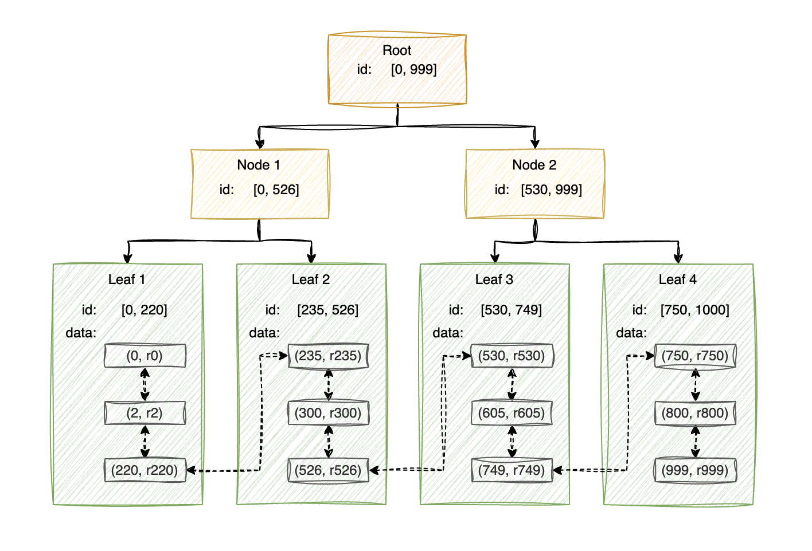

# B+ 树

B+ 树用多路导航和有序叶子支持索引查找。本文讲解树结构、范围扫描和页面调整。实现示例采用 MySQL 8.4 InnoDB。行存储由[聚簇索引](../clustered_index/index.mdx)介绍。查询成本的评估见[索引设计](../index-review.mdx)。

<span id="1-b-树由内部节点和叶子节点组成"></span>

## 1. 面试核心 {#core}

- B+ 树内部页保存导航键和子页指针，叶子页保存索引记录。[卡](#why-b-plus-tree)
- 分支数和叶子容量决定树高，Buffer Pool 命中减少磁盘读取。[卡](#height-and-io)
- 范围查询定位首条记录后，沿有序叶子继续扫描。
- 随机键分散插入位置，递增键把新增记录集中到树的右端。[卡](#insert-cost)
- InnoDB 默认页大小为 16KB，页合并默认阈值为 50%。[卡](#page-merge)

## 2. B+ 树的结构 {#b-树的结构}

B+ 树是一棵高度平衡的多路搜索树。所有叶子节点位于同一深度。

- 内部节点保存分隔键和子页指针。
- 叶子节点保存按键值排列的索引记录。
- 相邻叶子页通过链接支持顺序扫描。



“阶数”需要结合教材定义使用。有的教材指最大子节点数，有的指最大键数量。估算数据库索引时，直接使用每页容量更清楚。

<span id="2-页面分支数决定树高"></span>

## 3. 分支数与树高 {#分支数与树高}

InnoDB 默认以 16KB 的页组织索引。内部页只存导航信息，因此能容纳较多分支。键越宽，同一页面能容纳的导航项越少。

假设内部页平均有 500 个分支。三层树的叶子页数量约为 `500 × 500`。再乘每个叶子页的平均记录数，才得到行数估算。记录头和填充率也影响每页容量。

查询命中 Buffer Pool 时，页面读取在内存中完成。因此，三层树可以少于三次磁盘读取。范围扫描和溢出页则会增加访问页数。

<span id="3-等值查询从根节点逐层定位"></span>

## 4. 等值查询 {#等值查询}

等值查询从根页开始。每一层根据分隔键选择子页，直到目标叶子。在叶子页内继续定位目标记录。

树高随记录数按对数增长。用平均分支数 `f` 表示时，导航成本记为 `O(log_f N)`。

InnoDB 的叶子记录分工见[聚簇索引](../clustered_index/index.mdx)。

<span id="4-范围查询沿叶子页继续读取"></span>

## 5. 范围查询 {#范围查询}

范围查询先定位起点，再沿叶子顺序扫描。

```sql
SELECT * FROM users
WHERE id >= 10000 AND id < 10100;
```

定位 10000 后，扫描持续到第一条不小于 10100 的记录。中间各行共享这次树导航。索引键顺序与排序要求一致时，还能省去额外排序。

哈希表按哈希值定位，适合等值查找。B+ 树额外保留键顺序，能直接支持范围扫描。经典 B 树还在内部节点保存数据记录。B+ 树将记录集中在叶子层，内部页可容纳更多导航项。

<span id="5-插入和删除可能调整页面"></span>

## 6. 插入、删除与页分裂 {#插入删除与页分裂}

插入先定位目标叶子页。页面有足够空间时直接插入。页内重整后仍放不下新记录时，需要拆分页面。父页随之增加导航项。分裂传播到根页时，树高增加。

删除释放的空间可供后续写入复用。页面合并的具体条件见下文。修改索引键需要移除旧索引项，再插入新项。

随机键把插入分散到多个叶子页。相同写入量下，需要访问的活跃页面更多。递增键集中追加到右端，具有较好的写入局部性。高并发写入也会争用末端页面。

<span id="6-b-树不保证查询一定高效"></span>

## 7. 页面合并 {#页面合并}

MySQL 8.4 的 `MERGE_THRESHOLD` 默认是 50。删除或缩短记录后，页使用率低于阈值时会尝试合并。相邻页必须有空间容纳合并后的记录。

页内空闲空间由 InnoDB 后续复用。表文件是否缩小还取决于表空间和重建操作。因此，删除大量记录后，文件大小可以保持不变。

`innodb_fill_factor` 控制排序建索引时的填充比例。它与运行期间的合并阈值分属不同阶段。

## 8. 查询成本 {#查询变慢的原因}

B+ 树支持有序访问。扫描范围、回表和统计估算的评估见[索引设计](../index-review.mdx)。

## 9. 常见问题 {#7-常见问题}

### 9.1 叶子顺序 {#71-b-树的叶子节点为什么要保持有序}

有序叶子把相邻键放在同一条扫描路径上。范围查询只需定位起点，随后顺序读取。排序与键顺序一致时，也能直接输出有序结果。

### 9.2 树高与磁盘读取 {#72-b-树查询一定只发生三次磁盘-io-吗}

三层描述导航层数，磁盘读取取决于缓存命中。范围扫描还会读取更多叶子页。查询涉及二级索引回表或溢出页时，需计入额外访问。

## 10. 面试题 {#8-面试题}

### 10.1 MySQL 为什么常用 B+ 树索引，而不直接使用二叉树或哈希表 {#why-b-plus-tree}

<!-- 面试来源：
- 美团：https://www.nowcoder.com/discuss/608995688709455872
-->

**出现公司**：美团

**考察重点**

- 数据页、分支数量与树高。
- 等值、范围和排序访问。
- 叶子记录、回表和写入维护成本。

**相关内容**：[B+ 树的结构](#b-树的结构)至[查询成本](#查询变慢的原因)。

<details>
<summary>参考回答</summary>

B+ 树同时支持低树高导航和有序范围扫描。多路内部页比二叉结构容纳更多分支。同样的记录量因此需要更少导航层。叶子有序，范围查询可在定位后继续读取。

哈希表适合等值查找，范围和排序需要额外结构。B+ 树的代价是索引空间和页面维护。实际查询还需计入扫描量、缓存命中和回表成本。

</details>

### 10.2 三层 B+ 树查询是否一定发生三次磁盘 I/O？ {#height-and-io}

<!-- 本题为本站原理自测，尚未核验对应公司面经，不作公司归属。 -->

**出现公司**：暂无已核验的公开来源（本站自测）

**考察重点**

- 树高与缓冲池命中
- 回表、跨页与溢出页

**相关内容**：[分支数与树高](#分支数与树高)、[等值查询](#等值查询)。

<details>
<summary>参考回答</summary>

三层 B+ 树不固定对应三次磁盘 I/O。导航页命中 Buffer Pool 时直接从内存读取。范围跨页、溢出页和回表还会增加页面访问。树高只描述根到叶子的导航层数。

</details>

### 10.3 随机主键和递增主键分别影响哪些索引成本？ {#insert-cost}

<!-- 本题为本站原理自测，尚未核验对应公司面经，不作公司归属。 -->

**出现公司**：暂无已核验的公开来源（本站自测）

**考察重点**

- 键宽与分支数
- 页分裂和并发热点

**相关内容**：[插入、删除与页分裂](#插入删除与页分裂)。

<details>
<summary>参考回答</summary>

随机键分散写入页面，递增键集中向右端追加。前者需要缓存更多活跃页，后者有末端争用风险。主键宽度还会影响二级索引的记录大小。插入分布与键宽需要分别评估。

</details>

### 10.4 删除大量记录后，B+ 树页面和表文件会怎样变化？ {#page-merge}

<!-- 本题为本站原理自测，尚未核验对应公司面经，不作公司归属。 -->

**出现公司**：暂无已核验的公开来源（本站自测）

**考察重点**：页面利用率、合并条件和空间复用。

**相关内容**：[页面合并](#页面合并)。

<details>
<summary>参考回答</summary>

页使用率降低后，InnoDB 会尝试合并相邻页。MySQL 8.4 默认 `MERGE_THRESHOLD=50`。合并需要相邻页有足够空间。释放的页可供表空间复用，文件缩小另需重建等操作。

</details>

## 11. 参考资料 {#参考资料}

- [MySQL 8.4：The Physical Structure of an InnoDB Index](https://dev.mysql.com/doc/refman/8.4/en/innodb-physical-structure.html)
- [MySQL 8.4：Clustered and Secondary Indexes](https://dev.mysql.com/doc/refman/8.4/en/innodb-index-types.html)
- [MySQL 8.4：Index Page Merge Threshold](https://dev.mysql.com/doc/refman/8.4/en/index-page-merge-threshold.html)
- [MySQL 8.4：Reclaiming Disk Space](https://dev.mysql.com/doc/refman/8.4/en/innodb-truncate-table-reclaim-space.html)
