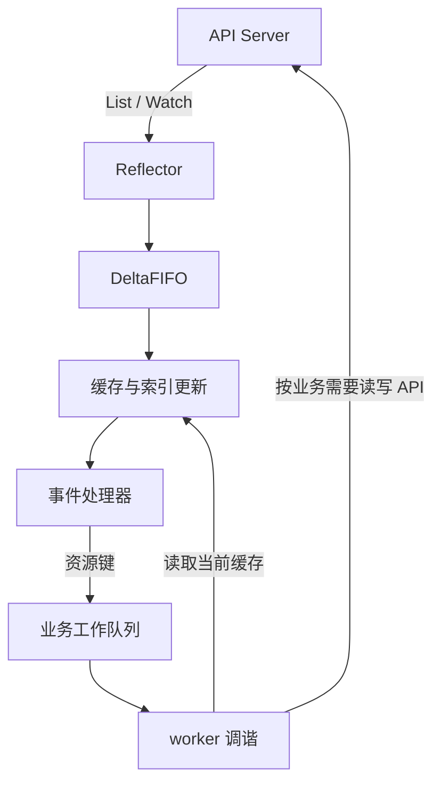

# client-go

**client-go** 是 Kubernetes 的 Go 客户端库，既能直接访问 API，也提供维护本地缓存和组织控制器工作的组件。编写控制器时，关键是根据当前状态反复作出正确决定，而不是假设每个事件只出现一次、回调里的对象永远最新。

本文以 Go 1.22.12、client-go v0.30.5 的实现说明机制。Kubernetes 的组件关系见 [Kubernetes 架构](../../../devops/kubernetes/architecture.mdx)，这里聚焦客户端的数据流与并发边界。

## 1. 面试核心 {#core}

- **client-go 通过 API Server 访问资源，不绕过它直接 Watch etcd**。类型化客户端、动态客户端和底层 REST 客户端提供不同层次的访问方式。[卡](#client-usage)
- **List 建立资源集合的起点，Watch 从相应版本继续观察变化**。`resourceVersion` 用于版本与观察位置，客户端不把它当时间戳或可自行运算的整数。[卡](#list-watch)
- **Informer 把资源变化同步到本地缓存，再通知处理器**。缓存可能滞后，回调发生时也可能已经有更新的缓存状态。[卡](#informer-flow)
- **DeltaFIFO 缓冲对象变化，工作队列安排业务调谐，两者不承担同一职责**。前者保存带变化类型的对象序列，后者通常只保存资源键。[卡](#delta-fifo)
- **同一处理器按顺序接收通知，不同处理器有各自的执行过程**。慢处理器会积压通知并消耗内存，回调应尽快把键交给工作队列。[卡](#slow-handler)
- **工作队列会合并重复键，并避免同一个键在同一队列内同时交给多个 worker**。这不保证不同键的业务完成顺序，也不提供跨进程互斥。[卡](#queue-order)
- **每次 Get 后都要 Done，成功后清除重试历史，失败按策略重试**。业务需要幂等，不能把队列当成恰好一次交付系统。[卡](#retry-lifecycle)
- **控制器持续调谐，准入 Webhook 在请求进入保存流程时检查或修改对象**。两者处在不同阶段，不能用慢 Webhook 替代长期调谐。[卡](#controller-webhook)

## 2. API 访问与版本 {#API访问与版本}

### 2.1 客户端与权限 {#客户端与权限}

**API Server** 是资源读写与观察的入口。它处理认证、授权、准入和资源版本等语义；client-go 发出的 List、Watch、Get、Update 等请求都通过这个入口。etcd 的存储细节不会把客户端变成 etcd 直连程序。

| 访问方式 | 对象形式 | 适用情况 |
| --- | --- | --- |
| 类型化客户端 | 编译时已知的 Go 结构体 | Pod、ConfigMap 等已有类型的资源 |
| 动态客户端 | `unstructured.Unstructured` | 运行时决定资源类型或处理自定义资源 |
| RESTClient | 组织 API 路径、参数、编码与请求 | 需要在较低层控制调用，或由生成客户端封装 |

客户端配置包括地址、凭据、证书信任和请求限速等。集群外通常读取明确指定的 kubeconfig；集群内可以使用工作负载对应的身份配置。凭据有效不代表有权访问全部资源，List 与 Watch 也需要对应授权，不能通过关闭 TLS 校验来解决配置问题。

客户端和传输应按服务生命周期复用，而不是每次事件都重新建立。请求继续传递 context，并给可能长时间等待的业务调用设置合适预算；Watch 则是一条需要持续管理的观察流。

### 2.2 List、Watch 与 resourceVersion {#ListWatch与resourceVersion}

**List** 返回匹配条件的资源集合，集合的 `resourceVersion` 标识这次观察位置。随后以相应版本启动 **Watch**，可以继续接收新增、修改和删除等通知，避免把“列出已有对象”和“观察后续变化”当成两个没有关联的动作。

Watch 观察的是 API 资源对象变化，不是 YAML 文件内容的逐字符修改，也不是直接订阅某个字段的补丁流。普通资源 Watch 的事件携带事件类型和相应对象表示；具体返回内容受请求形式影响。

**`resourceVersion` 是客户端应视为不透明的版本字符串**。它可用于续接观察和写入时的并发检查，但不应当被解释为业务时间，也不能凭数值差推算漏了几个事件。服务端不能提供请求版本之后的历史时，需要重新获取集合并恢复观察。

网络中断、版本过期和重连都是正常设计范围。因此控制器要能从当前资源重新计算结果；需要审计每一次中间状态的业务，不应只依赖 Informer 通知。

## 3. Informer 数据流 {#Informer数据流}

**Informer** 将资源集合同步到本地缓存，并向注册的处理器发送变化通知。SharedInformer 让多个使用者共享这条观察链，减少重复 List/Watch 和重复缓存。



### 3.1 Reflector 与 DeltaFIFO {#Reflector与DeltaFIFO}

**Reflector** 管理 List/Watch 的读取与恢复，把观察到的对象变化送入后续存储。**DeltaFIFO** 是这条链中的变化缓冲：按对象键组织等待处理的变化，例如 Added、Updated、Deleted。

同一键可以累积多个 delta，队列中则不为每次变化重复放置同一个键。它不是业务任务队列，也不能笼统理解成“只保存最后一个对象”；消费端需要知道对象经历了哪些待处理变化，才能正确更新缓存和发出通知。

重新 List 后，DeltaFIFO 还会结合已知对象识别本地原先存在、当前集合已经没有的对象。由于可能错过直接删除通知，删除事件有时用 `DeletedFinalStateUnknown` 包装最后已知对象，俗称 **tombstone**。处理删除时应使用支持该包装的取键函数，而不是直接断言它一定是 Pod 或 ConfigMap。

### 3.2 缓存与处理器 {#缓存与处理器}

**Indexer** 在缓存存储之外增加索引，例如按 namespace 查找对象；Lister 则在这些缓存之上提供读取接口。缓存读取减少 API 请求，但不会自动变成强一致读取。

Informer 先更新缓存和索引，再通知处理器。处理器收到某次更新时，缓存可能已经推进到同一对象的更晚版本。因此事件通常用于提示“这个键需要重新检查”，worker 再按键读取当前缓存，而不把旧回调对象长期当作权威状态。

同一注册处理器的通知顺序被保留，不同处理器之间没有统一的回调完成顺序。本文版本为每个处理器安排通知传递与执行过程，并使用可增长的待处理缓冲。一个处理器暂时阻塞，不意味着其他处理器立即同步阻塞；但持续积压会占用内存并影响整个进程，不能据此认为慢处理器没有代价。

共享缓存返回的对象应当只读。需要修改对象时先 `DeepCopy`，再按 API 的并发更新规则提交；直接改缓存中的 map 或字段，会污染其他使用者观察到的状态，还可能产生数据竞争。

### 3.3 初始同步与 resync {#初始同步与resync}

启动后应先等待需要的 Informer 完成初始缓存同步，再开始依赖缓存的业务。`WaitForCacheSync` 成功说明初始同步条件已经满足，不证明网络以后永不失败，也不证明所有处理器都完成了初始通知或所有业务已经调谐成功。

**resync** 是把本地已有对象再次交给处理器检查的机制。它不等于重新向 API Server List 全部数据，更不等于强制刷新成最新状态。断线后的重新 List 是观察恢复的一部分，与定期重新处理本地对象要分开解释。

## 4. 工作队列与调谐 {#工作队列与调谐}

### 4.1 键、去重与顺序 {#键去重与顺序}

**调谐**（reconcile）是读取当前状态，与业务希望达到的状态比较，再执行必要动作。工作队列通常存放 `namespace/name` 这样的键，表示这个对象需要重新检查。

本文版本的普通队列维护待处理、正在处理和重新变脏等状态：

1. 同一个键重复 Add，尚未开始处理时只保留一次待处理机会。
2. Get 把键移到正在处理的集合中；此时再 Add 同一键，不会把它立即交给另一个 worker。
3. 当前 worker 调用 Done 后，如果处理期间这个键又变脏，就再次放入待处理队列。

这个机制避免同一队列内同一键并行调谐，但不同键可以并行，完成时间不保证按入队顺序排列。延迟重试、事件合并和多 worker 也意味着不能用工作队列还原每个事件的原始时间线。

不同进程有各自的队列，不因此获得跨进程锁。多个控制器副本是否允许同时执行、如何选主、外部写入如何幂等，必须另外设计。相同 `namespace/name` 删除后再创建还可能对应不同 UID，需要区分“同名资源”和“同一个对象实例”。

### 4.2 重试与完成 {#重试与完成}

Get 取得的每个条目都要调用 `Done`，即使处理失败。Done 结束本次占用，`Forget` 清除该键的限速重试历史；这两个动作不能互相代替。

失败时可用 `AddRateLimited` 安排带退避的重试，成功后调用 Forget。还应区分暂时故障与不可恢复错误，设置可观察的失败处理和重试策略。永久丢弃一个键以后，如果没有新事件、定期检查或其他触发，它不会凭空重新出现。

调谐应尽量幂等。例如设置某个受控对象达到期望配置，比每收到一次通知就无条件追加一个对象更容易重复执行。即使队列不同时交付同一键，进程重启、重试和结果不确定的远程调用仍可能使业务执行多次。

## 5. ConfigMap 观察示例 {#ConfigMap观察示例}

下面创建一个 namespace 内的 ConfigMap Informer。调用方提供已配置的类型化客户端和控制器生命周期 context；List/Watch 保留 Informer 传入的选项，不丢弃 resourceVersion 等参数。

```go title="informer.go"
package controller

import (
    "context"

    corev1 "k8s.io/api/core/v1"
    metav1 "k8s.io/apimachinery/pkg/apis/meta/v1"
    "k8s.io/apimachinery/pkg/runtime"
    "k8s.io/apimachinery/pkg/watch"
    coreclient "k8s.io/client-go/kubernetes/typed/core/v1"
    "k8s.io/client-go/tools/cache"
)

func NewInformer(ctx context.Context, client coreclient.CoreV1Interface, namespace string) cache.SharedIndexInformer {
    resource := client.ConfigMaps(namespace)
    source := &cache.ListWatch{
        ListFunc: func(options metav1.ListOptions) (runtime.Object, error) {
            return resource.List(ctx, options)
        },
        WatchFunc: func(options metav1.ListOptions) (watch.Interface, error) {
            return resource.Watch(ctx, options)
        },
    }
    return cache.NewSharedIndexInformer(source, &corev1.ConfigMap{}, 0,
        cache.Indexers{cache.NamespaceIndex: cache.MetaNamespaceIndexFunc})
}
```

第三个参数零关闭本示例的周期 resync，不会关闭 Watch。调用方需要在结束时取消传入的 ctx，让在途 List/Watch 请求也能退出；不要为每次请求重新创建 Informer。

下面的 Controller 把事件转换成键，读取当前缓存后交给 `reconcile`。`current == nil` 表示当前缓存中没有这个键，非 nil 时提供独立副本。示例本身不修改集群资源；具体业务需要决定如何处理缺失、同名重建和写入冲突。

```go title="controller.go"
package controller

import (
    "context"
    "errors"
    "fmt"
    "sync"

    corev1 "k8s.io/api/core/v1"
    utilruntime "k8s.io/apimachinery/pkg/util/runtime"
    "k8s.io/client-go/tools/cache"
    "k8s.io/client-go/util/workqueue"
)

type Reconcile func(context.Context, string, *corev1.ConfigMap) error

type Controller struct {
    informer  cache.SharedIndexInformer
    queue     workqueue.RateLimitingInterface
    reconcile Reconcile
}

func NewController(informer cache.SharedIndexInformer, reconcile Reconcile) (*Controller, error) {
    if informer == nil || reconcile == nil {
        return nil, errors.New("informer and reconcile are required")
    }
    c := &Controller{informer: informer, reconcile: reconcile,
        queue: workqueue.NewRateLimitingQueue(workqueue.DefaultControllerRateLimiter())}
    enqueue := func(obj any) {
        key, err := cache.DeletionHandlingMetaNamespaceKeyFunc(obj)
        if err != nil {
            utilruntime.HandleError(err)
            return
        }
        c.queue.Add(key)
    }
    _, err := informer.AddEventHandler(cache.ResourceEventHandlerFuncs{
        AddFunc: enqueue,
        UpdateFunc: func(old, current any) { enqueue(current) },
        DeleteFunc: enqueue,
    })
    if err != nil {
        c.queue.ShutDown()
        return nil, err
    }
    return c, nil
}

func (c *Controller) process(ctx context.Context) bool {
    item, shutdown := c.queue.Get()
    if shutdown {
        return false
    }
    defer c.queue.Done(item)
    if ctx.Err() != nil {
        c.queue.Forget(item)
        return false
    }
    key := item.(string) // 本控制器只把字符串键放入队列。
    obj, exists, err := c.informer.GetIndexer().GetByKey(key)
    if err == nil {
        var current *corev1.ConfigMap
        if exists {
            current = obj.(*corev1.ConfigMap).DeepCopy()
        }
        err = c.reconcile(ctx, key, current)
    }
    if err == nil {
        c.queue.Forget(key)
    } else if ctx.Err() == nil && c.queue.NumRequeues(key) < 3 {
        c.queue.AddRateLimited(key)
    } else {
        c.queue.Forget(key)
        utilruntime.HandleError(fmt.Errorf("reconcile %s: %w", key, err))
    }
    return true
}

func (c *Controller) Run(ctx context.Context, workers int) error {
    if workers < 1 {
        c.queue.ShutDown()
        return errors.New("workers must be positive")
    }
    var group sync.WaitGroup
    group.Add(1)
    go func() {
        defer group.Done()
        c.informer.Run(ctx.Done())
    }()
    if !cache.WaitForCacheSync(ctx.Done(), c.informer.HasSynced) {
        c.queue.ShutDown()
        group.Wait()
        return errors.New("initial cache sync interrupted")
    }
    for i := 0; i < workers; i++ {
        group.Add(1)
        go func() {
            defer group.Done()
            for c.process(ctx) {
            }
        }()
    }
    <-ctx.Done()
    c.queue.ShutDown()
    group.Wait()
    return nil
}
```

`Run` 在初始缓存同步后启动 worker，结束时关闭队列以唤醒等待者，再等待本次启动的 goroutine 退出。它只运行一次；`reconcile` 必须支持多个键并行，并响应 context，否则等待退出仍可能卡住。构造后应启动控制器，不长期闲置已创建的限速队列。

每轮失败最多安排三次限速重试，成功后重试计数清零；耗尽后记录错误，等待其他触发。这个上限用于展示生命周期，不是适合所有故障的生产策略。关闭路径不承诺处理完全部待办，业务如需排空，应另外定义退出预算与停止接收新任务的顺序。

删除事件可能在 worker 运行前又被同名创建覆盖，因此 worker 读取到的是当前缓存状态。若要清理外部资源，不能只凭一次缓存缺失就删除：还需确认对象身份、所有权和业务协议，必要时结合 API 读取、finalizer 等机制。缓存同步和重复调谐无法替代这些约束。

## 6. 控制器与准入 Webhook {#控制器与准入Webhook}

**控制器**持续观察资源并调谐，使实际状态向期望状态靠拢。例如 Deployment 控制器根据副本需求维护下层资源，实际执行可能晚于用户提交配置。

**准入 Webhook** 在 API 请求的准入阶段参与校验或变更。校验型 Webhook 可以拒绝不符合约束的对象，变更型 Webhook 可以按规则调整对象；它不是一个持续观察资源状态的后台控制循环。

需要在对象接受前检查约束时考虑准入机制，需要持续修复偏差、创建下层资源或处理外部依赖时考虑控制器。Webhook 的延迟和可用性会影响 API 请求，不适合在里面等待一个长时间才能完成的调谐过程。控制器的执行又可能滞后，不能把它当成对每次 API 请求的同步拦截。

## 7. 面试题 {#面试题}

### 7.1 client-go 应怎样访问资源并管理客户端？ {#client-usage}

**考察重点**：API 入口、客户端层次、配置与权限、复用和 context。

**相关内容**：[客户端与权限](#客户端与权限)。

<details>
<summary>参考回答</summary>

**通过 API Server 访问资源，按对象类型选择类型化、动态或底层 REST 客户端。** 使用明确的配置与身份，检查证书信任和资源权限，不直接绕过 API Server 读写 etcd。

客户端在服务生命周期内复用，请求传递 context；共享缓存对象只读，修改前复制。控制器还应检查缓存初始同步、重试和关闭，而不是只证明一次 Get 能成功。

</details>

### 7.2 List/Watch 观察的是什么，resourceVersion 有什么作用？ {#list-watch}

**考察重点**：资源集合与后续变化、API Server、版本位置和观察恢复。

**相关内容**：[List、Watch 与 resourceVersion](#ListWatch与resourceVersion)。

<details>
<summary>参考回答</summary>

**观察的是 API 资源对象，入口是 API Server。** List 给出集合及观察位置，Watch 从相应版本继续读取变化，不是监听 YAML 文件或直接监听 etcd。

resourceVersion 作为不透明版本字符串用于续接和并发检查，不当时间戳或整数运算。历史不可用时重新 List 并恢复观察，业务依靠当前状态重新调谐，而不假设必定见到每一个中间事件。

</details>

### 7.3 Informer 从观察变化到业务执行经过哪些步骤？ {#informer-flow}

**考察重点**：Reflector、变化缓冲、缓存与索引、通知和业务队列。

**相关内容**：[Informer 数据流](#Informer数据流)、[初始同步与 resync](#初始同步与resync)。

<details>
<summary>参考回答</summary>

**Reflector 通过 List/Watch 取得变化，经 DeltaFIFO 交给缓存更新流程，再通知处理器。** 处理器把资源键入队，worker 从缓存读取当前状态并调谐。

先更新缓存再通知，不代表 worker 看到的一定是触发通知时的版本。启动时等待初始同步，运行中仍处理缓存滞后和断线；resync 是重新处理本地对象，不是强制重新 List。

</details>

### 7.4 为什么需要 DeltaFIFO，它和业务工作队列有什么区别？ {#delta-fifo}

**考察重点**：资源变化与业务任务、同键累积和删除恢复。

**相关内容**：[Reflector 与 DeltaFIFO](#Reflector与DeltaFIFO)、[键、去重与顺序](#键去重与顺序)。

<details>
<summary>参考回答</summary>

**DeltaFIFO 缓冲带变化类型的对象，供 Informer 更新缓存和发送通知；业务队列通常保存需要调谐的资源键。** 同一个键的多个 delta 可以累积，不能概括为始终只留最后一个事件。

重新 List 时需要识别已知对象的缺失，删除通知也可能带 tombstone。业务队列则关注去重、正在处理的键和失败重试，消费时通常重新读取当前缓存。

</details>

### 7.5 一个 Informer 的处理器阻塞，会怎样影响其他处理器？ {#slow-handler}

**考察重点**：单处理器顺序、处理器间隔离和通知积压。

**相关内容**：[缓存与处理器](#缓存与处理器)。

<details>
<summary>参考回答</summary>

**不同注册处理器有各自的通知执行过程，某个处理器短暂阻塞不等于其他处理器立即一起阻塞。** 同一处理器自己的后续通知仍要等前面的回调返回。

本文版本的待处理通知缓冲可以增长，持续阻塞会消耗内存，最终影响进程。回调应尽快取键入队，把慢操作交给有并发控制和重试策略的 worker。

</details>

### 7.6 工作队列能保证怎样的顺序和互斥？ {#queue-order}

**考察重点**：重复键合并、processing 与 dirty、并行及跨进程边界。

**相关内容**：[键、去重与顺序](#键去重与顺序)。

<details>
<summary>参考回答</summary>

**正确配对 Get 与 Done 时，同一队列内同一键不会同时交给多个 worker。** 处理期间再次 Add 会记为需要重做，Done 后再入队；未处理时的重复 Add 会合并。

不同键可以并行，业务完成顺序不等于入队顺序，也不能还原全部原始事件。多个控制器进程的队列彼此独立，外部副作用仍需幂等和并发控制。

</details>

### 7.7 Done、Forget 和 AddRateLimited 各自解决什么问题？ {#retry-lifecycle}

<!-- 本题为本站原理自测，尚未核验对应公司面经，不作公司归属。 -->

**考察重点**：本次占用、重试历史、失败调度与退出。

**相关内容**：[重试与完成](#重试与完成)、[ConfigMap 观察示例](#ConfigMap观察示例)。

<details>
<summary>参考回答</summary>

**Done 结束本次 Get 的处理占用，Forget 清除该键的限速历史，AddRateLimited 安排退避重试。** 失败也要 Done；成功通常 Forget，不能用其中一个替代另一个。

重试有预算和错误分类，丢弃后还要有可观察结果。队列关闭可以唤醒 Get，但不能强制结束已经进入、又不响应取消的业务函数。

</details>

### 7.8 控制器和准入 Webhook 分别适合解决什么问题？ {#controller-webhook}

**考察重点**：持续调谐、准入阶段、延迟与可用性边界。

**相关内容**：[控制器与准入 Webhook](#控制器与准入Webhook)。

<details>
<summary>参考回答</summary>

**控制器持续观察并修复状态偏差，准入 Webhook 在请求接受过程中校验或修改对象。** 前者适合维护期望状态，后者适合提交时必须执行的约束或变更规则。

Webhook 影响 API 请求的延迟与可用性，不应等待长期调谐；控制器可能滞后，也不能代替同步拒绝不合法请求。两者可以配合，但职责和失败策略应分别定义。

</details>

## 8. 参考资料 {#参考资料}

- [Kubernetes：API Concepts](https://kubernetes.io/docs/reference/using-api/api-concepts/)
- [Kubernetes：Controllers](https://kubernetes.io/docs/concepts/architecture/controller/)
- [Kubernetes：Admission Controllers](https://kubernetes.io/docs/reference/access-authn-authz/admission-controllers/)
- [client-go v0.30.5：SharedInformer](https://github.com/kubernetes/client-go/blob/v0.30.5/tools/cache/shared_informer.go)
- [client-go v0.30.5：Reflector](https://github.com/kubernetes/client-go/blob/v0.30.5/tools/cache/reflector.go)
- [client-go v0.30.5：DeltaFIFO](https://github.com/kubernetes/client-go/blob/v0.30.5/tools/cache/delta_fifo.go)
- [client-go v0.30.5：工作队列](https://github.com/kubernetes/client-go/blob/v0.30.5/util/workqueue/queue.go)
- [client-go v0.30.5：限速队列](https://github.com/kubernetes/client-go/blob/v0.30.5/util/workqueue/rate_limiting_queue.go)
- [client-go v0.30.5：官方工作队列示例](https://github.com/kubernetes/client-go/blob/v0.30.5/examples/workqueue/main.go)
