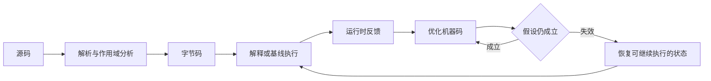

# V8 执行过程

**V8** 是执行 JavaScript 的引擎，会把源码解析成内部表示，生成可执行的字节码，并根据运行情况选择解释执行或生成机器码。频繁执行的代码可能得到进一步优化；优化依赖的条件不再成立时，引擎还需要恢复到能够处理当前输入的执行方式。

理解这条过程，是为了说明动态语言怎样兼顾启动成本与运行速度，以及为什么同一段代码第一次运行和长期运行的表现可能不同。岗位或项目涉及引擎性能时，重点是解释机制和验证假设，不需要把每个优化器名称背成一条永远不变的流水线。

## 1. 面试核心 {#core}

- 源码需要经过解析和编译才能执行。**JavaScript 引擎可以同时使用解释器和编译器，不能简单归为“逐行解释，没有编译”**。[卡](#execution-pipeline)
- 解释执行启动成本较低，生成更优机器码也要消耗时间和内存。**分层执行根据运行情况逐步投入编译成本，不是每个函数都必须经过全部层级**。[卡](#tiering)
- 动态语言的优化可以利用实际输入的类型、对象形状和调用行为。**运行时反馈是优化依据，推测条件需要检查或依赖失效机制保护**。[卡](#type-feedback)
- 对象形状描述内部布局，内联缓存帮助某个访问位置复用已有访问路径。**它们不是 JavaScript 的 class 或原型链，也不改变属性访问的语言语义**。[卡](#shapes-caches)
- 去优化用于在假设失效时保持正确执行。**它是恢复机制，不是语法错误；恢复需要把优化后的状态映射回可继续执行的状态**。[卡](#deoptimization)
- 性能结论必须对应实际负载。**冷启动、稳定运行、编译和 GC 都会影响测量，单次微基准不能证明整个页面得到同样收益**。[卡](#measurement)

## 2. 源码、语法树与字节码 {#源码语法树与字节码}

**解析**把源码中的字符和语法关系识别成引擎能继续处理的结构。**抽象语法树**（AST）描述表达式、语句等语法关系；作用域分析还要确定变量声明与引用之间的关系。后续编译把这些信息转换成更适合执行的形式。

**字节码**是给引擎执行使用的指令表示，不是处理器直接执行的机器指令。V8 的 Ignition 是字节码解释器，负责根据字节码完成相应操作。

```js
function add(left, right) {
  return left + right;
}
console.log(add(1, 2));   // 3
console.log(add("1", 2)); // 12
```

同一段 `+` 表达式可以做数值加法，也可以在类型转换后拼接字符串。解释器和优化后的代码都必须保留这种语言行为，不能因为函数前几次接收数字，就把以后传入字符串视作非法。

解析和编译本身有成本。V8 可以对暂时不需要的函数先做预解析，保留检查语法和分析外部作用域所需的信息，等需要时再完整解析与编译。代码缓存、流式处理等机制也会影响启动过程，不能假设每次页面加载都立即把所有函数完整编译到最高层级。

## 3. 分层执行 {#分层执行}

**即时编译**（JIT）是在程序运行过程中生成机器码。它可以结合当前的执行反馈，但编译本身也需要资源，所以启动速度和峰值运行速度不总是同一个目标。

V8 的执行方式可以按职责理解：

| 执行方式 | 主要作用与代价 |
| --- | --- |
| 字节码解释 | 尽快开始执行，减少一开始就生成大量机器码的成本；执行中有指令分派等开销 |
| 基线编译 | 用较低编译成本生成与字节码对应的机器码，减少解释器分派成本 |
| 优化编译 | 利用反馈和分析产生更专门的代码，提高热点执行效率，但编译和维护成本更高 |

V8 v5.9 的公开执行架构以 Ignition 和 TurboFan 为核心；V8 v9.1 又引入基线编译器 Sparkplug，Chrome 117 的 V8 增加了中间优化层 Maglev。这些演进说明执行层级会变化，理解职责比背固定名称顺序更重要。

下面只表示主要依赖关系，不表示每个函数必经全部步骤：



只运行一次的初始化函数，可能没有足够收益来抵消深度优化成本。长期反复执行的计算，则更可能从专门的机器码中受益。引擎还会考虑代码大小、反馈稳定程度和自身调度，不能用一个固定调用次数承诺“必定优化”。

## 4. 运行时反馈与对象形状 {#运行时反馈与对象形状}

**运行时反馈**是引擎在实际执行中收集到的信息，例如某个运算位置见过哪些值类型、某次属性访问见过哪些对象布局。它能帮助引擎为经常出现的情况准备更直接的执行路径。

例如，某个属性访问位置经常收到同一种布局的对象，引擎可以先检查布局是否符合预期，再从已知位置读取属性。省去重复的一般性查找后，执行可以更直接；如果输入不符合预期，就需要走其他路径或调整代码。

### 4.1 对象形状 {#对象形状}

**对象形状**是描述对象内部结构的元信息，V8 资料也使用 HiddenClass 或内部的 Map 来描述相关结构。这里的 Map 是引擎实现概念，不是 JavaScript 的 `Map` 集合。

形状可以关联属性布局和原型等信息。以一致方式创建的对象，有机会复用相同布局信息；增加、删除属性或改变原型等操作，则可能影响这些假设。

```js
function createUser(id, name) {
  return { id, name };
}
function readName(user) {
  return user.name;
}
const first = createUser(1, "Lin");
const second = createUser(2, "Kai");
console.log(readName(first), readName(second)); // Lin Kai
first.active = true;
console.log(readName(first)); // Lin
```

两次工厂调用使用一致的构造方式，便于引擎处理相近的结构。后来增加 `active`，语言层面的 `name` 读取仍然正确；是否改变具体内部形状、使哪一段优化失效，需要结合引擎和运行情况观察，不能由这两行日志直接证明。

形状不是原型链。原型链规定属性找不到时去哪里继续查找；形状帮助引擎实现这些操作。也不是用了 `class` 才有形状，普通对象同样需要内部布局。

### 4.2 内联缓存 {#内联缓存}

**内联缓存**（Inline Cache，IC）是在某个访问或调用位置保存已观察到的处理信息，让后续相似操作更快找到合适路径。它缓存的是访问策略等执行信息，不是把对象某个属性的旧值永久缓存下来。

一个位置只见过一种主要形状时，处理可以比较专一；见过少数几种时，可以保留多个分支；形状很多时，则可能需要更通用的处理。具体状态划分和转换阈值属于实现细节，不需要假设所有版本相同。

如果属性从 `"Lin"` 改为 `"Kai"`，读取必须得到新值；如果属性变成 getter，也必须遵循访问器语义。缓存和优化都不能绕过这些可观察行为。

因此，保持数据模型清晰、减少没有业务意义的反复结构变化，通常也便于引擎处理。但不能推出“永远不能 delete”“对象必须全部用 class 创建”这样的规则；需要动态结构时，应先保证模型正确，再用性能证据判断是否调整。

## 5. 推测优化与去优化 {#推测优化与去优化}

**推测优化**是根据已有反馈，针对某些预期条件生成更专门的代码。这里的推测必须受保护：可以在执行时检查条件，也可以登记依赖，在依赖变化时让相关代码失效。

**去优化**（deoptimization）是在优化前提不再成立时，退出当前优化形式并恢复能够继续正确执行的状态。引擎需要知道优化代码中的值对应哪些变量、栈帧和执行位置，才能保留已经发生的工作，继续剩余步骤。

```js
function plusOne(value) {
  return value + 1;
}
let checksum = 0;
for (let index = 0; index < 10000; index += 1) {
  checksum += plusOne(index);
}
console.log(checksum);    // 50005000
console.log(plusOne("2")); // 21
```

数值输入可能让引擎获得针对数值运算的反馈，字符串输入则要求执行字符串拼接。这个示例能验证两类输入的正确结果，但不保证某个版本一定优化了 `plusOne`，也不保证最后一次调用必然触发某一种去优化。

实际运行中，如果优化代码依赖的数值类型、对象形状或其他条件失效，可能需要检查失败后的退路。它不应从函数开头重新执行所有副作用，否则日志、写入或请求会被重复执行；恢复状态正是为了保持语义连续。

去优化并不是永远不好的异常。偶尔调整假设是动态运行时的正常工作；只有当相关开销在实际负载中显著，或者反复优化与退出造成成本时，才值得进一步定位。仅在日志里看到一次去优化，不足以说明它就是页面卡顿原因。

## 6. 性能验证 {#性能验证}

验证首先要明确目标：首次页面可用时间、一次交互延迟，还是长时间计算的吞吐。它们对解析、编译、执行和内存的关注不同。

只测热循环，可能掩盖首轮解析和编译成本；只测第一次调用，又不能代表稳定运行。真实页面还包含网络、DOM、布局、绘制和 GC，JavaScript 函数变快不代表端到端时间同比例变短。

### 6.1 建立可比较的实验 {#建立可比较的实验}

性能实验需要使用有代表性的输入，明确运行环境，并在相同条件下比较多次结果。保留计算结果，防止测试的工作因没有可观察作用而被优化掉；把日志移出被测热路径，避免把控制台成本算成业务算法成本。

还要观察分配和 GC。一次改动可能减少运算却增加临时对象，也可能使启动代码更多；这些代价需要结合目标一起判断。内存证据的读取方式见 [JavaScript 内存管理](./memory-management.mdx#内存泄漏的排查)。

如果想解释具体函数为什么慢，可以先用 Performance 或 CPU profile 找到真实热点，再结合版本适用的引擎诊断信息检查假设。不要从一个容易演示的隐藏类例子，直接推断整个项目的优化优先级。

### 6.2 观察字节码与优化记录 {#观察字节码与优化记录}

Node.js 使用 V8，可以做隔离的本地实验，但它的宿主环境不等于浏览器。把上一节的 `plusOne` 示例保存为 `plus-one.cjs` 后，可先确认本地 V8 支持哪些调试参数：

```bash
node --v8-options
node --print-bytecode --print-bytecode-filter=plusOne plus-one.cjs
node --trace-opt --trace-deopt plus-one.cjs
```

字节码输出用于观察函数生成了怎样的内部指令；优化记录用于观察本次运行是否发生编译或去优化。参数、指令名称和触发情况随 Node.js 携带的 V8 版本变化，不属于业务 API，也不是判断答案正确性的固定字符串。

这些记录能说明一次运行发生了什么，不能单独证明收益。确定性能改动是否有效，仍需回到目标设备、真实调用方式与端到端测量。

## 7. 面试题 {#面试题}

### 7.1 V8 怎样执行 JavaScript，为什么不能只说逐行解释？ {#execution-pipeline}

<!-- 本题为本站原理自测，尚未核验对应公司面经，不作公司归属。 -->

**考察重点**：解析、内部表示、字节码与机器码。

**相关内容**：[源码、语法树与字节码](#源码语法树与字节码)、[分层执行](#分层执行)。

<details>
<summary>参考回答</summary>

**源码先经过解析与作用域分析，再生成字节码等内部表示，执行时可以结合解释器和不同层级的编译器。** 解释执行便于较快开始，热点又可能转成更专门的机器码。

函数可以按需解析编译，并非加载时就把全部代码优化到底。具体层级和策略依赖版本，语言的动态语义则必须保持一致。

</details>

### 7.2 为什么要分层编译，而不是一开始就生成最优机器码？ {#tiering}

<!-- 本题为本站原理自测，尚未核验对应公司面经，不作公司归属。 -->

**考察重点**：启动、编译成本、运行反馈与长期收益。

**相关内容**：[分层执行](#分层执行)。

<details>
<summary>参考回答</summary>

**更深入的优化需要时间、内存和稳定反馈，很多代码运行次数不足以抵消这些成本。** 解释或基线执行先满足启动需要，反复执行的热点再投入更多优化。

分层是在启动速度、峰值速度和资源消耗之间取舍，不意味着每个函数必须依次走完所有层级，也不能用固定调用次数保证升级。

</details>

### 7.3 动态类型语言为什么还能做类型相关优化？ {#type-feedback}

<!-- 本题为本站原理自测，尚未核验对应公司面经，不作公司归属。 -->

**考察重点**：运行时反馈、推测条件与正确性保护。

**相关内容**：[运行时反馈与对象形状](#运行时反馈与对象形状)、[推测优化与去优化](#推测优化与去优化)。

<details>
<summary>参考回答</summary>

**引擎可以观察某个位置实际出现的类型与形状，为常见情况生成专门路径。** 同时通过运行时检查或依赖失效机制保护假设，不符合条件时走其他路径或去优化。

优化不能改变合法输入的行为。数值加法后来收到字符串，仍要按 JavaScript 的转换与拼接规则处理，而不是因为过去只见过数字就报类型错误。

</details>

### 7.4 对象形状、内联缓存、class 和原型链是什么关系？ {#shapes-caches}

<!-- 本题为本站原理自测，尚未核验对应公司面经，不作公司归属。 -->

**考察重点**：内部布局、访问策略与语言层面规则。

**相关内容**：[对象形状](#对象形状)、[内联缓存](#内联缓存)。

<details>
<summary>参考回答</summary>

**对象形状描述内部布局，内联缓存帮助一个访问位置复用适合已见形状的处理路径。** 它们是实现机制；class 和原型链则参与语言层面的构造与属性查找规则。

普通对象也有内部布局，缓存不能把可变属性的旧值永久固定。结构变化可能影响优化，但不能据此禁止所有动态属性操作，仍需按业务模型和测量结果判断。

</details>

### 7.5 什么是去优化，为什么不能简单从函数开头重新执行？ {#deoptimization}

<!-- 本题为本站原理自测，尚未核验对应公司面经，不作公司归属。 -->

**考察重点**：假设失效、状态恢复与副作用连续性。

**相关内容**：[推测优化与去优化](#推测优化与去优化)。

<details>
<summary>参考回答</summary>

**去优化是在优化条件失效时，恢复到能处理当前状态的执行形式。** 需要把优化代码中的值和执行位置映射回可以继续执行的状态。

从头重跑可能重复已经发生的副作用，破坏语义。去优化本身不是程序错误，是否造成明显性能问题要看频率、成本及实际热点。

</details>

### 7.6 怎样验证与 V8 优化相关的性能改动？ {#measurement}

<!-- 本题为本站原理自测，尚未核验对应公司面经，不作公司归属。 -->

**考察重点**：目标负载、冷暖状态、测量干扰与端到端收益。

**相关内容**：[性能验证](#性能验证)、[观察字节码与优化记录](#观察字节码与优化记录)。

<details>
<summary>参考回答</summary>

**先定位实际热点并明确目标，再用代表性输入在相同环境中重复比较。** 区分冷启动和稳定运行，保留结果，避免把日志成本或被消除的无效工作当成业务耗时。

同时观察编译、分配与 GC，必要时用版本适用的诊断记录解释行为。最终仍以页面或任务的端到端结果判断，单次微基准和一次去优化日志都不足以证明整体收益。

</details>

## 8. 参考资料 {#参考资料}

- [V8：Ignition](https://v8.dev/docs/ignition)
- [V8：Launching Ignition and TurboFan](https://v8.dev/blog/launching-ignition-and-turbofan)
- [V8：Blazingly fast parsing, part 2 — lazy parsing](https://v8.dev/blog/preparser)
- [V8：Sparkplug — a non-optimizing JavaScript compiler](https://v8.dev/blog/sparkplug)
- [V8：Maglev](https://v8.dev/blog/maglev)
- [V8：Fast properties in V8](https://v8.dev/blog/fast-properties)
