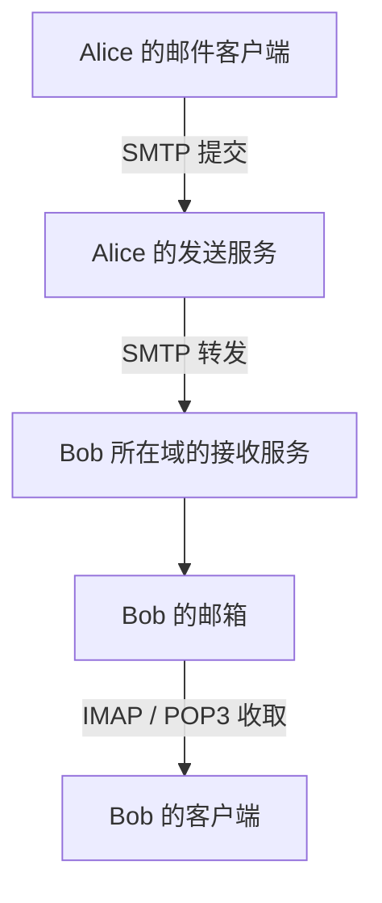

# 邮件协议

邮件收发由不同协议分工完成：**SMTP** 负责把邮件提交或转交给下一台服务器，**IMAP、POP3** 负责让用户访问已经存入邮箱的邮件。邮件正文、附件和字符编码则由消息格式与 MIME 描述，不由 SMTP 单独定义。

解释邮件流程时，重点是每一步交接了什么、确认到哪里为止。SMTP 返回成功不代表收件人已经读到邮件；客户端遇到超时，也不一定说明服务器没有保存邮件。这些区别直接影响失败重试和状态判断。

## 1. 面试核心 {#core}

- SMTP 同时用于**用户提交和服务器间转发**；IMAP、POP3 用于访问邮箱。网页邮箱可以通过 HTTPS 与浏览器交互，不能据此认为浏览器必须直接使用 SMTP。[卡](#mail-protocol-roles)
- SMTP 事务通过 **`MAIL FROM`、一个或多个 `RCPT TO`、`DATA`** 传递信封和消息。信封控制当前交付，消息头的 `From`、`To` 是消息内容的一部分，二者不能混用。[卡](#smtp-transaction) [卡](#envelope-headers)
- `DATA` 结束后的最终成功响应表示**当前服务器接受后续交付责任**，不是已读回执。临时失败、永久失败和最终响应丢失要分别处理，也要区分不同收件人的结果。[卡](#mail-retry)
- IMAP 可以管理服务器上的文件夹和标志，POP3 主要读取邮件。**POP3 读取不等于删除，IMAP 序号不等于稳定 UID**；删除和同步要看具体命令与状态。[卡](#mailbox-state)
- MIME 描述**媒体类型、字符集、传输编码和多部分结构**。Base64 便于承载二进制，不提供加密或身份验证。[卡](#mime-message)
- 隐式 TLS 从连接开始就握手，STARTTLS 在协议会话中升级；两者都要验证证书并落实加密策略。**一段 TLS 不等于邮件内容端到端保密**。[卡](#mail-tls)

## 2. 提交、转发与收取 {#提交转发与收取}

**邮件提交**是用户把新邮件交给自己的发送服务，**邮件转发**是服务器把它继续交给负责下一步处理的服务器。两者可以都使用 SMTP，但身份校验、路由和策略不同。

一条典型路径是：



用户客户端通常连接配置好的提交服务器，而不是自己查收件人域名的 MX 并向任意服务器发信。负责域间路由的发送服务可查询收件人域的 **MX 记录**，按优先级等规则选择目标邮件服务器，再解析其地址。MX 描述邮件接收入口，不是用户的 IMAP 登录地址；DNS 的查询与缓存机制见 [DNS 的资源记录](./dns.mdx#资源记录)。

| 协议 | 主要职责 | 不代表什么 |
| --- | --- | --- |
| SMTP | 提交、转交邮件，逐步交接投递责任 | 不管理用户的已读状态，不证明用户已收到或读过 |
| IMAP | 访问与管理服务器邮箱、文件夹、标志，支持多端同步 | 不以它替代 SMTP 向外发信 |
| POP3 | 列出并取回邮箱中的邮件，按会话处理删除 | 不要求每次下载后立刻删除服务器副本 |

网页邮箱中的「发送」按钮可以先发起 HTTPS 请求，由网站后端再完成邮件提交。协议职责要沿实际调用链判断，不能仅凭用户界面推断。

## 3. SMTP 事务 {#smtp-事务}

### 3.1 信封与消息头 {#信封与消息头}

**SMTP 信封**是当前传输事务中声明的返回路径和收件人列表。`MAIL FROM` 提供返回路径，通常供失败通知使用；每条 `RCPT TO` 指定一个交付对象。服务器处理的消息本身则由消息头、空行和消息体组成。

例如，事务的信封可以是：

```text
MAIL FROM:<bounce@example.test>
RCPT TO:<bob@example.test>
```

而消息头写的是：

```text
From: Alice <alice@example.test>
To: visible@example.test
Subject: Example
```

当前服务器按已接受的 `RCPT TO` 向 `bob@example.test` 处理交付，不是按消息头里的 `To` 再推导一次收件人。`From`、`To` 也不自动证明地址持有者身份。密送同样依赖这种分离：可以把对象列入信封收件人，却不把他的地址公开在发出的收件人头中。

### 3.2 从问候到最终确认 {#从问候到最终确认}

SMTP 是基于 TCP 的命令与响应协议。服务器先发问候，客户端通常使用 `EHLO` 说明自身并获取扩展能力；建立所需的安全和认证状态后，再发起邮件事务。

以下省略握手、认证及扩展能力列表，只展示一封本地邮件事务的关键次序：

```text
C: MAIL FROM:<bounce@example.test>
S: 250 2.1.0 OK
C: RCPT TO:<bob@example.test>
S: 250 2.1.5 Recipient accepted
C: DATA
S: 354 End data with <CR><LF>.<CR><LF>
C: From: Alice <alice@example.test>
C: To: visible@example.test
C: Subject: Example
C:
C: Hello
C: .
S: 250 2.0.0 Stored locally
```

这里的 `C:`、`S:` 只是阅读标记，不是发到网络上的字符。实际消息行以 CRLF 结束，`DATA` 内容用独占一行的点结束。正文中的某行原本以点开头时，发送端会再补一个点，接收端去掉这个额外的点，这叫 **dot-stuffing**，用于避免正文被误判为结束标记。

响应也要看阶段：`RCPT TO` 的 `250` 只是当前收件人被接受，`354` 只是允许开始发送数据；**只有数据发送结束后的最终成功响应，才表示服务器已接受这封消息的交付责任**。后续还可能存在中继、邮箱写入、过滤和用户读取等步骤。

### 3.3 多个收件人并非同一个结果 {#多个收件人并非同一个结果}

服务器会分别处理每条 `RCPT TO`。本地实验的一次事务同时给三个地址提交，结果如下：

| 收件人 | RCPT 响应 | 本次事务的结果 |
| --- | --- | --- |
| `bob@example.test` | `250` | 被接受，随后接收消息内容 |
| `temporary@example.test` | `450` | 暂时拒绝，没有成为本次已接受收件人 |
| `missing@example.test` | `550` | 永久拒绝，没有成为本次已接受收件人 |

如果客户端把三者都记为失败，再把整组收件人重复提交，就可能让 Bob 多收到一封。客户端应保留每个收件人的结果，并结合最终 DATA 响应判断已接受那部分是否完成交接。

## 4. 确认、错误与重试 {#确认错误与重试}

### 4.1 哪些失败可以重试 {#哪些失败可以重试}

SMTP 响应的首位帮助区分结果类别，但仍要结合发生阶段、完整错误信息及服务策略判断：

| 观察到的结果 | 含义与处理方向 |
| --- | --- |
| 最终 `2xx` | 当前服务器接受交付责任，不应仅因尚未看到收件箱变化就立刻重复提交 |
| `4xx` | 暂时失败，可以按策略延迟重试，避免紧密循环压垮暂时不可用的服务 |
| `5xx` | 当前请求存在永久失败条件，应检查地址、权限或内容等原因，不能不作改变无限重试 |
| 连接断开或超时 | 根据已发送到哪一步判断，结果可能仍未知，不能一律解释为未投递 |

例如 DATA 结束后返回 `451`，当前服务器没有接受这次交付责任，发送端仍需处理后续重试；返回 `554` 则需要先处理失败原因。服务器成功接受后，后续投递仍可能失败并产生失败通知，不能把一次 `250` 扩大成整条邮件链路都成功。

### 4.2 最终响应丢失为什么可能重复 {#最终响应丢失为什么可能重复}

**客户端不知道结果，不等于服务器没有完成操作。**服务器可能已经保存消息，却在最终 `250` 到达客户端前断开连接。客户端看到的只是超时或连接丢失，无法仅凭这一现象判断消息是否已被接受。

隔离实验在 SMTP 服务的处理回调中先保存消息，再主动断开连接，丢掉最终确认。客户端得到连接异常；随后把同一封消息重新提交，本地邮箱出现了两份记录。这是明确注入的故障场景，用来检验确认边界，没有模拟生产邮件队列的所有恢复过程。

两次提交使用相同的 `Message-ID`，仍然能产生两份记录。**`Message-ID` 是消息标识，不是 SMTP 提供的通用幂等键**，不能假设所有接收服务都会按它去重。

应用需要记录任务、收件人和尝试状态，把「明确失败」「已被当前服务器接受」「结果未知」分开。自己可控的任务调度可以防止重复创建任务，但外部投递的最终确认丢失仍需要核对和补偿策略。通用机制见[重试](../../system-design/reliability/retry-backoff-jitter-storms.mdx)和[幂等键](../../system-design/reliability/idempotency-keys-safe-retries.mdx)，不能仅靠增加重试次数承诺邮件恰好收到一次。

## 5. 邮箱访问与状态 {#邮箱访问与状态}

### 5.1 IMAP 保留服务器上的邮箱状态 {#imap-保留服务器上的邮箱状态}

IMAP 允许客户端选择邮箱、读取邮件或其中一部分、维护标志，并对服务器邮箱进行操作。比如 `\Seen` 表示已读，`\Deleted` 标记待删除；客户端可以让手机和电脑看到同一份服务器状态。

访问时还要分清两个编号：

- **消息序号**是当前邮箱中的相对位置，前面的消息被移除后，后面的序号可能变化。
- **UID** 是邮箱内的消息标识。跨会话持久使用时，要结合邮箱和 `UIDVALIDITY`；不能只拿一个裸 UID 当作所有邮箱、所有时期都通用的标识。

在隔离 Dovecot 实验中，两条 IMAP 连接选择同一邮箱。第一条用 `BODY.PEEK[]` 读取消息，没有因此设置 `\Seen`；显式设置已读后，另一条连接能看到该标志。将第一封标为 `\Deleted` 时，邮箱仍有三封；执行清除操作后，原来的第二封变成序号 1，但它的 UID 保持不变。

因此，同步器不能把序号 1 永久等同于同一封邮件，也不能把所有读取命令都视为对已读状态没有影响。`BODY.PEEK` 与普通正文读取在是否隐式设置 `\Seen` 上就有区别。

### 5.2 POP3 下载与删除是两步 {#pop3-下载与删除是两步}

POP3 的 `RETR` 取回邮件，`DELE` 在当前事务中标记删除。服务器在事务状态下收到 `QUIT` 后进入更新阶段，处理这些删除。`RSET` 可以撤销本次会话的删除标记；异常断开没有正常进入更新阶段时，不能按已成功提交删除处理。

本地实验依次验证了：只读取并退出，邮件仍在；标记删除后 `RSET` 再退出，邮件仍在；标记删除后直接断开，邮件仍在；标记删除并正常 `QUIT` 后，邮箱少一封。实际删除还可能遇到存储错误，因此客户端也要检查退出响应。

POP3 客户端可以利用服务器提供的 `UIDL` 识别已经取过的消息，并选择保留服务器副本。它仍缺少 IMAP 那样完整的文件夹和标志同步能力，不能把「保留副本」理解为两种协议的状态模型已经一样。

## 6. MIME 消息结构 {#mime-消息结构}

**MIME**（Multipurpose Internet Mail Extensions，多用途互联网邮件扩展）描述邮件内容的类型、编码与组合方式。它让接收方知道一段内容是文本、图片还是其他附件，以及怎样还原原始字节。

| 信息 | 例子 | 解决的问题 |
| --- | --- | --- |
| `Content-Type` | `text/plain; charset="utf-8"` | 说明媒体类型和文本字符集 |
| `Content-Transfer-Encoding` | `quoted-printable`、`base64` | 把内容转换为适合对应传输条件的表示 |
| `multipart` 与 `boundary` | `multipart/mixed` | 把正文和附件分成各自带头部的部分 |
| `Content-Disposition` | `attachment; filename="report.bin"` | 提供展示方式和文件名等信息 |

MIME 不负责选择 SMTP 服务器，也不负责把消息送入邮箱。Base64 只是一种编码，知道规则的人就可以还原，不能把它当成加密。

以下 Python 示例只在内存中构造和解析消息，不发送邮件：

```python
from email import policy
from email.message import EmailMessage
from email.parser import BytesParser

message = EmailMessage()
message["From"] = "alice@example.test"
message["To"] = "bob@example.test"
message["Subject"] = "Example"
message.set_content("你好\n", cte="quoted-printable")
message.add_attachment(
    b"\x00\xff",
    maintype="application",
    subtype="octet-stream",
    filename="report.bin",
)

wire = message.as_bytes(policy=policy.SMTP)
parsed = BytesParser(policy=policy.default).parsebytes(wire)
attachment = next(parsed.iter_attachments())
print(parsed.get_content_type())
print(attachment.get_payload(decode=True).hex())
```

输出为 `multipart/mixed` 和 `00ff`。正文与附件保留各自的类型和编码，接收端解析后能还原附件的原始字节。不要把手工拼接头部和 Base64 文本当作完整的 MIME 处理；边界、换行和编码需要保持一致。

## 7. TLS 与身份边界 {#tls-与身份边界}

### 7.1 隐式 TLS 与 STARTTLS {#隐式-tls-与-starttls}

**隐式 TLS** 是 TCP 连接建立后立即进行 TLS 握手，应用协议在加密通道中开始。**STARTTLS** 则先建立应用协议会话，再通过协议命令升级为 TLS。两者的安全性都依赖正确实现、证书验证和明确要求加密的策略，不能仅凭端口号判断一条连接是否安全。

| 用途 | 常见 TCP 端口与方式 |
| --- | --- |
| SMTP 服务器间转发 | 25；可协商 STARTTLS，具体转发安全策略另行配置 |
| SMTP 用户提交 | 587 配合 STARTTLS，或 465 隐式 TLS |
| IMAP 访问 | 143 可升级 TLS；993 隐式 TLS |
| POP3 访问 | 110 可升级 TLS；995 隐式 TLS |

SMTP 升级的关键次序是 `EHLO → STARTTLS → TLS 握手 → 再次 EHLO`。握手后要丢弃升级前获得的会话能力信息，重新确定服务能力；需要账号认证时，再按安全策略完成 SMTP AUTH。AUTH 验证提交者，不是把邮件正文自动加密。

本地实验要求 SMTP STARTTLS 成功后才能提交：升级前的 `MAIL FROM` 被拒绝，升级后重新 EHLO 才继续事务；隐式 TLS 端口也实际完成了握手。客户端信任专门生成的本地证书，同时验证目标名称；使用不受信的证书或错误主机名时连接被拒绝，没有关闭证书校验来让示例通过。

### 7.2 TLS 保护到哪里 {#tls-保护到哪里}

TLS 只保护当前两个通信端点之间的一段连接。客户端到提交服务加密，不表示提交服务到下一台邮件服务器也一定加密；处理邮件的服务端通常仍能读取消息内容，详见 [TLS 的使用边界](./tls.mdx#使用边界)。

端到端内容保护需要额外的消息加密机制。服务器证书、SMTP AUTH、消息头中的发件人和邮件内容签名也承担不同职责，不能因为其中一项验证成功，就推导其余身份和权限都已成立。

## 8. 面试题 {#面试题}

### 8.1 SMTP、IMAP 和 POP3 在邮件收发中各负责什么？ {#mail-protocol-roles}

**考察重点**：用户提交、服务器转发和邮箱访问的分工。

**相关内容**：[提交、转发与收取](#提交转发与收取)。

<details>
<summary>参考回答</summary>

**SMTP 用于提交和转交邮件，IMAP、POP3 用于访问已存入邮箱的邮件。**用户通常向配置的提交服务器发送，服务器再按路由继续转发；IMAP 管理服务器邮箱、文件夹与标志，POP3 主要列出和取回邮件。

网页邮箱可以先通过 HTTPS 调用后端，所以要沿调用链区分协议。SMTP 的成功确认也不表示收件人已读取。

</details>

### 8.2 SMTP 是什么，一封邮件如何完成提交？ {#smtp-transaction}

**考察重点**：SMTP 的职责、事务步骤和最终确认。

**相关内容**：[SMTP 事务](#smtp-事务)。

<details>
<summary>参考回答</summary>

**SMTP 是提交和转交邮件的应用层协议，事务通过 MAIL、RCPT 和 DATA 传递信封及消息。**客户端建立连接并完成必要的安全和认证过程后，用 `MAIL FROM` 声明返回路径、用一条或多条 `RCPT TO` 指定收件人，收到 `354` 后发送消息内容。

内容以规定的结束标记终止，正文点号按规则转义。DATA 结束后的最终成功响应，表示当前服务器接受后续交付责任；单条 RCPT 成功还不是整封邮件提交完成。

</details>

### 8.3 SMTP 信封地址与消息头中的 From、To 有什么区别？ {#envelope-headers}

<!-- 本题为本站原理自测，尚未核验对应公司面经，不作公司归属。 -->

**考察重点**：传输路由、返回路径与消息内容的边界。

**相关内容**：[信封与消息头](#信封与消息头)。

<details>
<summary>参考回答</summary>

**信封描述当前传输的返回路径和收件人，From、To 是消息内容里的头字段。**服务器按接受的 `RCPT TO` 处理本次交付，不能只读取 `To` 代替信封；密送对象也可以出现在信封中而不公开在收件人头里。

头部发件人、信封返回路径和认证身份不必相同，不能把其中一个字段当作全部身份验证结果。

</details>

### 8.4 邮件发送失败或超时后，应怎样判断是否重试？ {#mail-retry}

**考察重点**：响应阶段、临时与永久失败、部分收件人及结果未知。

**相关内容**：[多个收件人并非同一个结果](#多个收件人并非同一个结果)、[确认、错误与重试](#确认错误与重试)。

<details>
<summary>参考回答</summary>

**先区分明确失败、当前服务器已接受和结果未知，再决定重试范围与时机。**`4xx` 通常按策略延迟重试，`5xx` 先处理错误条件；多个收件人的 RCPT 结果要分别保留，不能把已成功交接的对象一起无条件重发。

最终 DATA 响应丢失时，服务器可能已经保存消息，盲目重试会重复。相同 `Message-ID` 不提供通用幂等保证，应用需要保留任务和尝试证据，并对未知结果制定核对、补偿和防重复策略。

</details>

### 8.5 IMAP 的序号能当稳定标识吗？POP3 下载后一定删除吗？ {#mailbox-state}

<!-- 本题为本站原理自测，尚未核验对应公司面经，不作公司归属。 -->

**考察重点**：邮箱状态、稳定定位和删除提交时机。

**相关内容**：[邮箱访问与状态](#邮箱访问与状态)。

<details>
<summary>参考回答</summary>

**IMAP 序号会随邮箱中的删除等变化重新排列，POP3 的 RETR 也不会自动删除邮件。**IMAP 持久定位要结合邮箱、`UIDVALIDITY` 和 UID；标记 `\Deleted` 与真正清除是不同步骤。

POP3 用 `DELE` 标记删除，事务阶段的 `QUIT` 进入更新处理；`RSET` 可以撤销标记。客户端可以下载并保留副本，但这不等于拥有 IMAP 的文件夹和标志同步模型。

</details>

### 8.6 MIME 怎样表示附件？Base64 是否提供保密性？ {#mime-message}

<!-- 本题为本站原理自测，尚未核验对应公司面经，不作公司归属。 -->

**考察重点**：媒体类型、多部分结构、传输编码与加密的区别。

**相关内容**：[MIME 消息结构](#mime-消息结构)。

<details>
<summary>参考回答</summary>

**MIME 用多部分结构组织正文和附件，每一部分可以有自己的类型、编码和展示信息；Base64 只是编码，不是加密。**`Content-Type` 说明媒体类型，`Content-Transfer-Encoding` 说明如何还原传输表示，boundary 分隔各部分，`Content-Disposition` 可以说明附件及文件名。

MIME 负责内容格式，SMTP 负责传递消息，两者不能相互替代。

</details>

### 8.7 SMTP STARTTLS 与隐式 TLS 有何不同，能否保证邮件端到端保密？ {#mail-tls}

<!-- 本题为本站原理自测，尚未核验对应公司面经，不作公司归属。 -->

**考察重点**：升级顺序、证书验证、认证及逐段保护范围。

**相关内容**：[TLS 与身份边界](#tls-与身份边界)。

<details>
<summary>参考回答</summary>

**隐式 TLS 立即握手，STARTTLS 在已开始的 SMTP 会话中升级；两者都只保护当前连接。**SMTP 升级后应重新 EHLO 获取能力，并按要求认证；必须验证证书、目标名称和安全策略，不能失败后静默退回明文。

邮件经过的下一段连接需要自己的保护，邮件服务端也仍可能读取内容。端到端保密要依靠额外的消息加密机制。

</details>

## 9. 参考资料 {#参考资料}

- [RFC 5321：SMTP 事务、确认、重试与域间路由](https://www.rfc-editor.org/rfc/rfc5321)
- [RFC 5322：互联网邮件消息格式](https://www.rfc-editor.org/rfc/rfc5322)
- [RFC 6409：邮件提交](https://www.rfc-editor.org/rfc/rfc6409)
- [RFC 9051：IMAP 邮箱、UID 与状态操作](https://www.rfc-editor.org/rfc/rfc9051)
- [RFC 1939：POP3 事务、取回和更新](https://www.rfc-editor.org/rfc/rfc1939)
- [RFC 2045、2046：MIME 编码与多部分结构](https://www.rfc-editor.org/rfc/rfc2045)、[RFC 2046](https://www.rfc-editor.org/rfc/rfc2046)
- [RFC 2183：Content-Disposition](https://www.rfc-editor.org/rfc/rfc2183)
- [RFC 8314：邮件提交与访问的 TLS](https://www.rfc-editor.org/rfc/rfc8314)
- [RFC 3207：SMTP STARTTLS](https://www.rfc-editor.org/rfc/rfc3207)、[RFC 4954：SMTP AUTH](https://www.rfc-editor.org/rfc/rfc4954)
- [Python 3.12：email 示例](https://docs.python.org/3.12/library/email.examples.html)、[smtplib](https://docs.python.org/3.12/library/smtplib.html)
