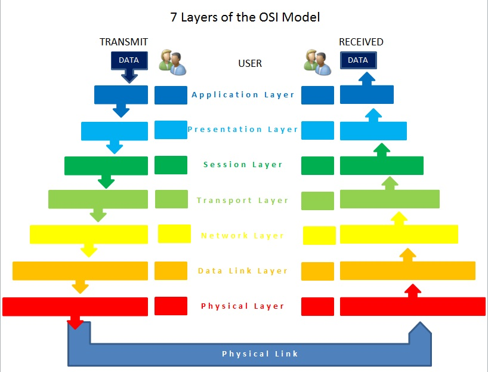
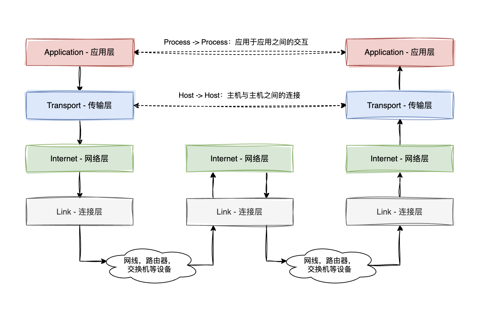
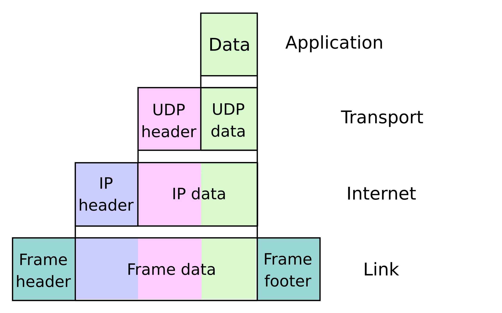

# 网络模型

网络模型按职责拆分通信过程。本文负责层级对应、封装和设备分工。

## 1. 面试核心 {#core}

- **分层对应。** OSI 分为七层，TCP/IP 的应用层涵盖 OSI 的上三层职责。[卡](#osi-vs-tcpip)
- **转发职责。** IP 负责跨网络转发，链路层负责当前链路上的帧传输。
- **协议封装。** TCP 段封装进 IP 包，IP 包再封装进链路帧。[卡](#encapsulation-hop)
- **负载均衡层次。** 四层负载均衡使用传输信息，七层负载均衡解析应用协议。

## 2. 概述 {#概述}

### 2.1 网络模型的作用 {#网络模型的作用}

分层让上层通过接口使用下层能力。协议负责对等实体之间的通信规则。接口负责同一系统内相邻层的调用关系。

### 2.2 OSI 与 TCP/IP 模型 {#osi-与-tcpip-模型}

OSI 是七层参考模型。TCP/IP 描述互联网协议族的分层。两者按职责作近似映射，各层实现并非一一对应。

## 3. OSI 七层模型 {#osi-七层模型}

### 3.1 OSI 模型的设计原则 {#osi-模型的设计原则}

每层承担明确职责，并通过接口向上提供服务。分层用于组织通信功能。具体实现可以跨越多个层级。

### 3.2 OSI 各层 {#osi-各层}

| 层级 | 职责 |
| --- | --- |
| 7 应用层 | 向应用提供通信服务，例如请求与响应。 |
| 6 表示层 | 处理数据表示、编码和语法转换。 |
| 5 会话层 | 管理对话、同步点与恢复。 |
| 4 传输层 | 提供端到端传输服务。 |
| 3 网络层 | 处理逻辑寻址与跨网络转发。 |
| 2 数据链路层 | 在相邻节点之间组织和传输帧。 |
| 1 物理层 | 通过电、光或无线信号传送比特。 |

表示层涉及传输语法，与用户界面展示不同。会话层描述通信对话，Web 登录 Session 属于应用概念。TCP/IP 应用会自行组织这些功能。

### 3.3 OSI 模型示意图 {#osi-模型示意图}



作者 MrsValdry，CC BY-SA 3.0，https://commons.wikimedia.org/w/index.php?curid=16941456

## 4. TCP/IP 四层模型 {#tcpip-四层模型}

### 4.1 TCP/IP 模型的来源 {#tcpip-模型的来源}

RFC 1122 按链路、IP、传输和应用组织互联网主机要求。五层教学模型进一步拆开链路层与物理层。

### 4.2 TCP/IP 各层 {#tcpip-各层}

| TCP/IP 层 | 协议或功能 | OSI 的近似对应 |
| --- | --- | --- |
| 应用层 | HTTP、DNS 等应用协议。 | 应用、表示、会话层。 |
| 传输层 | TCP 字节流和 UDP 数据报。 | 传输层。 |
| 网络层 | IP 寻址、路由和 ICMP。 | 网络层。 |
| 链路层 | 当前链路的访问与传输。 | 数据链路、物理层。 |

### 4.3 TCP/IP 模型示意图 {#tcpip-模型示意图}



### 4.4 层级之间的交互 {#层级之间的交互}

以 HTTP/1.1 通过 TCP 发送为例：

```text
HTTP 消息
  → TCP 头 + TCP 数据
    → IP 头 + IP 负载
      → 以太网头 + IP 包 + 帧校验序列
```

接收端按协议字段识别上层负载，再逐层解析。以太网还增加帧尾校验，并非每层都只增加头部。物理层最终把比特编码成信号。



作者 en:User:Cburnett original work, colorization by en:User:Kbrose，CC BY-SA 3.0，https://commons.wikimedia.org/w/index.php?curid=1546338

## 5. 逐跳处理与设备分工 {#逐跳处理与设备分工}

二层交换机按 MAC 转发表转发帧。路由器解析目标 IP，再为下一跳重新封装链路帧。TTL 或 Hop Limit 也随转发递减。

未发生 NAT 时，路由后的源和目标 IP 保持不变。链路头随下一跳更换。具体下一跳解析见 [IP](./ip.mdx#地址与逐跳转发)。

交换机和路由器的名称描述其主要功能。支持三层路由的交换机也能执行 IP 转发。判断设备行为应看实际启用的功能。

## 6. 四层与七层负载均衡 {#四层与七层负载均衡}

四层负载均衡按 IP、端口和传输连接信息转发。七层负载均衡解析 HTTP 等应用协议。它能依据 Host、路径和请求头选择后端。

七层代理也能按客户端 IP 制定规则。因此“按来源路由”无法单独判定属于四层。判定依据是转发决策使用的协议层和处理模型。

对 HTTPS 按路径路由，需要先终止 TLS 以读取 HTTP。TLS 透传可以保留端到端加密，但读取不到加密路径。SNI 预读属于额外的握手信息解析能力。

七层代理还可做鉴权、重写和协议级观测。代价是处理应用协议及维护代理连接。

## 7. 面试题 {#面试题}

### 7.1 OSI 与 TCP/IP 模型如何对应，四层和七层负载均衡怎样区分 {#osi-vs-tcpip}


**考察重点**

- 两种分层模型的职责与近似映射。
- 封装、解封装和同层协议字段。
- 四层与七层负载均衡可读取的信息和适用场景。

**相关内容**：[OSI 七层模型](#osi-七层模型)至[四层与七层负载均衡](#四层与七层负载均衡)。

<details>
<summary>参考回答</summary>

**OSI 划分为七层，TCP/IP 常按四层描述。**

TCP/IP 应用层涵盖 OSI 的上三层职责。链路层涵盖数据链路与物理传输，其他层按职责近似对应。

四层负载均衡依据地址、端口和传输状态。七层负载均衡解析应用协议，可按 HTTP 路径路由。七层同样能使用客户端 IP，来源规则并非四层专属。

</details>

### 7.2 数据经过路由器时，哪些封装信息会变化？ {#encapsulation-hop}

<!-- 本题为本站原理自测，尚未核验对应公司面经，不作公司归属。 -->


**考察重点**：帧封装、网络转发与端到端地址。

**相关内容**：[层级之间的交互](#层级之间的交互)、[逐跳处理与设备分工](#逐跳处理与设备分工)。

<details>
<summary>参考回答</summary>

**路由器移除入站链路封装，再封装下一跳链路帧。**

链路源和目标地址随之变化，TTL 或 Hop Limit 递减。未发生 NAT 时，源和目标 IP 保持不变。路由器根据目的 IP 选择下一跳。

</details>

## 8. 参考资料 {#参考资料}

- [RFC 1122：Requirements for Internet Hosts](https://www.rfc-editor.org/rfc/rfc1122)
- [ISO/IEC 7498-1：OSI Basic Reference Model](https://www.iso.org/standard/20269.html)
- [ITU-T X.200：OSI Basic Reference Model](https://www.itu.int/rec/T-REC-X.200-199407-I/en)
- [NGINX：HTTP Load Balancing](https://docs.nginx.com/nginx/admin-guide/load-balancer/http-load-balancer/)
- [NGINX：TCP and UDP Load Balancing](https://docs.nginx.com/nginx/admin-guide/load-balancer/tcp-udp-load-balancer/)
