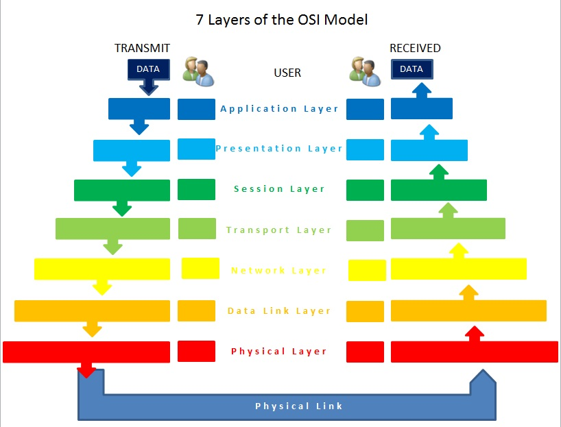
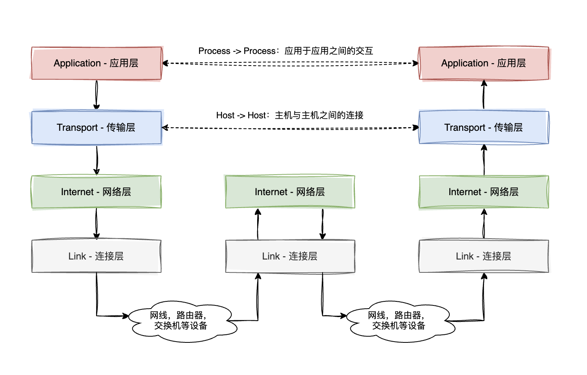
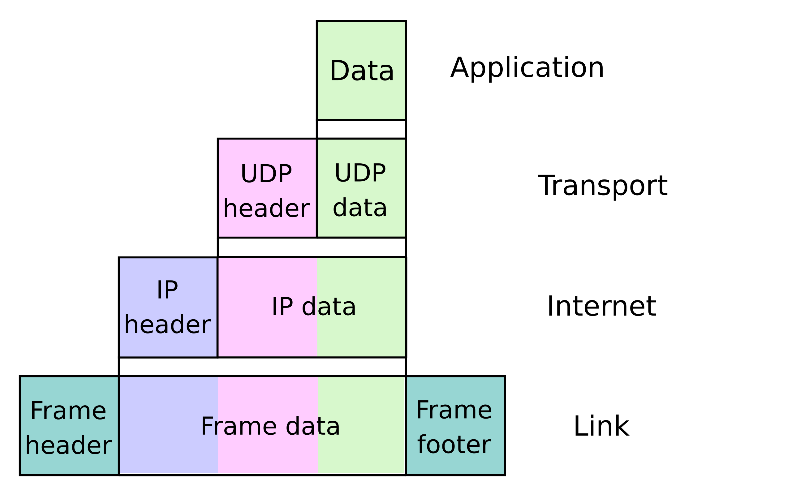

# 网络模型

**网络模型**把一次通信按职责分成几层：应用决定要交换什么内容，传输层组织端到端的数据传送，网络层选择跨网络的下一跳，链路层完成当前链路上的传输。

理解分层，重点是能沿着一次请求说清每层做了什么、设备能读到哪些信息。这样才能解释数据经过路由器时哪些地址会变，以及为什么按 HTTP 路径分流需要七层负载均衡。

## 1. 面试核心 {#core}

- OSI 分为七层，TCP/IP 常分为四层；TCP/IP 的应用层涵盖 **OSI 应用、表示和会话三层的职责**，两种模型按职责近似对应。[卡](#osi-vs-tcpip)
- 发送数据时，**TCP 段封装进 IP 包，IP 包再封装进链路帧**；接收端按相反方向解析。
- 常规收包先由**网卡按配置过滤、DMA 写入主存，再由驱动和协议栈交给 socket**；网卡放行不等于应用已经取得数据。[卡](#nic-to-process)
- IP 负责跨网络转发，链路层负责当前链路上的传输。**路由器会为下一跳重新封装链路帧**；没有 NAT 时，源和目标 IP 保持不变。[卡](#encapsulation-hop)
- 四层负载均衡使用地址、端口等传输信息；七层负载均衡**解析应用协议**，因此能按 HTTP 路径选择后端。

## 2. 概述 {#概述}

### 2.1 网络模型的作用 {#网络模型的作用}

分层让上层直接使用下层提供的能力，不必自己完成整条通信链路。例如，HTTP 需要发送消息，可以使用 TCP 提供的字节流，不必自己处理丢包重传。

这里要分清两个概念：**协议**约定通信双方怎样理解同一层的数据，例如两端都按 TCP 规则解释序列号；**接口**约定同一台主机内，相邻层怎样调用和交付数据。协议连接的是通信双方，接口连接的是本机的不同层。

### 2.2 OSI 与 TCP/IP 模型 {#osi-与-tcpip-模型}

**OSI** 是描述通信职责的七层参考模型，**TCP/IP 模型**则按互联网协议族划分层次。两者可以按职责近似对应，但不要求实际软件也拆成同样数量的模块。

## 3. OSI 七层模型 {#osi-七层模型}

### 3.1 OSI 模型的设计原则 {#osi-模型的设计原则}

OSI 的每一层承担一组职责，并把能力通过接口交给上一层使用。这样可以分别讨论数据表示、可靠传输、寻址等问题。它描述的是功能分工，具体实现可以在同一个模块里完成多个层级的工作。

### 3.2 OSI 各层 {#osi-各层}

| 层级 | 职责 |
| --- | --- |
| 7 应用层 | 向应用提供通信服务，例如请求与响应。 |
| 6 表示层 | 处理数据表示、编码和语法转换。 |
| 5 会话层 | 管理对话、同步点与恢复。 |
| 4 传输层 | 提供端到端传输服务。 |
| 3 网络层 | 处理逻辑寻址与跨网络转发。 |
| 2 数据链路层 | 在相邻节点之间组织和传输帧。 |
| 1 物理层 | 通过电、光或无线信号传送比特。 |

表里的「表示」指数据怎样编码、双方怎样理解同一份数据，不是页面怎样显示；「会话」指通信对话的管理，也不能直接等同于 Web 登录后的 Session。TCP/IP 模型把这些职责归入应用层，由应用协议和程序自行组织。

### 3.3 OSI 模型示意图 {#osi-模型示意图}



作者 MrsValdry，CC BY-SA 3.0，https://commons.wikimedia.org/w/index.php?curid=16941456

## 4. TCP/IP 四层模型 {#tcpip-四层模型}

### 4.1 TCP/IP 模型的来源 {#tcpip-模型的来源}

TCP/IP 四层模型按应用、传输、网络和链路划分通信职责，RFC 1122 也按这些层次组织互联网主机要求。教学中还会看到五层模型，它把四层模型中的链路部分进一步拆成数据链路层和物理层，便于分别讨论帧和信号。

### 4.2 TCP/IP 各层 {#tcpip-各层}

| TCP/IP 层 | 协议或功能 | OSI 的近似对应 |
| --- | --- | --- |
| 应用层 | HTTP、DNS 等应用协议。 | 应用、表示、会话层。 |
| 传输层 | TCP 字节流和 UDP 数据报。 | 传输层。 |
| 网络层 | IP 寻址、路由和 ICMP。 | 网络层。 |
| 链路层 | 当前链路的访问与传输。 | 数据链路、物理层。 |

### 4.3 TCP/IP 模型示意图 {#tcpip-模型示意图}



### 4.4 层级之间的交互 {#层级之间的交互}

**封装**是把上层交下来的数据作为本层的负载，再加上本层需要的控制信息。例如，HTTP/1.1 消息通过 TCP 发送时，TCP 把字节组织成段，IP 再把 TCP 段作为自己的负载：

```text
HTTP 消息
  → TCP 头 + TCP 数据
    → IP 头 + IP 负载
      → 以太网头 + IP 包 + 帧校验序列
```

每一层增加的信息都有用途：TCP 头帮助接收端确认和排序字节，IP 头提供寻址信息，以太网头说明当前链路上交给谁。以太网还增加帧尾校验，所以封装不只是添加头部。物理层最后把这些比特编码成电、光或无线信号。

接收端做相反的事：解析链路帧，取出 IP 包，再按包里的协议字段交给 TCP，最终把收到的字节交给应用。这一过程叫**解封装**。



作者 en:User:Cburnett original work, colorization by en:User:Kbrose，CC BY-SA 3.0，https://commons.wikimedia.org/w/index.php?curid=1546338

### 4.5 从网卡接收数据到 socket {#从网卡接收数据到socket}

**网卡接收、写入主存和交给应用，是接收路径上的不同阶段。** 以下以常见以太网网卡和 Linux 常规协议栈为例，不把某一型号的内部电路或驱动细节当成所有设备的统一实现。

网卡可以先依据驱动配置的接收规则过滤帧，包括本机的单播 MAC、广播以及需要接收的组播。这里的 MAC 地址判断可以由网卡硬件完成，不是只有进入内核软件后才能做。混杂模式会放宽接收范围；组播过滤能力、VLAN 过滤和虚拟化配置也会影响哪些帧交给主机。因此，“不是本机单播 MAC 就一定丢弃”并不成立，硬件放行也不代表最终会交给本机应用。

**接收描述符**是驱动与网卡共享的接收管理记录，用来描述可写入的缓冲区，并让驱动识别设备完成的工作。常见接收路径如下：

| 阶段 | 主要工作 |
| --- | --- |
| 驱动准备 | 在主存准备接收缓冲，建立设备可用的 DMA 映射，把缓冲地址等信息填入接收描述符，交给网卡使用 |
| 网卡接收 | 接收并按配置过滤帧，将获准接收的数据通过 DMA 写入对应的主存缓冲，更新完成状态、长度等信息 |
| 驱动处理完成 | CPU 运行驱动，检查完成描述符、同步并整理缓冲，处理错误，再把包交给内核网络接收路径，同时补充后续可用缓冲 |
| 协议栈交付 | 解析链路类型与 IP、TCP 或 UDP 等头部，执行路由、协议状态和必要校验；属于本机且满足协议条件的数据才可能进入对应 socket 的接收队列 |
| 应用读取 | 应用通过 `recv` 等接口取得数据；普通接收通常还涉及从内核到用户缓冲的交付，不等于网卡直接写好了应用对象 |

描述符常组织成环形队列，但描述符本身和它指向的数据缓冲不是同一对象。网卡片内缓冲也不等于主存接收缓冲。DMA 地址由驱动通过相应接口取得，经过 IOMMU 时还可能需要地址转换，不能直接把应用的虚拟地址填给设备使用。

Linux 的 **NAPI** 用于组织网络接收、发送完成等事件的处理。常见方式是中断通知后调度驱动的轮询函数，在预算范围内批量处理已接收的数据；它也支持不先经过一次设备中断的轮询方式。因此，不必每收到一个包就产生一次中断。DMA 负责数据搬运、CPU 负责驱动和协议处理的分工，见 [I/O 模型](../operating-system/io-models.mdx#cpu-dma与设备完成)，这里不再重复整套 I/O 分类。

最后，目标 MAC 只帮助判断链路上的接收对象，不能定位应用进程。IP 层还要判断本地交付还是转发，传输层结合协议、地址、端口和连接状态查找 socket；不满足条件时可能丢弃或按协议返回错误。对于 TCP，应用读到的是整理后的字节流，一个 `recv` 与一个网卡收到的帧没有一一对应关系。设备卸载、XDP 或用户态网络路径会改变部分步骤，不能由这条常规路径推断固定复制次数或所有收包场景。

## 5. 逐跳处理与设备分工 {#逐跳处理与设备分工}

二层交换机主要看帧中的目标 MAC 地址，按 MAC 转发表决定从哪个端口发出。路由器则取出 IP 包，根据目标 IP 选下一跳，再为下一段链路重新封装帧。

例如，主机把发往远端服务器的包先交给网关，当前帧的目标 MAC 是网关，而 IP 包里的目标地址仍是服务器。网关继续转发时，帧中的链路地址会换成下一跳对应的地址；未发生 NAT 时，源和目标 IP 不变，TTL 或 Hop Limit 则随路由转发递减。下一跳的地址怎样获得，见 [IP](./ip.mdx#地址与逐跳转发)。

设备名称只描述主要功能。支持三层路由的交换机也能转发 IP 包，所以判断设备处理哪一层，要看实际启用了什么功能。

## 6. 四层与七层负载均衡 {#四层与七层负载均衡}

**四层负载均衡**依据 IP、端口和传输连接信息分配流量；**七层负载均衡**还会解析 HTTP 等应用协议，可以根据 `Host`、路径和请求头选择后端。例如，把 `/orders` 转给订单服务、把 `/users` 转给用户服务，需要读取 HTTP 路径。

对于 HTTPS，代理必须先终止 TLS，也就是由它完成 TLS 握手并解密，才能读到路径。如果只是把 TLS 流量原样转发给后端，代理就读不到加密后的 HTTP 内容。部分代理可以预读 TLS 握手中的 SNI（目标服务器名称），但这不等于已经能读到 HTTP 路径。

七层代理也能按客户端 IP 制定规则，因此仅凭「按来源路由」不能判断它属于四层。区别在于是否解析应用协议，以及按什么信息决定转发。七层代理可以进一步做鉴权、请求重写和应用指标统计，代价是解析协议并维护两端连接。

## 7. 面试题 {#面试题}

### 7.1 OSI 与 TCP/IP 模型如何对应，四层和七层负载均衡怎样区分 {#osi-vs-tcpip}

**考察重点**

- 两种分层模型的职责与近似映射。
- 封装、解封装和同层协议字段。
- 四层与七层负载均衡可读取的信息和适用场景。

**相关内容**：[OSI 七层模型](#osi-七层模型)至[四层与七层负载均衡](#四层与七层负载均衡)。

<details>
<summary>参考回答</summary>

**TCP/IP 应用层对应 OSI 的上三层职责，链路层涵盖数据链路和物理传输；四层与七层负载均衡的区别在于是否解析应用协议。**

OSI 的传输层、网络层分别与 TCP/IP 的同名层近似对应。这是职责上的对应，不要求实现也按层一一拆分。

四层负载均衡依据地址、端口和传输状态分配流量；七层负载均衡能读取 HTTP 等应用协议，因此可以按路径选择后端。七层也能使用客户端 IP，不能仅凭来源规则判断层级。HTTPS 的路径经过加密，代理需要先终止 TLS 才能读取。

</details>

### 7.2 数据经过路由器时，哪些封装信息会变化？ {#encapsulation-hop}

<!-- 本题为本站原理自测，尚未核验对应公司面经，不作公司归属。 -->

**考察重点**：帧封装、网络转发与端到端地址。

**相关内容**：[层级之间的交互](#层级之间的交互)、[逐跳处理与设备分工](#逐跳处理与设备分工)。

<details>
<summary>参考回答</summary>

**链路封装会按下一跳重新生成，TTL 或 Hop Limit 递减；没有 NAT 时，源和目标 IP 保持不变。**

路由器先移除收到的链路封装，根据 IP 包里的目标地址查路由表，再用下一跳的链路地址封装新帧。因此，下一跳会变，数据报最终要去的 IP 地址不会随每次路由转发一起改变。

</details>

### 7.3 数据从网卡怎样到达应用，网卡如何判断是否接收？ {#nic-to-process}

**考察重点**：接收过滤、描述符与缓冲、DMA、驱动和协议栈的职责。

**相关内容**：[从网卡接收数据到 socket](#从网卡接收数据到socket)、[I/O 模型：CPU、DMA 与设备完成](../operating-system/io-models.mdx#cpu-dma与设备完成)。

<details>
<summary>参考回答</summary>

**常见以太网网卡先按驱动配置的 MAC、组播等规则过滤，再通过 DMA 把数据写入主存接收缓冲；CPU 随后运行驱动和协议栈。** 混杂模式等配置会放宽过滤，不能只用“目标 MAC 是否等于本机单播地址”概括全部接收条件。

驱动事先准备缓冲和描述符，完成后检查状态、处理错误并交给协议栈；NAPI 可以结合中断与批量轮询，不要求一个包一次中断。协议栈再根据地址、端口和协议状态交给 socket，应用调用读取接口取得数据。TCP 字节流和链路帧不一一对应，网卡接收成功也不代表某个进程已经读完。

</details>

## 8. 参考资料 {#参考资料}

- [RFC 1122：Requirements for Internet Hosts](https://www.rfc-editor.org/rfc/rfc1122)
- [ISO/IEC 7498-1：OSI Basic Reference Model](https://www.iso.org/standard/20269.html)
- [ITU-T X.200：OSI Basic Reference Model](https://www.itu.int/rec/T-REC-X.200-199407-I/en)
- [NGINX：HTTP Load Balancing](https://docs.nginx.com/nginx/admin-guide/load-balancer/http-load-balancer/)
- [NGINX：TCP and UDP Load Balancing](https://docs.nginx.com/nginx/admin-guide/load-balancer/tcp-udp-load-balancer/)
- [Linux 6.6：NAPI，事件处理与轮询预算](https://docs.kernel.org/6.6/networking/napi.html)
- [Linux 6.6：Dynamic DMA mapping Guide，设备地址与主存缓冲](https://docs.kernel.org/6.6/core-api/dma-api-howto.html)
- [Linux 6.6：e1000 驱动，接收过滤、描述符和协议栈交付的一个实现](https://github.com/torvalds/linux/blob/v6.6/drivers/net/ethernet/intel/e1000/e1000_main.c)
