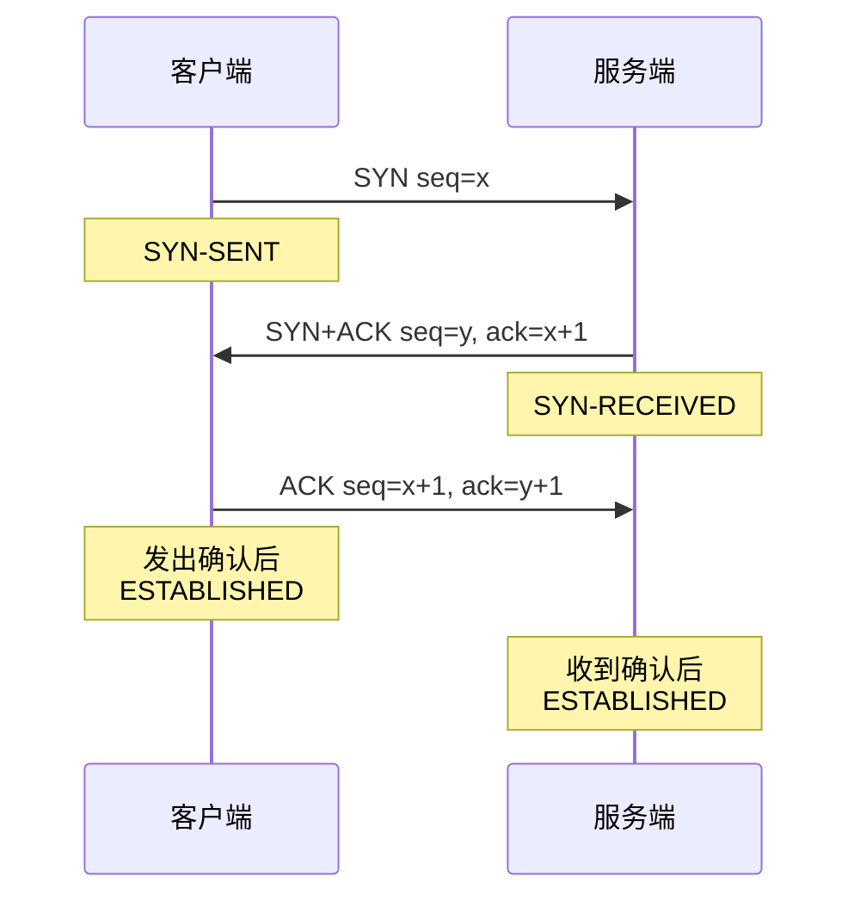
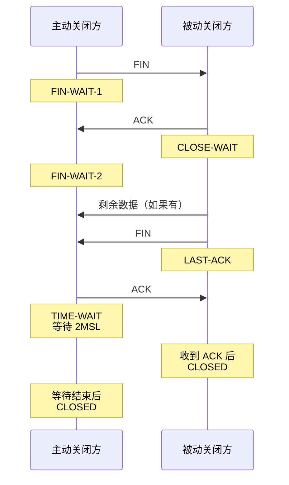

# TCP 连接

TCP 建立连接时，通过三次握手交换并确认双方的初始序列号；关闭时，两个发送方向分别结束。连接状态记录的就是这些步骤进行到了哪里。

理解握手和关闭，不能只记住报文数量，还要能解释每一步在等待谁。这样遇到第三次 ACK 丢失、`TIME_WAIT` 或 `CLOSE_WAIT` 堆积时，才能判断是在等待网络确认，还是本地应用尚未完成处理。

## 1. 面试核心 {#core}

- 握手让双方确认初始序列号。SYN 占用一个序列号，**第三次 ACK 让服务端知道自己的 SYN 已被客户端收到**。[卡](#three-way-handshake-time-wait)
- 客户端发出第三次 ACK 后进入 `ESTABLISHED`，服务端则要**收到有效 ACK 后才进入 `ESTABLISHED`**，因此两端状态可能暂时不同。[卡](#lost-handshake-ack)
- FIN 只表示**本端不再发送数据**，另一个方向仍可继续发送。两个方向分别关闭，确认对端的 ACK 与本端的 FIN 可以合并。[卡](#half-close-reset)
- 常规单方主动关闭时，主动关闭者进入 `TIME_WAIT` 等待 `2MSL`，以便**响应 FIN 重传，并让旧报文失效**。[卡](#three-way-handshake-time-wait)
- `CLOSE_WAIT` 表示已收到对端 FIN，**本地应用还没有关闭发送方向**；它持续堆积时，要检查应用关闭路径。`TIME_WAIT` 则要结合短连接频率和实际资源压力判断。[卡](#connection-states)

## 2. TCP 连接状态 {#1-tcp-连接保存双方状态}

TCP 连接是双方为一次通信维护的一组状态，包括序列号、确认号、接收窗口和当前连接状态。序列号标识字节的位置，确认号说明已经连续收到哪里，接收窗口说明还能接收多少数据；这些信息让双方能够确认、重传并按序交付字节。

建立连接时需要完成两件事：

1. 确认客户端到服务端、服务端到客户端的通信路径可用。
2. 双方交换并确认初始序列号，为两个方向的字节编号确定起点，并结合序列号检查等机制区分新旧连接的数据。

**全双工**表示两个方向都能发送数据，而且可以同时发送。结束时，一个方向发完了，不代表另一个方向也发完，所以关闭必须分别处理。

## 3. 三次握手与初始序列号 {#2-三次握手同步初始序列号}

三次握手让双方各自发出一个 SYN，并确认对方的 SYN。**初始序列号**是本端这一方向的编号起点，下图分别用 `x` 和 `y` 表示：

假设客户端初始序列号为 `x`，服务端初始序列号为 `y`：

1. 客户端发送 `SYN`，序列号为 `x`，进入 `SYN-SENT`。
2. 服务端回复 `SYN + ACK`，序列号为 `y`，确认号为 `x + 1`，进入 `SYN-RECEIVED`。
3. 客户端回复 `ACK`，确认号为 `y + 1`，客户端进入 `ESTABLISHED`；服务端收到有效 ACK 后才进入 `ESTABLISHED`。

`SYN` 会占用一个序列号，因此确认号在对方序列号基础上加一。不带数据的 ACK 不占序列号。第三个报文可以同时携带应用数据。服务端收到该 ACK 后，才能确认自己的 SYN 和初始序列号已被接收。

## 4. 第三次握手的作用 {#3-两次交互无法完成双方确认}

第三次 ACK 让服务端确认：客户端已经收到并接受了本次连接的服务端初始序列号。只有前两步时，客户端能通过 SYN+ACK 知道自己的 SYN 已到达；服务端却还不知道自己的 SYN 是否到达客户端。

例如，一个旧 SYN 在网络中延迟很久才到达，服务端会回复 SYN+ACK。但原客户端并没有发起这次新连接，就不会按新的服务端序列号正常完成确认。服务端等待第三次有效 ACK，便不会仅凭这个旧请求进入已建立状态、分配完整连接资源。

握手只确认建连时的状态，不保证后续网络一直可用。数据传输仍要靠序列号、确认和重传处理丢包，靠拥塞控制调节发送速度。

## 5. 四次挥手与双向关闭 {#4-四次挥手分别关闭两个方向}

关闭连接需要分别结束两个发送方向。FIN 表示「我的数据发完了」，收到它的一方可以先确认，再继续发送自己的剩余数据：

以客户端主动关闭为例：

1. 客户端发送 `FIN`，表示客户端已经没有更多数据发送，进入 `FIN-WAIT-1`。
2. 服务端确认该 `FIN`，进入 `CLOSE-WAIT`；客户端收到 ACK 后进入 `FIN-WAIT-2`。此时服务端仍可以继续发送剩余数据。
3. 服务端应用完成发送并关闭连接后，服务端发送自己的 `FIN`，进入 `LAST-ACK`。
4. 客户端确认服务端的 `FIN`，进入 `TIME-WAIT`；服务端收到最后的 ACK 后关闭连接。

第二步的 ACK 与第三步的 FIN 可以合并在一个报文中，所以抓包时不一定总能看到四个独立报文。「四次挥手」描述的是两个方向各自发送 FIN、各自获得确认的逻辑过程。FIN 和 SYN 一样占用一个序列号，确认时也要把它计入。

## 6. TIME_WAIT 与 CLOSE_WAIT {#5-time_wait-与-close_wait-指向不同问题}

`TIME_WAIT` 是关闭过程中的等待状态。常规单方主动关闭时，主动关闭者在自己的 FIN 已获确认、又收到并确认对端 FIN 后进入这个状态，等待 `2MSL`。**MSL** 是报文最大生存时间，不是一次往返耗时 RTT；具体计时值由实现决定。

这段等待有两个作用：如果最后的 ACK 丢失，对端会重传 FIN，主动关闭者仍能再次确认；旧连接中迟到的报文也有时间从网络中消失，避免干扰随后使用相同四元组的连接。这里的四元组指源 IP、源端口、目标 IP 和目标端口。

`CLOSE_WAIT` 则是在等本地应用关闭。被动关闭方收到 FIN 后进入这个状态，说明对端已经停止发送，但本地还没有结束自己的发送方向。短暂出现属于正常过渡；持续堆积时，要检查应用是否漏了 socket 释放，或负责关闭的线程是否被阻塞。

客户端和服务端都可以主动关闭，双方也可能同时发送 FIN。如果自己的 FIN 还没被确认就先收到对端 FIN，会进入 `CLOSING`；等自己的 FIN 获得确认后，再进入 `TIME-WAIT`。这种情况下，两端都可能处于 `TIME_WAIT`。

### 6.1 TIME_WAIT 的资源压力与连接复用 {#time_wait-的资源压力与连接复用}

`TIME_WAIT` 多不一定是故障，它的数量随连接关闭速率和等待时长增长。先用 `ss -tan state time-wait` 确认主动关闭端和目标分布，再检查是否真的出现临时端口耗尽、内存压力或连接失败。只有数量高而没有资源压力时，可以保留正常等待。

确实有压力时，优先减少连接创建和关闭频率。HTTP keep-alive、HTTP/2 多路复用和数据库连接池都让多个请求复用连接，从而减少需要等待关闭的连接。

Linux 的 `net.ipv4.tcp_tw_reuse` 允许在协议安全条件下，为新连接复用 `TIME_WAIT` socket，主要用于主动发起连接的一端。相关检查涉及 TCP timestamps 和等待时间，具体条件及效果需要结合目标内核和实际网络路径验证。

`tcp_tw_recycle` 的旧实现则依赖同一对端地址的时间戳单调递增。NAT 后的多台主机共用公网地址，时间戳却可能不同，因此会破坏这个假设。Linux 4.12 已经删除这个参数，新内核上设置它会报找不到 `/proc/sys/net/ipv4/tcp_tw_recycle`。不能把它与 `tcp_tw_reuse` 当成同一种机制。另一个参数 `tcp_fin_timeout` 管理的是孤儿 `FIN_WAIT_2` 的等待，也就是应用已不再持有、但仍等待对端 FIN 的连接，不控制 `TIME_WAIT` 的计时。

## 7. 握手丢包与半连接 {#握手丢包与半连接}

握手报文丢失时，要分别看两端已经走到哪一步。尤其第三次 ACK 丢失后，客户端已经认为连接建立，服务端却仍在等待：

| 丢失位置 | 典型状态与恢复 | 排查关注点 |
| --- | --- | --- |
| 初始 SYN | 客户端仍在 SYN-SENT，等待重传或超时 | 网络可达性、监听端口、防火墙 |
| SYN+ACK | 客户端还未收到应答，双方按各自定时器重传 SYN 或 SYN+ACK | 返回路径、半连接积压 |
| 第三次 ACK | 客户端已进入 ESTABLISHED，服务端仍在 SYN-RECEIVED；服务端重传 SYN+ACK，客户端再次确认 | 分别观察两端状态与服务端队列 |

纯 ACK 没有独立的重传定时器，所以第三次 ACK 丢了，并不是客户端到点就重发它。服务端重传 SYN+ACK 后，客户端才会再次确认；后续数据若携带有效确认，也能让服务端完成握手。重试次数、退避和最终超时由协议实现及配置决定。

**SYN flood** 是大量发起却不完成握手的连接请求，让服务端持续承受半连接处理压力。SYN cookies、速率限制和合理的队列配置可以减少这类压力；如果带宽已经耗尽，还需要上游限制攻击流量。排查时要分清是在等待握手，还是握手已经完成、但应用来不及接收连接。

### 7.1 SYN 队列与 accept 队列 {#syn-队列与-accept-队列}

Linux 监听 socket 的两类队列对应不同等待阶段：**SYN 半连接队列**保存尚未完成握手的请求，**accept 全连接队列**保存已完成握手、等待应用调用 `accept()` 取走的连接。

| 队列 | 等待条件 | 相关配置 |
| --- | --- | --- |
| SYN 半连接队列 | 服务端已发 SYN+ACK，等待有效 ACK | `net.ipv4.tcp_max_syn_backlog`；SYN cookies 启用并触发时改变状态保存方式 |
| accept 全连接队列 | 握手完成，等待应用 accept | `listen(fd, backlog)`，上限受 `net.core.somaxconn` 截断 |

Linux 的 `listen()` 参数 `backlog` 指完成握手后的等待队列长度。例如，应用传入 1024、`somaxconn=4096` 时，配置按 1024 生效；应用传入 8192 时，会被上限截到 4096。这个参数约束的是等待应用接收的连接，已经被 `accept()` 取走的活跃连接数量，还要看应用和系统资源。

SYN cookies 在触发时把握手信息编码进 SYN+ACK，减少保存半连接状态的压力，但不能解决应用来不及 `accept()` 的问题。后者需要检查应用接收速度。可以用 `ss -lnt` 查看监听队列，再结合 `TcpExtListenOverflows`、`TcpExtListenDrops` 等指标，区分握手积压与应用接收不足。

## 8. 半关闭、复位与业务完成 {#半关闭复位与业务完成}

**半关闭**是只结束一个方向、保留另一个方向。调用 `shutdown(SHUT_WR)` 后，本端不再发送，却仍能接收；对端读完此前的数据后读到 EOF，知道本端已经发完，但仍可以把结果发回来。

FIN 表示按序结束一个发送方向，RST 则直接复位连接，应用会按连接错误处理，不能把它当作正常的数据结束。

ACK 和 FIN 都不能证明业务已经成功。ACK 只确认对端协议栈收到字节，FIN 只标记发送方向结束；订单是否创建、数据是否持久化，要由应用层响应说明。因此，应用协议还需要定义业务结果、超时、请求标识和重试规则。

## 9. 常见问题 {#6-常见问题}

### 9.1 为什么建立连接通常是三次交互，关闭通常是四次？ {#61-为什么建立连接通常是三次关闭通常是四次}

因为建立连接时，服务端可以把确认客户端 SYN 的 ACK 与自己的 SYN 合并发送；关闭时，确认对方发完与自己发完，却不一定发生在同一时刻。收到 FIN 的一方可以先回 ACK，等剩余数据发完后再发送自己的 FIN，于是表现为四个报文。如果它也已经发完，ACK 和 FIN 仍然可以合并。

### 9.2 收到 FIN 就表示应用已经处理完数据了吗？ {#62-收到-fin-是否表示连接中的数据都处理完了}

不是。FIN 位于此前数据之后，只说明发送方不会再发送新的字节。接收端协议栈会按序交付数据，但应用还可能没有读完缓冲区，也可能尚未完成业务处理，资源仍需要由应用关闭。

## 10. 面试题 {#7-面试题}

### 10.1 为什么 TCP 建立连接需要三次握手，TIME_WAIT 有什么作用 {#three-way-handshake-time-wait}

**考察重点**

- 理解双向可达、初始序列号与连接状态。
- 理解全双工关闭、半关闭和 ACK/FIN 合并。
- 理解 TIME_WAIT、CLOSE_WAIT 与线上连接问题。

**相关内容**：[三次握手与初始序列号](#2-三次握手同步初始序列号)、[第三次握手的作用](#3-两次交互无法完成双方确认)、[TIME_WAIT 与 CLOSE_WAIT](#5-time_wait-与-close_wait-指向不同问题)。

参考回答

**三次握手让双方确认初始序列号和连接状态；TIME_WAIT 则用于处理关闭时的 FIN 重传，并等待旧报文消失。**

- 客户端发 SYN，服务端回 SYN+ACK，客户端再回 ACK。第三次报文让服务端确认自己的 SYN 已被收到，也降低旧 SYN 误建连接的风险。
- TCP 的两个方向分别用 FIN 关闭。单方主动关闭时，主动关闭者确认对端 FIN 后进入 TIME_WAIT，等待 2MSL；这时仍能响应对端重传的 FIN。

CLOSE_WAIT 表示已收到对端 FIN，但应用尚未关闭本地发送方向。它持续堆积时应检查 socket 关闭路径和阻塞线程。

### 10.2 第三次握手的 ACK 丢失，客户端和服务端分别处于什么状态？ {#lost-handshake-ack}

<!-- 本题为本站原理自测，尚未核验对应公司面经，不作公司归属。 -->

**考察重点**

- 理解两端状态变化时机。
- 理解 SYN+ACK 重传与纯 ACK。

**相关内容**：[三次握手与初始序列号](#2-三次握手同步初始序列号)、[握手丢包与半连接](#握手丢包与半连接)。

参考回答

**客户端已进入 ESTABLISHED，服务端仍停在 SYN-RECEIVED。**

纯 ACK 没有独立的重传定时器。服务端未收到确认会重传 SYN+ACK，客户端收到后再回复 ACK；后续数据携带有效 ACK 时，也能让服务端完成握手。握手完成后，服务端应用还需调用 `accept()` 才能取得连接。

### 10.3 收到 FIN 后还能发送数据吗，RST 又有什么不同？ {#half-close-reset}

<!-- 本题为本站原理自测，尚未核验对应公司面经，不作公司归属。 -->

**考察重点**

- 理解全双工与半关闭。
- 理解协议确认和业务完成。

**相关内容**：[四次挥手与双向关闭](#4-四次挥手分别关闭两个方向)、[半关闭、复位与业务完成](#半关闭复位与业务完成)。

参考回答

**可以。FIN 只结束对端的发送方向；RST 则复位整个连接，属于异常终止。**

收到 FIN 后，本端只要尚未关闭发送方向，就能继续发送剩余数据，再用自己的 FIN 结束。无论收到 ACK 还是 FIN，都不能据此认定业务已提交，仍需核对应用响应和业务结果。

### 10.4 线上 TIME_WAIT 或 CLOSE_WAIT 大量堆积，各应该先查什么？ {#connection-states}

<!-- 本题为本站原理自测，尚未核验对应公司面经，不作公司归属。 -->

**考察重点**

- 理解主动关闭与本地关闭责任。
- 理解连接复用、资源压力和调用栈。

**相关内容**：[TIME_WAIT 与 CLOSE_WAIT](#5-time_wait-与-close_wait-指向不同问题)。

参考回答

**`TIME_WAIT` 多时先查短连接频率和实际资源压力；`CLOSE_WAIT` 持续堆积时先查本地应用的关闭路径。**

`TIME_WAIT` 是正常的协议等待，应确认主动关闭端是否出现端口耗尽、内存压力或建连失败，再考虑连接复用和容量。`CLOSE_WAIT` 则说明对端已经停止发送，本地仍未关闭，需要检查异常分支是否漏关 socket，以及相关线程是否阻塞。

### 10.5 SYN 半连接队列、accept 全连接队列与 backlog 有什么关系？ {#listen-queues-backlog}

<!-- 本题为本站原理自测，尚未核验对应公司面经，不作公司归属。 -->

**考察重点**：握手阶段、应用接收与 Linux 队列容量。

**相关内容**：[SYN 队列与 accept 队列](#syn-队列与-accept-队列)。

参考回答

**SYN 队列等待完成握手，accept 队列等待应用取走已建立连接；Linux 的 `listen(backlog)` 管理后者，并受 `somaxconn` 限制。**

`backlog=8192`、`somaxconn=4096` 时被截到 4096；半连接容量还涉及 `tcp_max_syn_backlog` 与 SYN cookies。处理 accept 积压需要提升应用接收速度，SYN cookies 主要降低半连接状态压力。

### 10.6 TIME_WAIT 过多怎样处理，tcp_tw_reuse 和 tcp_tw_recycle 有什么区别？ {#time-wait-reuse}

<!-- 本题为本站原理自测，尚未核验对应公司面经，不作公司归属。 -->

**考察重点**：连接复用、主动连接端口压力与时间戳安全检查。

**相关内容**：[TIME_WAIT 的资源压力与连接复用](#time_wait-的资源压力与连接复用)。

参考回答

**优先通过 keep-alive、HTTP/2 或连接池减少短连接。**

先确认主动关闭端是否存在端口或内存压力，只有数量多不一定需要调参。`tcp_tw_reuse` 在协议安全条件下复用 `TIME_WAIT` socket，相关检查涉及时间戳和等待时间，具体行为需要按目标内核验证。`tcp_tw_recycle` 的旧机制依赖同一对端地址的时间戳单调递增，NAT 后多个主机的不同时间戳会破坏这个假设，Linux 4.12 起已删除该参数。

## 11. 参考资料 {#参考资料}

- [RFC 9293：Transmission Control Protocol](https://www.rfc-editor.org/rfc/rfc9293)
- [RFC 6528：Defending against Sequence Number Attacks](https://www.rfc-editor.org/rfc/rfc6528)
- [RFC 4987：TCP SYN Flooding Attacks](https://www.rfc-editor.org/rfc/rfc4987.html)
- [Linux man-pages：listen(2)](https://man7.org/linux/man-pages/man2/listen.2.html)
- [Linux Kernel：IP Sysctl](https://docs.kernel.org/networking/ip-sysctl.html)
- [Linux man-pages：tcp(7)](https://man7.org/linux/man-pages/man7/tcp.7.html)
- [Linux Kernel：SNMP counters](https://docs.kernel.org/networking/snmp_counter.html)
