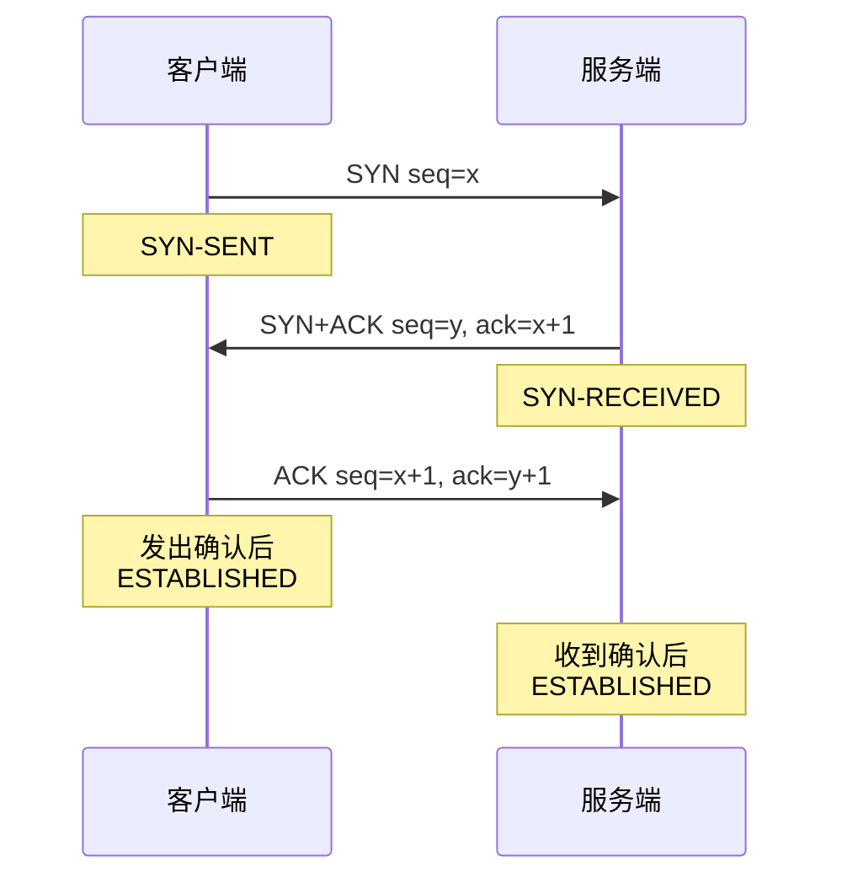
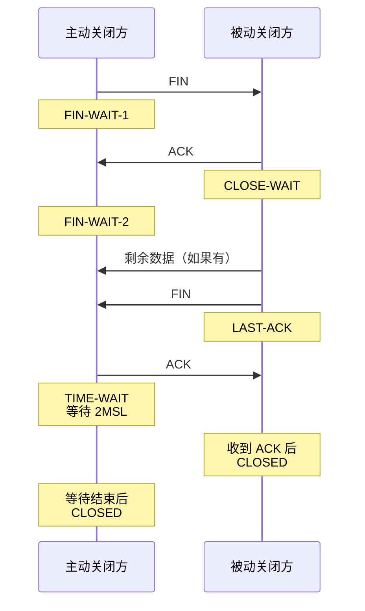

# TCP 连接

TCP 通过三次握手同步连接状态与初始序列号，通过两个方向分别关闭来释放全双工连接。本文负责握手、关闭、Linux 监听队列和 TIME_WAIT 处理。

## 1. 面试核心 {#core}

- 握手同步双方初始序列号和连接状态；SYN 占用序列号，第三次 ACK 完成服务端对确认的接收。[卡](#three-way-handshake-time-wait)
- 客户端发出第三次 ACK 后进入 ESTABLISHED，服务端收到有效 ACK 后进入 ESTABLISHED。[卡](#lost-handshake-ack)
- FIN 只关闭发送方向并占用序列号；两个方向分别关闭，ACK 与 FIN 可以合并。[卡](#half-close-reset)
- 单方主动关闭时，主动关闭者在确认对端 FIN 后进入 TIME_WAIT 等待 2MSL，以处理 FIN 重传并隔离旧报文。[卡](#three-way-handshake-time-wait)
- CLOSE_WAIT 表示已收到对端 FIN 且本地发送方向尚未关闭，TIME_WAIT 表示主动终止后的等待状态。[卡](#connection-states)

## 2. TCP 连接状态 {#1-tcp-连接保存双方状态}

TCP 向应用提供可靠、有序的字节流。通信双方需要维护序列号、确认号、接收窗口和连接状态，后续数据才能被确认、重传并按顺序交付。

建立连接时需要完成两件事：

1. 确认客户端到服务端、服务端到客户端的通信路径可用。
2. 交换双方的初始序列号，避免新连接把网络中迟到的旧报文当成当前数据。

连接是全双工的，两个方向可以独立发送数据，也可以独立结束发送。这一点决定了关闭过程需要分别处理两个方向。

## 3. 三次握手与初始序列号 {#2-三次握手同步初始序列号}

假设客户端初始序列号为 `x`，服务端初始序列号为 `y`：

1. 客户端发送 `SYN`，序列号为 `x`，进入 `SYN-SENT`。
2. 服务端回复 `SYN + ACK`，序列号为 `y`，确认号为 `x + 1`，进入 `SYN-RECEIVED`。
3. 客户端回复 `ACK`，确认号为 `y + 1`，客户端进入 `ESTABLISHED`；服务端收到有效 ACK 后才进入 `ESTABLISHED`。

`SYN` 会占用一个序列号，因此确认号在对方序列号基础上加一。不带数据的 ACK 不占序列号。第三个报文可以同时携带应用数据，但服务端必须收到该 ACK，才能确认客户端已经接收自己的 SYN 和初始序列号。

## 4. 第三次握手的作用 {#3-两次交互无法完成双方确认}

如果只有客户端的 `SYN` 和服务端的 `SYN + ACK`，客户端能够确认服务端收到了自己的请求，服务端却不知道自己的回复是否到达客户端。服务端也就无法判断对方是否接受了本次连接参数。

第三次 ACK 完成服务端方向的确认。它还可以帮助服务端区分有效的新连接与网络中迟到的旧 SYN，避免仅凭一个历史请求就进入已建立状态并分配完整连接资源。

握手建立当前连接状态，后续传输继续依赖序列号、确认、超时重传和拥塞控制。

## 5. 四次挥手与双向关闭 {#4-四次挥手分别关闭两个方向}

以客户端主动关闭为例：

1. 客户端发送 `FIN`，表示客户端已经没有更多数据发送，进入 `FIN-WAIT-1`。
2. 服务端确认该 `FIN`，进入 `CLOSE-WAIT`；客户端收到 ACK 后进入 `FIN-WAIT-2`。此时服务端仍可以继续发送剩余数据。
3. 服务端应用完成发送并关闭连接后，服务端发送自己的 `FIN`，进入 `LAST-ACK`。
4. 客户端确认服务端的 `FIN`，进入 `TIME-WAIT`；服务端收到最后的 ACK 后关闭连接。

第二步的 ACK 与第三步的 FIN 可以在同一个报文中发送，因此抓包时不一定总能看到四个独立报文。“四次挥手”描述的是两个方向各自发送 FIN 并获得确认的逻辑过程。

## 6. TIME_WAIT 与 CLOSE_WAIT {#5-time_wait-与-close_wait-指向不同问题}

常规单方主动关闭过程中，主动关闭者在自己的 FIN 已被确认、又收到对端 FIN 并回复 ACK 后进入 `TIME-WAIT`，等待 `2MSL`。MSL 是报文最大生存时间，不是一次往返的 RTT；具体计时值与实现有关。这段时间允许它在最后 ACK 丢失、对方重传 FIN 时再次回复，也让旧连接中的迟到报文从网络中消失，避免污染随后复用相同四元组的连接。

被动关闭的一方收到 FIN 后进入 `CLOSE-WAIT`。这个状态表示对端已经停止发送，本地应用还没有关闭自己的方向。少量、短暂的 `CLOSE-WAIT` 属于正常过渡；持续堆积说明应用关闭路径尚未完成，应检查 socket 释放和相关线程阻塞。

双方同时发 FIN、又在自身 FIN 被确认前收到对端 FIN 时，各自经过 `CLOSING` 后进入 `TIME-WAIT`；客户端与服务端都能承担主动关闭角色。

TIME_WAIT 数量随短连接关闭速率和等待时长增长，处理依据是端口与内存等实际资源压力。

### 6.1 TIME_WAIT 的资源压力与连接复用 {#time_wait-的资源压力与连接复用}

TIME_WAIT 多时先减少连接创建与关闭频率：HTTP keep-alive、HTTP/2 多路复用和数据库连接池可以让多个请求共享连接。用 `ss -tan state time-wait` 确认主动关闭端和目标分布，再检查临时端口耗尽、内存占用与连接失败；仅数量高且没有资源压力时，保留正常等待即可。

Linux 的 `net.ipv4.tcp_tw_reuse` 用于在协议安全条件下为新连接复用 TIME_WAIT socket，主要适用于主动发起连接的一端。Linux 6.6 的取值为 `0`（关闭）、`1`（全局启用）、`2`（仅回环，默认值）；非回环出站连接只有在确有端口压力、协商 TCP timestamps 且满足内核时间戳和等待时间检查时，才有评估 `1` 的意义。它保留协议安全检查，效果需在目标内核与实际网络路径下验证。

支持 `tcp_tw_reuse_delay` 的内核还可配置复用等待，当前内核文档默认 1000ms，并要求该值至少覆盖对端时间戳时钟的 tick 间隔，以维持 PAWS 安全性。上线前读取实际内核版本与 sysctl 值，避免将新版本参数直接套到旧内核。

`tcp_tw_recycle` 已在 Linux 4.12 移除，其旧实现对同一对端地址的时间戳作假设，会与 NAT 后多个主机及时间戳偏移冲突。TIME_WAIT 处理应使用连接复用、容量调整和有依据的 `tcp_tw_reuse` 评估；`tcp_fin_timeout` 管理孤儿 FIN_WAIT_2 等待，与 TIME_WAIT 计时分属不同机制。

## 7. 握手丢包与半连接 {#握手丢包与半连接}

| 丢失位置 | 典型状态与恢复 | 排查关注点 |
| --- | --- | --- |
| 初始 SYN | 客户端仍在 SYN-SENT，等待重传或超时 | 网络可达性、监听端口、防火墙 |
| SYN+ACK | 客户端还未收到应答，双方按各自定时器重传 SYN 或 SYN+ACK | 返回路径、半连接积压 |
| 第三次 ACK | 客户端已进入 ESTABLISHED，服务端仍在 SYN-RECEIVED；服务端重传 SYN+ACK，客户端再次确认 | 分别观察两端状态与服务端队列 |

纯 ACK 没有独立的重传定时器；通过对方重传 SYN+ACK 或后续携带有效确认的数据恢复。重试次数、退避和最终超时属于协议实现及配置，不应背成跨系统的固定常量。

SYN flood 会让服务端不断处理难以完成的连接请求。SYN cookies、限制速率和合理配置队列可降低状态分配压力；带宽耗尽还需要上游流量治理。半连接等待握手完成，与握手完成后等待应用 accept 是两个阶段，排障时要结合操作系统队列和指标。

### 7.1 SYN 队列与 accept 队列 {#syn-队列与-accept-队列}

Linux 监听 socket 有两个阶段的排队：SYN 半连接队列保存尚未完成握手的请求，accept 全连接队列保存已完成握手、等待应用 `accept()` 取走的连接。

| 队列 | 等待条件 | 相关配置 |
| --- | --- | --- |
| SYN 半连接队列 | 服务端已发 SYN+ACK，等待有效 ACK | `net.ipv4.tcp_max_syn_backlog`；SYN cookies 启用并触发时改变状态保存方式 |
| accept 全连接队列 | 握手完成，等待应用 accept | `listen(fd, backlog)`，上限受 `net.core.somaxconn` 截断 |

Linux 自 2.2 起，`listen()` 的 backlog 指完成握手后的等待队列长度。例如应用传 `backlog=1024`、`somaxconn=4096` 时按 1024 请求容量；应用传 8192 时受 4096 上限约束。它管理的是待接收连接，已经被 accept 取走的活跃连接由应用和系统资源限制。

SYN cookies 在 SYN 队列溢出等条件下将握手信息编码进 SYN+ACK，降低保存半连接状态的压力；accept 队列消费缓慢仍需改善应用接收速度。诊断时将 `ss -lnt` 的监听队列与 `TcpExtListenOverflows`、`TcpExtListenDrops` 等指标结合，分别判断握手积压和应用处理不足。

## 8. 半关闭、复位与业务完成 {#半关闭复位与业务完成}

`shutdown(SHUT_WR)` 可以结束本端发送方向，仍保留接收方向；对端读完此前数据后读取到 EOF，但仍可返回结果。`FIN` 表示有序结束这一方向，`RST` 则用于复位连接，接收应用按连接错误处理该终止。

TCP ACK 确认协议栈收到对应字节，FIN 标记发送方向结束；业务执行与持久化结果由应用层响应确认。需要端到端成功语义时，协议必须定义业务响应、超时、请求标识和重试规则。

## 9. 常见问题 {#6-常见问题}

### 9.1 握手与挥手的报文数量 {#61-为什么建立连接通常是三次关闭通常是四次}

建立连接时，服务端可以把对客户端 SYN 的 ACK 与自己的 SYN 合并，所以三个报文能够完成双方初始序列号确认。关闭时，收到 FIN 的一方先确认该方向结束，剩余数据发完后再发送自己的 FIN，分开发送时表现为四个报文。

### 9.2 FIN 与应用处理进度 {#62-收到-fin-是否表示连接中的数据都处理完了}

FIN 表示发送方不会再发送新的字节，它在序列空间中位于此前数据之后。接收端协议栈按序交付数据，应用仍需读取剩余字节、完成业务处理并关闭资源。

## 10. 面试题 {#7-面试题}

### 10.1 为什么 TCP 建立连接需要三次握手，TIME_WAIT 有什么作用 {#three-way-handshake-time-wait}

<!-- 面试来源：
- 字节跳动：https://www.nowcoder.com/discuss/353156517979430912；2026-10-13 检索结果可核对三次握手、TIME_WAIT 与 CLOSE_WAIT。
- 补充复核：https://www.nowcoder.com/discuss/353155506619490304；一面第 5—7 项。
- 原美团链接：https://www.nowcoder.com/discuss/353154541233315840；本轮未取得正文，暂不展示公司归属。
-->

**出现公司**：字节跳动

**考察重点**

- 双向可达、初始序列号与连接状态。
- 全双工关闭、半关闭和 ACK/FIN 合并。
- TIME_WAIT、CLOSE_WAIT 与线上连接问题。

**相关内容**：[三次握手与初始序列号](#2-三次握手同步初始序列号)、[第三次握手的作用](#3-两次交互无法完成双方确认)、[TIME_WAIT 与 CLOSE_WAIT](#5-time_wait-与-close_wait-指向不同问题)。

参考回答

客户端先发 SYN 和初始序列号，服务端用 SYN+ACK 确认客户端并发送自己的初始序列号，客户端最后用 ACK 让服务端确认其 SYN 已被接收。两次交互时服务端无法确认客户端是否收到自己的连接参数；三次能够同步双方状态和序列号，并降低旧 SYN 误建连接的风险。

TCP 是全双工连接，一个方向发送 FIN 后，另一个方向仍可继续发送，所以关闭需要两个 FIN 分别得到确认。常规关闭中，主动关闭方在自己的 FIN 已确认且回复对方 FIN 后进入 TIME_WAIT，用于应对对方重传 FIN，并等待旧报文消失。CLOSE_WAIT 则表示本地应用收到对端 FIN 后仍未关闭自己的方向，长期堆积应检查 socket 关闭路径和阻塞线程。

### 10.2 第三次握手的 ACK 丢失，客户端和服务端分别处于什么状态？ {#lost-handshake-ack}

<!-- 本题为本站原理自测，尚未核验对应公司面经，不作公司归属。 -->

**出现公司**：暂无已核验的公开来源（本站自测）

**考察重点**

- 两端状态变化时机。
- SYN+ACK 重传与纯 ACK。

**相关内容**：[三次握手与初始序列号](#2-三次握手同步初始序列号)、[握手丢包与半连接](#握手丢包与半连接)。

参考回答

客户端已进入 ESTABLISHED，服务端仍停在 SYN-RECEIVED。服务端未收到确认会重传 SYN+ACK，客户端再回复 ACK；后续携带有效 ACK 的数据也可完成确认。纯 ACK 由对方重传报文等事件触发再次发送，服务端应用取得连接还需要 accept。

### 10.3 收到 FIN 后还能发送数据吗，RST 又有什么不同？ {#half-close-reset}

<!-- 本题为本站原理自测，尚未核验对应公司面经，不作公司归属。 -->

**出现公司**：暂无已核验的公开来源（本站自测）

**考察重点**

- 全双工与半关闭。
- 协议确认和业务完成。

**相关内容**：[四次挥手与双向关闭](#4-四次挥手分别关闭两个方向)、[半关闭、复位与业务完成](#半关闭复位与业务完成)。

参考回答

可以。FIN 结束对端发送方向，本端在应用尚未关闭时仍可以发送剩余数据，之后才发自己的 FIN。RST 复位连接，属于异常终止语义。业务提交结果依赖应用协议响应与幂等核对。

### 10.4 线上 TIME_WAIT 或 CLOSE_WAIT 大量堆积，各应该先查什么？ {#connection-states}

<!-- 本题为本站原理自测，尚未核验对应公司面经，不作公司归属。 -->

**出现公司**：暂无已核验的公开来源（本站自测）

**考察重点**

- 主动关闭与本地关闭责任。
- 连接复用、资源压力和调用栈。

**相关内容**：[TIME_WAIT 与 CLOSE_WAIT](#5-time_wait-与-close_wait-指向不同问题)。

参考回答

TIME_WAIT 多先看谁主动关闭、是否大量短连接、四元组与端口资源是否真正受限，再考虑连接复用和容量。CLOSE_WAIT 持续存在说明本地已收到对端 FIN，但应用尚未完成关闭，应查关闭路径、异常分支和阻塞线程。两种状态分别对应关闭后的等待和应用尚未关闭的连接。

### 10.5 SYN 半连接队列、accept 全连接队列与 backlog 有什么关系？ {#listen-queues-backlog}

<!-- 本题为本站原理自测，尚未核验对应公司面经，不作公司归属。 -->

**出现公司**：暂无已核验的公开来源（本站自测）

**考察重点**：握手阶段、应用接收与 Linux 队列容量。

**相关内容**：[SYN 队列与 accept 队列](#syn-队列与-accept-队列)。

参考回答

SYN 队列等待完成握手，accept 队列等待应用取走已建立连接；Linux 的 `listen(backlog)` 管理后者，并受 `somaxconn` 限制。`backlog=8192`、`somaxconn=4096` 时被截到 4096；半连接容量还涉及 `tcp_max_syn_backlog` 与 SYN cookies。处理 accept 积压需要提升应用接收速度，SYN cookies 主要降低半连接状态压力。

### 10.6 TIME_WAIT 过多怎样处理，tcp_tw_reuse 和 tcp_tw_recycle 有什么区别？ {#time-wait-reuse}

<!-- 本题为本站原理自测，尚未核验对应公司面经，不作公司归属。 -->

**出现公司**：暂无已核验的公开来源（本站自测）

**考察重点**：连接复用、主动连接端口压力、时间戳与内核版本。

**相关内容**：[TIME_WAIT 的资源压力与连接复用](#time_wait-的资源压力与连接复用)。

参考回答

优先通过 keep-alive、HTTP/2 或连接池减少短连接，再确认主动关闭端的端口和内存压力。Linux 6.6 中 `tcp_tw_reuse=2` 默认只对回环启用；非回环出站连接评估 `1` 时，还需协商 TCP timestamps 并通过内核等待与安全检查。`tcp_tw_recycle` 因时间戳假设等问题在 Linux 4.12 移除，已无可配置项。

## 11. 参考资料 {#参考资料}

- [RFC 9293：Transmission Control Protocol](https://www.rfc-editor.org/rfc/rfc9293)
- [RFC 6528：Defending against Sequence Number Attacks](https://www.rfc-editor.org/rfc/rfc6528)
- [RFC 4987：TCP SYN Flooding Attacks](https://www.rfc-editor.org/rfc/rfc4987.html)
- [Linux man-pages：listen(2)](https://man7.org/linux/man-pages/man2/listen.2.html)
- [Linux Kernel：IP Sysctl](https://docs.kernel.org/networking/ip-sysctl.html)
- [Linux 6.6：IP Sysctl](https://www.kernel.org/doc/html/v6.6/networking/ip-sysctl.html)
- [Linux 6.6：tcp_twsk_unique](https://github.com/torvalds/linux/blob/v6.6/net/ipv4/tcp_ipv4.c)
- [Linux man-pages：tcp(7)](https://man7.org/linux/man-pages/man7/tcp.7.html)
- [Linux Kernel：SNMP counters](https://docs.kernel.org/networking/snmp_counter.html)
