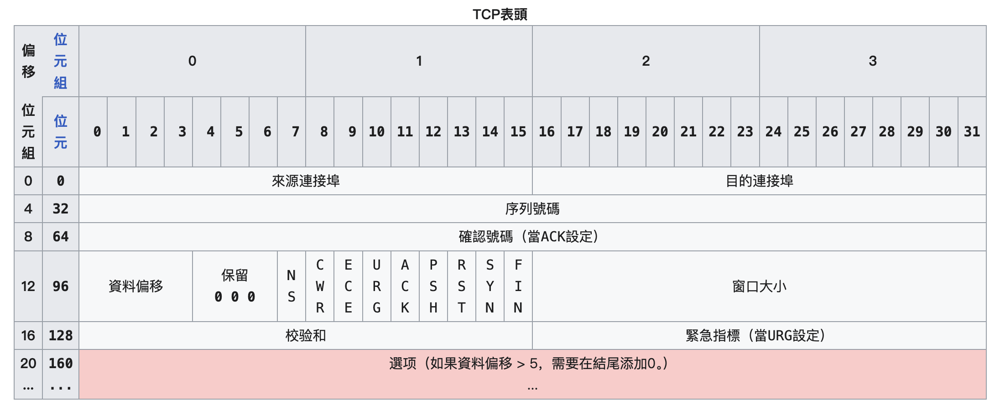

# TCP 与 UDP

TCP 提供可靠、有序的字节流。UDP 提供保留消息边界的数据报。本文负责传输语义、可靠性和流量调节。

## 1. 面试核心 {#core}

- **TCP 可靠交付。** TCP 用字节序列号、确认和重传实现可靠有序交付。[卡](#tcp-vs-udp)
- **UDP 数据报。** UDP 保留数据报边界，头部为 8 字节。
- **流量与拥塞控制。** TCP 接收窗口 rwnd 保护接收端，拥塞窗口 cwnd 约束网络负载。[卡](#tcp-flow-congestion)
- **确认与重传。** TCP 按字节累计确认，SACK 可补充报告已收到的区间。[卡](#tcp-ack-retransmission)
- **消息边界。** TCP 的一次 send 可被分多次读取，应用需定义消息边界。

## 2. TCP 与 UDP 概述 {#tcp-与-udp-概述}

### 2.1 TCP 与 UDP 的区别 {#tcp-与-udp-的区别}

| 特性 | TCP | UDP |
| --- | --- | --- |
| 交付形式 | 有序字节流。 | 保留边界的数据报。 |
| 连接状态 | 双方维护连接状态。 | 协议没有握手连接。 |
| 恢复机制 | 确认、重传与去重。 | 交由应用协议处理。 |
| 发送控制 | 接收窗口和拥塞控制。 | 应用承担速率与拥塞治理。 |
| 首部 | 最少 20 字节，带选项时更长。 | 固定 8 字节。 |

UDP socket 可以调用 connect 指定对端。该调用配置本地 socket，并未增加 UDP 协议握手。

### 2.2 使用场景 {#使用场景}

TCP 适合文件传输和数据库连接等可靠字节流场景。实时音视频可采用 UDP，由应用按时效决定是否重传。UDP 也支持组播使用场景。

[DNS](./dns.mdx#dns-传输) 同时支持 UDP 与 TCP。HTTP/3 在 UDP 之上使用 QUIC 提供可靠流。协议选择取决于应用需要的交付语义。

## 3. TCP {#tcp}

### 3.1 传输故障 {#可靠传输面对的问题}

IP 数据报会丢失、重复、乱序或损坏。TCP 接收端按序交付已确认有效的字节。连接持续失败时，TCP 最终向应用报告错误。

### 3.2 TCP 的可靠性设计 {#tcp-的可靠性设计}

TCP 按字节编号，将数据划分为报文段发送。接收端用序列号处理乱序和重复。校验和用于检测传输错误，但存在漏检概率。

ACK 表示下一个期望字节的位置。发送端保留尚未确认的数据，以便丢失后重传。握手同步初始序列号，详见 [TCP 连接](./tcp_handshake.mdx)。

### 3.3 TCP 头部 {#tcp-头部}

| 字段 | 含义 |
| --- | --- |
| 源端口、目标端口 | 与源目标 IP 一起标识连接。 |
| Sequence Number | 当前段首字节的序号；SYN 使用初始序号。 |
| Acknowledgment Number | 期望收到的下一个字节序号。 |
| Window | 接收端通告的可用窗口。 |
| Checksum | 检测首部和数据的传输错误。 |
| SYN、ACK、FIN、RST | 标记连接建立、确认、结束和复位。 |

### 3.4 累计确认与重传 {#累计确认与重传}

假设先发送字节 1000 至 1499。接收端连续收到后，回复 ACK=1500。若 1500 至 1999 丢失，后续段到达也无法推进累计确认。

SACK 选项可报告已经收到的其他字节区间。发送端据此缩小重传范围。累计 ACK 仍表示连续收到数据的位置。

重传超时 RTO 根据 RTT 和波动估计。超时后，发送端重传并增加等待时间。RFC 5681 的快速重传在收到三个重复 ACK 后触发。RFC 8985 的 RACK 使用基于时间的丢包检测。

TCP ACK 确认对端协议栈接收字节。业务提交结果需要应用响应确认。

### 3.5 流量控制与拥塞控制 {#流量控制与拥塞控制}

rwnd 表示接收端还能接收多少数据。cwnd 是发送端估计的网络承载窗口。简化计算中，在途数据受两者较小值约束。可新增发送量还需扣除已在途数据。

接收窗口为 0 时，发送端暂停普通数据发送。零窗口探测用于确认窗口恢复。接收端释放缓冲后，可以重新通告可用窗口。

RFC 5681 的慢启动快速扩大 cwnd。进入拥塞避免后，窗口增长放缓。丢包触发窗口调整和相应恢复。CUBIC、BBR 等算法有各自规则，面试应区分算法版本。

### 3.6 小包合并与延迟确认 {#小包合并与延迟确认}

Nagle 算法在有未确认数据时合并后续小写入。延迟 ACK 则让接收端等待合适时机确认。两者叠加会增加部分请求响应模式的等待。

Linux 的 TCP_NODELAY 可关闭 Nagle。启用后也应关注小包数量和 CPU 开销。消息边界仍由应用协议定义。

## 4. UDP {#udp}

### 4.1 传输控制开销 {#传输控制开销}

UDP 省去协议握手、确认和重传状态。需要可靠性的应用仍要自行承担相关成本。TCP 长连接则能分摊握手开销。

### 4.2 UDP 的特点 {#udp-的特点}

UDP 数据报会丢失、重复或乱序。应用可丢弃过期媒体帧，也可实现自己的恢复机制。Linux recv 的用户缓冲区过小时，数据报会被截断。剩余数据不会留给下次 recv 补齐。

### 4.3 UDP 的头部 {#udp-的头部}

UDP 首部包含源端口、目标端口、长度和校验和。长度包含首部及数据。UDP 校验和检测错误，恢复策略由应用定义。

过大数据报的分片和路径 MTU 处理见 [IP](./ip.mdx#路径-mtu-与分片)。

## 5. 协议选择 {#选择-tcp-或-udp}

需要可靠字节流时，可直接使用 TCP。需要保留边界或控制过期数据时，可选择 UDP。最终应比较重传、时延、拥塞治理与部署支持。

## 6. 常见问题 {#常见问题}

### 6.1 UDP 与 TCP 的性能条件 {#udp-与-tcp-的性能条件}

UDP 头部更小，也省去协议握手。端到端性能仍受应用恢复逻辑和网络状况影响。长连接中的 TCP 握手成本已被多个请求分摊。

### 6.2 应用消息边界 {#应用消息边界}

TCP 的读取结果可合并多次发送，也可只包含一部分。应用协议需要长度字段或其他分帧规则。具体解码实现见 [RPC](./rpc-serialization-netty-event-loop.mdx#半包与粘包)。

## 7. 面试题 {#面试题}

### 7.1 TCP 和 UDP 有哪些差异，实际项目中怎样选择 {#tcp-vs-udp}

**考察重点**

- 连接、可靠性、有序性和消息边界。
- 流量控制、拥塞控制与应用层责任。
- DNS、实时音视频和 QUIC 等实际场景。

**相关内容**：[TCP 与 UDP 概述](#tcp-与-udp-概述)、[协议选择](#选择-tcp-或-udp)。

参考回答

**TCP 提供面向连接的可靠有序字节流。**

它通过确认、重传和窗口机制控制传输。UDP 提供保留边界的数据报，应用负责恢复和拥塞治理。

文件传输可直接使用 TCP。实时媒体可使用 UDP，并按时效处理丢包。HTTP/3 使用 UDP 上的 QUIC 提供可靠传输。因此要按交付语义和恢复成本选择协议。

### 7.2 流量控制与拥塞控制分别限制什么？ {#tcp-flow-congestion}

<!-- 本题为本站原理自测，尚未核验对应公司面经，不作公司归属。 -->

**考察重点**：rwnd、cwnd 和零窗口探测。

**相关内容**：[流量控制与拥塞控制](#流量控制与拥塞控制)。

参考回答

**流量控制用 rwnd 保护接收端缓冲。**

拥塞控制用 cwnd 约束注入网络的数据量。在途数据受两者较小值限制。rwnd 为 0 时，发送端通过探测确认窗口恢复。网络拥塞则由所用算法调整 cwnd。

### 7.3 累计 ACK、SACK 和超时重传怎样处理丢包？ {#tcp-ack-retransmission}

<!-- 本题为本站原理自测，尚未核验对应公司面经，不作公司归属。 -->

**考察重点**：字节编号、连续确认和恢复路径。

**相关内容**：[累计确认与重传](#累计确认与重传)。

参考回答

**累计 ACK 指向下一个期望字节。**

SACK 补充报告缺口之后已经收到的区间。发送端据此重传缺失数据。确认迟迟未到时，RTO 到期会触发重传。RTO 由 RTT 及其波动估计，并在超时后退避。

### 7.4 小请求为什么会受 Nagle 和延迟 ACK 影响？ {#nagle-delayed-ack}

<!-- 本题为本站原理自测，尚未核验对应公司面经，不作公司归属。 -->

**考察重点**：小写入合并与确认等待。

**相关内容**：[小包合并与延迟确认](#小包合并与延迟确认)。

参考回答

**已有未确认数据时，Nagle 会缓存后续小写入。**

收到 ACK 或攒够完整段后，再继续发送。接收端同时延迟 ACK 时，小请求会多等一段时间。TCP_NODELAY 可关闭 Nagle，但会增加小包开销。配置前应观察实际写入模式和延迟。

## 8. 参考资料 {#参考资料}

- [RFC 9293：Transmission Control Protocol](https://www.rfc-editor.org/rfc/rfc9293)
- [RFC 768：User Datagram Protocol](https://www.rfc-editor.org/rfc/rfc768)
- [RFC 9000：QUIC](https://www.rfc-editor.org/rfc/rfc9000)
- [RFC 5681：TCP Congestion Control](https://www.rfc-editor.org/rfc/rfc5681.html)
- [RFC 6298：TCP Retransmission Timer](https://www.rfc-editor.org/rfc/rfc6298.html)
- [RFC 2018：TCP SACK](https://www.rfc-editor.org/rfc/rfc2018.html)
- [RFC 896：Nagle Algorithm](https://www.rfc-editor.org/rfc/rfc896.html)
- [Linux man-pages：tcp(7)](https://man7.org/linux/man-pages/man7/tcp.7.html)
- [Linux man-pages：udp(7)](https://man7.org/linux/man-pages/man7/udp.7.html)
- [RFC 8985：RACK-TLP](https://www.rfc-editor.org/rfc/rfc8985.html)
