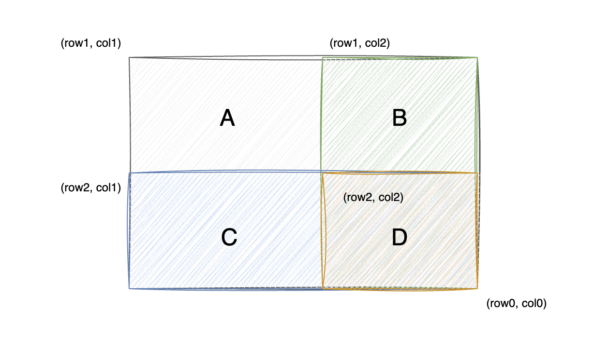

import { Blue, Green, Yellow, Red } from '@site/src/components/priority-tag';

# 304. 二维区域和检索 - 矩阵不可变

## 1. 题目简介

难度：<Yellow>中等</Yellow>，原题链接：[304. 二维区域和检索 - 矩阵不可变](https://leetcode.cn/problems/range-sum-query-2d-immutable/)。

> 给定一个二维矩阵 `matrix`，需要处理以下类型的多个请求：
>
> - 计算其子矩形范围内元素的总和，该子矩阵的左上角为 `(row1, col1)` ，右下角为 `(row2, col2)` 。
>
> 实现 `NumMatrix` 类：
>
> - `NumMatrix(int[][] matrix)` 初始化 `NumMatrix` 对象。
> - `int sumRegion(int row1, int col1, int row2, int col2)` 返回左上角 `(row1, col1)` 、右下角 `(row2, col2)` 的子矩阵的元素总和。

## 2. 问题分析

矩阵不会改变，可以先保存一组累计和，让每次查询只做常数次加减。这里选择保存从各个位置延伸到右下角的矩形和。

设矩阵有 `m` 行、`n` 列，`sums[i][j]` 表示从 `(i, j)` 到 `(m - 1, n - 1)` 的元素总和。计算它时，把当前位置、下方矩形和右侧矩形相加，再减去下方与右侧重复覆盖的部分。因此，要从右下角往左上角计算，保证所依赖的累计和已经求出。

查询也利用同样的重叠关系。下图按几何边界展示矩形的包含与交叠；映射到数组时，题目的右下角 `(row2, col2)` 包含在查询范围内，因此排除区要从下一行、下一列开始。



用 A、B、C、D 分别表示四个一直延伸到矩阵右下角的矩形和：

1. A 从 `(row1, col1)` 开始，包含整个查询范围。
2. B 从 `(row1, col2 + 1)` 开始，表示查询范围右侧需要排除的部分。
3. C 从 `(row2 + 1, col1)` 开始，表示查询范围下方需要排除的部分。
4. D 从 `(row2 + 1, col2 + 1)` 开始，是 B 与 C 的重叠部分。

从 A 中减去 B 和 C 后，D 被减了两次，需要加回一次：

```
area = A - B - C + D
```

这里 `area` 对应的就是查询区域内的元素总和。代码额外申请一行、一列并保持为 0，这样即使查询范围贴着矩阵的底边或右边，也能直接访问 `row2 + 1`、`col2 + 1`，不必单独判断。

## 3. 代码实现

```java
class NumMatrix {

    private int[][] sums;

    public NumMatrix(int[][] matrix) {
        int m = matrix.length;
        int n = matrix[0].length;
        // 这里需要多申请一行一列，可以避免边界条件的判断
        sums = new int[m + 1][n + 1];
        sums[m - 1][n - 1] = matrix[m - 1][n - 1];
        for (int i = m - 1; i >= 0; i--) {
            for (int j = n - 1; j >= 0; j--) {
                sums[i][j] = matrix[i][j] + sums[i + 1][j] + sums[i][j + 1] - sums[i + 1][j + 1];
            }
        }
    }

    public int sumRegion(int row1, int col1, int row2, int col2) {
        return sums[row1][col1] - sums[row1][col2 + 1] - sums[row2 + 1][col1] + sums[row2 + 1][col2 + 1];
    }
}
```

## 4. 复杂度分析

- 初始化时间复杂度：**O(m × n)**，每个位置计算一次累计和。
- 单次查询时间复杂度：**O(1)**，读取四个累计和并做加减。
- 空间复杂度：**O(m × n)**，保存累计和矩阵。