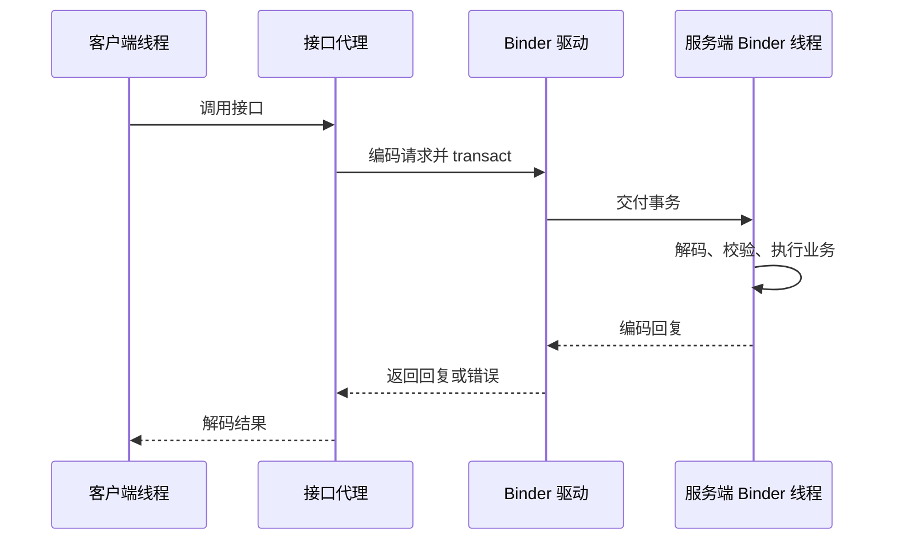

---
knowledge:
  id: mobile.android.binder
  type: concept
description: "解释 Binder 的代理与服务端对象、AIDL 与 asInterface、线程模型、oneway、事务大小、死亡通知与身份校验。"
keywords: [Binder, AIDL, IPC, asInterface, oneway, Binder 线程池, DeathRecipient]
---

# Binder

Binder 是 Android 的进程间通信机制，也是系统服务与应用交换请求的重要基础。客户端可以通过接口发起调用，底层由代理、数据编码、Binder 驱动和服务端对象协作完成。接口看起来像普通方法，并不意味着远程调用具有相同的线程、速度和失败保证；这些差异决定了主线程阻塞、并发错误和重试问题怎样发生。

## 1. 面试核心 {#core}

- Binder 把远程对象引用和事务传输结合起来，**代理负责请求转换，驱动负责跨进程传递，服务端入口负责解码与调用实现**。[卡](#mechanism)
- AIDL 生成接口通信代码，`asInterface` 选择本地对象或远程代理，**本地调用和远程调用不一定走相同路径**。[卡](#as-interface)
- 远程服务通常在 Binder 线程池处理调用，**同一接口可能并发或重入，不能按主线程串行 UI 代码编写**。[卡](#threading)
- 普通远程调用等待回复，`oneway` 不等待服务端完成，**返回 void 不自动等于 oneway，oneway 也不保证业务已经执行成功**。[卡](#oneway)
- Binder 事务缓冲区由进程中进行中的事务共享，**单次数据低于一个名义容量，不代表一定能够传输成功**。[卡](#transaction-size)
- 远程对象可能在任何一次调用前后死亡，**存活检查不能消除后续竞态，失败后重试还需判断业务是否已经生效**。[卡](#death)
- 服务端应使用系统提供的调用身份验证权限，**请求参数里的 UID 或包名不能自行充当可信身份**。[卡](#identity)

## 2. 对象与事务链路 {#对象与事务链路}

**Binder 对象**向其他进程暴露可以调用的接口。客户端持有的是可由驱动识别的远程引用或句柄，不是能直接解引用到另一个进程堆内存的 Java 对象地址。

**Binder 事务**携带一次调用的操作标识、编码参数以及必要的对象或文件描述符引用。一次典型的同步远程请求可以这样理解：



Java 层的 `IBinder` 表达底层对象操作接口，`IInterface` 表达上层接口关系；服务端 Binder 对象可以在 `onTransact` 等入口分发事务，客户端远程对象通常由 BinderProxy 等实现承接。AIDL 生成的 Proxy/Stub 位于更具体的接口层，不能把所有名字相似的“代理”都当作同一个类。

**Parcel** 是 Binder 常用的数据容器。写入和读取需要匹配的数据类型与顺序；普通业务对象要按约定编码，Binder 对象和文件描述符则有专门的传递语义。Parcel 不是适合长期磁盘存储的通用稳定序列化格式，也不是自动校验业务可信性的边界。

Binder 的经典数据通路由驱动管理目标进程可映射的接收缓冲区，将发送方事务数据复制到目标缓冲区。面试中的“一次拷贝”通常指这段传输路径的特点，不能据此说整个 Java 对象编码、native 处理和返回链路完全没有其他内存操作，更不能称为任意数据的零拷贝共享。

应用常通过绑定服务取得 IBinder，系统服务还有相应的服务管理与查询机制。拿到接口引用后仍要考虑权限、连接存续和重连；服务发现只解决“找到入口”，不证明每次调用必然成功。

## 3. AIDL 与 asInterface {#aidl与asinterface}

**AIDL** 是描述接口方法与数据类型的语言，构建工具根据它生成通信代码。调用方与服务端需要遵循同一接口契约，不能只凭方法名相同就混用不同的参数协议。

以返回笔记标题的接口为例，客户端的 Proxy 将笔记 ID 编码到 Parcel，发出对应事务；服务端 Stub 根据事务标识解码，调用实际的 `readTitle`，再编码结果。开发者主要实现业务接口，生成代码承担机械的封送与解封送工作。

**`Stub.asInterface(IBinder)`** 把底层 IBinder 转成具体接口。典型 Java 生成逻辑会先尝试 `queryLocalInterface`：

| 条件 | 典型结果 | 执行含义 |
| --- | --- | --- |
| 当前进程存在与描述符匹配的本地接口 | 返回该本地接口 | 可以直接调用，仍在调用线程执行 |
| 没有合适的本地接口 | 建立接口代理 | 按远程通信路径编码和发送事务 |
| 输入 Binder 为空 | 返回空接口 | 调用方需要按连接状态处理 |

所以 asInterface 不是每次都强制跨进程，也不是把远程对象复制到当前进程。它让上层代码按同一接口使用本地实现或代理，但两条路径的执行线程、数据复制和失败方式仍有差别。

同进程调用可能直接传递对象引用，跨进程则需要按协议编码后建立另一端可使用的表示。设计接口时不能让正确性依赖“调用方修改了某个普通对象，服务端一定立刻看到”，否则同进程测试通过后，改成远程服务就可能失效。

## 4. 线程、同步与 oneway {#线程同步与oneway}

### 4.1 线程池与重入 {#线程池与重入}

远程 AIDL 调用通常由服务端进程的 Binder 线程池处理，同一服务可能同时收到多个请求。它不会因为实现类属于 Service，就自动回到 Service 生命周期回调所在的主线程；要更新 UI，需要明确转交到相应线程。

本地接口直接调用则通常沿用调用者线程。因此测试与设计都要包含本地和远程两种条件，不能假设“所有调用都在固定的 Binder 线程”或“所有请求天然排成一列”。

同步 Binder 调用还可能形成嵌套回调：A 调 B，B 又回调 A，原来以为被锁保护或暂时稳定的状态可能被重入代码触及。不要一边持有内部锁，一边发起未知的远程调用；跨进程锁顺序难以统一，回调还可能导致死锁或半完成状态被观察。

线程池大小有具体运行时和配置条件，背一个固定线程数量不能代替并发设计。服务端应控制共享状态、避免长时间阻塞工作线程，并为耗时任务明确异步业务协议和资源限制。

### 4.2 同步事务与单向事务 {#同步事务与单向事务}

**同步事务**会等待服务端执行与回复。即使方法返回 void，只要没有声明相应的单向调用语义，它仍可能是同步事务。主线程等待慢服务、服务端锁或磁盘操作，都可能影响应用响应。

**`oneway`** 改变远程调用的等待方式：请求交给传输机制后，调用方不等待服务端方法完成。它仍有参数编码、排队与传输成本；目标进程也可能在执行前死亡或被冻结，不能把“调用返回”当作业务成功确认。

同一 Binder 节点上的单向事务有相应的串行交付约束，但不能推导所有对象、所有客户端和所有后续异步任务都共享一个全局顺序。如果服务端收到请求后又把工作发到其他执行器，业务完成顺序还要由该协议自己保证。

对于本地直调，AIDL 中的 oneway 不会凭空创建工作线程，调用仍然是普通同步调用。需要统一异步业务语义时，应在业务实现中明确任务边界，而不是依赖是否跨进程碰巧决定等待行为。

## 5. 大小、死亡与结果不确定性 {#大小死亡与结果不确定性}

### 5.1 事务大小 {#事务大小}

Binder 事务使用有界缓冲区。Android 的 TransactionTooLargeException 文档以约 1 MB 的进程级共享缓冲区说明限制；它由该进程进行中的事务共同使用，不是每个 Bundle 都能独占的“安全上限”。

请求和回复都可能过大，多笔中等大小事务同时存在也可能失败。应避免直接发送大位图、巨大数组或完整页面列表，优先用记录 ID、分页、受控 URI、文件描述符或适合的数据通道，并明确接收方的访问权限和关闭责任。

失败也可能发生在服务端已经执行、却无法送回结果的阶段。因此客户端收到 TransactionTooLargeException 或某些通信失败时，不能直接断言“服务端什么都没做”。涉及下单、扣款或写入时，应使用请求 ID、可查询结果或幂等协议处理不确定性。

### 5.2 死亡通知 {#死亡通知}

**死亡通知**让持有远程 Binder 的一方知道目标进程消失。`linkToDeath` 注册接收者，`unlinkToDeath` 用于结束不再需要的订阅。

```kotlin
import android.os.IBinder
import android.os.RemoteException

@Throws(RemoteException::class)
fun observeRemoteDeath(
    remote: IBinder,
    onDeath: () -> Unit
): IBinder.DeathRecipient {
    val recipient = IBinder.DeathRecipient { onDeath() }
    remote.linkToDeath(recipient, 0)
    return recipient
}

fun stopObserving(remote: IBinder, recipient: IBinder.DeathRecipient) {
    remote.unlinkToDeath(recipient, 0)
}
```

注册时目标已经死亡，也可能直接抛出 RemoteException，因此调用方需要处理注册失败。死亡回调可能来自 Binder 线程，`onDeath` 应安全地更新连接状态，必要时再转交到 UI；代码不保证它运行在主线程。

`isBinderAlive` 或 `pingBinder` 只反映检查时的状态。检查通过后，目标仍可能在下一条请求前死亡；“先检查再调用”不能消除竞态。应在实际调用处处理远程异常，按连接机制重新取得接口，并判断哪些待处理操作可以安全重试。

服务端在调用后死亡，也不等于已经落盘的业务结果被撤销。Binder 提供通信与对象死亡信息，不提供跨进程业务事务回滚。

## 6. 调用身份与权限 {#调用身份与权限}

**调用身份**是系统为 IPC 提供的发起方信息。服务端应在请求入口通过 Binder 提供的 UID 等信息和平台权限机制进行校验，结合具体资源的业务权限决定是否允许操作。

客户端传入的 `userId`、包名或声称的 UID 都是请求数据，不能自行成为可信授权依据。Binder 接口可达、AIDL 类型正确、参数可解码，也不代表调用者有权读取某条笔记。

需要临时以服务自身身份调用其他本地接口时，可能使用 `clearCallingIdentity`，并在 finally 中 `restoreCallingIdentity`。这会改变当前线程上的调用身份，不能用来替代权限校验；应先校验原始发起者，再明确为什么后续工作需要服务身份，且始终恢复。

把工作投递到另一个线程之后，也不能在那里无条件通过 `getCallingUid` 找回先前 IPC 的发起者。需要在入口取得并验证必要身份，再把经过校验的业务上下文传下去。身份与资源归属检查应围绕实际操作，不要只在绑定时做一次就忽略后续请求。

## 7. 面试题 {#面试题}

### 7.1 Binder 跨进程调用的基本流程是什么？ {#mechanism}

**考察重点**：代理、事务编码、驱动和服务端分发。

**相关内容**：[对象与事务链路](#对象与事务链路)。

<details>
<summary>参考回答</summary>

**客户端代理编码参数并发出事务，Binder 驱动把请求交给目标进程，服务端解码、校验并调用实现，同步调用再返回编码结果。** 客户端持有远程引用而非可直接访问的对象地址。需要同时考虑线程池、数据大小、权限和远程死亡，不能只把接口看作无成本的普通方法。

</details>

### 7.2 AIDL 的 asInterface 是做什么的？ {#as-interface}

**考察重点**：底层 Binder 与具体接口、本地优化与代理。

**相关内容**：[AIDL 与 asInterface](#aidl与asinterface)。

<details>
<summary>参考回答</summary>

**它把 IBinder 转成具体接口，典型生成逻辑先查询匹配的本地实现，找不到时返回远程代理。** 本地路径可能直接在调用线程执行，远程路径才需要编码与驱动传输。统一接口并没有抹去线程、数据复制和失败语义的差异。

</details>

### 7.3 AIDL 服务为什么需要考虑并发与重入？ {#threading}

<!-- 本题为本站原理自测，尚未核验对应公司面经，不作公司归属。 -->

**考察重点**：Binder 线程池、嵌套调用和锁范围。

**相关内容**：[线程池与重入](#线程池与重入)。

<details>
<summary>参考回答</summary>

**远程请求可以由线程池并发处理，同步调用链还可能回调进入原进程，形成重入。** 服务端共享状态需要明确保护，不能在持有内部锁时随意调用未知远程接口，也不能直接操作 UI。本地路径又可能沿用调用线程，所以测试要区分两种执行条件。

</details>

### 7.4 void 方法与 oneway 方法有什么区别？ {#oneway}

<!-- 本题为本站原理自测，尚未核验对应公司面经，不作公司归属。 -->

**考察重点**：返回值类型与事务等待语义。

**相关内容**：[同步事务与单向事务](#同步事务与单向事务)。

<details>
<summary>参考回答</summary>

**返回 void 只说明没有业务返回值，普通远程事务仍会等待回复；oneway 才表示不等待远程实现执行完成。** 它仍有传输成本，也不保证业务成功，目标可能尚未执行就死亡。本地直调中的 oneway 不会自动切换线程，仍是普通同步调用。

</details>

### 7.5 Bundle 小于 1 MB 就一定能通过 Binder 传输吗？ {#transaction-size}

<!-- 本题为本站原理自测，尚未核验对应公司面经，不作公司归属。 -->

**考察重点**：共享事务缓冲区、请求与回复成本。

**相关内容**：[事务大小](#事务大小)。

<details>
<summary>参考回答</summary>

**不能保证，文档中的容量由进程内进行中的事务共享，不是每次调用独占的额度。** 编码开销、其他并发事务和回复大小都会影响结果。应控制请求与响应规模，大数据使用 ID、分页或合适的数据通道；失败时还要考虑服务端是否已经执行。

</details>

### 7.6 注册死亡通知并检查存活后，是否就不需要处理远程调用失败？ {#death}

<!-- 本题为本站原理自测，尚未核验对应公司面经，不作公司归属。 -->

**考察重点**：检查与使用之间的竞态、业务结果不确定性。

**相关内容**：[死亡通知](#死亡通知)。

<details>
<summary>参考回答</summary>

**仍然需要，目标可以在检查后或请求执行过程中死亡，注册通知本身也可能失败。** 每次实际调用都要处理异常，按连接机制重连，并判断旧请求是否可以安全重试。死亡说明连接对象失效，不保证之前的业务修改没有发生。

</details>

### 7.7 Binder 服务应怎样验证调用者身份？ {#identity}

<!-- 本题为本站原理自测，尚未核验对应公司面经，不作公司归属。 -->

**考察重点**：系统身份、入口权限与异步上下文。

**相关内容**：[调用身份与权限](#调用身份与权限)。

<details>
<summary>参考回答</summary>

**在 IPC 入口使用系统提供的调用身份和权限机制校验，再结合具体资源的业务授权。** 不能相信参数里自称的 UID 或包名。清除身份之前要先校验原调用者，之后必须恢复；跨线程处理时要传递经过校验的上下文，不能假定新线程还保留原 IPC 身份。

</details>

## 8. 参考资料 {#参考资料}

- [Android：Android Interface Definition Language](https://developer.android.com/develop/background-work/services/aidl)
- [AOSP：AIDL overview](https://source.android.com/docs/core/architecture/aidl)
- [AOSP：Binder threading](https://source.android.com/docs/core/architecture/ipc/binder-threading)
- [Android API：IBinder](https://developer.android.com/reference/android/os/IBinder)
- [Android API：Binder](https://developer.android.com/reference/android/os/Binder)
- [Android API：TransactionTooLargeException](https://developer.android.com/reference/android/os/TransactionTooLargeException)
- [Android API：Parcel](https://developer.android.com/reference/android/os/Parcel)
- [AOSP Android 14：Binder.java](https://android.googlesource.com/platform/frameworks/base/+/android-14.0.0_r1/core/java/android/os/Binder.java)
- [AOSP Android 14：Java Binder code generation](https://android.googlesource.com/platform/system/tools/aidl/+/android-14.0.0_r1/generate_java_binder.cpp)
- [Android kernel android-14.0.0_r0.67：binder_alloc.c](https://android.googlesource.com/kernel/common/+/refs/tags/android-14.0.0_r0.67/drivers/android/binder_alloc.c)
