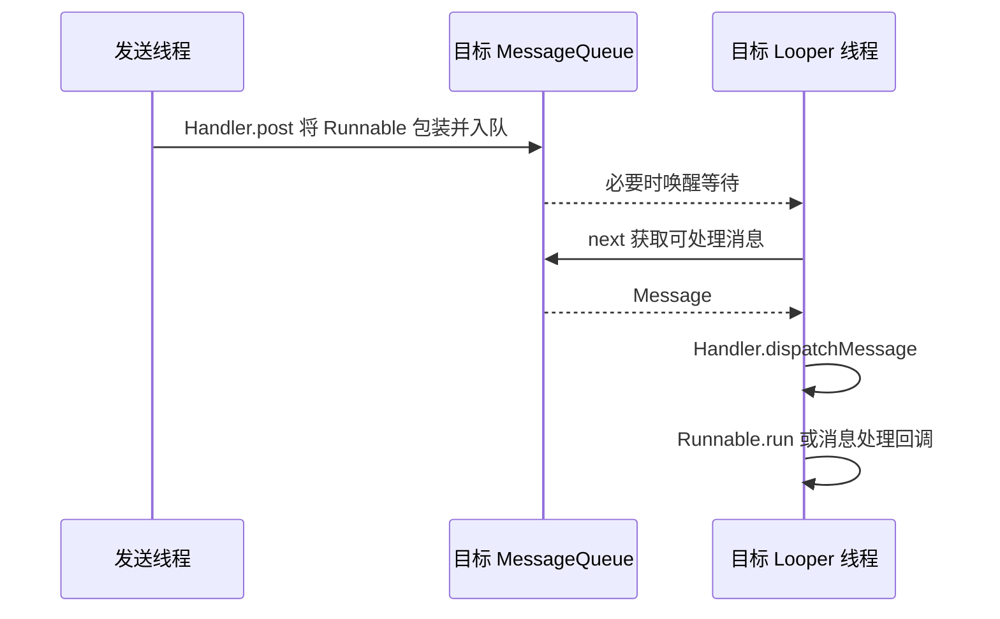

---
knowledge:
  id: mobile.android.handler-looper
  type: concept
description: "解释 Handler、Looper、MessageQueue 的协作、线程归属、延迟消息、阻塞唤醒、同步屏障和生命周期清理。"
keywords: [Android 消息机制, Handler, Looper, MessageQueue, HandlerThread, 同步屏障]
---

# Android 消息机制

Android 消息机制把工作送到指定线程，再由该线程的 Looper 取出和分发。Handler 负责提交与处理入口，MessageQueue 保存待处理工作，Looper 驱动取消息与分发过程。代码最终在哪个线程执行，取决于 Handler 绑定的 Looper；发送消息的线程不会因为调用了 post 就被搬到另一个线程。实现细节以 AOSP Android 14 为例。

## 1. 面试核心 {#core}

- 一个 Looper 对应其所属线程及 MessageQueue，**同一线程可以创建多个 Handler，共用这个 Looper 和队列**。[卡](#mechanism)
- 子线程可以创建 Handler，**关键是指定一个可用 Looper，而不是规定 Handler 只能在主线程构造**。[卡](#worker-handler)
- 普通消息按目标处理时间入队，**postDelayed 表达最早处理条件，不承诺精确执行时刻**。[卡](#message-order)
- `post` 的 Runnable 也封装成消息，**最终在目标 Looper 线程执行，直接调用 handleMessage 则只是普通方法调用**。[卡](#post-send)
- 队列暂时无可处理消息时会等待，**Looper 的循环不等于不停消耗 CPU；长回调才会占住后续分发机会**。[卡](#loop-blocking)
- 同步屏障可以让异步消息越过被阻挡的同步消息，**这里的异步标记不代表另开一个线程**。[卡](#barrier)
- 未执行的消息可以间接持有页面，**需要清理无效任务并校验结果，而不只是把 Handler 改成静态类**。[卡](#leak)
- HandlerThread 提供带 Looper 的线程，**任务仍串行执行，quitSafely 也不会等待所有未来延迟消息**。[卡](#handler-thread)

## 2. 对象关系与分发链路 {#对象关系与分发链路}

**Message** 保存一次待分发工作的内容，例如 what、参数、对象或 Runnable。**MessageQueue** 管理消息的待处理顺序。**Looper** 在所属线程上不断取出可处理消息。**Handler** 关联目标 Looper，并提供发送和分发回调。

一次普通 post 的过程是：



消息的 `target` 指向负责分发的 Handler，因此多个 Handler 共用队列时，Looper 仍能把每条消息交回正确入口。Handler 不为每条消息创建一个线程，也不为自己单独创建一个队列。

Android 14 的 `Looper.prepare()` 使用 ThreadLocal 保存当前线程对应的 Looper，并拒绝在同一线程重复准备。ThreadLocal 在这里用于按线程找到关联对象，不是把多个线程的消息复制到相互独立的 Handler 字段中。

应用主线程的 Looper 由框架准备并进入循环，普通应用代码不需要再手动 prepare 主 Looper。普通工作线程则不自动拥有 Looper；只有执行了相应准备和循环逻辑，绑定到它的消息才有机会被处理。

## 3. 线程归属与 HandlerThread {#线程归属与handlerthread}

**线程归属**由 Handler 构造时关联的 Looper 决定。即使在工作线程中构造 `Handler(Looper.getMainLooper())`，提交的回调仍交给主线程。

```kotlin
import android.os.Handler
import android.os.Looper
import android.util.Log

fun deliverToMain(text: String) {
    val handler = Handler(Looper.getMainLooper())
    handler.post {
        val onMain = Looper.myLooper() == Looper.getMainLooper()
        Log.d("Delivery", "onMain=$onMain, text=$text")
    }
}
```

当回调被正常分发时，`onMain` 为 true；调用 `deliverToMain` 的线程不影响这个归属。实际项目通常复用已有 Handler，不需要每次都为同一个 Looper 创建新对象。

如果希望工作在线程自己的消息循环里串行运行，可以使用 **HandlerThread**。它把线程启动、Looper 准备和循环过程组织在一起：

```kotlin
import android.os.Handler
import android.os.HandlerThread
import android.util.Log

fun runSerialJobs() {
    val worker = HandlerThread("serial-worker")
    worker.start()
    val handler = Handler(worker.looper)
    handler.post { Log.d("Jobs", "first") }
    handler.post {
        Log.d("Jobs", "second")
        worker.quitSafely()
    }
}
```

两项普通立即任务按入队顺序在 worker 上处理，第二项完成后请求退出。调用 start 之后读取 `worker.looper`，HandlerThread 会协调 Looper 准备过程；只创建线程对象而不启动，不能得到一个正在处理消息的线程。

HandlerThread 适合需要线程归属和串行消息处理的工作，不是线程池。某项工作阻塞会拖住后面所有工作，突发任务也可能使队列积压。普通独立后台任务可以按需要使用 Executor 或协程，并分别设计并发度、取消和结果归属，不必统一改造成消息循环。

## 4. 入队时间与回调选择 {#入队时间与回调选择}

### 4.1 时间顺序 {#时间顺序}

`sendMessageDelayed`、`postDelayed` 会根据 `SystemClock.uptimeMillis()` 计算目标时间。这个时钟不包含深度睡眠时间，因此不能将延迟消息当作精确墙钟闹钟，也不能承诺设备休眠期间仍准时执行。

Android 14 的 MessageQueue 使用按 `when` 排列的消息链表。普通定时消息会找到合适位置：后提交但更早到期的消息可以排到前面；相同目标时间的普通消息按实际入队先后保留顺序。多个线程同时发送时，业务代码不能凭各自开始调用的墙钟顺序，断言最终谁先完成入队。

| 已提交的目标时间 | 没有特殊屏障或队首操作时的候选顺序 |
| --- | --- |
| 先提交 100，再提交 20，再提交 50 | 20、50、100 |
| 两条消息目标时间相同 | 按实际入队顺序处理 |
| 目标时间已到，但线程还在处理一个长回调 | 等长回调结束后才有机会处理 |

`postAtFrontOfQueue` 等特殊入口还会改变普通排序假设，滥用会让其他消息饥饿。解释某段日志顺序时，先检查是否有队首操作、同步屏障、不同 Handler 的异步标记，以及同一线程中尚未结束的工作。

### 4.2 post 与 sendMessage {#post与sendmessage}

`post` 把 Runnable 放到 Message 的 callback 中；`sendMessage` 通常传递 what 和参数，让 Handler 的消息回调解释。Android 14 的默认 `dispatchMessage` 依次判断：

1. 消息有 Runnable callback 时，执行它。
2. 否则若 Handler 构造时提供了 Callback，先调用它；返回 true 表示已经处理。
3. 若未被前一步处理，再调用 Handler 的 `handleMessage`。

因此重写 `handleMessage` 并不意味着所有 post 的 Runnable 都先经过这个方法。把 `handler.handleMessage(message)` 直接写进工作线程，也不会完成排队或线程切换，它只是当前线程上的普通方法调用。

消息可以从对象池获得并在分发后回收。发送后就应把它视为交给队列管理，不能继续修改同一 Message，或在框架回收后保留并重复使用。需要把业务数据传给回调时，也要考虑对象是否还会被其他线程同时修改；入队不是给任意共享对象拍快照。

## 5. 等待、唤醒与同步屏障 {#等待唤醒与同步屏障}

### 5.1 等待与唤醒 {#等待与唤醒}

MessageQueue 没有到期且可处理的消息时，会通过 native 层等待。Android 14 的 native Looper 使用 epoll 等待相关文件描述符事件，并使用 eventfd 等机制唤醒；Java 层同时根据下一条目标时间决定等待时长。

这与 `while(true)` 中不断执行空操作不同：线程等待期间可以让出 CPU，有新工作或到达等待条件后再继续。队列等待也不是一直持有 Java 队列锁睡眠；发送方可以在受保护的入队操作中插入消息，并在需要时通知 native 唤醒。

每次入队都调用一次唤醒也没有必要。目标线程本来就在运行，或新消息不会改变最近需要处理的时间时，可以省去多余唤醒；若队列在等待而新消息需要更早处理，才需要调整等待。

Looper 本身维持循环不等于 ANR。ANR 涉及特定组件或输入处理超过响应条件；长消息回调、锁等待、同步 Binder 调用和阻塞 I/O 都可能占住主线程。一次栈快照停在 nativePollOnce，可能只是采样时线程空闲，不能单凭这一帧就认定“消息循环卡死”。

### 5.2 同步屏障 {#同步屏障}

**同步屏障**是队列内部用于暂缓同步消息的一种机制。Android 14 中屏障消息没有普通 target；当队首是屏障时，取消息逻辑会继续寻找可通过的异步消息。

**异步消息**在这里指被标记为可越过同步屏障的消息，不是后台线程。`Handler.createAsync` 创建的 Handler 可以让其消息避开这类屏障，但回调仍在它绑定的 Looper 线程执行；目标时间没有到达时也不会因此提前执行。

界面调度可以利用屏障，让需要优先完成的渲染相关工作获得机会。普通业务不应通过反射操作隐藏屏障 API，也不应把所有消息都标记为异步来追求“更快”；那会改变原有调度关系，且不能消除回调本身的计算成本。

## 6. 生命周期、引用与退出 {#生命周期引用与退出}

**消息持有链**可能是主线程 Looper → MessageQueue → Message → Runnable 或 Handler → Activity。页面已经退出，但一个很久以后执行的 Runnable 仍引用页面时，页面就可能继续保持可达。

静态 Handler 配合弱引用可以打断某一条持有关系，但不能消除 Runnable 直接捕获页面、消息 obj 持有大对象或失效任务继续执行等其他路径。应先明确工作何时不再需要，再清理对应回调。

```kotlin
import android.app.Activity
import android.os.Handler
import android.os.Looper

class NoticeActivity : Activity() {
    private val handler = Handler(Looper.getMainLooper())
    private val showNotice = Runnable { title = "Ready" }

    override fun onStart() {
        super.onStart()
        handler.postDelayed(showNotice, 5_000)
    }

    override fun onStop() {
        handler.removeCallbacks(showNotice)
        super.onStop()
    }
}
```

这个提示只在页面可见时有意义，因此在 onStop 移除同一个 Runnable 实例。不能重新创建一个内容相同的 Runnable，期待它必然匹配原来的回调。实际页面还要检查请求版本与对象身份，防止旧结果更新新的界面。

`removeCallbacks` 只能移除尚在队列中的相应工作，不能强行中断已经开始执行的回调。扫描删除也有队列遍历成本，不能用频繁全队列扫描代替合理状态设计；`removeCallbacksAndMessages(null)` 会移除属于该 Handler 的所有待处理内容，使用共享 Handler 时尤其要避免误删别人的任务。

工作 Looper 的 `quit()` 请求停止，不保证处理完剩余消息；`quitSafely()` 会处理已经到期的剩余工作，但未来才到期的延迟消息不会都等完。退出后继续投递会失败，post/send 返回成功也只代表入队成功，不保证进程退出或其他变化后仍一定执行。应用主 Looper 不允许通过这些方法随意退出。

## 7. 面试题 {#面试题}

### 7.1 Handler、Looper、MessageQueue 怎样协作？ {#mechanism}

**考察重点**：对象职责、目标线程与分发链路。

**相关内容**：[对象关系与分发链路](#对象关系与分发链路)。

<details>
<summary>参考回答</summary>

**Handler 将工作封装成消息并提交到关联 Looper 的队列，Looper 在自己的线程取出消息，再交给消息的 target Handler 分发。** 同一 Looper 可以有多个 Handler，它们共享消息队列。切换的是工作执行位置，发送线程本身不会迁移。

</details>

### 7.2 子线程可以创建 Handler 吗？ {#worker-handler}

**考察重点**：构造位置、Looper 可用性与处理线程。

**相关内容**：[线程归属与 HandlerThread](#线程归属与handlerthread)。

<details>
<summary>参考回答</summary>

**可以，关键是 Handler 关联哪个可用 Looper。** 子线程中显式指定主 Looper，回调仍在主线程；若希望回调在该子线程执行，就需要它自己的 Looper 和消息循环，通常可用 HandlerThread。普通线程没有自动准备 Looper，不能无条件使用依赖当前 Looper 的构造方式。

</details>

### 7.3 消息队列怎样按时间组织消息？ {#message-order}

**考察重点**：when、入队顺序与实际执行条件。

**相关内容**：[时间顺序](#时间顺序)。

<details>
<summary>参考回答</summary>

**Android 14 的普通消息按 when 插入有序链表，相同目标时间按实际入队先后排列。** 延迟依据 uptimeMillis，目标时间只表示可处理条件，线程忙、屏障或设备深度睡眠都会影响实际时刻。队首插入等特殊 API 还会改变普通排序前提。

</details>

### 7.4 post 的 Runnable 一定会进入 handleMessage 吗？ {#post-send}

<!-- 本题为本站原理自测，尚未核验对应公司面经，不作公司归属。 -->

**考察重点**：dispatchMessage 的回调优先级。

**相关内容**：[post 与 sendMessage](#post与sendmessage)。

<details>
<summary>参考回答</summary>

**默认分发会先检查 Message 的 Runnable callback，有则直接运行；否则才检查 Handler.Callback，再决定是否调用 handleMessage。** 因此不能假定 post 必经 handleMessage。直接调用 handleMessage 也不会产生排队或线程切换。

</details>

### 7.5 Looper 一直循环，为什么不等于主线程一直忙等？ {#loop-blocking}

<!-- 本题为本站原理自测，尚未核验对应公司面经，不作公司归属。 -->

**考察重点**：事件等待、CPU 调度与响应超时。

**相关内容**：[等待与唤醒](#等待与唤醒)。

<details>
<summary>参考回答</summary>

**没有可处理消息时，队列可以进入 native 等待，有事件或需要调整时再唤醒，所以不是不断执行空循环。** Android 14 实现中涉及 epoll 和 eventfd。主线程响应问题要检查长回调、锁或 I/O 等阻塞，单次采样在 nativePollOnce 可能只是空闲等待。

</details>

### 7.6 异步 Handler 是否会在后台线程执行？ {#barrier}

<!-- 本题为本站原理自测，尚未核验对应公司面经，不作公司归属。 -->

**考察重点**：同步屏障与线程归属的区别。

**相关内容**：[同步屏障](#同步屏障)。

<details>
<summary>参考回答</summary>

**不会仅因异步标记改变线程，它仍在指定 Looper 的线程执行。** 异步消息表示可以越过同步屏障，不代表忽略目标时间，也不减少计算成本。不能把 createAsync 当作启动工作线程或通用性能优化开关。

</details>

### 7.7 Handler 为什么可能导致 Activity 内存泄漏？ {#leak}

**考察重点**：待处理消息的强引用链与清理范围。

**相关内容**：[生命周期、引用与退出](#生命周期引用与退出)。

<details>
<summary>参考回答</summary>

**队列中的消息可能通过 Handler、Runnable 或 obj 继续持有已退出的 Activity，使其仍然可达。** 应在工作失效时清理对应任务，并避免长期对象不必要地持有页面。静态 Handler 或弱引用只能处理特定引用路径，不能代替取消、结果校验或移除 Runnable 捕获。

</details>

### 7.8 HandlerThread 的作用是什么？ {#handler-thread}

**考察重点**：线程、Looper 初始化、串行工作与退出。

**相关内容**：[线程归属与 HandlerThread](#线程归属与handlerthread)、[生命周期、引用与退出](#生命周期引用与退出)。

<details>
<summary>参考回答</summary>

**它提供一个准备并运行 Looper 的线程，适合需要固定线程和串行消息处理的工作。** start 之后才能建立可用的执行环境，长任务会阻塞后续任务。退出要由所有者管理；quitSafely 只继续处理已到期工作，不等于等待全部未来延迟任务。

</details>

## 8. 参考资料 {#参考资料}

- [Android API：Handler](https://developer.android.com/reference/android/os/Handler)
- [Android API：Looper](https://developer.android.com/reference/android/os/Looper)
- [Android API：HandlerThread](https://developer.android.com/reference/android/os/HandlerThread)
- [Android API：SystemClock](https://developer.android.com/reference/android/os/SystemClock)
- [AOSP Android 14：Handler.java](https://android.googlesource.com/platform/frameworks/base/+/android-14.0.0_r1/core/java/android/os/Handler.java)
- [AOSP Android 14：Looper.java](https://android.googlesource.com/platform/frameworks/base/+/android-14.0.0_r1/core/java/android/os/Looper.java)
- [AOSP Android 14：MessageQueue.java](https://android.googlesource.com/platform/frameworks/base/+/android-14.0.0_r1/core/java/android/os/MessageQueue.java)
- [AOSP Android 14：Native Looper.cpp](https://android.googlesource.com/platform/system/core/+/android-14.0.0_r1/libutils/Looper.cpp)
