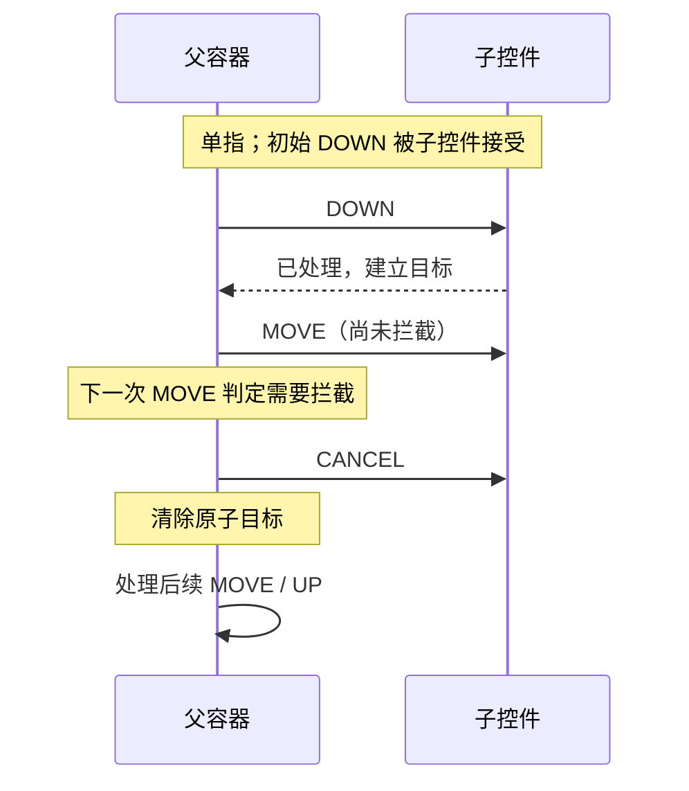

---
knowledge:
  id: mobile.android.touch-events
  type: concept
description: "解释 Android 触摸事件的目标建立、分发与拦截、消费返回值、取消事件、多点触控和滑动冲突。"
keywords: [Android, MotionEvent, dispatchTouchEvent, onInterceptTouchEvent, onTouchEvent, 滑动冲突]
---

# Android 触摸事件

Android 触摸事件按手势序列分发。手指按下时建立接收目标，后续移动和抬起通常沿已有目标传递；父容器可以按规则接管，并向原目标发送取消事件。理解“谁持有这一段手势”，比把每个 `MOVE` 都想成重新寻找手指下面的控件更有用。

## 1. 面试核心 {#core}

- `dispatchTouchEvent()` 负责分发，`onInterceptTouchEvent()` 决定容器是否拦截，`onTouchEvent()` 处理自身触摸；**这三个方法的 `true` 含义不能混用**。[卡](#dispatch)
- 普通分发中子 View 接受 `DOWN` 才能成为后续目标，**在 A 上按下后滑到 B，不会自然把同一根手指的手势交给 B**。[卡](#target)
- 父级可以在 `MOVE` 阶段拦截，**原子目标收到 `CANCEL`，不能把它当成成功的 `UP`**。[卡](#cancel)
- 在通常启用状态下，`OnTouchListener` 有机会先于 `onTouchEvent()` 处理；**监听器消费事件可能阻止默认点击逻辑执行**。[卡](#listener)
- 滑动冲突要结合方向、阈值和可滚动范围，**不能靠所有方法统一返回 `true` 解决**。[卡](#conflict)
- `requestDisallowInterceptTouchEvent(true)` 可以请求父链不拦截，**它不是向已经失去的子目标重新发送一遍 `DOWN`**。[卡](#disallow)
- 多点触控要用 pointer ID 跟踪手指，**pointer index 只是在当前事件中的位置，不能跨事件固定保存**。[卡](#multi-touch)

## 2. 事件序列与目标 {#事件序列与目标}

**MotionEvent** 描述一次输入事件，其中包含动作、触点和坐标等信息。常见单指序列以 `ACTION_DOWN` 开始，经过零次或多次 `ACTION_MOVE`，以 `ACTION_UP` 或 `ACTION_CANCEL` 结束。

| 动作 | 对当前处理者的含义 |
| --- | --- |
| `DOWN` | 一段新手势开始，应初始化本次状态 |
| `MOVE` | 触点发生移动，可能包含历史采样 |
| `UP` | 最后一根手指正常抬起；是否形成点击仍取决于手势条件 |
| `CANCEL` | 当前手势被取消，应结束跟踪，不能提交正常点击或拖动结果 |
| `POINTER_DOWN`、`POINTER_UP` | 多指序列中额外手指按下或某根手指先抬起 |

普通窗口的触摸会经过 Activity、Window 和视图树等层次。讨论 View 分发时，可以从根容器的 `dispatchTouchEvent()` 继续追踪；系统输入派发、窗口选择与 View 内部的目标选择是不同层次。

对于单指，父容器在 `DOWN` 时检查可接收事件的子节点和命中区域，向候选子节点分发。某个子节点返回已处理后，父容器记住这个触摸目标，后续事件通常继续发给它。自定义分发、系统取消、父级接管和多点分流会改变具体过程，但不会把每次 `MOVE` 都当成新的点击。

例如 A、B 两个按钮并排：手指在 A 内按下，移动到 B 内，再抬起。在没有拦截或自定义转发的普通情况下，A 仍是这一根手指的目标，B 不会凭空收到新的 `DOWN`。A 可能因为手指离开有效区域而取消按压或点击资格；这和“把事件转交给 B”是两件事。

## 3. 分发、拦截与消费 {#分发拦截与消费}

### 3.1 三个方法的职责 {#三个方法的职责}

| 方法 | 典型职责 | 返回 `true` 表示什么 |
| --- | --- | --- |
| `dispatchTouchEvent(event)` | 组织向子目标或自身的分发 | 本次分发结果为已处理 |
| `ViewGroup.onInterceptTouchEvent(event)` | 判断是否由容器接管子目标的手势 | 拦截，不是直接宣告自身点击已经完成 |
| `onTouchEvent(event)` | 处理当前 View 自己的触摸行为 | 自己处理了本次事件 |

普通 View 没有 `onInterceptTouchEvent()`，它是 ViewGroup 的拦截入口。自定义容器如果在 `dispatchTouchEvent()` 开头无条件返回 `true`，就可能绕过子节点和默认分发；屏幕看似不再“穿透”，但子控件也无法点击。

子 View 对初始 `DOWN` 返回未处理，通常不会被父容器登记为后续触摸目标。父容器可能尝试其他候选，或者转由自己的触摸逻辑处理。这里的未处理不是把事件广播给所有控件，也不是让同一个调用无限向上重试。

已经登记目标之后，某次 `MOVE` 返回 `false` 也不等于框架自动把手势转移到旁边的 View。目标关系与单次返回值要分开分析；只靠某一个布尔值无法描述整段手势。

### 3.2 中途拦截与 CANCEL {#中途拦截与cancel}

父容器可以先观察 `DOWN` 而不拦截，等移动超过阈值、方向明确后，在 `onInterceptTouchEvent()` 返回 `true`。框架会取消原子目标，并把后续事件交给容器处理。



在 Android 14 的普通 `ViewGroup` 实现中，触发接管的这一次事件主要用来取消原目标，不应假设它还会原样再进入父级 `onTouchEvent()`。需要的起点和阈值状态应在拦截判断阶段保存好；后续运动从已保存状态继续。

收到 `CANCEL` 后，应清理按压状态、速度跟踪、拖动临时数据等，不触发一次正常点击。窗口变化、系统输入处理等也可能造成取消，因此不能只在 `UP` 中释放手势资源。新的 `DOWN` 也应重置旧状态，以防上次序列因外部情况未完整到达。

### 3.3 监听器与点击 {#监听器与点击}

**OnTouchListener** 是注册在 View 上的触摸监听器。在常见的启用状态和普通触摸路径中，它先于 `onTouchEvent()` 获得处理机会；若返回 `true`，默认 `onTouchEvent()` 通常不再处理这一事件。

点击不是独立于触摸流程、一定会按顺序到达的第三个事件。标准控件的触摸实现会判断按下、移动、抬起和取消是否满足点击条件，再执行点击逻辑。因此不能把 `onTouch → onTouchEvent → onClick` 背成无条件流水线。

自定义触摸处理如果自行确认点击，应使用 `performClick()` 进入点击语义，并保留必要的父类处理，使无障碍、点击监听器等能力有相应入口。标准按钮能满足需求时，直接复用标准控件通常更可靠；自行实现还需要处理超出区域、长按和取消等条件。

## 4. 滑动冲突 {#滑动冲突}

### 4.1 父容器判定方向 {#父容器判定方向}

**滑动冲突**是多个嵌套组件都能响应一段手势，需要决定由谁处理的问题。横向分页容器里面放纵向列表时，可以在位移超过 `touchSlop` 后，比较横纵位移决定归属。`touchSlop` 是系统给出的移动容差，避免轻微抖动被当成拖动。

下面只展示单指、横向父容器的拦截与增量交付。`onDrag` 接收横向滚动增量，实际滚动范围、速度和松手动画由使用方处理；它不是完整的分页控件。

```kotlin
import android.content.Context
import android.view.MotionEvent
import android.view.ViewConfiguration
import android.widget.FrameLayout
import kotlin.math.abs

class HorizontalInterceptLayout(context: Context) : FrameLayout(context) {
    private val slop = ViewConfiguration.get(context).scaledTouchSlop
    private var downX = 0f
    private var downY = 0f
    private var lastX = 0f
    private var dragging = false
    var onDrag: (Float) -> Unit = {}

    override fun onInterceptTouchEvent(event: MotionEvent): Boolean {
        when (event.actionMasked) {
            MotionEvent.ACTION_DOWN -> {
                downX = event.x
                downY = event.y
                lastX = event.x
                dragging = false
            }
            MotionEvent.ACTION_MOVE -> {
                val dx = abs(event.x - downX)
                val dy = abs(event.y - downY)
                if (!dragging && dx > slop && dx > dy) {
                    dragging = true
                    lastX = event.x
                }
                return dragging
            }
            MotionEvent.ACTION_UP, MotionEvent.ACTION_CANCEL -> dragging = false
        }
        return false
    }

    override fun onTouchEvent(event: MotionEvent): Boolean {
        when (event.actionMasked) {
            MotionEvent.ACTION_DOWN -> lastX = event.x
            MotionEvent.ACTION_MOVE -> {
                if (dragging) onDrag(lastX - event.x)
                lastX = event.x
            }
            MotionEvent.ACTION_UP, MotionEvent.ACTION_CANCEL -> dragging = false
        }
        return true
    }
}
```

在子控件已经接受 `DOWN` 的情形下，横向移动超过阈值才触发接管；`lastX` 在接管时更新，所以后续增量不把之前的位移突然全部算进去。纵向移动继续留给子目标。若一开始没有子控件消费 `DOWN`，容器自身也可能成为处理者；完整控件需要为这种路径补齐拖动启动策略。

示例没有实现多指切换、点击语义和边缘回交，不能直接当作通用手势组件。项目中的分页、列表或嵌套滚动通常优先使用已有组件，只有行为不满足需求时再实现相应策略。

### 4.2 子控件请求父链不拦截 {#子控件请求父链不拦截}

子控件可以调用 `parent.requestDisallowInterceptTouchEvent(true)`，请求父容器及其祖先在这段手势中不通过常规拦截逻辑接管。合适时传入 `false`，重新允许父级判断；下一段 `DOWN` 会开始新的拦截状态。

这一方案通常要求父容器先让 `DOWN` 到达子控件。父级若已经在 `DOWN` 拦截，子控件就没有机会处理这次事件并发出请求。父级已经接管之后，再修改请求也不会自动重建原子控件的触摸目标。

方向相同的嵌套滚动还要考虑边界：子列表能继续滚动时由它消费，到达边缘后再让父级参与。若需要父子同时分担一段滚动距离、惯性或预消费，应使用嵌套滚动协议。嵌套滚动交换的是滚动量与消费结果，和“把触摸目标彻底换给父级”不是同一机制。

## 5. 多点触控与坐标 {#多点触控与坐标}

**pointer ID** 标识一根活动触点，**pointer index** 是它在当前 `MotionEvent` 中的数组位置。其他手指抬起后，index 可以变化；处理长期跟踪时应保存 ID，再用 `findPointerIndex(id)` 获取当前事件中的位置。

例如第一根手指 ID 为 3，第二根 ID 为 8。当前它们的 index 可能是 0 和 1；ID 3 抬起后，下一事件中 ID 8 的 index 可以变为 0。继续固定读取 `getX(1)` 可能读取错误或越界，不能把 ID 直接作为 `getX()` 参数。

`actionMasked` 取得动作类别，`actionIndex` 指出 `POINTER_DOWN` 或 `POINTER_UP` 对应哪根触点。跟踪的手指抬起时，需要明确切换到剩余触点或结束本次操作，并重置位移基准，避免切换瞬间跳动。

`getX(index)`、`getY(index)` 是接收 View 对应的局部坐标；raw 坐标使用不同的显示坐标口径，遇到窗口偏移、多窗口或变换时尤其不能混算。普通 ViewGroup 会在向子节点派发时处理相应坐标变换。

框架还支持将不同触点分配给不同子目标。因此“整个多指序列永远只有一个目标”不是通用结论；前面的 A、B 推演针对同一根手指的普通序列。

## 6. 面试题 {#面试题}

### 6.1 Android 触摸事件如何分发，三个核心方法分别做什么？ {#dispatch}

**考察重点**：分发结果、父级拦截与自身处理的区别。

**相关内容**：[事件序列与目标](#事件序列与目标)、[三个方法的职责](#三个方法的职责)。

<details>
<summary>参考回答</summary>

**父级在初始按下时选择目标，后续沿目标关系分发，并可按规则拦截。** `dispatchTouchEvent()` 的结果说明本次分发是否处理，`onInterceptTouchEvent()` 的 `true` 表示父容器拦截，`onTouchEvent()` 的 `true` 表示自身处理。子控件不接受初始 `DOWN`，通常不能成为后续目标；不能把一次 `MOVE` 返回 `false` 等同于自动转交旁边控件。

</details>

### 6.2 在 ViewA 按下，移动到 ViewB 再抬起，事件会怎样传递？ {#target}

**考察重点**：目标建立与坐标命中的时间关系。

**相关内容**：[事件序列与目标](#事件序列与目标)。

<details>
<summary>参考回答</summary>

**普通单指分发中，A 接受 `DOWN` 后仍是目标，后续移动到 B 不会自动给 B 新建手势。** A 可能因移动超出有效区域而不再形成点击，但这不表示 B 收到了按下。若父级拦截或系统取消，则 A 收到取消；自定义转发要另外讨论。

</details>

### 6.3 ACTION_CANCEL 什么时候出现，应该怎样处理？ {#cancel}

**考察重点**：手势取消与正常结束的区别。

**相关内容**：[中途拦截与 CANCEL](#中途拦截与cancel)。

<details>
<summary>参考回答</summary>

**原目标失去当前手势时可能收到 `CANCEL`，父容器中途拦截就是一个例子，系统或窗口变化也可能取消。** 应清理按压、拖动和速度等临时状态，不触发一次成功点击。资源清理不能只写在 `UP`，新的 `DOWN` 也要能够重置旧状态。

</details>

### 6.4 onTouch、onTouchEvent 与 onClick 的执行关系是什么？ {#listener}

**考察重点**：监听器消费与标准点击语义。

**相关内容**：[监听器与点击](#监听器与点击)。

<details>
<summary>参考回答</summary>

**普通启用 View 的触摸路径中，OnTouchListener 有机会先处理；返回 `true` 后通常不再交给默认 `onTouchEvent()`。** 点击由触摸逻辑判断完整条件后触发，并非三个方法必然依次执行。自己实现点击判断时要正确调用 `performClick()`，同时考虑取消、移动与无障碍。

</details>

### 6.5 如何用外部拦截处理滑动冲突？ {#conflict}

**题型**：综合题

**考察重点**：方向判定、阈值、接管状态与边界。

**相关内容**：[父容器判定方向](#父容器判定方向)、[中途拦截与 CANCEL](#中途拦截与cancel)。

<details>
<summary>参考回答</summary>

**父容器先放行按下，记录坐标，移动超过阈值后根据方向和可滚动条件决定是否拦截。** 一旦接管，原子目标会收到取消；父级要保存好增量基准，并处理后续移动、抬起和取消。示例展示单指横向判定，多指、惯性和边缘回交需要额外策略，不能统一返回 `true`。

</details>

### 6.6 子 View 如何请求父 View 不拦截事件？ {#disallow}

**考察重点**：请求传播、时机与目标关系。

**相关内容**：[子控件请求父链不拦截](#子控件请求父链不拦截)。

<details>
<summary>参考回答</summary>

**通过 `requestDisallowInterceptTouchEvent(true)` 请求父链不进行常规拦截，合适时再传入 `false`。** 子控件必须有机会收到事件；父级已经在 `DOWN` 拦截或已经接管后，这个调用不会自动给子控件补发 `DOWN`、恢复目标。协同消费滚动距离应进一步考虑嵌套滚动协议。

</details>

### 6.7 Android 多点触控中 pointer ID 与 index 有什么区别？ {#multi-touch}

<!-- 本题为本站原理自测，尚未核验对应公司面经，不作公司归属。 -->

**考察重点**：触点身份、事件内索引和切换策略。

**相关内容**：[多点触控与坐标](#多点触控与坐标)。

<details>
<summary>参考回答</summary>

**ID 用于跟踪触点，index 只表示它在当前事件数组中的位置，可能随其他手指离开而变化。** 保存 ID，再用 `findPointerIndex()` 查询；用 `actionMasked` 和 `actionIndex` 处理触点加入或退出。活动手指切换时重设坐标基准，不能把 ID 当作 `getX()` 的 index。

</details>

## 7. 参考资料 {#参考资料}

- [Android：Manage touch events in a ViewGroup](https://developer.android.com/develop/ui/views/touch-and-input/gestures/viewgroup)
- [Android API：MotionEvent](https://developer.android.com/reference/android/view/MotionEvent)
- [Android API：ViewGroup](https://developer.android.com/reference/android/view/ViewGroup)
- [Android API：View](https://developer.android.com/reference/android/view/View)
- [Android API：ViewConfiguration](https://developer.android.com/reference/android/view/ViewConfiguration)
- [AndroidX：NestedScrollingChild3](https://developer.android.com/reference/androidx/core/view/NestedScrollingChild3)
- [AOSP Android 14：ViewGroup](https://android.googlesource.com/platform/frameworks/base/+/android-14.0.0_r1/core/java/android/view/ViewGroup.java)
- [AOSP Android 14：View](https://android.googlesource.com/platform/frameworks/base/+/android-14.0.0_r1/core/java/android/view/View.java)
