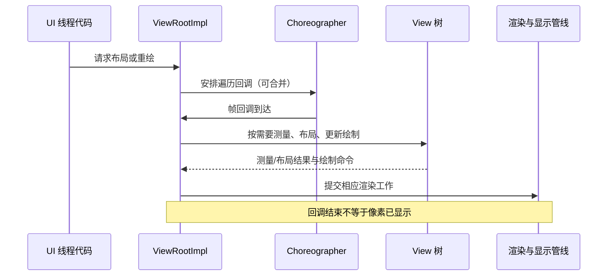

---
knowledge:
  id: mobile.android.view-layout-drawing
  type: concept
description: "解释 Android View 的尺寸约束、测量布局绘制、刷新请求、帧调度和硬件渲染，并给出自定义 View 示例。"
keywords: [Android View, MeasureSpec, onMeasure, onLayout, onDraw, requestLayout, invalidate]
---

# Android View

**View** 是 Android 视图系统中负责界面呈现和交互的基本对象，`ViewGroup` 在此基础上管理子 View。一个控件能显示出来，需要先回答“多大”“放在哪里”“画什么”；这分别对应测量、布局和绘制。理解这条链路，才能解释自定义控件尺寸错误、刷新不生效和界面卡顿，而不只是背出三个方法名。

## 1. 面试核心 {#core}

- `measure`、`layout`、`draw` 分别处理尺寸、位置和绘制，**一次界面更新不保证每个 View 都完整执行三步，也不保证只测量一次**。[卡](#pipeline)
- `MeasureSpec` 表达父级约束，`LayoutParams` 表达子控件的布局需求；**`wrap_content` 的最终大小依赖父布局和控件自身测量实现**。[卡](#measure-spec)
- 自定义 View 要在 `onMeasure` 中给出符合约束的尺寸，**同时考虑内容、padding 和建议最小尺寸**。[卡](#custom-measure)
- `requestLayout()` 请求重新布局，`invalidate()` 请求更新绘制内容；**两者都不是立即完成整帧的同步调用**。[卡](#refresh)
- 硬件加速下绘制命令可以被记录并复用，**屏幕更新不意味着每次都重新调用所有 View 的 `onDraw`**。[卡](#hardware)
- 帧调度连接输入、动画和遍历等工作，**刷新预算取决于实际帧率，不能把所有设备都当成每帧 16 ms**。[卡](#frame)
- View 的位置、平移和绘制坐标属于不同层面，**修改 `translationX` 不等于重新安排兄弟控件的布局**。[卡](#coordinates)

## 2. 视图树与遍历 {#视图树与遍历}

`ViewGroup` 持有子 View，子 View 又可以是另一个容器，最终组成树。父节点需要把可用空间分给子节点，子节点的测量结果也会影响父节点需要多大空间，因此测量并不是简单地给所有控件填写 XML 中的数值。

| 阶段 | 框架入口与自定义回调 | 主要结果 |
| --- | --- | --- |
| 测量 | `measure()` → `onMeasure()` | `measuredWidth`、`measuredHeight` 等测量结果 |
| 布局 | `layout()` → 条件满足时调用 `onLayout()` | 在父容器坐标系中的 `left`、`top`、`right`、`bottom` |
| 绘制 | `draw()` → `onDraw()`、子节点绘制等 | 软件绘制结果或供渲染使用的绘制命令 |

自定义普通 View 通常覆盖 `onMeasure()`、`onDraw()`；自定义容器还要实现子 View 的测量和 `onLayout()`。`ViewGroup` 的 `dispatchDraw()` 负责组织子节点绘制，`onDraw()` 本身不是“遍历所有子 View”的入口。

窗口一侧由 `ViewRootImpl` 协调遍历。它不是视图树里的普通 `ViewGroup`，也不是让应用直接调用的公开布局组件。应用通常通过改变状态、设置属性或请求刷新，让框架安排后续工作。

同一个 View 可能被父布局多次测量，例如先取得内容期望大小，再根据剩余空间重新分配。反过来，如果尺寸约束和缓存状态允许，也可能复用测量结果。不要把一次 `requestLayout()` 等同于“每个节点恰好执行一次 `onMeasure()`”。

## 3. 尺寸约束与测量 {#尺寸约束与测量}

### 3.1 MeasureSpec 的三种模式 {#measurespec的三种模式}

**MeasureSpec** 把一个维度的约束模式和尺寸编码在一个整数中。读取时使用 `MeasureSpec.getMode()` 与 `MeasureSpec.getSize()`，不要直接把这个整数当作像素值。

| 模式 | 约束含义 | 期望宽度为 120 px 时的例子 |
| --- | --- | --- |
| `EXACTLY` | 父级要求指定大小 | 指定 80 px，测量结果应为 80 px |
| `AT_MOST` | 不能超过上限 | 上限 200 px 时可取 120 px；上限 80 px 时只能取 80 px |
| `UNSPECIFIED` | 本次未给出这个方向的上限 | 可以采用自身期望大小，但仍由控件实现决定 |

`UNSPECIFIED` 不是“尺寸一定为 0”，也不是“把内容无限扩张”。它只是这次测量没有施加上限，控件仍需要返回一个有限、合理的尺寸。

### 3.2 LayoutParams 与父布局 {#layoutparams与父布局}

**LayoutParams** 是子 View 交给父容器解释的布局参数。`wrap_content`、`match_parent`、具体尺寸，以及某些容器支持的权重、约束和 margin，都在父布局的规则下参与计算。

例如，一个父容器已经确定宽度为 300 px，左右 padding 各 10 px。若它按普通可用空间规则测量一个 `wrap_content` 子控件，通常会给出最多 280 px 的约束；子控件还要根据文本、图片等内容决定自己需要多少。换成支持权重或特殊滚动规则的容器，测量过程就可能不同。

所以不能建立“`wrap_content` 永远对应 `AT_MOST`，`match_parent` 永远对应 `EXACTLY`”的无条件等式。父级自己的模式、可用空间和布局算法都会影响传下去的 `MeasureSpec`。

margin 是父容器安排子节点时处理的外部空间，padding 是 View 自己内容边界内的空间。自定义 View 把 padding 忽略掉，可能导致内容被裁掉；自定义 ViewGroup 忽略子节点的 margin，则可能出现控件挤在一起的问题。

### 3.3 自定义尺寸示例 {#自定义尺寸示例}

下面的 `SwatchView` 希望有 48 dp 的内容区域，同时接受父级约束。`resolveSize()` 根据 `MeasureSpec` 在期望尺寸与实际约束之间作决定；dp 先转换成像素，测量和绘制最终使用像素。

```kotlin
import android.content.Context
import android.graphics.Canvas
import android.graphics.Color
import android.graphics.Paint
import android.view.View
import kotlin.math.max
import kotlin.math.roundToInt

class SwatchView(context: Context) : View(context) {
    private val paint = Paint(Paint.ANTI_ALIAS_FLAG).apply {
        color = Color.BLUE
    }
    private val contentSize = (48 * resources.displayMetrics.density).roundToInt()

    override fun onMeasure(widthMeasureSpec: Int, heightMeasureSpec: Int) {
        val wantedWidth = max(suggestedMinimumWidth, contentSize + paddingLeft + paddingRight)
        val wantedHeight = max(suggestedMinimumHeight, contentSize + paddingTop + paddingBottom)
        setMeasuredDimension(
            resolveSize(wantedWidth, widthMeasureSpec),
            resolveSize(wantedHeight, heightMeasureSpec)
        )
    }

    override fun onDraw(canvas: Canvas) {
        super.onDraw(canvas)
        val rightEdge = (width - paddingRight).toFloat()
        val bottomEdge = (height - paddingBottom).toFloat()
        if (rightEdge > paddingLeft && bottomEdge > paddingTop) {
            canvas.drawRect(
                paddingLeft.toFloat(), paddingTop.toFloat(),
                rightEdge, bottomEdge, paint
            )
        }
    }

    fun setSwatchColor(color: Int) {
        if (paint.color == color) return
        paint.color = color
        invalidate()
    }
}
```

假设屏幕密度为 1，左右 padding 各为 8 px，没有更大的最小宽度，`wantedWidth` 为 64 px。父级给出 `AT_MOST 100` 时结果为 64 px，给出 `AT_MOST 40` 时为 40 px，给出 `EXACTLY 100` 时则为 100 px。内容区域变小时，示例按实际空间绘制色块，不强行维持 48 px。

`setSwatchColor()` 只改变颜色，因此请求重绘即可。若增加一个会改变期望尺寸的属性，还需要请求重新布局。示例只提供代码创建方式；若要在 XML 中使用，应补充接收 `AttributeSet` 的构造入口和属性解析。

`Paint` 在初始化时创建，避免每次 `onDraw()` 都分配。绘制需要复杂路径或尺寸相关缓存时，可以在尺寸变化时更新；但 padding、文本或其他内容变化也可能要求更新缓存，不能只盯着宽高变化。

## 4. 布局与坐标 {#布局与坐标}

**布局**决定 View 在父容器中的边界。布局结束后，`width` 通常由 `right - left` 得到，`height` 由 `bottom - top` 得到；它们与测量阶段得到的值属于不同结果，不应该在尚未完成布局时混用。

普通 View 的 `onDraw()` 使用自己的局部坐标系，左上角通常是 `(0, 0)`。父容器会为子节点绘制处理相应变换，所以子 View 不需要再把自己的 `left`、`top` 加到每个局部绘制坐标上。

| 属性或坐标 | 含义 |
| --- | --- |
| `left`、`top` | 相对父容器的布局位置 |
| `translationX`、`translationY` | 在布局结果基础上施加的平移 |
| `x`、`y` | 相应布局位置加平移，例如 `x = left + translationX` |
| Canvas 当前坐标 | 会受 `translate`、`scale` 等绘制变换影响 |

将一个控件向右平移 20 px，并不会自动让后面的兄弟控件向右腾出 20 px。若需求是重新排列内容，应修改布局条件并请求布局；若需求是保持布局占位而做位移动画，平移属性更符合语义。

`Canvas.save()` 与 `restore()` 可以保存、恢复绘制状态。自定义绘制里临时平移后不恢复，后续图形也可能被一起移动。它们保存的是 Canvas 状态，不是控件的业务数据或整个 View 对象。

## 5. 刷新请求 {#刷新请求}

### 5.1 requestLayout 与 invalidate {#requestlayout与invalidate}

`requestLayout()` 表示尺寸或布局关系需要重新评估；`invalidate()` 表示当前绘制内容需要更新。两者设置相应状态并把工作交给框架，调用返回时不保证布局、绘制或屏幕呈现已经结束。

| 变化 | 通常需要的操作 |
| --- | --- |
| 色块颜色改变，尺寸不变 | `invalidate()` |
| 自定义控件期望宽高改变 | `requestLayout()`，若绘制内容也变则同时 `invalidate()` |
| 更新标准控件的属性 | 优先使用其 setter，由控件处理需要的布局和重绘 |
| 每帧改变自定义绘制内容 | 在主线程更新状态，并使用合适的动画或帧刷新入口 |

这不是“`requestLayout()` 只测量、永远不绘制”的严格切割。布局变化可能进一步导致绘制；实际执行还取决于 View 是否附着、可见、尺寸是否变化，以及硬件渲染状态。应根据自己改变了什么发出请求，不把副作用当作稳定契约。

同一帧前的多次请求可以合并，不会机械地排成同等数量的完整绘制。若在 `onDraw()` 中无条件再次调用 `invalidate()`，则可能不断请求后续帧，即使界面内容已经没有变化。

### 5.2 主线程与附着状态 {#主线程与附着状态}

普通 View 状态应在 UI 线程更新。后台线程计算完结果后，应把状态更新和刷新一起切回主线程；`postInvalidate()` 可以安排重绘，但不会让后台线程对 View 字段的任意修改变成线程安全。

`postInvalidateOnAnimation()` 可以将刷新请求安排到后续动画时机。它不是“更快画完”的同步方法，也不能消除主线程已有的阻塞。排查刷新问题时，还要确认 View 已附着、仍然可见，以及回调到达时页面是否已经被替换；相关排队与生命周期问题见 [Android 消息机制](./handler-looper.mdx#生命周期引用与退出)。

## 6. 绘制命令与帧调度 {#绘制命令与帧调度}

### 6.1 硬件加速 {#硬件加速}

**硬件加速绘制**会记录和复用绘制命令，再由渲染管线执行。软件绘制则直接把相应绘制结果写入目标位图等表面。不能仅从一个 `Canvas` 参数推断底层一定走 GPU，可以用 `Canvas.isHardwareAccelerated` 检查当前 Canvas。

在硬件渲染路径中，没有变脏的节点可以复用已有绘制记录。某些平移、透明度等属性变化也可以更新渲染属性，因此动画在动，不代表每一帧都重新执行该 View 的 `onDraw()`。

这也解释了为什么自定义字段变了却没有刷新：框架不一定知道这个字段影响了绘制。如果绘制内容改变，需要正确调用 `invalidate()`，让已有记录有机会被更新。

GPU 不会替应用完成文本计算、布局算法和业务回调。主线程创建大量对象、反复测量复杂树，仍会延误提交；GPU 上复杂混合、大面积重复绘制等也可能拖慢帧。优化前要区分时间花在哪一段。

### 6.2 一次更新如何进入帧 {#一次更新如何进入帧}

**Choreographer** 协调显示节奏相关的回调。应用的输入处理、动画和视图遍历等工作会进入相应调度过程；`ViewRootImpl` 安排的遍历回调最终按需要执行测量、布局和绘制准备。



60 Hz 的刷新间隔约为 16.67 ms，120 Hz 约为 8.33 ms。这是理解节奏的起点，不代表主线程可以独占整个间隔，也不保证每台设备始终按同一刷新率工作。帧流水线、调度延迟和显示截止时间都会影响最终是否及时呈现。

因此 `onDraw()` 很快仍可能卡顿：输入回调、测量布局、渲染线程或 GPU 工作都可能成为瓶颈。应结合实际 trace、帧指标与触发操作定位，再决定减少布局、降低分配、简化绘制还是调整其他工作。

## 7. 面试题 {#面试题}

### 7.1 View 的测量、布局和绘制分别完成什么？ {#pipeline}

**考察重点**：视图树遍历、结果与执行条件。

**相关内容**：[视图树与遍历](#视图树与遍历)。

<details>
<summary>参考回答</summary>

**测量计算符合约束的宽高，布局确定相对父容器的位置，绘制生成相应画面或绘制命令。** 自定义控件通过 `onMeasure()`、`onLayout()`、`onDraw()` 等回调参与；容器还负责子节点。父级可能多次测量子节点，也可能复用已有结果，因此一次刷新不等于所有节点固定执行三步各一次。

</details>

### 7.2 MeasureSpec 与 LayoutParams 有什么区别？ {#measure-spec}

<!-- 本题为本站原理自测，尚未核验对应公司面经，不作公司归属。 -->

**考察重点**：父级约束与子节点布局需求。

**相关内容**：[MeasureSpec 的三种模式](#measurespec的三种模式)、[LayoutParams 与父布局](#layoutparams与父布局)。

<details>
<summary>参考回答</summary>

**LayoutParams 表达由父布局解释的需求，MeasureSpec 是这次测量实际传给子 View 的约束。** `EXACTLY` 要求指定值，`AT_MOST` 给出上限，`UNSPECIFIED` 不施加该方向的上限。`wrap_content` 仍依赖父布局和子控件的测量实现，不能无条件映射成一种模式。

</details>

### 7.3 自定义 View 怎样支持 wrap_content？ {#custom-measure}

<!-- 本题为本站原理自测，尚未核验对应公司面经，不作公司归属。 -->

**考察重点**：期望尺寸、约束与内容边界。

**相关内容**：[自定义尺寸示例](#自定义尺寸示例)。

<details>
<summary>参考回答</summary>

**在 `onMeasure()` 中计算内容所需尺寸，加上 padding，并与建议最小尺寸比较，再按父级 MeasureSpec 得出结果。** 可用 `resolveSize()` 或需要传播测量状态时的 `resolveSizeAndState()`，最后调用 `setMeasuredDimension()`。不能只返回固定 dp 数值而忽略像素转换或父级上限。

</details>

### 7.4 requestLayout 与 invalidate 有什么区别，分别适用于什么场景？ {#refresh}

**考察重点**：布局失效、绘制失效和异步调度。

**相关内容**：[requestLayout 与 invalidate](#requestlayout与invalidate)、[主线程与附着状态](#主线程与附着状态)。

<details>
<summary>参考回答</summary>

**尺寸或布局关系改变时请求 `requestLayout()`，绘制内容改变时请求 `invalidate()`。** 改颜色通常只需重绘，改变自定义控件期望宽高则需重新布局，必要时同时重绘。两者都会交给框架调度，可合并，也不保证调用返回时画面已经显示。`postInvalidate()` 只安排刷新，不使后台修改 View 自动线程安全。

</details>

### 7.5 硬件加速后，为什么画面在变却没有每帧调用 onDraw？ {#hardware}

<!-- 本题为本站原理自测，尚未核验对应公司面经，不作公司归属。 -->

**考察重点**：绘制记录复用与属性变化。

**相关内容**：[硬件加速](#硬件加速)。

<details>
<summary>参考回答</summary>

**已有绘制命令可以复用，某些动画只改变渲染属性，无需每帧重新执行绘制代码。** 但自定义绘制内容变了仍需要正确使节点失效。硬件加速也不会省去主线程业务、测量布局等成本，必须分别定位 CPU 与渲染管线的问题。

</details>

### 7.6 onDraw 执行很快，为什么界面仍然可能掉帧？ {#frame}

<!-- 本题为本站原理自测，尚未核验对应公司面经，不作公司归属。 -->

**考察重点**：完整帧链路、执行预算与观测证据。

**相关内容**：[一次更新如何进入帧](#一次更新如何进入帧)。

<details>
<summary>参考回答</summary>

**`onDraw()` 只是帧链路的一部分，输入、动画、测量布局、渲染线程、GPU 或调度延迟都可能影响呈现。** 60 Hz 与 120 Hz 的间隔不同，不能只按 16 ms 判断。应看实际帧和 trace 中的耗时位置，区分绘制记录完成、提交完成与最终显示。

</details>

### 7.7 修改 translationX 与修改布局位置有什么区别？ {#coordinates}

<!-- 本题为本站原理自测，尚未核验对应公司面经，不作公司归属。 -->

**考察重点**：布局边界、渲染变换与兄弟节点关系。

**相关内容**：[布局与坐标](#布局与坐标)。

<details>
<summary>参考回答</summary>

**`translationX` 在已有布局位置上施加平移，不自动重新安排兄弟控件。** `left` 是父容器中的布局位置，`x` 包含 `left` 与平移。需要改变排布和占位时应改变布局条件；保持占位做视觉位移时可以使用平移属性。

</details>

## 8. 参考资料 {#参考资料}

- [Android：How Android draws views](https://developer.android.com/guide/topics/ui/how-android-draws)
- [Android API：View.MeasureSpec](https://developer.android.com/reference/android/view/View.MeasureSpec)
- [Android API：View](https://developer.android.com/reference/android/view/View)
- [Android：Create a custom drawing](https://developer.android.com/develop/ui/views/layout/custom-views/custom-drawing)
- [Android：Hardware acceleration](https://developer.android.com/develop/ui/views/graphics/hardware-accel)
- [Android API：Choreographer](https://developer.android.com/reference/android/view/Choreographer)
- [AOSP Android 14：ViewRootImpl](https://android.googlesource.com/platform/frameworks/base/+/android-14.0.0_r1/core/java/android/view/ViewRootImpl.java)
- [AOSP Android 14：View](https://android.googlesource.com/platform/frameworks/base/+/android-14.0.0_r1/core/java/android/view/View.java)
