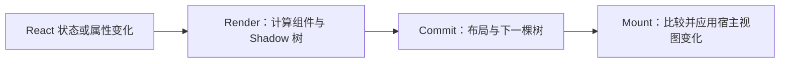

**React Native 渲染**把 React 组件描述转换为 Android、iOS 等平台上的界面。React 负责组件与更新，React Native 的渲染器把变化交给宿主平台；写的是 JSX，不意味着最终生成 HTML 或 DOM。

本文以 React Native 0.76.9、React 18 为基线。这一代默认启用新架构，项目仍需检查实际构建配置和依赖的兼容情况。理解渲染链路，才能解释状态更新后为什么要经过布局和挂载，以及为什么 JS 计算、原生调用和屏幕更新会有不同的阻塞来源。

## 1. 面试核心 {#core}

- **组件描述、布局数据和原生视图是不同对象**。函数组件不必对应原生控件，布局节点也可能在挂载时被扁平化。[卡](#trees)
- **Fabric 是新架构的渲染器，JSI 是 JS 与 C++ 交互的接口**。Hermes 执行 JavaScript，TurboModules 组织原生能力，它们不能互相替代。[卡](#architecture)
- **渲染阶段决定下一份界面，挂载阶段修改宿主视图**。布局与树比较也有成本，组件函数执行不等于屏幕立刻变化。[卡](#pipeline)
- **原生视图操作在 UI 线程执行，其他工作不能机械绑定到三条固定线程**。新架构可以根据调度条件安排渲染与布局。[卡](#threads)
- **React Native 样式和布局不等同于浏览器 CSS**。布局依赖 Yoga、约束与平台测量，文本和输入还涉及平台行为。[卡](#layout)
- **状态身份仍由 React 的类型、位置和 key 等规则决定**。这些规则可以复用，DOM API 和浏览器事件机制需要重新判断。[卡](#identity)
- **新架构支持更灵活的调度，但不消除应用自身的同步耗时**。JSI、并发渲染和原生控件都不是自动流畅的保证。[卡](#blocking)

## 2. React 组件与宿主界面 {#React组件与宿主界面}

### 2.1 JSX 描述什么 {#jsx描述什么}

**宿主组件**是渲染器能直接连接到目标平台的界面组件，例如 React Native 的 `View` 和 `Text`。业务函数组件通过组合它们描述界面，本身不必新增一层原生视图。

下面的 `CounterPanel` 使用 React 状态，但界面由 React Native 组件组成：

```tsx
import React, {useState} from 'react';
import {Pressable, Text, View} from 'react-native';

export function CounterPanel({label}: {label: string}) {
  const [count, setCount] = useState(0);
  return (
    <View>
      <Text>{label}: {count}</Text>
      <Pressable
        accessibilityRole="button"
        accessibilityLabel="增加"
        onPress={() => setCount(value => value + 1)}>
        <Text>增加</Text>
      </Pressable>
    </View>
  );
}
```

点击后，`setCount` 请求下一次状态更新；React 重新计算组件描述，渲染器把需要的变化应用到原生界面。函数式更新读取队列中的前一状态，相关规则见 [React 组件](../../tools-and-frameworks/react/components.mdx#排队批处理与异步闭包)。

这里没有 `div`、`document.querySelector` 或 HTML 点击事件。`Text` 承载文本，`Pressable` 处理按压交互；即使名字或用途与 Web 组件相似，也不能直接套用 DOM 的 API。

### 2.2 React Native 与 WebView 的区别 {#与webview的区别}

WebView 由 Web 引擎处理网页的 HTML、CSS、JavaScript 和绘制。React Native 的基本界面则通过渲染器连接平台组件，不是默认把整棵组件树塞进一个网页。

两者可以同时存在：一个 React Native 页面可以嵌入 WebView 展示网页。判断项目采用哪种机制，要看这块界面实际由谁布局、绘制和处理交互，不能只看项目名称。WebView 的实现与对应比较题见 [Android WebView](../android/webview.mdx#mechanism)。

原生组件也不等于零成本。React 计算、布局、视图层级、图片和业务代码都需要资源，性能不能只根据框架名称排序。

## 3. 新旧架构的职责 {#新旧架构的职责}

### 3.1 几个名称对应不同层次 {#几个名称对应不同层次}

| 名称 | 主要职责 | 不应据此推导的结论 |
| --- | --- | --- |
| React | 组件、状态、协调与更新调度 | React 本身决定了 Android 控件如何绘制 |
| Hermes | 执行 JavaScript 的引擎 | Hermes 就是 UI 渲染器 |
| JSI | 提供 JS 运行时与 C++ 交互的接口 | 每次调用都自动进入后台线程 |
| Fabric | 新架构中的原生渲染器 | Fabric 负责所有设备能力调用 |
| TurboModules | 新架构的原生模块系统 | 模块支持同步访问就应执行长时间同步任务 |
| Yoga | 根据布局属性与约束计算几何信息 | Yoga 完成所有文本测量和像素绘制 |

这些部分共同参与一个应用，但解决不同问题。比如更换 JS 引擎不会让业务组件自动变成另一种原生控件；原生模块能访问蓝牙，也不意味着它负责页面布局。

### 3.2 Legacy Bridge 与新架构 {#legacy与新架构}

旧架构中的常规 JS 与原生调用依赖异步 Bridge：调用信息编码后排队，另一侧再处理。频繁、小批量的往返和大数据传递会增加通信成本。不过旧原生模块 API 也存在受限制的同步方法，不能把“旧架构的常规路径异步”说成历史上任何接口都绝不可能同步。

新架构通过 JSI 等机制连接 JS 与 C++，Fabric 使用共享的 C++ 渲染核心，原生模块也有类型契约与按需加载机制。它不再要求所有正常调用都走旧式异步 Bridge，但仍然需要处理参数、对象生命周期、任务调度和平台边界。

React Native 0.76 默认启用新架构，并提供兼容旧库的互操作能力。兼容层有适用限制；“能够启动”不等于所有库都已迁移，也不代表可以无条件使用新架构的全部并发能力。面试解释旧项目时，应先说明项目版本、是否启用新架构及相关库实际采用的接口。

## 4. Fabric 的渲染链路 {#fabric的渲染链路}

### 4.1 三种树的责任 {#三种树的责任}

**React 元素树**描述组件希望呈现什么；**React Shadow Tree** 是渲染器保存界面属性和布局相关数据的 C++ 树；**Host View Tree** 是宿主平台上的实际视图层级。

它们不是三份完全相同的对象。`CounterPanel` 是组合组件，不会因此拥有一个同名原生控件。`View` 等宿主组件与 Shadow 节点关联，而部分只参与布局的节点还可能被扁平化，减少不必要的原生层级。

**视图扁平化**在保持需要的布局与显示语义的前提下，合并部分不必单独存在的宿主视图。是否可以合并取决于节点属性和平台需求，不能看到一个 JSX `View` 就断言运行时必有一个独立原生 View。

### 4.2 Render、Commit 与 Mount {#渲染提交与挂载}

Fabric 将一次界面更新概括为三个阶段：



1. **Render** 执行组件逻辑，形成需要的宿主描述与 Shadow 节点。渲染计算可能被重新执行，因此不要在组件函数体中启动无法重复的业务副作用。
2. **Commit** 处理布局并确定下一份可挂载的树。Yoga 根据样式与根约束计算位置和尺寸；文本等节点的测量还可能调用平台能力。
3. **Mount** 根据前后树计算宿主操作，再在 UI 线程应用视图的创建、属性更新、插入或移除。

这里的阶段用于解释 Fabric 内部数据流，不宜与 React DOM 文档中的每个术语或具体回调时机强行一一对应。应用看到组件函数运行，只能说明发生了计算，不能证明已经产生一张新显示帧。

### 4.3 不可变树与复用 {#不可变树与复用}

Fabric 用不可变的 Shadow 树表达某一版界面，更新时形成新版本，并对未改变的部分采用结构共享。这样不同阶段可以持有一致的快照，减少在原对象上边改边读带来的冲突。

结构共享也不等于每次更新都复制整棵树，更不等于完全不做比较。解释成本时，要区分组件执行、节点更新、布局、宿主变更和后续绘制；其中一个数量减少，其他部分不一定同比减少。

## 5. 布局与平台测量 {#布局与平台测量}

### 5.1 Yoga 与样式 {#yoga与样式}

**Yoga** 是 React Native 使用的布局引擎。它根据父级可用空间和节点属性计算尺寸、位置，实际绘制交给宿主平台。

React Native 的 Flexbox 与浏览器有相似概念，但默认值和支持范围不同。例如默认主轴方向为 `column`，默认 `flexShrink` 为 0，样式数值通常表示密度无关的逻辑尺寸；不能按 Web CSS 的默认行为直接推断。

```tsx
import React from 'react';
import {Text, View} from 'react-native';

export function SplitRow() {
  return (
    <View style={{width: 300, padding: 10, gap: 10, flexDirection: 'row'}}>
      <View style={{width: 40, height: 20}} />
      <View style={{flex: 1, height: 20}}>
        <Text>内容</Text>
      </View>
    </View>
  );
}
```

在父级允许该宽度、没有额外边框或外边距时，内侧宽度是 280，两项之间的间距是 10，左项宽 40，右项得到剩余 230。这个计算说明约束关系，不是说文字一定完整显示；字体、内容和高度限制仍会影响文本表现。

### 5.2 布局结果不是绘制结果 {#布局结果不是绘制结果}

Yoga 知道一个文本节点需要占据多大区域，但文本尺寸可能需要平台测量。字体、语言、缩放和平台实现不同，都可能改变结果。不要用一个平台的截图推断另一个平台的换行和基线完全一致。

`onLayout` 报告布局信息，适合响应尺寸变化。它不是“该像素已经显示到屏幕”的回执，也不能单独证明触摸命中、遮挡和可访问性行为正确。JS 组件测试同样不能代替设备上的原生布局与显示检查。

## 6. 线程与更新边界 {#线程与更新边界}

### 6.1 谁可以修改原生视图 {#谁可以修改原生视图}

**UI 线程**负责实际宿主视图操作；JS 逻辑通常在 JavaScript 线程执行。Fabric 的渲染与布局可以根据事件优先级和调度条件安排工作，部分高优先级场景还支持在 UI 线程同步推进渲染链路。

因此，“JS 线程、Shadow 线程、UI 线程始终各做固定一步”不足以解释新架构。介绍时先讲清工作责任，再说明具体版本的调度路径；不要用旧架构的固定线程图覆盖所有实现。

### 6.2 并发不等于任意代码都可中断 {#并发不等于任意代码可中断}

React 可以在可调度的工作边界调整更新优先级，但组件里一次很长的同步循环仍会占用执行它的线程。`async` 函数在遇到等待前的同步计算也不会自动转移到工作线程。

JS 线程被占用时，依赖 JS 的输入响应、状态计算和逻辑更新可能延迟；已经由原生独立驱动的滚动或动画则可能继续。反过来，UI 线程被阻塞时，即使 JS 执行很快，宿主界面仍可能卡顿。

JSI 提供直接交互的可能，不代表调用没有成本。同步跨边界工作还会把调用方占用到返回为止。要改善卡顿，先定位具体线程和阶段，再决定减少工作、拆分任务、异步执行或改变数据传递方式。

### 6.3 状态身份与平台 API 分开判断 {#状态身份与平台api}

`CounterPanel` 的 `label` 改变时，同一类型与位置上的组件通常保留 `count`；有意更换 `key` 可以让它重新建立状态。身份规则见 [React 协调](../../tools-and-frameworks/react/reconciliation.mdx#状态重置与保留)，这里复用的是 React 规则，文章中的 DOM 示例并不是 React Native 控件实现。

同样，Effect 的建立与清理可以复用 [React Hooks](../../tools-and-frameworks/react/hooks.mdx)，但监听的对象应是 RN 或原生 API。不能把浏览器的页面事件、CSS 布局或 `createRoot` 原样搬进移动应用。

## 7. 面试题 {#面试题}

### 7.1 React 元素树、Shadow Tree 与原生视图树有什么不同？ {#trees}

<!-- 本题为本站原理自测，尚未核验对应公司面经，不作公司归属。 -->

**考察重点**：界面描述、布局数据、宿主对象与扁平化。

**相关内容**：[三种树的责任](#三种树的责任)

<details>
<summary>参考回答</summary>

**它们分别表达组件希望呈现的界面、渲染器保存的属性与布局数据，以及平台实际视图。** 组合组件不必有独立宿主视图；部分布局节点还可以扁平化，所以不能把 JSX 节点数直接当作原生控件数。

</details>

### 7.2 Hermes、JSI、Fabric 和 TurboModules 分别负责什么？ {#architecture}

<!-- 本题为本站原理自测，尚未核验对应公司面经，不作公司归属。 -->

**考察重点**：执行引擎、交互接口、渲染器与原生能力的分工。

**相关内容**：[新旧架构的职责](#新旧架构的职责)

<details>
<summary>参考回答</summary>

**Hermes 执行 JS，JSI 提供 JS 与 C++ 交互接口，Fabric 负责新架构渲染，TurboModules 负责原生模块。** 它们处于不同层次；使用 JSI 不意味着自动后台执行，启用新架构也不意味着业务代码没有性能成本。

</details>

### 7.3 setState 后，Fabric 怎样让界面发生变化？ {#pipeline}

<!-- 本题为本站原理自测，尚未核验对应公司面经，不作公司归属。 -->

**考察重点**：计算、布局、树比较与宿主挂载。

**相关内容**：[渲染提交与挂载](#渲染提交与挂载)、[不可变树与复用](#不可变树与复用)

<details>
<summary>参考回答</summary>

**更新先改变需要计算的界面描述，再经布局和挂载变成宿主视图变化。** Render 形成相关 Shadow 节点，Commit 处理布局与下一棵树，Mount 比较并应用宿主操作。未改变部分可以共享，组件函数执行也不等于屏幕立即显示新帧。

</details>

### 7.4 新架构还能固定画成 JS、Shadow、UI 三条线程吗？ {#threads}

<!-- 本题为本站原理自测，尚未核验对应公司面经，不作公司归属。 -->

**考察重点**：线程责任与调度路径。

**相关内容**：[谁可以修改原生视图](#谁可以修改原生视图)

<details>
<summary>参考回答</summary>

**不能把固定三线程图当作所有新架构路径的保证。** 实际宿主视图操作在 UI 线程，JS 逻辑通常在 JS 线程；Fabric 的渲染与布局安排还取决于优先级和调度条件，部分场景能在 UI 线程同步推进。回答应说明版本与具体工作。

</details>

### 7.5 React Native 的布局可以完全按浏览器 CSS 推断吗？ {#layout}

<!-- 本题为本站原理自测，尚未核验对应公司面经，不作公司归属。 -->

**考察重点**：默认值、父约束、逻辑尺寸与平台测量。

**相关内容**：[布局与平台测量](#布局与平台测量)

<details>
<summary>参考回答</summary>

**不能，RN 使用自己的样式接口和 Yoga 布局，并依赖平台测量部分内容。** Flexbox 概念相似，但默认方向、收缩行为和支持范围不同；文本还受字体、缩放与平台影响。布局事件也不是像素已显示或交互正确的证明。

</details>

### 7.6 改变 CounterPanel 的 label 和改变它的 key，状态会一样吗？ {#identity}

<!-- 本题为本站原理自测，尚未核验对应公司面经，不作公司归属。 -->

**考察重点**：属性更新与组件身份。

**相关内容**：[状态身份与平台 API 分开判断](#状态身份与平台api)

<details>
<summary>参考回答</summary>

**仅改变 label 通常保留同一组件的 count，改变 key 则可以建立新身份并重置状态。** 前提是比较同一父级位置的组件，并结合类型一起判断。这个 React 规则跨渲染器复用，但不说明原生视图必须按相同数量创建或销毁。

</details>

### 7.7 使用新架构后，长时间同步计算还会让页面卡顿吗？ {#blocking}

<!-- 本题为本站原理自测，尚未核验对应公司面经，不作公司归属。 -->

**考察重点**：可调度边界、线程阻塞与同步跨边界成本。

**相关内容**：[并发不等于任意代码都可中断](#并发不等于任意代码可中断)

<details>
<summary>参考回答</summary>

**仍然可能，调度机制不能自动拆开任意一段长循环。** JS 阻塞会延迟依赖 JS 的逻辑与更新，UI 线程阻塞会影响宿主界面；同步原生调用也会占用调用方。先根据线程和阶段定位，再减少或重新安排具体工作。

</details>

## 8. 参考资料 {#参考资料}

- [React Native 0.76 发布说明](https://reactnative.dev/blog/2024/10/23/release-0.76-new-architecture)
- [React Native：New Architecture is here](https://reactnative.dev/blog/2024/10/23/the-new-architecture-is-here)
- [React Native：Render, Commit, and Mount](https://reactnative.dev/architecture/render-pipeline)
- [React Native：Threading Model](https://reactnative.dev/architecture/threading-model)
- [React Native：View Flattening](https://reactnative.dev/architecture/view-flattening)
- [React Native：Fabric](https://reactnative.dev/architecture/fabric-renderer)
- [React Native：Bundled Hermes](https://reactnative.dev/architecture/bundled-hermes)
- [React Native：Core Components and Native Components](https://github.com/react/react-native-website/blob/1e510146b8d4d17877f8890acd9e5709796633cc/website/versioned_docs/version-0.76/intro-react-native-components.md)
- [React Native：Layout with Flexbox](https://github.com/react/react-native-website/blob/1e510146b8d4d17877f8890acd9e5709796633cc/website/versioned_docs/version-0.76/flexbox.md)
- [React Native：Text](https://github.com/react/react-native-website/blob/1e510146b8d4d17877f8890acd9e5709796633cc/website/versioned_docs/version-0.76/text.md)
- [React Native：Layout Props](https://github.com/react/react-native-website/blob/1e510146b8d4d17877f8890acd9e5709796633cc/website/versioned_docs/version-0.76/layout-props.md)
- [React Native 0.76：View](https://github.com/react/react-native-website/blob/1e510146b8d4d17877f8890acd9e5709796633cc/website/versioned_docs/version-0.76/view.md)
- [React Native 0.76：Legacy Android Native Modules](https://github.com/react/react-native-website/blob/1e510146b8d4d17877f8890acd9e5709796633cc/website/versioned_docs/version-0.76/legacy/native-modules-android.md)
