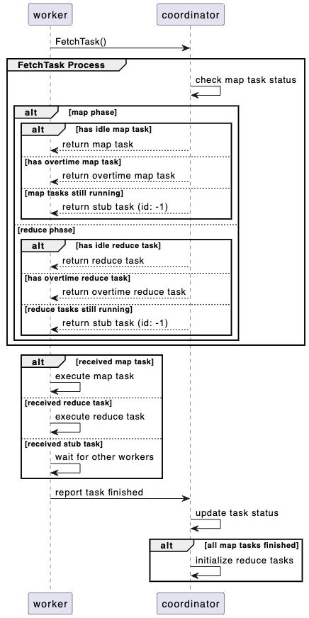

# 实验 1: MapReduce

本文是 MIT MapReduce 实验的实现笔记。重点是任务状态、RPC、超时重派和输出提交。

课程旧名为 6.824，当前页面使用 6.5840。以下实验约定采用 2026 年课程版本。实验要求与依赖版本应以所选学期仓库为准。

本文直接使用 Map、Reduce 和分区的概念。尚不熟悉计算模型时，先读 [Lec 1: MapReduce](./lec1_mapreduce.mdx)。

## 1. 面试核心 {#core}

- **任务分工。** Coordinator 管理任务状态，Worker 通过 RPC 领取并报告结果。
- **超时重派。** 本实验等待 10 秒后重派未完成任务，原 Worker 仍可继续运行。[卡](#mr-lab-stale-attempt)
- **阶段屏障。** 实验用阶段屏障确保 Reduce 收到全部 Map 的对应分区。[卡](#mr-lab-phase-barrier)
- **输出提交。** 临时文件加原子重命名避免读到半文件，提交版本需另行检查。[卡](#mr-lab-atomic-output)

## 2. 实验简介 {#实验简介}

实验使用 Go 实现单 Coordinator 与多个 Worker。所有进程运行在同一台机器，共享工作目录。该环境省略了跨机器文件传输与协调器复制。

学习目标是完成正常执行，并处理 Worker 崩溃。调试时重点观察重复执行与完成报告的顺序。

## 3. 基本配置 {#基本配置}

先准备 Git 和课程要求的 Go 版本，再取得实验仓库。实验页面给出仓库地址、启动命令和测试入口。

Go 插件与主程序应使用相同工具链构建。更换工具链后重新编译两者，避免加载失败。

## 4. 实验要求 {#实验要求}

需要实现以下文件：

- `mr/coordinator.go` 管理任务和阶段。
- `mr/worker.go` 执行任务并写出结果。
- `mr/rpc.go` 定义通信字段。

保留 `main/mrcoordinator.go` 与 `main/mrworker.go` 的启动逻辑。Worker 领取任务、读取输入、执行并写出文件。Coordinator 在 10 秒后重派未完成任务。

实验使用这一超时作为故障判断。超时是调度决策，无法证明原 Worker 已经停止。

## 5. 任务细分 {#任务细分}

### 5.1 Coordinator {#coordinator}

任务状态可分为 idle、running 和 completed。领取时在同一锁内选择任务并改为 running。分配时间从本次领取开始计时。

Map 全部完成后，才向 Worker 分配 Reduce。Reduce 全部完成后，`Done()` 返回 true。暂时无可分配任务时，回复 wait，避免忙等。

完成数只在首次有效提交时增加。重复报告返回已接受结果，避免重复计数。

### 5.2 Worker {#worker}

Map 任务读取输入并调用用户函数。输出按 `ihash(key) % nReduce` 分区。中间文件约定为 `mr-X-Y`，X 与 Y 是任务编号。

Reduce 读取对应分区的所有 Map 输出。按 key 排序分组后调用 reduce 函数。最终输出写为 `mr-out-Y`。

输出先写临时文件，成功关闭后再发布。Go 1.17 起可用 `os.CreateTemp`。文件命名与提交策略见 [输出提交](#输出提交)。

### 5.3 RPC {#rpc}

可以定义 `FetchTask` 与 `ReportTask` 两种 RPC。回复包含任务类型、任务编号和输入位置。完成报告还携带本次 attempt。

Go RPC 编码的结构体字段需要导出。字段名应以大写字母开头。RPC 失败后重试要处理重复提交。

## 6. 实验实现 {#实验实现}

本节保留设计片段，完整实现由读者自行完成。以下 attempt 方案是可选的加强设计。

### 6.1 任务结构 {#任务结构}

```go
type Task struct {
    TaskType   string
    TaskID     int
    Inputs     []string
    Outputs    []string
    Status     string
    Attempt    uint64
    AssignedAt time.Time
}

type Coordinator struct {
    mu           sync.Mutex
    tasks        []Task
    nReduce      int
    nMap         int
    finishedMaps int
}
```

这是结构定义片段，需要导入 `sync` 与 `time`。`AssignedAt` 记录本次分配时间。重新分配时更新时间并递增 `Attempt`。

### 6.2 Worker 与 Coordinator 的交互 {#worker-与-coordinator-的交互}



1. Worker 通过 `FetchTask` 获取任务或等待指令。
2. Coordinator 原子标记 running，并返回 attempt。
3. Worker 执行任务，完成临时输出。
4. Worker 报告任务编号、attempt 和文件位置。
5. Coordinator 校验报告并提交，随后更新阶段。

共享锁只保护状态变更。文件读取和计算放在锁外，避免阻塞其他任务领取。

### 6.3 RPC 状态校验 {#rpc-状态校验}

假设 attempt 1 超时后，任务被重派为 attempt 2。旧 Worker 随后报告成功时，Coordinator 应拒绝旧版本。

接收报告时检查任务类型、编号、状态与 attempt。已完成任务的重复报告只返回确认。错误版本既不改状态，也不增加完成数。

### 6.4 输出提交 {#输出提交}

原子 rename 保证读者看到完整文件。它并不阻止迟到的旧 attempt 覆盖新结果。

可让 Worker 只写 attempt 专属文件。Coordinator 验证版本后，在提交临界区发布最终文件。Worker 自身不直接覆盖最终路径。

多个 Map 分区文件可逐个发布，全部成功后才标记完成。阶段屏障确保 Reduce 在此之前不会读取。该方案依赖本实验 Coordinator 持续运行的假设。

临时文件与目标文件放在同一文件系统。实验在 Unix 环境下使用 rename 的原子替换语义。跨文件系统移动无法沿用该保证。

## 7. 测试 {#测试}

在实验仓库运行课程的 `test-mr.sh`。以下边界值得分别观察：

- 正常 Map 与 Reduce 输出应与顺序程序一致。
- 并行领取后，同一任务只接受一次完成。
- Worker 崩溃后，任务应在超时后恢复。
- 旧 attempt 迟到时，当前结果保持不变。
- Map 输出发布失败时，Reduce 阶段保持等待。

可用 race detector 检查共享状态竞争。启用时应让插件和主程序使用一致的构建选项。本文仓库未包含实验实现，以上是读者验证步骤。

## 8. 面试题 {#面试题}

### 8.1 Map 任务超时重派后，旧 Worker 报告完成该怎样处理？ {#mr-lab-stale-attempt}

<!-- 本题为本站原理自测，尚未核验对应公司面经，不作公司归属。 -->


**考察重点**：attempt、状态转换与重复报告。

**相关内容**：[RPC 状态校验](#rpc-状态校验)。

<details>
<summary>参考回答</summary>

**Coordinator 应拒绝旧 attempt 的完成报告，只接受当前任务版本。**

实验等待 10 秒后重派任务，但超时 Worker 仍可完成，所以需要用任务编号和 attempt 共同标识一次执行。

完成计数只能增加一次，输出提交也要验证同一版本，避免旧 Worker 覆盖新结果。

</details>

### 8.2 Reduce 为什么需要等待全部 Map 完成？ {#mr-lab-phase-barrier}

<!-- 本题为本站原理自测，尚未核验对应公司面经，不作公司归属。 -->


**考察重点**：完整输入、分区与阶段状态。

**相关内容**：[Coordinator](#coordinator)、[Worker](#worker)。

<details>
<summary>参考回答</summary>

**Reduce 需要本分区来自全部 Map 的输入。**

实验通过 Map 阶段屏障确保文件集合完整。

Coordinator 在锁内确认全部 Map 已提交后再分配 Reduce。重复完成报告无需再次计数。暂时没有任务时，Worker 等待后继续领取。

</details>

### 8.3 临时文件加 rename，能否同时解决半文件和旧任务覆盖？ {#mr-lab-atomic-output}

<!-- 本题为本站原理自测，尚未核验对应公司面经，不作公司归属。 -->


**考察重点**：原子可见性与版本提交。

**相关内容**：[输出提交](#输出提交)。

<details>
<summary>参考回答</summary>

**rename 解决单文件的完整可见性，旧任务覆盖需版本控制。**

旧 Worker 仍能执行一次完整覆盖。

Worker 写 attempt 专属文件，由 Coordinator 验证后发布。最终路径仅由提交逻辑更新。Map 全部输出发布后，再允许 Reduce 读取。

</details>

## 9. 参考资料 {#参考资料}

- [MIT 6.824 / 6.5840：Lab 1 MapReduce](https://pdos.csail.mit.edu/6.824/labs/lab-mr.html)
- [MIT 6.5840：2026 Schedule](https://pdos.csail.mit.edu/6.824/schedule.html)
- [Dean、Ghemawat：MapReduce，OSDI 2004](https://pdos.csail.mit.edu/6.824/papers/mapreduce.pdf)
- [Go：os.Rename](https://pkg.go.dev/os#Rename)
- [Go：plugin](https://pkg.go.dev/plugin)
- [Go：Data Race Detector](https://go.dev/doc/articles/race_detector)
