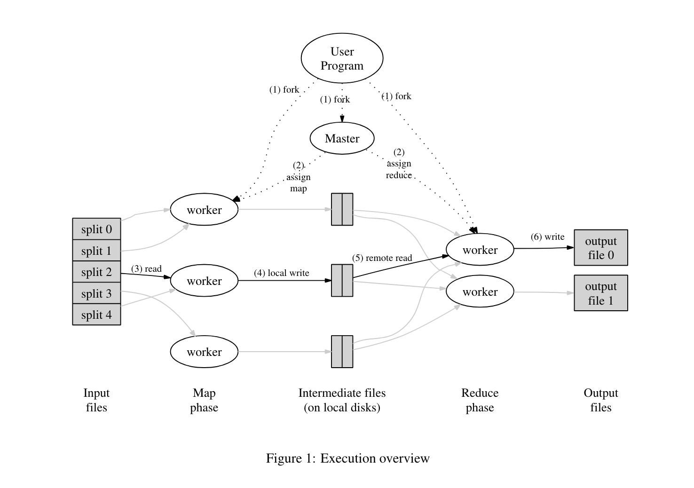

# Lec 1: MapReduce

MapReduce 用 Map、分组和 Reduce 表达批量计算。本文是 2004 年论文与 MIT 课程的学习笔记。重点是执行过程、重执行语义和性能优化。任务状态与 RPC 实现见 [实验 1: MapReduce](./lab1_mapreduce.mdx)。

## 1. 面试核心 {#core}

- Map 输出键值对序列，框架按 key 分组后调用 Reduce。[卡](#mr-shuffle-partition)
- Map 中间结果保存在本地，丢失后需重新计算。[卡](#mr-worker-reexecution)
- 确定性函数与原子提交使重执行结果等价于顺序执行。[卡](#mr-worker-reexecution)
- Combiner 的局部聚合需保持任意分组后的结果一致。[卡](#mr-combiner-average)
- 备份任务缓解慢节点造成的长尾，数据倾斜需另行处理。[卡](#mr-straggler-skew)

## 2. 论文介绍 {#论文介绍}

Google 在 2004 年发表 MapReduce 论文。模型面向离线索引、日志分析与大规模排序。用户编写计算函数，运行时管理任务分配和失败恢复。

本文讲解该论文中的实现。MIT 课程旧名为 6.824，当前课程名为 6.5840。课程实验采用更简单的单机共享文件环境。

## 3. 分布式批处理问题 {#分布式批处理问题}

大规模输入需要分片并行处理。随机器数量增加，节点故障和负载差异会影响任务完成。

运行时需要完成输入拆分、任务调度和数据交换。计算代码只描述每条输入与每组中间数据的处理。

## 4. MapReduce 编程模型 {#mapreduce-编程模型}

### 4.1 Map 函数 {#map-函数}

Map 接收一个输入键值对，输出零个或多个中间键值对。

```text
map(k1, v1) → list(k2, v2)
```

同一个 key 可以出现多次。把相同 key 的值聚在一起，是框架的分组职责。

### 4.2 Reduce 函数 {#reduce-函数}

Reduce 接收一个中间 key 及其全部值。输出可以包含零个或多个结果。

```text
reduce(k2, list(v2)) → list(v2)
```

论文接口通过迭代器传递值序列。实现可逐步读取，避免把全部值一次放入内存。

### 4.3 单词计数 {#单词计数}

```python
def map_words(text):
    for word in text.split():
        yield word, 1

def reduce_word(word, values):
    return word, sum(values)
```

输入 `apple pen apple` 产生三个键值对。分组后，apple 对应 `[1, 1]`。Reduce 输出 apple 的计数 2，以及 pen 的计数 1。

## 5. MapReduce 执行流程 {#mapreduce-执行流程}



1. 输入分为 M 个 Map 任务，用户设置 R 个 Reduce 分区。
2. Master 将任务分配给空闲 Worker。
3. Map 输出写入内存缓冲，再分区写入本地磁盘。
4. Master 记录中间文件位置，并通知 Reduce Worker。
5. Reduce 拉取自身分区的数据，排序并按 key 分组。
6. Reduce 写出结果文件，全部完成后结束作业。

### 5.1 Shuffle 与分区 {#shuffle-与分区}

Shuffle 将同一 key 的中间记录送到同一 Reduce 分区。默认分区函数可用 `hash(key) % R`。

Reduce Worker 从每个 Map Worker 获取对应分区。分区内再排序、分组并调用用户函数。不同 Reduce 分区各有输出文件。

数据拉取可与其他 Map 的执行重叠。某个 key 的最终归约要等输入完整。实验采用更简单的 Map 完成屏障。

M 与 R 由输入规模、并行度和输出需求决定。任务多于机器数有利于动态调度。

## 6. 容错 {#容错}

### 6.1 Master 故障 {#master-故障}

论文中的 Master 是单点。论文实现遇到 Master 故障时会中止作业。客户端可选择重新执行。

检查点恢复是论文讨论的可扩展方案。它并非该实现已经提供的恢复路径。

### 6.2 Worker 故障 {#worker-故障}

Master 通过探测判断 Worker 是否可达。失败节点上的运行任务会被重新分配。

该节点已完成的 Map 也需重做。因为中间结果在节点本地，其他 Worker 无法再读取。已完成 Reduce 的结果在全局文件系统中，可以保留。

### 6.3 输出提交与确定性 {#输出提交与确定性}

Map 完成后报告中间文件位置。Master 只接受一个有效完成结果，并忽略重复报告。

Reduce 先写私有临时文件，再原子重命名到最终路径。多个尝试竞争时，最终文件来自某一次完整执行。

确定性 Map 与 Reduce 对相同输入产生相同结果。因此，重复执行仍能得到等价的作业输出。外部副作用需由应用保证幂等。

不同 Reduce 分区可读取非确定性 Map 的不同尝试。各次尝试可产生不同结果。此时各分区可分别对应某次顺序执行。整个作业未必对应同一次顺序执行。

## 7. 性能优化 {#性能优化}

### 7.1 数据局部性与任务粒度 {#数据局部性与任务粒度}

调度器尽量把 Map 放在输入所在机器附近。局部读取减少网络传输。中间结果保存在本地，也减少额外复制流量。

大量小任务便于动态均衡。过细任务则增加 Master 元数据和调度开销。任务粒度需在并行度与管理成本之间取舍。

### 7.2 Combiner {#combiner}

Combiner 在 Map 端局部聚合，减少传输的中间记录。单词计数可先把本机同词的 1 相加。

局部结果必须能继续合并，并保持最终答案一致。常见做法使用满足结合律和交换律的聚合。框架是否执行 Combiner，也应不影响正确性。

直接平均局部平均值会出错。例如 `[1, 3]` 与 `[10]` 的均值分别为 2 和 10。再平均得到 6，整体均值却是 `14/3`。

可传递 `(sum, count)`，分别相加后再相除。该中间状态保留了各组样本数。

### 7.3 备份任务与数据倾斜 {#备份任务与数据倾斜}

少数慢任务会拖长作业尾部。备份任务在其他机器重复执行剩余任务。运行时采用先完成的有效结果。

若慢任务来自热点 key，换机器仍需处理同样的数据。可合并的聚合可先加盐拆键，再进行第二轮聚合。需要完整同组语义的操作则需重新设计计算。

## 8. 使用边界 {#使用边界}

MapReduce 适合高吞吐离线批处理。多轮计算需反复写入中间结果，会增加 IO 成本。交互查询与流式处理需要不同的执行模型。


## 9. 面试题 {#面试题}

### 9.1 Map 输出怎样变成 Reduce 的输入？ {#mr-shuffle-partition}

<!-- 本题为本站原理自测，尚未核验对应公司面经，不作公司归属。 -->

**出现公司**：暂无已核验的公开来源（本站自测）

**考察重点**：键值对、分区、排序与分组。

**相关内容**：[MapReduce 编程模型](#mapreduce-编程模型)、[Shuffle 与分区](#shuffle-与分区)。

<details>
<summary>参考回答</summary>

框架按 key 分区，把同组记录送到同一 Reduce。Map 本身输出的是键值对序列。

Reduce Worker 从各 Map 取得自己的分区，再排序分组。用户 reduce 函数接收 key 及其全部值。

</details>

### 9.2 Worker 故障后，为什么已完成 Map 要重做而 Reduce 可以保留？ {#mr-worker-reexecution}

<!-- 本题为本站原理自测，尚未核验对应公司面经，不作公司归属。 -->

**出现公司**：暂无已核验的公开来源（本站自测）

**考察重点**：输出位置、原子提交与确定性。

**相关内容**：[Worker 故障](#worker-故障)、[输出提交与确定性](#输出提交与确定性)。

<details>
<summary>参考回答</summary>

Map 中间文件在故障节点本地，丢失后需重算。已完成 Reduce 的文件在全局文件系统中，可以继续使用。

确定性函数保证重复执行得到同样结果。原子提交避免混合不同尝试的文件内容。外部副作用还需应用幂等处理。

</details>

### 9.3 求平均值时，能直接把 Reduce 函数用作 Combiner 吗？ {#mr-combiner-average}

<!-- 本题为本站原理自测，尚未核验对应公司面经，不作公司归属。 -->

**出现公司**：暂无已核验的公开来源（本站自测）

**考察重点**：任意分组下的聚合等价性。

**相关内容**：[Combiner](#combiner)。

<details>
<summary>参考回答</summary>

直接平均局部均值会丢失各组样本数。应在中间阶段传递 sum 与 count，最终再相除。

`[1, 3]` 和 `[10]` 的局部均值再平均得到 6。整体均值为 `14/3`。使用总和与计数可以保留正确结果。

</details>

### 9.4 备份任务能解决热点 key 造成的 Reduce 长尾吗？ {#mr-straggler-skew}

<!-- 本题为本站原理自测，尚未核验对应公司面经，不作公司归属。 -->

**出现公司**：暂无已核验的公开来源（本站自测）

**考察重点**：慢节点、数据倾斜与两阶段聚合。

**相关内容**：[备份任务与数据倾斜](#备份任务与数据倾斜)。

<details>
<summary>参考回答</summary>

备份任务主要缓解慢节点，热点输入仍需处理同样的数据。重复调度无法消除 key 的数据倾斜。

可合并的计数能加盐拆键，再做第二轮聚合。需要同组完整数据的操作，应重新设计处理边界。

</details>

## 10. 参考资料 {#参考资料}

- [Dean、Ghemawat：MapReduce，OSDI 2004](https://pdos.csail.mit.edu/6.824/papers/mapreduce.pdf)
- [MIT 6.824 / 6.5840：Lecture 1](https://pdos.csail.mit.edu/6.824/notes/l01.txt)
- [MIT 6.5840：2026 Schedule](https://pdos.csail.mit.edu/6.824/schedule.html)
- [MIT 6.824 / 6.5840：Lab 1](https://pdos.csail.mit.edu/6.824/labs/lab-mr.html)
- [Apache Hadoop：MapReduce Tutorial](https://hadoop.apache.org/docs/r3.3.6/hadoop-mapreduce-client/hadoop-mapreduce-client-core/MapReduceTutorial.html)
