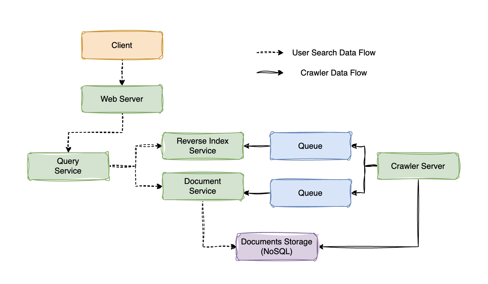
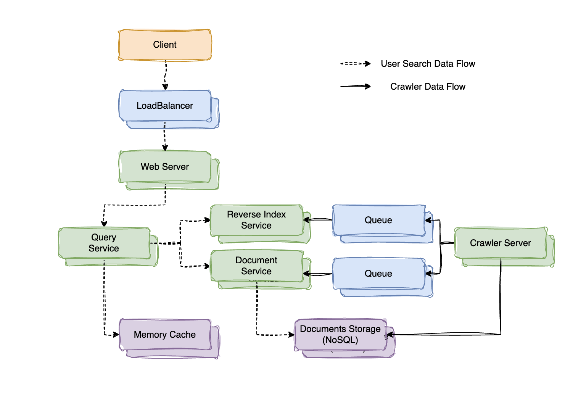

# 设计网页爬虫

网页爬虫持续发现、抓取并索引公开网页。本文保留一个简化搜索系统的设计案例。重点是调度、去重、礼貌抓取与故障恢复。

## 1. 面试核心 {#core}

- **URL 去重。** URL 规范化与原子去重共同约束待抓取任务。[卡](#crawler-dedup-leases)
- **礼貌抓取。** 抓取调度按主机限制并发，并遵守 robots.txt。[卡](#crawler-politeness)
- **任务重派。** 租约超时允许重派任务，输出幂等处理重复执行。[卡](#crawler-dedup-leases)
- **条件抓取。** ETag 与 Last-Modified 支持条件抓取，304 可省去响应正文。[卡](#crawler-recrawl)
- **索引恢复。** 搜索索引是派生数据，应能从已存网页版本重建。

## 2. 需求 {#需求}

### 2.1 核心用例 {#核心用例}

系统抓取公开网页，提取标题、摘要和外链。用户通过关键词查询索引。本文暂不展开相关性排名与近似重复检测算法。

抓取应受深度、域名和总量预算约束。动态日历与无限参数组合会形成抓取陷阱。调度器需限制同类 URL 的扩张。

### 2.2 礼貌抓取 {#礼貌抓取}

调度按主机维护并发数与下次允许抓取时间。robots.txt 按 RFC 9309 解析。规则用于表达抓取偏好，不构成访问授权。

robots.txt 返回 4xx 时，协议允许继续访问。网络错误或 5xx 时，爬虫应按完全禁止处理。缓存规则有效期与重试策略也需受控。

429 或 503 可携带 `Retry-After`。调度器应据此推迟抓取，并做有界退避。RFC 9309 未标准化 `Crawl-delay`，额外支持需单独声明。

## 3. 规模 {#规模}

本例假设每周抓取 10 亿页，平均页面为 500 KB。KB 按十进制计算，每页为 500000 字节。平均抓取速率为：

```text
10^9 / (7 × 24 × 3600) ≈ 1653 页/秒
1653 × 500000 ≈ 827 MB/秒 ≈ 6.61 Gb/秒
```

一年按 52 周计算。连续保存三年原始页面，约需 78 PB。该值假设每次抓取都保存完整版本。索引、副本和压缩效果另算。

查询量假设每 30 天为 1000 亿次。平均查询约为 38580 QPS。峰值需另设系数，查询响应大小也需单独估算。

## 4. 高层设计 {#高层设计}

系统分为 URL frontier、抓取器、解析器与索引服务。frontier 保存待调度任务和主机抓取时间。原始页面放入对象存储，元数据放入数据库。

```text
种子与外链 → 规范化/去重 → 主机调度 → 抓取器
                                      ↓
用户查询 ← 搜索索引 ← 解析与索引任务 ← 页面存储
```

原有示意图展示队列与查询服务的分离。实际实现还需补上租约、主机调度和版本记录。



队列吸收短时波动，持续吞吐仍取决于消费者。系统监控积压年龄，并在超预算时降低发现速率。

## 5. 核心组件 {#核心组件}

### 5.1 URL 规范化与去重 {#url-规范化与去重}

规范化可统一主机名大小写、默认端口并去掉片段。查询参数需保留业务含义。任意排序或删除参数会错误合并不同页面。

用规范化 URL 的唯一键原子创建任务。只用“先查询、再入队”会在并发时重复入队。已抓取状态还应包含版本与下次抓取时间。

Bloom Filter 可减少精确查询次数，但存在假阳性。要求完整覆盖时，命中后仍应查询精确集合。容忍少量漏抓的场景才可直接跳过。

### 5.2 任务租约与提交 {#任务租约与提交}

任务记录包含 URL、状态、attempt、租约期限与重试次数。领取时原子修改状态并增加 attempt。

```text
待处理 → 运行中(attempt, leaseUntil) → 完成
              ↓ 超时
           待重试 → 运行中(新 attempt)
```

worker 写入不可变页面版本，再提交完成报告。调度器只接受当前 attempt 的报告。旧 worker 迟到时，结果应被拒绝。

任务完成与索引事件可用事务 Outbox 关联。索引消费者按 URL 和页面版本幂等写入。故障后重复消费会得到相同结果。

### 5.3 抓取与解析 {#抓取与解析}

抓取器遵守主机预算，并限制大小、时长和重定向。URL 指向的网络风险见 [SSRF](../../../security/injection-authorization-ssrf-deserialization.mdx#ssrf)。

原始正文保存成功后，再解析标题、摘要和外链。解析进程需限制 CPU、内存与文档嵌套深度。搜索页面对摘要做安全输出，避免执行抓取内容。

元数据可包含以下字段：

```text
url, contentVersion, objectKey, title, summary,
etag, lastModified, fetchedAt, nextFetchAt
```

`contentVersion` 绑定正文与索引版本。`nextFetchAt` 决定下次抓取时间。

### 5.4 增量抓取 {#增量抓取}

支持 ETag 的站点可使用 `If-None-Match`。只有 Last-Modified 时，可用 `If-Modified-Since`。收到 304 后保留原正文，并更新检查时间。

两种验证字段都存在时，优先使用 ETag 条件。页面变化频率可用于调整重抓间隔。内容摘要用于识别相同正文，URL 仍保留各自元数据。

### 5.5 用户查询 {#用户查询}

查询接口读取搜索索引，返回标题、摘要和链接：

```http
GET /api/v1/search?q=hello+world
```

```json
{
  "items": [
    {"title": "Example", "snippet": "示例摘要", "link": "https://example.com/"}
  ],
  "nextCursor": null
}
```

接口应说明索引新鲜度与分页语义。搜索服务故障时，抓取链路仍可保存新页面。

## 6. 扩展 {#扩展}

frontier 可按主机分片，保持每台主机的礼貌预算。热点站点受自己的速率限制。增加 worker 主要提高跨站点并行度。

搜索索引通过分片与副本扩展。协调状态需要可靠存储，避免多实例重复领取。页面、元数据和索引均需验证恢复流程。



恢复演练覆盖 worker 崩溃、租约过期与索引暂停。关键指标包括抓取成功率、积压年龄和索引延迟。恢复后还需核对正文与索引版本。

## 7. 面试题 {#面试题}

### 7.1 多个 worker 怎样避免重复领取，超时重派后又怎样提交？ {#crawler-dedup-leases}

<!-- 本题为本站原理自测，尚未核验对应公司面经，不作公司归属。 -->

**出现公司**：暂无已核验的公开来源（本站自测）

**考察重点**：原子领取、租约、attempt 与幂等。

**相关内容**：[URL 规范化与去重](#url-规范化与去重)、[任务租约与提交](#任务租约与提交)。

<details>
<summary>参考回答</summary>

**通过唯一键去重，并原子领取带租约的任务。**

每次重派增加 attempt，提交时验证当前版本。

超时 worker 仍可继续运行，因此抓取允许重复执行。页面按版本保存，完成报告拒绝旧 attempt。索引消费按 URL 与版本幂等。

</details>

### 7.2 增加 worker 后，怎样避免对单个站点产生过量请求？ {#crawler-politeness}

<!-- 本题为本站原理自测，尚未核验对应公司面经，不作公司归属。 -->

**出现公司**：暂无已核验的公开来源（本站自测）

**考察重点**：主机调度、robots 与退避。

**相关内容**：[礼貌抓取](#礼貌抓取)、[扩展](#扩展)。

<details>
<summary>参考回答</summary>

**由共享调度器按主机限制并发与抓取间隔。**

新增 worker 增加跨站并行度，同站预算保持受控。

抓取前解析 robots.txt。网络错误或 5xx 时按完全禁止处理。限流响应触发退避，并遵循 Retry-After。

</details>

### 7.3 已抓取页面怎样重抓，并保持索引可恢复？ {#crawler-recrawl}

<!-- 本题为本站原理自测，尚未核验对应公司面经，不作公司归属。 -->

**出现公司**：暂无已核验的公开来源（本站自测）

**考察重点**：HTTP 验证字段、版本与派生数据。

**相关内容**：[增量抓取](#增量抓取)、[任务租约与提交](#任务租约与提交)。

<details>
<summary>参考回答</summary>

**按重抓计划发送条件请求，未变化时复用正文。**

ETag 对应 If-None-Match，304 表示本次无需正文。

变化页面保存新版本，再异步更新索引。索引任务幂等处理，失败后重放。索引可从保存的页面版本重新构建。

</details>

## 8. 参考资料 {#参考资料}

- [RFC 9309：Robots Exclusion Protocol](https://www.rfc-editor.org/rfc/rfc9309.html)
- [RFC 9110：HTTP Semantics](https://www.rfc-editor.org/rfc/rfc9110.html)
- [RFC 3986：URI Generic Syntax](https://www.rfc-editor.org/rfc/rfc3986.html)
- [Apache Nutch：项目文档](https://nutch.apache.org/documentation/)
- [AWS：Transactional outbox pattern](https://docs.aws.amazon.com/prescriptive-guidance/latest/cloud-design-patterns/transactional-outbox.html)
- [Redis：Bloom filter](https://redis.io/docs/latest/develop/data-types/probabilistic/bloom-filter/)
