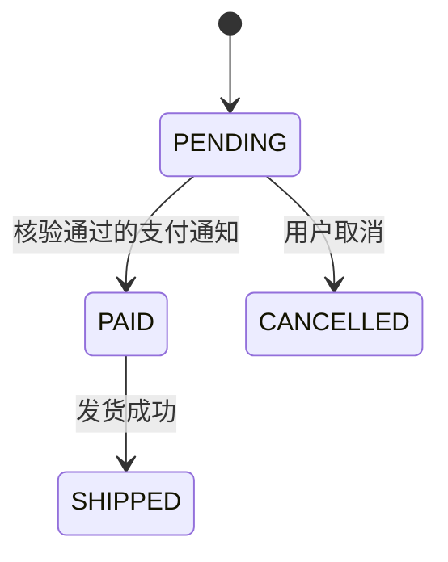

# 状态迁移测试

**状态迁移测试**根据系统当前状态和收到的事件，验证下一状态及相应动作。同一个“取消”操作，在待支付订单和已发货订单上可能有不同结果；只检查接口名称和参数，就会漏掉这种历史条件。

状态模型让操作顺序成为测试的一部分。测试需要确认系统确实处于起始状态，也要检查结果之外的副作用，例如重复支付通知有没有重复发货。

## 1. 面试核心 {#core}

- 一次迁移包括**起始状态、事件、必要条件、目标状态和动作**。只画状态名字，无法推导完整检查。[卡](#model-elements)
- **经过所有状态不等于执行所有转换，执行所有单步转换也不等于覆盖所有序列**。覆盖指标必须说明计算对象。[卡](#coverage-differences)
- 非法事件要验证拒绝或约定处理，并检查**原状态和受保护数据没有被错误改变**。[卡](#invalid-events)
- 重复、乱序和超时事件需要单独建模。**状态相同不代表副作用没有重复执行**，应核对记录、金额或任务数量。[卡](#duplicate-late-events)
- 并发事件还涉及时序和原子性。**顺序执行两个事件不能证明同时发生时也正确**。[卡](#concurrent-transitions)

## 2. 状态、事件与动作 {#状态事件与动作}

**状态**表示会影响后续行为的当前事实，**事件**表示外部输入或内部发生的事情。事件只有满足对应条件，才允许触发某个动作并改变状态。

下面给出一个用于测试设计的简化订单模型：`PENDING` 待支付、`PAID` 已支付、`SHIPPED` 已发货、`CANCELLED` 已取消。约定只允许取消待支付订单；退款是另一条流程，不在这个模型中伪装成“取消成功”。



图表示主要状态变化，重复事件和拒绝行为需要补进表格：

| 当前状态 | 支付通知 | 取消 | 发货 |
| --- | --- | --- | --- |
| PENDING | 核验后变为 PAID，只记一次支付 | 变为 CANCELLED，释放预占资源 | 拒绝，保持状态 |
| PAID | 同一支付重复通知不重复入账 | 按本例规则拒绝，退款另走流程 | 成功后变为 SHIPPED |
| SHIPPED | 已处理通知不重复入账 | 拒绝，退货另走流程 | 同一发货请求不重复执行 |
| CANCELLED | 不恢复订单，记录并进入约定的对账或补偿处理 | 重复取消保持原结果 | 拒绝，保持状态 |

支付通知还应核验订单号、金额和真实性。这些是迁移条件，不是只要事件名称叫“支付成功”就无条件进入 `PAID`。

不同业务可以选择不同规则。若允许已支付取消，就需要加入退款状态和动作，不能直接沿用这个简化模型的拒绝结论。

## 3. 覆盖与序列 {#覆盖与序列}

**状态覆盖**检查到过哪些状态，**转换覆盖**检查执行过哪些起始状态到目标状态的事件关系。图中没有展示的自环、拒绝和补偿动作，仍可作为表格中的独立检查目标。

假设测试走过 `PENDING → PAID → SHIPPED`，再从新订单走 `PENDING → CANCELLED`，四个状态都到过了。但没有验证已支付时取消、重复支付和已取消后收到支付通知。

单步转换都检查过后，序列仍可能有遗漏。例如：支付、重复支付、发货，与支付、发货、重复支付具有不同历史。如果程序在发货后清掉了去重记录，第二条序列才可能暴露重复入账。

序列数量会随着长度快速增长，有循环时甚至没有有限的全部路径集合。实际要根据业务风险选择关键序列，并明确长度或目标：首次成功、重复操作、取消后迟到通知、失败后重试以及恢复后的继续执行。

## 4. 测试准备与断言 {#测试准备与断言}

执行事件前，应验证起始状态，执行后同时检查目标状态和业务动作。直接改数据库造一个状态可以减少准备成本，但也可能跳过建立关联记录的过程；必须知道该状态依赖哪些事实。

下面用一个纯函数演示顺序，不声称它实现了真实支付：

```python
def apply_event(state, event, payment_records):
    if state == "PENDING" and event == "pay":
        return "PAID", payment_records + 1
    if state == "PENDING" and event == "cancel":
        return "CANCELLED", payment_records
    if state == "PAID" and event == "ship":
        return "SHIPPED", payment_records
    if state in {"PAID", "SHIPPED"} and event == "pay":
        return state, payment_records
    raise ValueError("transition not allowed in this example")

state, records = "PENDING", 0
for event in ["pay", "ship", "pay"]:
    state, records = apply_event(state, event, records)
assert (state, records) == ("SHIPPED", 1)
print(state, records)
```

输出为 `SHIPPED 1`。最后一次支付事件没有改变状态，也没有新增支付记录。如果断言只检查 `SHIPPED`，把重复事件错误地记账两次的实现仍可能通过。

这段函数只实现表中演示序列所需的规则；取消后的迟到支付、重复发货和真实对账需要独立实现与检查。参考模型也要有自己的适用范围，不能因为代码很短就默认它代表所有业务。

## 5. 重复、乱序与并发 {#重复乱序与并发}

重复事件测试要使用同一个业务事件标识，核对多次处理后的唯一结果；再用不同标识区分真正的新操作。幂等键的实现机制见 [幂等键](../../system-design/reliability/idempotency-keys-safe-retries.mdx)。

迟到事件不一定应该简单忽略。例如订单已经取消，却收到了真实支付成功通知，系统仍需要按约定进行对账或退款。测试要同时检查订单没有被非法恢复、资金事实没有丢失，以及补偿任务只建立一次。

支付与取消同时到达，则需要检查允许的竞争结果。可以在测试环境使用可控屏障，让两个请求都到达指定阶段后再继续；记录实际完成顺序，并核对订单、账目与资源的一致性。只在两个线程里发请求，不能保证目标竞争窗口确实发生。

测试结束要检查稳定后的业务状态。瞬时中间状态与最终一致性要分开，给出完成期限及超时证据，不能通过无限重试把未完成的补偿隐藏起来。

## 6. 面试题 {#面试题}

### 6.1 一份能够指导测试的状态模型应包含什么？ {#model-elements}

<!-- 本题为本站原理自测，尚未核验对应公司面经，不作公司归属。 -->

**考察重点**：状态、事件、守卫条件与动作。

**相关内容**：[状态、事件与动作](#状态事件与动作)。

<details>
<summary>参考回答</summary>

**需要当前状态、触发事件、允许条件、目标状态，以及必须执行或不得执行的动作。** 支付通知还需要金额、订单和真实性等条件，不能只按事件名称迁移。

模型还应说明重复和非法事件的处理。状态图可以呈现主要关系，完整事件表则便于检查遗漏组合。

</details>

### 6.2 状态覆盖、转换覆盖和序列覆盖有什么区别？ {#coverage-differences}

<!-- 本题为本站原理自测，尚未核验对应公司面经，不作公司归属。 -->

**考察重点**：覆盖对象和历史依赖。

**相关内容**：[覆盖与序列](#覆盖与序列)。

<details>
<summary>参考回答</summary>

**状态覆盖说明到过哪些状态，转换覆盖说明执行过哪些单步关系，序列覆盖还关心这些操作的先后组合。** 经过所有订单状态，不代表测过重复支付或非法发货。

单步都通过也可能在特定历史下失败。存在循环时不能简单宣称覆盖全部路径，应明确选择的序列、长度或风险目标。

</details>

### 6.3 非法状态下调用接口，只检查返回错误够吗？ {#invalid-events}

<!-- 本题为本站原理自测，尚未核验对应公司面经，不作公司归属。 -->

**考察重点**：拒绝结果与状态、数据保持。

**相关内容**：[测试准备与断言](#测试准备与断言)。

<details>
<summary>参考回答</summary>

**还要确认受保护状态和副作用符合约定。** 未支付订单请求发货即使返回错误，也不能已经创建物流单或扣减资源。

测试先确认起始状态，执行后核对原状态、关联记录和需要保持的业务不变量，避免出现“先写入再报错”的假拒绝。

</details>

### 6.4 怎样验证重复支付通知和取消后迟到的支付通知？ {#duplicate-late-events}

<!-- 本题为本站原理自测，尚未核验对应公司面经，不作公司归属。 -->

**题型**：综合题

**考察重点**：重复处理、事件顺序、账目与补偿。

**相关内容**：[状态、事件与动作](#状态事件与动作)、[重复、乱序与并发](#重复乱序与并发)。

<details>
<summary>参考回答</summary>

**重复通知使用相同业务事件标识，核对只形成一次账目和后续动作；迟到通知则按确认过的取消与补偿规则检查。** 不能只看订单状态是否保持不变。

取消后收到真实支付事实时，订单可能保持取消，但仍需要对账或退款。测试要检查补偿被建立、能够完成且不会重复执行，同时保留未完成时的超时证据。

</details>

### 6.5 顺序执行“支付再取消”和“取消再支付”，能证明并发处理正确吗？ {#concurrent-transitions}

<!-- 本题为本站原理自测，尚未核验对应公司面经，不作公司归属。 -->

**考察重点**：竞争窗口、原子性与最终结果。

**相关内容**：[重复、乱序与并发](#重复乱序与并发)。

<details>
<summary>参考回答</summary>

**不能，顺序执行没有覆盖两个请求同时读取旧状态再写入的竞争。** 需要控制或观察目标时序，并核对允许的最终结果。

可以在测试环境让请求停在关键阶段，再同时继续，检查订单、账目和资源是否一致。并发请求次数本身不证明已经触发目标竞争条件。

</details>

## 7. 参考资料 {#参考资料}

- [ISTQB 及 CTFL 编写组：Foundation Level Syllabus 4.0.1，4.2.4 State Transition Testing](https://istqb.org/wp-content/uploads/2024/11/ISTQB_CTFL_Syllabus_v4.0.1.pdf)
