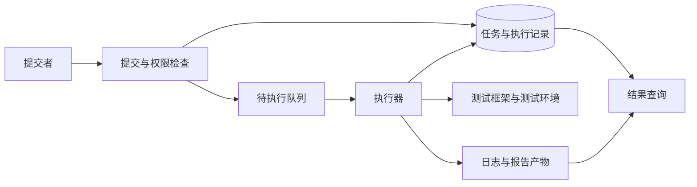

# 测试执行平台

**测试执行平台**把测试任务的提交、排队、执行、结果保存和查询组织成一条可追踪流程。pytest 或 JUnit 负责怎样运行测试，平台则负责谁可以运行哪份测试、用什么环境、交给哪个执行器，以及失败或失联后怎样收尾。

面试中设计这类项目，重点是任务和资源的完整生命周期。页面上有“执行”按钮、后台调用一个命令，只覆盖了顺利运行时的一小段路径。

## 1. 面试核心 {#core}

- 平台要把**不可变的执行输入、任务状态、执行尝试和证据产物**关联起来，才能重建一次运行。[卡](#platform-design)
- 测试框架组织用例、断言和生命周期，平台组织跨任务资源与执行；**两者可以组合，不必互相重写**。[卡](#framework-platform)
- 提交去重和执行去重解决不同问题，**队列重复投递不能默认当成不会发生**。[卡](#duplicate-dispatch)
- 执行器失联时结果可能未知，**心跳超时不证明旧进程已经停止**，重新执行需要防止旧结果覆盖和重复副作用。[卡](#lost-worker)
- 取消与超时包含停止工作、回收资源和记录结果，**修改任务状态不等于进程已终止**。[卡](#cancellation-timeout)
- 平台执行的是代码，需要限定制品、参数、凭证和资源，**一个独立目录不足以隔离不可信任务**。[卡](#execution-isolation)

## 2. 职责与执行链路 {#职责与执行链路}

一个小型平台可以从 API、持久化任务表、工作队列、执行器和产物存储开始，不需要先实现复杂插件市场或多级调度器。

API 检查权限和输入后创建任务；队列传递待执行标识；执行器领取任务，准备环境并运行框架，最后上传产物并报告终态。数据库保存权威状态，队列和进程日志不应成为唯一任务记录。

通用调度机制见[分布式任务调度](../../basic-knowledge/middleware/scheduled-tasks-sharding-recovery.mdx)。测试平台在此基础上还需记录用例集合、测试环境、数据范围和判定结果；设备测试或仿真平台可以增加专用资源约束，但不改变这些基础责任。

## 3. 执行输入与记录 {#执行输入与记录}

任务应引用确定的制品或源码提交，而不是仅记录会移动的分支名。运行时、依赖与测试环境也需要有可追踪版本。

| 记录 | 关键字段及用途 |
| --- | --- |
| 任务 | `task_id`、提交者、项目、制品、用例选择、环境、输入摘要 |
| 执行尝试 | `attempt_id`、所属任务、执行器、开始结束、期限、心跳、状态 |
| 用例结果 | 稳定用例标识、参数、通过失败跳过、耗时、失败阶段 |
| 产物 | 对应尝试、文件类型、大小、摘要、存储位置和访问范围 |
| 数据归属 | 本轮数据标识、建立与清理结果、残留项 |

**执行尝试**表示某个任务实际启动的一次运行。一个任务重试两次，就有三次尝试，而不是把同一行记录来回覆盖成“成功”。保留独立尝试才能看见首轮失败和重试成本。

制品、测试集合和环境确定后，执行器应先校验依赖与就绪，再执行用例。环境准备失败需要单独记录，不能把未开始的用例都归成业务断言失败，相关准备见[测试环境](test-environments.mdx#建立就绪与销毁)。

## 4. 状态、重复与领取 {#状态重复与领取}

下面是一组可用的状态示例，具体名称可以调整，但转换条件要明确：

| 状态 | 含义 | 可到达的后续状态 |
| --- | --- | --- |
| queued | 已提交，尚未开始执行 | running、cancelled |
| running | 某次尝试正在运行 | passed、failed、error、cancelling、timed_out |
| cancelling | 已要求取消，仍在确认停止与清理 | cancelled、error |
| passed／failed | 用例完成后的判定 | 保持该尝试终态，重试创建新尝试 |
| error | 准备、执行器或产物等基础设施错误 | 保留原因，按策略创建新尝试 |
| timed_out／cancelled | 达到期限或取消已完成 | 保留清理与残留信息 |

“passed”还应有完成条件，例如预期用例已收集并完成、结果已经写入、必要产物已保存。执行器只发来一句“命令退出 0”，不一定足以满足这些条件；框架和门禁语义见[测试报告](test-reporting.mdx)。

提交去重可以用调用方提供的幂等标识，并检查同一标识是否对应相同输入。它防止重复点击创建重复任务，但不能阻止队列重投或执行器恢复导致的重复启动。

领取任务需要持久化的条件更新或等效互斥：只有尚未被领取的任务才能分配给当前执行器。开始、完成和取消都校验任务状态及尝试标识，防止并发写入互相覆盖。机制与业务副作用的区别见[幂等键](../../system-design/reliability/idempotency-keys-safe-retries.mdx)。

## 5. 失联、重试与旧结果 {#失联重试与旧结果}

执行器心跳超时，只能说明平台在期限内没有收到心跳。旧进程可能已经停止，也可能仍在运行，只是无法与控制端通信。

若立即重新派发，两个执行器可能同时运行同一任务。可以给每次尝试独立标识和递增代次，完成回报只有匹配当前尝试时才可更新权威状态；旧尝试的产物仍保留在自己的目录，不能覆盖新结果。

这能阻止旧结果覆盖任务状态，却不能自动阻止旧进程继续修改被测数据库。对外部副作用仍需要资源隔离、业务幂等、可验证的执行租约或先确认旧执行已停止。不能把一个状态字段当成“恰好执行一次”的保证。

重试策略应按失败阶段区分。领取前暂时故障、准备环境失败、业务断言失败和执行结果未知，不适合使用同一条“失败就重试”规则。重试需要上限、独立数据范围和首轮证据，结果未知时尤其要先检查已发生的副作用。

## 6. 超时、取消与资源回收 {#超时取消与资源回收}

平台可以区分排队期限、准备期限和执行期限，避免任务一直占据资源。取消排队任务相对直接；取消已运行任务则需要通知执行器停止接受新工作、终止当前工作并清理资源。

停止命令的父进程并不一定停止它启动的子进程。执行器应使用适合操作系统的进程组、容器或作业资源管理方式，先尝试正常退出，再在限定等待后升级终止，并确认目标资源实际结束。

清理同样可能失败，例如临时数据库断连或浏览器没有退出。应记录清理阶段、残留资源及补偿回收任务，而不是先标记成功后丢失责任。数据的定向清理见[测试数据管理](test-data-management.mdx#代表性敏感信息与清理)。

取消与成功回报还可能竞争。状态转换需要原子地检查当前尝试和状态，并定义业务规则：取消已生效后不能被迟到的成功回报悄悄改写；若完成先被确认，后到的取消也不能伪造一次从未发生的终止。

## 7. 执行边界与项目验证 {#执行边界与项目验证}

平台不要直接把用户字符串拼接到 shell 命令中。允许的测试入口、参数和工作目录应有明确约束，使用参数列表调用进程只能避免一部分 shell 解析风险，不能让被执行代码自动变可信。

测试代码本身能读写文件和访问网络，执行器还需要适合信任范围的文件、网络、CPU、内存和凭证限制。只换一个临时目录不能隔离系统权限；容器也需要按实际权限配置，不能默认拥有完整沙箱保证。

日志和报告按项目及提交者授权访问，凭证按最小范围提供，结果文件应有大小与保留上限。平台还要限制并发、队列和产物容量，防止某一项目耗尽全部资源。

验证项目时，除了顺利执行，还应主动演练重复提交、重复派发、执行器中断、迟到回报、准备失败、超时、取消以及产物上传失败。每个场景都应核对任务状态、执行次数、外部副作用和资源回收，才足以说明平台具备完整生命周期。

## 8. 面试题 {#面试题}

### 8.1 一个测试执行平台应该包含哪些核心模块？ {#platform-design}

**题型**：综合题

**考察重点**：任务、执行器、状态、数据与产物的完整链路。

**相关内容**：[职责与执行链路](#职责与执行链路)、[执行输入与记录](#执行输入与记录)、[状态、重复与领取](#状态重复与领取)。

参考回答

**包括提交与权限、持久化任务、排队调度、执行器、环境数据准备、结果产物及查询。** 测试框架在执行器中运行，平台保留确定的制品、用例选择、环境及每次尝试。

设计还要覆盖重复领取、失联、超时、取消和清理。设备或仿真资源可以在调度约束中扩展，但应先把通用任务生命周期做完整。

### 8.2 测试框架和测试平台的职责有什么不同？ {#framework-platform}

<!-- 本题为本站原理自测，尚未核验对应公司面经，不作公司归属。 -->

**考察重点**：用例生命周期与跨任务执行管理。

**相关内容**：[职责与执行链路](#职责与执行链路)。

参考回答

**框架负责发现用例、准备夹具、执行断言和形成结果，平台负责谁运行哪份测试、使用什么资源以及跨任务状态管理。** 平台可以直接调用 pytest 或 JUnit，无需重写其断言机制。

平台还需要权限、队列、执行器、产物、取消和回收。两者之间应传递明确的输入、退出状态和结构化结果。

### 8.3 提交接口已经做了幂等，为什么任务仍可能重复执行？ {#duplicate-dispatch}

<!-- 本题为本站原理自测，尚未核验对应公司面经，不作公司归属。 -->

**考察重点**：提交去重、重复投递与条件领取。

**相关内容**：[状态、重复与领取](#状态重复与领取)。

参考回答

**提交幂等只防止重复创建任务，队列重投、领取确认丢失或执行器恢复仍可能重复启动。** 需要持久化条件领取，并让状态回报绑定当前尝试。

测试副作用还需独立隔离或幂等保护。不能只依赖一个提交 ID 就宣称业务恰好执行一次。

### 8.4 执行器心跳超时后，重新派发需要防范什么？ {#lost-worker}

<!-- 本题为本站原理自测，尚未核验对应公司面经，不作公司归属。 -->

**考察重点**：结果未知、旧执行和迟到回报。

**相关内容**：[失联、重试与旧结果](#失联重试与旧结果)。

参考回答

**心跳超时不证明旧进程已停止，重新派发可能与旧执行并行。** 新尝试要有独立标识和产物范围，状态更新检查当前代次，避免迟到结果覆盖。

状态保护不能阻止旧进程修改外部数据，还需确认停止、隔离资源或保护副作用。重试前按失败阶段和已执行情况判断，不应无条件重跑。

### 8.5 用户点击取消后，平台需要完成哪些工作？ {#cancellation-timeout}

<!-- 本题为本站原理自测，尚未核验对应公司面经，不作公司归属。 -->

**考察重点**：状态竞争、实际终止与资源归属。

**相关内容**：[超时、取消与资源回收](#超时取消与资源回收)。

参考回答

**先区分排队和运行状态，再停止相应工作，确认进程及子资源结束，清理数据并记录结果。** 修改一条任务状态不能代替实际终止。

取消与完成回报需要原子状态检查和明确优先规则。清理失败保留残留资源和补偿回收，不能把任务从页面隐藏就当作完成取消。

### 8.6 给每个任务建立独立目录，是否已经实现执行隔离？ {#execution-isolation}

<!-- 本题为本站原理自测，尚未核验对应公司面经，不作公司归属。 -->

**考察重点**：代码信任、系统权限与资源限制。

**相关内容**：[执行边界与项目验证](#执行边界与项目验证)。

参考回答

**没有，工作目录只分开部分文件位置，代码仍可能访问其他文件、网络和系统资源。** 需要按任务信任范围配置进程或容器权限、网络、资源和凭证边界。

执行入口和参数应受控，使用参数列表也不能替代代码沙箱。产物和日志同样需要项目权限、大小与保留范围。

## 9. 参考资料 {#参考资料}

- [Python 3.12：subprocess](https://docs.python.org/3.12/library/subprocess.html)
- [Kubernetes：Jobs](https://kubernetes.io/docs/concepts/workloads/controllers/job/)
- [pytest：Exit codes](https://docs.pytest.org/en/8.4.x/reference/exit-codes.html)
- [OWASP：OS Command Injection Defense Cheat Sheet](https://cheatsheetseries.owasp.org/cheatsheets/OS_Command_Injection_Defense_Cheat_Sheet.html)
