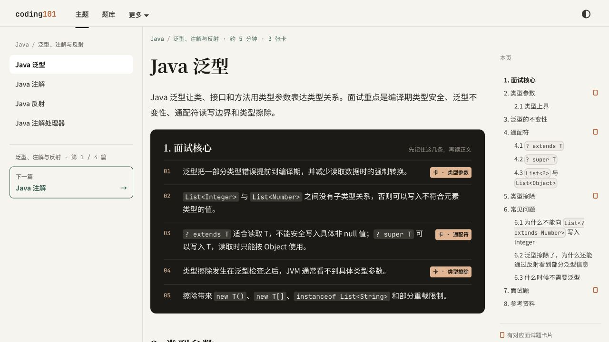
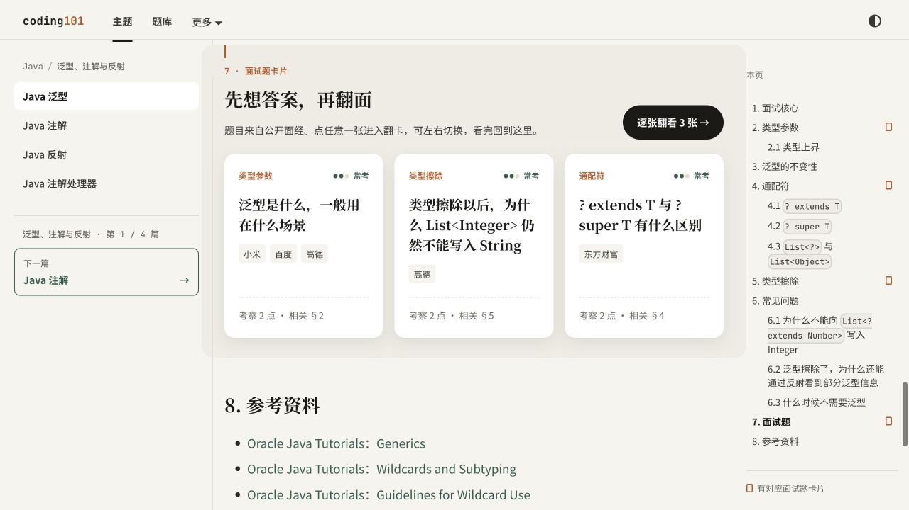
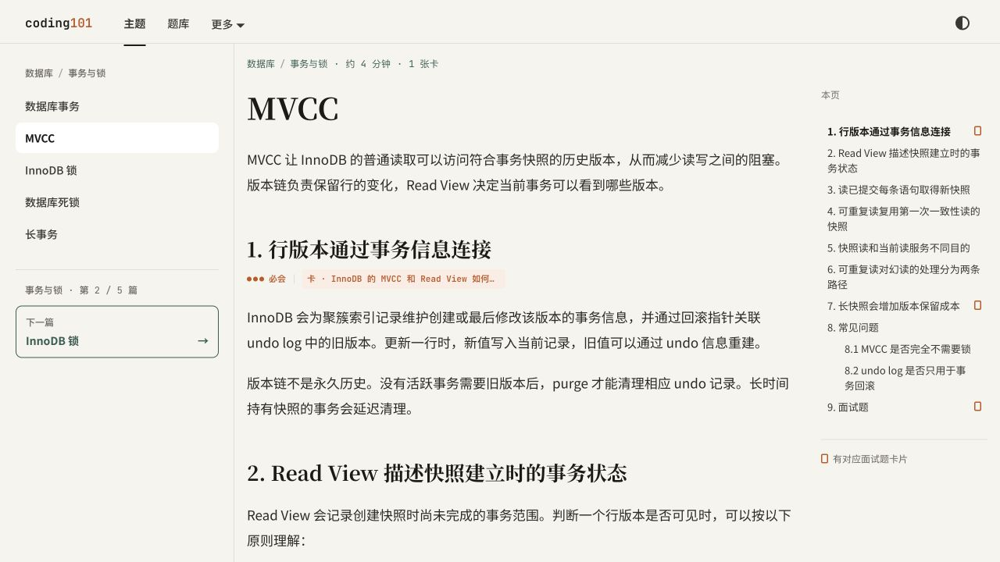
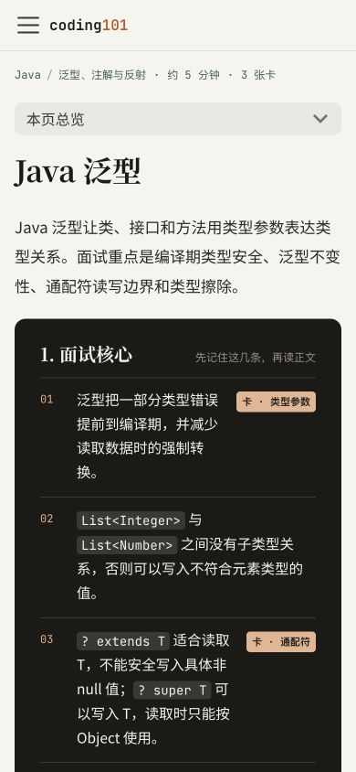
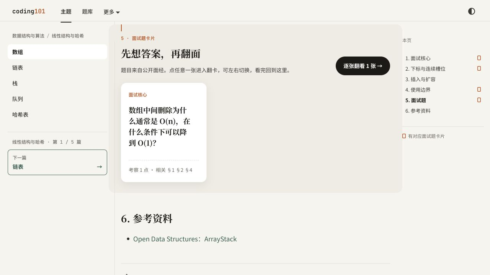
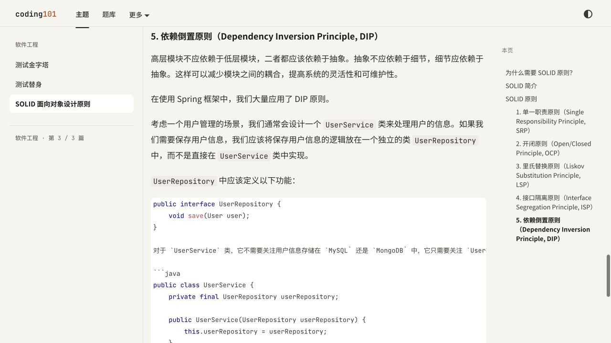

# 存量文章更新计划

检查日期：2026-10-13。基于当前工作区，包括已有未提交修改；Git 基线为 `e335e21`。初次盘点只新增材料；第 0 批实施与验收见 [第 0 批记录](./audits/article-format-2026-10-13/batch-0.md)。

当前原则（2026-10-13 用户补充）：优先覆盖面试要点，暂不按篇幅、阅读时长或题量限制文章，重点主题可以保留多道题。

建议先修复影响阅读与来源可信度的问题，再补齐共享基础和 Java 剩余文章，随后整理系统设计、AI 与运维。现有新版 Java 文章以验收和小修为主。

## 1. 最新要求与实际呈现

### 1.1 基准的优先顺序

1. [AGENTS.md](../AGENTS.md)：内容定位、文章篇幅、命名、面试题结构及写作要求。
2. [内容元信息规范](./content-schema.md)：稳定文章 ID、卡片 ID、相关章节、综合题及迁移规则。
3. [视觉设计交接](../design/README.md)及当前 [主题样式](../src/css/custom.css)、[文章组件](../src/learning/article/ArticleParts.tsx)、[内容转换插件](../plugins/remark-article-blocks/index.ts)：决定实际显示效果。
4. [Java 泛型](../docs/basic-knowledge/java/language/generics.mdx)：当前技术主题文章的可用样例。

`design-qa.md` 是早期蓝白岗位路线的验收记录，不是新版文章页标准。2026-08 的文风校准集仍有参考价值，但不能覆盖后来新增的稳定 ID 和卡片交互要求。

### 1.2 文章应满足的要求

| 方面 | 当前要求 | 更新时的处理 |
| --- | --- | --- |
| 首屏 | 标准概念标题，直接说明对象、范围与重点 | 技术主题优先一个概念；目录、路线引用与页面标题一致 |
| 核心摘要 | 3—5 条结论及回答边界 | 使用“面试核心”；与已有题目对应的结论加 `[卡](#稳定题目ID)` |
| 阅读主线 | 覆盖面试需要的机制、示例、追问与边界 | 不以字数或阅读时长删减；用目录、摘要和关联阅读帮助定位 |
| 标题层级 | 长文二级、三级标题连续编号 | 已发布卡片 ID 不随编号、标题修改；正文锚点变更要同步引用 |
| 常见问题 | 处理正文留下的真实疑问 | 当前组件默认展开第一项，其余折叠；不要再手工套重复折叠层 |
| 面试题源码 | 按考点覆盖决定题量，保留题目、公司、考察重点、相关内容、折叠参考回答 | 公司归属须有可核验来源注释；本站自测明确标记，不补造公司 |
| 面试题页面 | 由源码生成卡片，进入翻卡查看答案 | `
` 继续作为标准源码；不要另维护一套卡片答案 |
| 资料 | 用官方文档、规范或一手资料核验事实 | `:::note 参考资料`、独立参考章节都已存在，不因样式不同认定缺失 |
| 稳定性 | 保留 `knowledge.id` 和卡片显式 ID | 拆分、合并、撤下时登记 `contentMoves.json`，同步路线与相关链接 |

系统设计案例、操作教程和算法主题按各自结构组织。不能把“缺少面试核心”直接等同于不合格，也不能为了统一外观补出没有内容的章节。

### 1.3 视觉要求

当前主题采用暖色纸张背景、衬线标题、无衬线正文、等宽代码与标签；墨绿用于学习入口，朱砂用于卡片与重点。正文为 17px、1.9 行高，二级标题 26px，三级标题 18px。代码、表格、提示块使用统一卡片样式。

文章负责语义结构，视觉由组件统一处理：核心摘要自动形成深色块，题目引用形成标签，常见问题自动折叠，文末面试题形成卡片。后续文章不应为复制效果内嵌颜色、间距或单独布局。

移动端需特别验收核心摘要的换行：本次 390px 宽截图中，右侧卡片标签挤占文本宽度，一条摘要会变成多行。第 0 批已将窄屏卡片标签放到下一行，保留结论内容。

## 2. 存量盘点

数量修正：初次扫描未处理 `1. MapReduce` 目录的编号规范化，漏计两篇 MIT 6.824 文章。现按构建产物校对领域与文章总数；下表摘要情况保留第 0 批修改前的基线。

扫描 `docs/` 下全部 365 个 Markdown/MDX 文件：268 篇已发布知识树文章、2 篇草稿、95 个其他页面。其他页面包含栏目导读、求职资料、工具指南和 28 个 LeetCode 页面，不能全部套用技术文章模板。Blog 和独立 React 页面未纳入文章数量统计。

生成产物确认有 **437 张卡片**。268 篇已发布知识树文章都有稳定 ID；437 道题的显式 ID、公司字段、考察关联及参考回答结构已具备，构建校验通过。这里只确认结构与链接有效，不代表已逐条核验公司来源和技术答案。

| 知识树领域 | 文章数 | 无“面试核心”标题 | 有核心但无卡片链接 | 超过 3 道题 |
| --- | ---: | ---: | ---: | ---: |
| Java | 106 | 8 | 0 | 0 |
| 数据库 | 15 | 10 | 5 | 0 |
| 缓存与 Redis | 8 | 6 | 2 | 0 |
| 操作系统 | 8 | 0 | 7 | 0 |
| 计算机网络 | 9 | 5 | 4 | 0 |
| 消息队列与中间件 | 5 | 5 | 0 | 0 |
| 数据结构与算法 | 21 | 6 | 15 | 0 |
| 系统设计 | 41 | 41 | 0 | 0 |
| 安全 | 4 | 4 | 0 | 0 |
| 软件工程 | 3 | 1 | 0 | 0 |
| AI 应用与 Agent | 29 | 0 | 0 | 12 |
| 运维与云原生 | 17 | 3 | 0 | 3 |
| 大数据 | 2 | 2 | 0 | 0 |
| **合计** | **268** | **91** | **33** | **15** |

领域按运行时知识树归属，不按文件夹。例如 Spring Security、Maven 两篇文件位于系统设计目录，但归入 Java；部分生产工程文章归入运维。各列彼此可能重叠，不能相加作为改写篇数。“超过 3 道题”仅保留为历史统计，不再作为更新依据。

其他发现：

- 只有《Embedding 与向量检索》的核心摘要超过 5 条，目前为 6 条。
- 《Redis 数据结构》《SOLID 面向对象设计原则》《设计网页爬虫》及 MIT 6.824 两篇 MapReduce 文章没有标准面试题区。前两篇需补自测；爬虫案例、课程讲义与实验按各自文体审查。
- 《索引设计》正文已有“高频考点”提示块，并非完全缺少摘要；应统一为可识别的“面试核心”。其 front matter 标题原为“索引”，与正文标题不一致；第 0 批已统一标题与摘要。
- 38 篇文章包含“本站自测”标记。这些题不能按缺少公司来源处理，也不能显示为已核验公司真题。
- 《数据库索引》《索引设计》与 B+ 树、聚簇索引、联合索引、执行计划文章存在讲解交叉。应先确定各篇边界，再删减重复正文；不直接删除已有文章或 ID。
- `content-schema.md` 中“249 篇、376 张”是旧数量；`product-roadmap.md`、知识树 README 也有已落后于实现的状态描述；第 0 批已同步当前数量与实现状态。

逐文件数据见 [inventory.json](./audits/article-format-2026-10-13/inventory.json)，按最新原则调整后的结构复核候选见 [backlog.md](./audits/article-format-2026-10-13/backlog.md)。候选清单不是全文质量评分；本次为全量结构扫描加代表文章细读、页面抽查。

## 3. 更新顺序

### 第 0 批：修复展示错误与统一验收基准（已完成）

已于 2026-10-13 完成；以下保留任务范围，修复原因、截图与验证结果见[第 0 批验收记录](./audits/article-format-2026-10-13/batch-0.md)。

1. **修复 SOLID 的代码围栏。** 已实测部分正文和下一段代码标记被包进代码块。先恢复正常显示，再调整概念解释与自测题。
2. **修正自测题的来源呈现。** `InterviewCards` 固定显示“题目来自公开面经”，《数组》的本站自测卡片也出现这句文案。统一改为准确说明来源的文案，明确显示本站自测；原始 URL 继续保留在源码注释。
3. **统一《索引设计》的标题与摘要入口。** 同步 front matter、索引、路线名称；保护稳定 ID。
4. **补文章页验收矩阵。** 使用泛型、MVCC、数组、SOLID 四个样例检查桌面和手机；补测暗色、长代码、宽表格、长题目、FAQ 展开、翻卡与回查。
5. **处理开发预览的草稿兼容。** `npm start` 会把 Pastebin、奶茶店草稿送入严格 ID 校验而失败；生产构建会排除草稿并成功。先确认草稿是否应进入学习索引，再统一开发与生产的过滤规则。
6. **校正文档状态。** 更新盘点数量及已完成能力，保留计划与现状的区分。

验收：错误正文正常显示，自测来源不再误标；样例首屏、卡片及回查路径可用；开发预览和生产构建的草稿策略一致。

### 第 1 批：8 篇主路径文章试点（已完成）

已于 2026-10-13 完成以下 8 篇，题目从 8 道扩充到 32 道；技术事实、来源、MySQL 实验与页面效果见[第 1 批验收记录](./audits/article-format-2026-10-13/batch-1.md)。当前知识树为 268 篇、461 张卡片。以下保留原计划范围：

| 顺序 | 文章 | 主要更新 |
| --- | --- | --- |
| 1 | [数据库事务](../docs/basic-knowledge/database/transaction/index.mdx) | 核心结论与回答边界；隔离级别概述与 MVCC 分工 |
| 2 | [MVCC](../docs/basic-knowledge/database/transaction/mvcc-read-view-consistent-read.mdx) | 核心摘要、快照时机、相关章节精确关联 |
| 3 | [InnoDB 锁](../docs/basic-knowledge/database/transaction/innodb-locking-ranges.mdx) | 适用版本、锁范围的最小例子、追问边界 |
| 4 | [数据库索引](../docs/basic-knowledge/database/indices/index.mdx) | 概念范围、核心阅读与深入阅读划分 |
| 5 | [联合索引与覆盖索引](../docs/basic-knowledge/database/indices/composite-covering-back-table.mdx) | 最小查询示例、回表判断、与索引总览去重 |
| 6 | [TCP 连接](../docs/basic-knowledge/network/tcp_handshake.mdx) | 核心摘要、握手与关闭的题目边界、图文核验 |
| 7 | [MyBatis](../docs/basic-knowledge/java/data-access/mybatis-mapping-executor-plugins.mdx) | 请求执行主线、核心摘要、插件细节的阅读层次 |
| 8 | [数据库连接池](../docs/basic-knowledge/java/data-access/connection-pool-capacity-timeout-leaks.mdx) | 容量、超时、泄漏的核心结论与场景边界 |

这里的“更新”是审阅任务，不预设每篇都需要重写全部正文。

验收：每篇能在开头看清复习重点；代表题能从正文推出；参考回答默认隐藏；核心卡片、正文依据、路线入口一致。记录单篇耗时与常见返工点，用于后续排期。

### 第 2 批：共享基础与 Java 收尾

- **共享基础 45 篇**：数据库 15、Redis 8、操作系统 8、网络 9、中间件 5，包含第 1 批已处理文章。按“事务和索引 → Redis → 网络与 OS → 消息语义”推进，每批 6—10 篇。
- **Java 剩余 8 篇摘要候选**：MyBatis、JPA、连接池、N+1、批处理与分页、并行 Stream、Spring Security、Maven。第 1 批已覆盖其中 2 篇，其余分批补齐。
- **33 篇核心到卡片的关联补齐**作为轻量任务随所属批次完成：只在已有结论确实对应题目时加链接，不为凑标签新建重复题。
- **Redis 数据结构优先技术核验**：源码中将字符串内部实现表述为 HashTable，并混用数据类型与内部编码。按官方文档核对键空间、值类型、编码及适用版本，随后补代表题。
- **现有新版 Java 正文**以抽查与校验为主：保留本轮已完成的标题、摘要和题目整理，核验摘要中的事实、适用版本与面试考点覆盖。

验收：共享知识有明确正文归属，岗位路线只表达顺序、优先级和深度；同一解释不在概念总览、实现文章和任务教程中重复维护。

### 第 3 批：系统设计、安全与工程内容

覆盖系统设计 41、安全 4、软件工程 3 篇；第 0 批已处理的 SOLID 不重复计工作量。

- **技术概念类**：重试、超时、幂等、限流、熔断、复制、一致性等沿核心结论—机制—代价—边界展开，保留有面试价值的深入追问。
- **设计案例类**：保留需求、容量估算、读写链路、数据模型、故障和取舍。《设计网页爬虫》重点检查容量假设、调度与去重、代码是否明确为示意、自测与资料来源。
- **架构与协作类**：逐篇确认对应资深岗位面试的具体问题与证据，保留有面试价值的决策、兼容迁移、评审和复盘内容；泛职业成长内容不进入求职主路径。
- **卡片关联**：现有“从第 1 节至第 8 节”式链接只给出两个端点，无法精确表达回答依据。改为真正支撑考点的章节；需要多个独立概念推导的题再判断是否标为综合题。

验收：每篇文体明确；概念文有停止条件；设计题的回答基于约束；综合题关系与卡片标记通过构建校验。41 篇没有摘要是待分类信号，不要求所有案例加同一模块。

### 第 4 批：AI、运维与算法精修

- **AI 29 篇、运维 17 篇**已有较好的新格式覆盖。按面试考点覆盖与来源证据复核文章，代表对象为 Agent 评估、AI 辅助开发、RAG、Function Calling、Pod、网络排障、磁盘与文件系统。
- 不因文章较长或有 4—5 道以上题目合并、拆分或删除内容。核对重复问法时保留不同考点和追问条件；确因知识归属需要迁移时保留旧卡 ID 映射。
- 《Embedding 与向量检索》将 6 条摘要合并到 3—5 条，避免一条摘要承载多个段落。
- **算法与数据结构 21 篇**按前置关系、适用问题、复杂度、最小示例、边界输入组织；处理 15 篇摘要无卡片链接和 6 篇摘要候选，避免改成新的单题题解库。

验收：面试要点有正文依据和对应自测；参考回答能解释推导；命令或代码提供可核对的结果与边界；拆分后路线、引用和学习 ID 均有效。

### 第 5 批：导读与历史内容维护

检查其余 95 个已发布页面的职责：栏目导读维护入口和下一步；求职资料维护目标岗位与时效；工具教程检查可执行性；28 个 LeetCode 页面仅维护正确性、链接和明显排版问题。

不统一添加面试核心或卡片，不把已发布 WIP、空入口表述成完成能力。需要撤下或合并的内容先确认引用与 ID 迁移方案。

## 4. 每批交付与验收

每批只处理一个相邻主题组，建议 6—10 篇；拆分复杂文章时减量。第 1 批已完成；来源核验和实验的工作量因文章而异，暂不承诺后续总工期。

1. **编辑验收**：开头和标题直接、结论有范围、示例能解释结果、FAQ 不重复正文、面试要点覆盖充分；标题与路线名称一致。
2. **事实与来源**：核验本批关键技术结论及公司原始面经；失效或无法确认的来源如实标记。API、版本、默认值和排障命令优先核验。
3. **结构校验**：运行 `npm run check:doc-links`、`npm run check:review-resources`、`LOCAL_PREVIEW=true npm run build`。组件修改再补 `npm run typecheck` 及针对性交互检查。
4. **页面验收**：至少抽查技术主题、含代码或宽表格页面、卡片页；桌面浅色、桌面暗色、390px 手机。检查摘要可读性、代码与表格溢出、FAQ、翻卡、正文回查和返回。
5. **变更核对**：稳定 ID 保持或有迁移映射；题目、相关章节、路线与核心/深入阅读同步更新；不改无关文章。

构建成功不能替代浏览器检查：本次 SOLID 的代码围栏错误与自测来源文案问题都能通过构建。

## 5. 初次盘点的视觉检查与证据

以下截图均来自本次工作区生产构建，在本机预览；桌面 1280×720，手机 390×844。未以历史截图或线上旧部署代替工作区结果。

1. **泛型首屏：基本良好。** 标题、范围、五条摘要及卡片入口层级清楚，可作技术主题样例。

   

2. **泛型题目区：基本良好。** 三张卡片和资料区分离，题目先展示；本次未完整执行翻卡及返回流程。

   

3. **MVCC 首屏：需补内容层级。** 主题样式已生效，但从导语直接进入机制，缺少可快速复习的摘要；目录中的长标题换行较多。

   

4. **泛型手机首屏：需改善摘要密度。** 未见首屏横向溢出，但卡片标签压缩正文列，核心摘要占据较长纵向空间。

   

5. **数组自测卡片：来源文案有误。** 源码明确是本站自测，组件却统一宣称来自公开面经；应优先修正。

   

6. **SOLID 代码区：存在显示错误。** 普通说明和代码围栏标记进入代码块，应先恢复语义边界。

   

检查边界：未完成暗色、键盘焦点、屏幕阅读器、全站移动端及外链可访问性测试，不能据截图宣称无障碍合规。首屏小号弱对比提示、长代码及宽表格列入后续测试；本次不将其直接判为对比度或响应式失败。

## 6. 初次盘点的验证结果

- `npm run check:doc-links`：通过。
- `npm run check:review-resources`：通过，校验了 20 个核心主题、67 篇阅读范围、277 个题目链接及现有岗位资料；这些是脚本覆盖范围，不是全站卡片总数。
- `LOCAL_PREVIEW=true npm run build`：通过，268 篇知识树文章、437 张生成卡片；已有 Blog 作者与摘要标记警告。
- `npm start`：初次盘点失败，原因是两篇 `draft: true` 草稿在开发模式下缺少 `knowledge.id`；第 0 批已修复并验证启动成功，开发与生产索引一致。
- 保留工作区原有 112 个文件的未提交修改。未提交、推送或部署。
