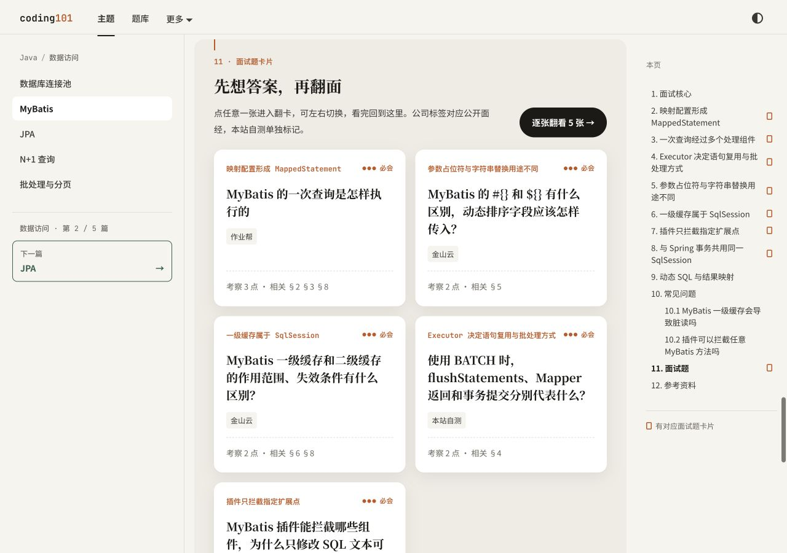
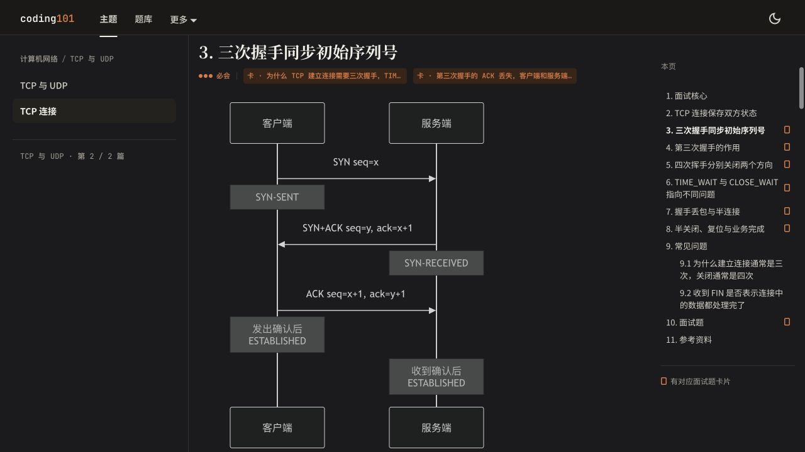
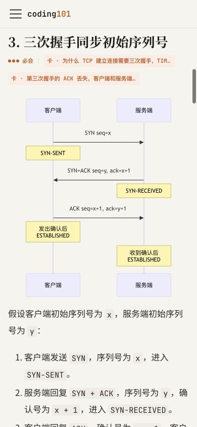

# 第 1 批文章更新与验收

日期：2026-10-13。范围为计划中的 8 篇文章，基于第 0 批完成后的工作区继续修改。优先覆盖面试要点，没有按篇幅或题量删减。未提交、推送或部署。

## 完成范围

每篇补齐 5 条面试核心、对应卡片入口、连续章节编号和独立参考资料区；参考资料以官方文档、规范、源码为主。相关内容改为准确的正文章节，并同步 8 个复习资源的摘要入口和阅读范围。全部旧正文锚点、8 道原题的稳定 ID 和文章 knowledge.id 保留。

| 文章 | 本轮补充和校正 | 题目数（原为各 1 道） |
| --- | --- | --- |
| 数据库事务 | 条件更新与丢失更新；两次转账更新的影响行数；自动提交、隐式提交、语句与事务回滚；redo/undo/binlog、持久性配置和提交结果不确定 | 4 |
| MVCC | Read View 可见性判断；BEGIN 与首次一致性读的区别；RR/RC 双会话推演；快照读与当前读混用；长快照和导出一致性 | 4 |
| InnoDB 锁 | 唯一等值查询存在与不存在记录的差异；记录锁、间隙锁、意向锁；双会话实验；死锁与超时；NOWAIT/SKIP LOCKED | 4 |
| 数据库索引 | 概念总览与深入文章分工；聚簇索引选择、主键宽度、NULL 唯一约束；优化器成本与执行计划证据 | 3 |
| 联合索引与覆盖索引 | 范围边界、ICP 与覆盖的区别；查询与索引示例；Using index 与 Using index condition；排序、LIMIT、MVCC 回表边界 | 4 |
| TCP 连接 | 两端 ESTABLISHED 的时机；握手丢包与重传；FIN、半关闭、RST；同时关闭与 2MSL；协议确认与业务成功；重画握手和关闭图 | 4 |
| MyBatis | 查询与缓存路径；一级/二级缓存边界；参数绑定与白名单；BATCH 的 flush 与 commit；Spring Session 生命周期；动态 SQL、ResultMap、N+1；旧缓存值与脏读的区别 | 5 |
| 数据库连接池 | 连接归还与事务边界；连接总预算、等待与持有时间；Hikari 参数；泄漏告警；超时预算；REQUIRES_NEW 嵌套借连接 | 4 |
| **合计** | **新增 24 道；本批共 10 道有公司来源、22 道本站自测** | **32** |

当前全站生成索引为 13 个领域、268 篇知识树文章、461 张卡片。初次盘点与第 0 批的 437 张属于历史验收数，不回写历史记录。

## 技术事实核验

- 数据库文章以 MySQL 8.4 / InnoDB 为主要范围。Read View 算法对照 MySQL 8.4.0 的 `read0types.h`，隔离、锁和事务错误处理对照 8.4 官方手册；PostgreSQL 隔离差异引用固定版本 18 文档。
- 覆盖索引不是“任何情况下都不访问聚簇记录”的保证：InnoDB 仍可能为 MVCC 可见性检查读取聚簇记录。唯一等值锁是否退化为记录锁，也要区分目标记录存在与不存在。
- TCP 以 RFC 9293 为依据，SYN flood 参考 RFC 4987。旧挥手图片中的状态位置不够准确，已换为可随主题渲染的 Mermaid 图。客户端发出第三次确认后与服务端收到确认后的状态分别标注。
- MyBatis/MyBatis-Spring 以官方 API、配置和事务文档核对。`useCache=false` 不能当作关闭一级缓存；`flushStatements` 不等于提交事务；DefaultSqlSession 与 SqlSessionTemplate 的线程安全性质分别说明。
- 连接池以 HikariCP 官方说明、JDBC API 和 Spring 事务传播文档核对。泄漏检测只告警，不自动回收；扩大池容量的效果取决于数据库余量；查询超时与请求超时不等价。

完整技术参考链接已写入每篇文章的参考资料区。

## 面经来源复核

公司标签仅表示候选人的公开面经出现过相关问题。无法取得正文的旧链接保留在源码注释中，不继续展示未经本轮核实的公司，也不把抓取失败直接认定为虚假来源。

| 原归属与链接 | 核验结果与处理 |
| --- | --- |
| 事务 · [美团](https://www.nowcoder.com/discuss/353158342476505088) | 原文明确问 ACID、隔离级别；保留 |
| MVCC · [阿里云](https://www.nowcoder.com/discuss/599874114614026240) | 未取得面经正文；暂移除公司标签，保留待复核注释 |
| MVCC · [美团](https://www.nowcoder.com/discuss/606612767239311360?sourceSSR=post) | SSR 正文明确问 undo、MVCC、幻读；保留，注释换为可读地址 |
| InnoDB 锁 · [美团](https://www.nowcoder.com/discuss/353159442889908224) | 原文问锁类型；保留。候选人回答中的技术错误不作为正文依据 |
| 索引总览 · [美团](https://www.nowcoder.com/discuss/353156355747946496) | 未取得正文；改用下行已核实的字节跳动面经 |
| 联合/覆盖索引 · [字节跳动](https://www.nowcoder.com/discuss/353159293912424448) | 原文问索引使用、回表；同时支持索引总览对应题 |
| TCP · [字节跳动](https://www.nowcoder.com/discuss/353156517979430912) | 正文/检索结果可核对握手、TIME_WAIT、CLOSE_WAIT；保留，并增加[另一篇第一人称面经](https://www.nowcoder.com/discuss/353155506619490304)交叉核对 |
| TCP · [美团](https://www.nowcoder.com/discuss/353154541233315840) | 未取得正文；暂移除公司标签 |
| MyBatis · 原标[金山办公](https://www.nowcoder.com/discuss/800822936729894912) | 原文为金山云，列出缓存、参数绑定、分页、批处理，不能支持原查询全流程题；改为金山云并用于新增缓存、参数题 |
| MyBatis · [CVTE](https://www.nowcoder.com/discuss/353154893408051200) | 未取得正文；暂移除公司标签 |
| 连接池 · [招银网络科技旧链接](https://www.nowcoder.com/discuss/353155487401189376) | 未取得正文；替换为[已核验面经](https://www.nowcoder.com/discuss/353154809148678144?urlSource=sitemap)，明确问连接池设计考虑方向 |
| 连接池 · [腾讯](https://www.nowcoder.com/discuss/353156687580307456) | 未取得正文；暂移除公司标签 |

MyBatis 原查询流程题改用[作业帮面经](https://www.nowcoder.com/discuss/353155250779529216)：定向检索返回的完整面经索引文本包含“mybatis 执行过程”；直连页面本轮不可读取，核验方式已如实记在源码注释。新增题中只有缓存、参数绑定两题使用明确匹配的金山云来源，其余 22 道标记本站自测。

## 可执行验证

使用官方 `mysql:8.4` 临时容器，实际版本 **8.4.11**，无主机端口、无外部网络，数据置于临时文件系统；测试后停止并自动移除容器。结果保存在 [mysql-results.json](./batch-1/mysql-results.json)。

| 实验 | 实际结果 |
| --- | --- |
| 普通读 / 普通读 / FOR UPDATE / 普通读 | RR：110、110、120、110；RC：110、120、120、120 |
| RR WITH CONSISTENT SNAPSHOT | 后续事务提交 110 后仍读到起始快照中的 100 |
| RR 唯一键查不存在的 15（已有 10、20） | 记录到 `X,GAP`、上界 20；其他事务插入 15 超时，原事务提交后可插入 |
| RR 锁住已存在的唯一键 10 | 其他事务插入 15 成功 |
| RC 查询不存在的唯一键 15 | 其他事务插入 15 成功 |
| 默认锁等待超时与重复键错误 | 失败语句回滚，此前成功的插入仍在事务中，显式 ROLLBACK 后撤销 |
| ICP 与覆盖执行计划 | 受控 FORCE INDEX 对比得到 `Using index condition` 与 `Using where; Using index` |

执行计划实验用 FORCE INDEX 控制比较变量，不意味着优化器在所有数据量下都自动选择该索引。本轮未搭建 MyBatis/Spring/JDBC 集成工程，相关边界通过官方文档核验；TCP 未进行抓包实验。

- `npm run check:doc-links`：通过。
- `npm run check:review-resources`：通过，20 个核心主题、67 个阅读范围、277 个静态题目链接。
- `LOCAL_PREVIEW=true npm run build`：通过；仅有已有 Blog 作者、摘要及运行环境警告。
- 8 篇原有正文锚点、原题 ID 保留，32 题均有显式 ID、相关内容和折叠参考回答。
- `git diff --check`：通过。文章更新阶段只修改内容和配套计划/资源数据；后续响应式复核修改了文章卡片 CSS，见下文。

## 页面验收

使用本机生产构建预览，桌面 1280×720、手机 390×844。8 篇均检查桌面首屏和手机宽度，页面没有整体横向溢出；宽代码与 MVCC 表格在内部容器处理。原始测量见 [browser-checks.json](./batch-1/browser-checks.json)。

- 摘要、目录、核心卡片标签、正文关联和资料区正常。
- MyBatis 五题网格显示作业帮、金山云及本站自测；进入参数题时答案默认遮罩，空格翻面后显示；回查落到第 5 节，浏览器返回后可回到文末题目区；FAQ 可用 Enter 展开。
- TCP 握手与关闭图检查浅色手机、暗色桌面。首轮图在手机上文字偏小，将状态注释放到对应参与者下方后重新构建、复查。
- MVCC 双会话推演表和 SQL 代码在手机上可阅读，表格没有撑宽整个页面。

其余 8 篇桌面首屏、手机样例、翻面前后和正文回查截图保存在 [batch-1](./batch-1/) 目录。本次验收范围为上述文章与抽测交互，不代表完成全站无障碍或所有浏览器兼容性认证。

## 后续接续

第 1 批完成。第 2 批继续共享基础与 Java 剩余文章，优先 Redis 数据结构事实校正、事务/索引剩余专题，再推进 JPA、N+1、批处理与分页。沿用“正文依据—代表问题—官方资料—页面实测”的验收方式，不恢复题量上限。

本轮没有记录可靠的逐篇计时，不能据此给出准确工期。主要返工点是来源归属与题目不匹配、版本条件遗漏、编号变化后的旧锚点保护，以及手机时序图尺寸；后续每批仍按 6—10 篇组织，来源复核和可执行示例预留独立时间。

## 卡片响应式复核与修正

2026-10-13 用户指出原截图中三列卡片过窄、长题目频繁换行和标签截断。此前将这一布局判为正常不准确；原截图保留为 [修正前证据](./batch-1/mybatis-cards.png)。

原因：网格虽采用自动分列，但最小列宽为 220px，703px 的正文区域仍排入三列；卡片没有固定高度，却有 260px 最小高度，并由网格按行拉齐。标签被强制单行省略。此外，601—996px 视口中侧栏已隐藏，题目区仍用桌面的 -32px 负边距，768px 实测左右各超出视口 16px。

修正仅涉及 `src/learning/article/article.module.css`：

- 网格按容器宽度使用 `auto-fit`，最小可读宽度 300px；不足 300px 时允许占满容器，避免窄屏溢出。
- 移除 260px 最小高度，由内容决定高度；同一行保持等高，不限制题目行数。
- 标签允许完整换行，长词可断行，保留优先级标签。
- 在 996px 及以下统一收窄题目区边距，匹配侧栏折叠后的正文。

复查 320、390、768、1024、1280、1440px，列数依次为 1、1、2、1、2、2；页面宽度均等于视口宽度，卡片与标签没有横向溢出。1024px 为一列是因为两侧导航仍占空间，正文只剩 511px。1280px 下每卡约 344px，按行内容分别高约 226px、255px、226px；390px 下各卡高度约 198—255px。测量见 [card-layout-checks.json](./batch-1/card-layout-checks.json)。

桌面、手机、平板和暗色截图已复查；点击参数题仍打开正确卡片，答案默认遮罩。生产构建（含链接与复习资源校验）、`npm run typecheck` 和 `git diff --check` 均通过。

[手机截图](./batch-1/mybatis-cards-responsive-390.png) · [平板截图](./batch-1/mybatis-cards-responsive-768.png) · [暗色截图](./batch-1/mybatis-cards-responsive-dark.png)

## 题目区外层边界修正

同日用户继续指出背景块侵占侧栏与右侧目录。上一轮测量“没有页面横向滚动”不足以证明题目区没有越过正文：1280px 下正文为 x=316—1019，背景块为 x=284—1051，实际侵入左侧栏 16px，并贴住右侧目录起点。原因是桌面仍保留左右 -32px 的外层负边距。

已移除标题和题目区在所有尺寸下的横向负边距，保留容器内边距。修正后背景块、标题、正文均为 x=316—1019，与侧栏相隔 16px、右侧目录相隔 32px；内部卡片继续按实际可用宽度响应式排列。

复查 320、390、768、996、997、1024、1280、1440px：标题和背景块的左右边界全部与正文一致，卡片无溢出；特别覆盖侧栏折叠断点两侧。生产构建（含链接、复习资源检查）与 `git diff --check` 通过。此记录替代上一节关于最终外层布局的结论，旧截图和测量保留为修正过程证据。

[边界测量](./batch-1/card-container-checks.json) · [桌面截图](./batch-1/mybatis-cards-contained-1280.png) · [手机截图](./batch-1/mybatis-cards-contained-390.png) · [平板截图](./batch-1/mybatis-cards-contained-768.png)
