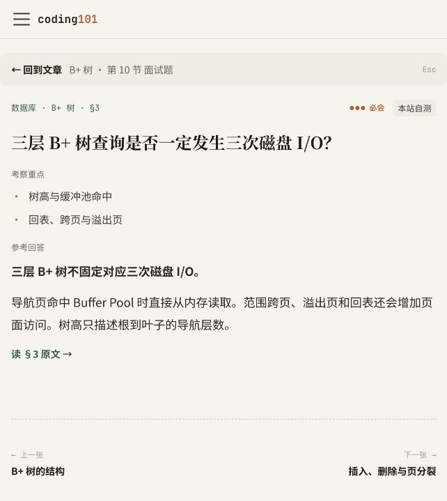

# 面试核心与卡片参考回答整理

2026-10-15 完成四篇示例之外的 264 篇知识树文章、863 张卡片的检查和调整。全站现有 268 篇知识树文章、877 张卡片。

## 内容调整

- 面试核心按主题要点组织，保留结论、必要说明、版本条件和卡片链接。为要点增加便于定位的名称，并补充或改写其中 67 条的说明。
- 参考回答先回答问题，再解释原因、条件或依据。69 个答案调整了措辞或内容组织，794 个已经明确作答的答案保留原措辞，调整结论强调和段落层次。
- 多要点题按需要分点，排查题保留有依据的步骤。补全脱离正文后无法理解的示例条件，例如缓冲区的 `source` / `view`、配置覆盖前后的值，以及方法句柄的调用类型。
- 四篇已确认示例保留内容，其中 10 个答案同步将结论与解释分段。
- `volatile` 进一步明确：示例中 `publish` 只调用一次，之后不再修改 `data` 指向的对象。方法名和字段名直接使用代码标识符，并将这项写法补入项目 `AGENTS.md`。
- 修复 Redis Sentinel 题目遗漏的“5 个”前提，保留原卡片锚点。

此次主要调整主题摘要与卡片答案。原本已经清楚、直接作答的内容保留，没有逐篇重写全部正文，也没有重新核验全部外部技术资料。

## 完整性核对

以本轮批量调整前的工作区快照为基准，以下内容全部保持一致：

- front matter，包括 `knowledge.id`。
- 卡片 ID、章节显式锚点和 HTML 兼容锚点。
- 公司来源及自测归属注释。
- `[卡]` 链接与卡片数量。
- 所有 fenced code blocks。

批量调整中，面试核心与参考回答之外只有 Sentinel 题目补全这一项文字变化。`volatile` 的专项修改已在该快照之前完成。

逐文件统计见 [manifest.json](./manifest.json)。统计区分措辞变化与只调整加粗、空白和分段的变化。

## 验证结果

- `node scripts/check-article-format.mjs --strict --list`：268 篇文章，0 个结构问题；双亲委派示例的一处长句提示保留，该句完整说明委派顺序。
- `npm run check:doc-links`：通过。
- `node scripts/check-review-resources.mjs`：通过，20 个核心主题、67 篇阅读范围和 277 道题目链接一致。
- Markdown AST 检查：877 个参考回答中，873 个以加粗结论段开始，4 个以分别强调结论的列表开始；无未解析的 `**`。
- `LOCAL_PREVIEW=true npm run docusaurus -- build`：通过。
- `git diff --check`：通过。
- 浏览器检查：`volatile` 的方法与字段表述显示正常；B+ 树面试核心、卡片跳转、默认待翻面状态、参考回答和回原文入口正常。

文章整理完成时，完整 `npm run build` 曾在校招生成文件检查中失败。后续核对发现，12 个校招页面和 1 个面经页面的 `description` 已更新，但两个生成脚本仍保留旧文案。现已把页面文案同步回模板，重新生成结果与现有页面完全一致，完整 `npm run build` 已通过。原有博客作者、摘要标记与运行环境提示仍为非阻断警告。

## 卡片显示

页面验证时发现，加粗结论后直接紧接中文会让 Markdown 将部分 `**` 作为文本显示。已将结论与解释分段，并重新检查全部卡片的解析结果。

