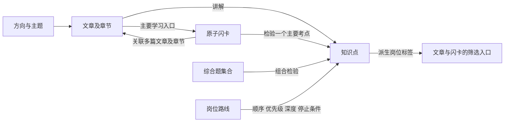

# Coding 101 领域术语与内容模型

本文定义 Coding 101 的内容类型、知识关系和学习功能用语，供内容建设、页面设计和开发共同使用。领域、文章、闪卡是三个面向读者的内容类型；知识点负责连接内容与岗位要求。本文描述目标模型，当前实现和开发顺序见[项目计划](./product-roadmap.md)。

## 1. 术语

| 术语 | 定义 | 边界与示例 |
| --- | --- | --- |
| 领域 Domain | 按技术对象组织的知识入口，可以包含子主题 | Java、数据库、缓存、操作系统、计算机网络、Node.js、Go；入口存在不代表内容已建设完成 |
| 主题 Topic | 领域内部用于组织相关知识的分组 | Java 集合、Java 并发；使用与领域一致的分类结构，不另建一种正文类型 |
| 知识点 Knowledge Point | 能够独立检验的学习目标，是知识树的叶子 | “解释 HashMap 对 key 相等性的要求”；范围需足以独立作答和判断遗漏 |
| 文章 Article | 对明确技术概念或任务作连贯解释的内容 | 讲解机制、示例与适用边界，可以支撑多个知识点 |
| 原子闪卡 Flashcard | 用一个明确问题检验一个主要知识点的复习内容 | 包含问题、简明参考回答、自检要点和关联文章；可以有不同问法 |
| 综合题 Composite Question | 组合多个知识点完成解释、设计或实现的练习 | 在统一题库中关联知识点与文章，不新增主树叶子；真题与自测均可采用此粒度 |
| 岗位 Role | 用户准备应聘的岗位方向 | Java 后端开发；公司、单条 JD、校招或社招场景另行记录 |
| 岗位路线 Role Roadmap | 面向岗位和招聘场景编排的知识范围 | 保存顺序、优先级、回答深度和停止条件，不复制文章或闪卡 |
| 标签 Tag | 便于跨分类浏览和检索的描述 | 例如线程安全、性能；岗位标签由岗位与知识点的关联生成 |
| 练习集合 | 按文章、领域、岗位或筛选条件选择的闪卡集合 | 保存或计算卡片引用，不复制卡片内容 |
| 练习会话 | 用户围绕一个集合进行的一次练习 | M1 只保留当次界面状态；跨访问记录属于 M2 |
| 个人学习计划 | 结合目标岗位、可用时间和复习记录安排的个人任务 | 属于 M2；与所有读者共享的岗位路线区分 |

知识点是内部关联单位，不要求用户额外访问一层“知识点页面”。文章和闪卡都可以直接进入。现有代码中的 `RoadmapTopic` 是较大的复习分组，不直接当作原子知识点迁移。

## 2. 内容关系

知识树的浏览层级采用“方向 → 主题 → 文章 → 原子闪卡”。方向与主题可以继续细分，但不把岗位当作文章的归属目录。可导入导图工具的结构见[文章与闪卡知识树](./knowledge-tree/article-flashcard-tree.md)，使用约定见[知识树入口](./knowledge-tree/README.md)。

每篇文章在树中有一个主要位置，每张原子卡在一篇主要文章下展开。这个位置表示主要讲解入口，不限制文章与卡片的多对多关系；其他文章通过关联阅读进入。知识点 ID 仍负责学习目标、前置、岗位要求及掌握记录，树上直接显示检验该目标的问题，不再额外插入一层知识点名称。

- 每个知识点有一个主要主题归属，可关联其他主题；文章归属决定树中的展示位置，知识前置与相关关系允许跨分支。树上的父子层级不等于全部学习依赖。
- 每篇文章可讲解多个知识点，同一个知识点可由多篇文章共同支撑。不同文章解释不同方面，重复的同一知识正文应合并维护。
- 每张原子闪卡检验一个主要知识点，可关联多篇文章；每篇文章也可关联多张闪卡。前置知识不自动变成该卡的额外考察目标。跨文章阅读不自动使题目成为综合题。
- 同一知识点的等价问法作为变式维护，不因换一种措辞重复计算掌握情况。需要分别判断掌握情况的问题应拆成不同知识点。
- “介绍一下 HashMap”等综合问题可组合多个知识点，用于综合口述；在统一题库的综合练习集合中管理，不新增知识树叶子，不计入原子卡片数量。它们保留相关知识点与文章引用，答对综合题不自动标记全部关联考点已掌握。综合问答功能不在 M1 的必交范围，现有题目与案例目录见[综合练习集合](./knowledge-tree/practice-mindmap.md)。
- 考察粒度与题目来源分别保存：原子题和综合题都可能是本站自测或公开面经真题。面经真题中的原子题可以进入文章下的闪卡，不能因为来源是真题就从知识树排除。

## 3. 闪卡内容规范

一张可发布的原子闪卡必须让读者知道问题的条件、回答到哪里、漏答了什么，以及去哪里补充原理。综合题另设分项检查，不套用单一主要考点的约束。

| 内容 | 要求 |
| --- | --- |
| 问题 | 能独立理解；必要时包含最小代码、版本或场景条件，避免依赖“上文” |
| 主要知识点 | 唯一稳定引用，对应一个可独立检验的目标 |
| 参考回答 | 默认隐藏；保留回答此题所需的结论、理由与关键边界，不复制整篇文章 |
| 自检要点 | 明确必须解释的内容和容易遗漏的条件；不要求逐字复述 |
| 关联阅读 | 至少一个有效的回答依据，允许多篇文章；优先指向章节，并说明阅读目的 |
| 补充阅读 | 根据需要标记“补充前置”或“深入阅读”，不把全部关联文章列为必读 |
| 来源与适用范围 | 区分公开面经与本站自测；公司归属有可核验出处，版本敏感结论注明适用条件 |

例：卡片“自定义对象作为 HashMap 的 key，需要满足哪些约束？”可以同时关联《HashMap》的查找章节、《对象相等性》的契约说明，以及其他有关 key 状态变化的解释。每个链接注明具体用途；尚无对应文章时先登记缺口，不能生成无效入口。

技术结论依据规范、官方文档或可验证示例核验。公开面经用于证明出现过相应问题，不能直接用作答案依据，也不能凭少量样本标注全市场频率。

## 4. 岗位关联与检索

岗位路线在知识点上设置要求，同一知识点可以服务多个岗位。优先级为“必会、常考、按岗选学”，回答深度为“基础回答、原理解释、场景分析”；它们属于具体路线中的要求，不是文章或卡片的永久等级。

岗位标签从明确的知识点关联生成：

1. 闪卡通过主要知识点获得适用岗位。
2. 文章通过明确讲解的知识点获得岗位标签；仅作为补充链接被引用，不自动获得标签。
3. 文章包含部分相关知识时，岗位入口显示对应章节和停止条件，不把整篇文章升级为必读。
4. 引用一个前置知识点，不自动把它的全部深入内容加入岗位必会范围。

搜索覆盖文章标题与正文、闪卡问题、技术术语及别名。结果区分文章和闪卡，闪卡结果默认不泄露参考回答。支持内容类型、领域、岗位和标签筛选；优先级与回答深度在选定岗位路线后使用，避免混合不同岗位的要求。

别名用于统一检索，例如 NodeJs 指向 Node.js、GoLang 指向 Go、“范型”可检索到“泛型”。标签使用规范词表，不重复建立同义标签。

## 5. 学习功能用语

| 功能名称 | 行为与产出 | 阶段 |
| --- | --- | --- |
| 按主题学习 | 选择领域或岗位范围，阅读文章，再用关联闪卡独立作答 | M1 |
| 闪卡练习 | 选择范围，先作答再看答案，核对自检要点，按需补读后再次作答 | M1 |
| 面试自测 | 闪卡练习在岗位准备场景下的入口名称，与闪卡练习共用内容和交互 | M1 |
| 复习记录 | 保存练习、自评与时间，支持再次访问和跨设备继续 | M2 |
| 个人学习计划 | 依据目标、时间和复习记录安排阅读与练习任务，允许调整 | M2 |
| 间隔复习 | 根据复习记录安排下次复习时间，进入待复习队列 | M2 |
| 模拟面试 | 围绕岗位组织连续问答、追问及适用的编码或项目讨论，并给出反馈 | 后续单独定义，不作为 M1 或 M2 的默认承诺 |

产品中优先使用“闪卡练习”或“面试自测”，避免用“闪卡面试”混指单题记忆与完整模拟面试。打开文章、翻开答案、完成练习与能够独立回答是不同状态；M2 的掌握信息须明确来自用户自评。

## 6. 数据维护约束

M1 使用仓库内的结构化内容和现有 MDX 正文，不以新增服务端或后台管理系统作为前提。下列是逻辑字段，具体目录和文件格式在 M1 的数据模型任务中确定。

| 对象 | 最小信息 |
| --- | --- |
| 领域与主题 | 稳定 ID、名称、别名、上级、排序、可用状态 |
| 知识点 | 稳定 ID、学习目标、主要主题、前置、关联主题、审核状态 |
| 文章 | 稳定 ID、标准标题、正文位置、主要主题、所讲解知识点与章节、标签、审核状态 |
| 原子闪卡 | 稳定 ID、主要知识点、主要文章、问题及变式、参考回答、自检要点、关联阅读及用途、标签、来源、适用条件、内容修订号 |
| 综合题 | 稳定 ID、多个关联知识点、题设、分项检查、参考方案、关联阅读、来源与适用条件；独立于原子卡片计数 |
| 岗位路线 | 岗位与招聘场景、知识点引用、顺序、优先级、回答深度、停止条件、依据 |

文章正文保留一个权威位置，闪卡问答也保留一份标准内容。文章中的面试题通过引用展示对应卡片，独立练习读取同一份内容；文章默认展示 1—3 道代表题，其余卡片在练习入口提供。按照仓库规范保留公司来源注释，不把来源缺失的问题编造为公司真题。

稳定 ID 不随标题或 URL 改动；卡片修订号用于识别答案或考察范围的实质变动，为 M2 记录关联预留依据。M1 迁移应保留已有题目锚点和文章 URL，确需变化时提供跳转。

内容审核区分“待整理、待核验、可发布”。已有文件或题目数量不能代替审核完成状态。卡片缺少有效回答依据、主要考点或自检标准时不能进入正式练习集合。
