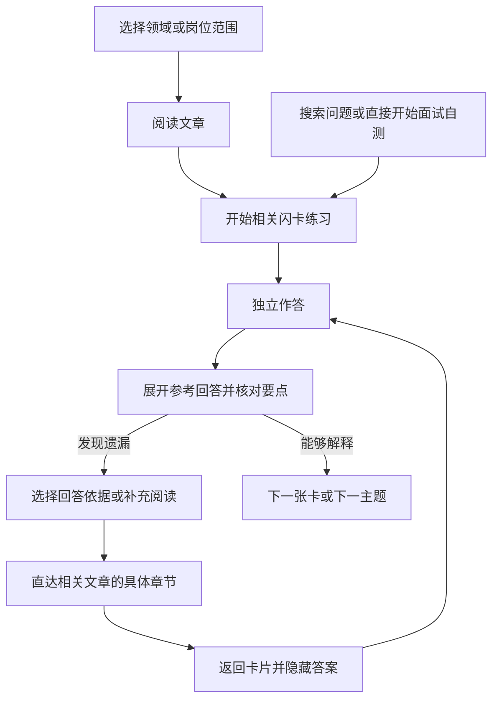

# Java 校招用户故事地图

本地图描述文章、闪卡与岗位关联的 M1 目标体验，并列出 M2 的个人学习功能。术语见[内容模型](./content-model.md)，任务与验收见[项目计划](./product-roadmap.md)，当前实现见[目标对照](./java-campus-gap-analysis.md)。首批建议面向 Java 后端校招，共享知识可以被其他岗位复用。

## 1. 故事地图

| 用户活动 | 用户故事 | M1 支持 | M2 支持 |
| --- | --- | --- | --- |
| 选择范围 | 我想按领域探索，或按岗位确定先学什么 | 领域、子主题、岗位路线，优先级、回答深度与停止条件 | 保存个人目标、时间和偏好 |
| 学习知识 | 我想理解概念、机制和边界 | 文章、前置链接、核心与深入阅读、关联卡片 | 保存阅读位置与任务状态 |
| 独立作答 | 我想检查自己能否回答一个明确问题 | 闪卡问题、默认隐藏答案、自检要点 | 保存练习记录与自评 |
| 查缺补漏 | 我想针对漏答的内容找到解释 | 一张卡关联多篇文章及具体章节，标明阅读目的 | 按个人记录筛选薄弱知识点 |
| 再次练习 | 我想确认补读后能否独立回答 | 返回卡片并重置答案，在当次会话中重练 | 间隔复习、待复习队列与跨设备继续 |
| 查找资料 | 我想直接找到刚遇到的问题 | 关键词、术语别名、领域、岗位、标签与内容类型筛选 | 收藏与个人复习筛选 |
| 安排学习 | 我想知道每天学什么、时间不足怎样取舍 | 共享岗位路线与阅读顺序，用户自行安排日程 | 可调整的个人任务与学习计划 |

简历、项目、编码与 SQL 资料继续提供独立入口。闪卡检验概念与解释能力，编码实现和项目表达仍需对应练习。

## 2. 两条学习路径

两条路径共用文章和卡片内容。用户可以从文章、岗位、搜索或卡片直达，无需先走完固定路线。返回文章补读时应保留当次练习上下文；M1 不保证刷新或重新访问后恢复会话。

## 3. 典型故事与验收

### 3.1 按岗位学习

“我要准备 Java 后端校招，想先掌握核心知识。”

用户选择 Java 后端校招路线，查看必会知识与阅读边界，进入文章后完成对应闪卡。能解释则继续，发现前置缺口则补读。验收要求岗位筛选得到相关知识点，文章明确章节范围，卡片和文章展示一致的岗位关系。

### 3.2 从问题开始

“我学过 HashMap，想先检查自己哪里不会。”

用户从主题进入卡片，先回答再核对自检要点。发现 key 相等性的问题后，可以查看《HashMap》或《对象相等性》的对应章节，再返回原卡片重新作答。验收要求多篇关联阅读各有用途、章节可达、返回后可隐藏答案。

### 3.3 面试后回查

“我刚被问到一个问题，想快速查清并再练一次。”

用户输入问题关键词或技术别名，区分文章与闪卡结果，并按岗位或领域缩小范围。验收要求检索可定位目标，问题结果不提前展示答案，无结果时可调整条件。

### 3.4 个人持续复习

“我每天有一些时间，希望继续上次内容并复习薄弱点。”

M2 用户登录后选择目标、时间与日期，查看个人任务，完成阅读与自测并保存自评，稍后在待复习队列中继续。验收要求计划可调整、状态含义清楚、跨设备记录一致。此故事不作为 M1 已提供的能力。

## 4. 页面与状态边界

领域、岗位、文章、闪卡和搜索页面的职责统一见[项目计划](./product-roadmap.md)。M1 的参考回答与自检由用户核对，不自动评分，也不持久化掌握状态。完整模拟面试需要连续追问与综合任务，另行定义。

访问文章和练习不依赖登录。M2 增加账户后，访客仍可使用 M1 能力；个人记录、计划和复习安排属于登录后的功能。
